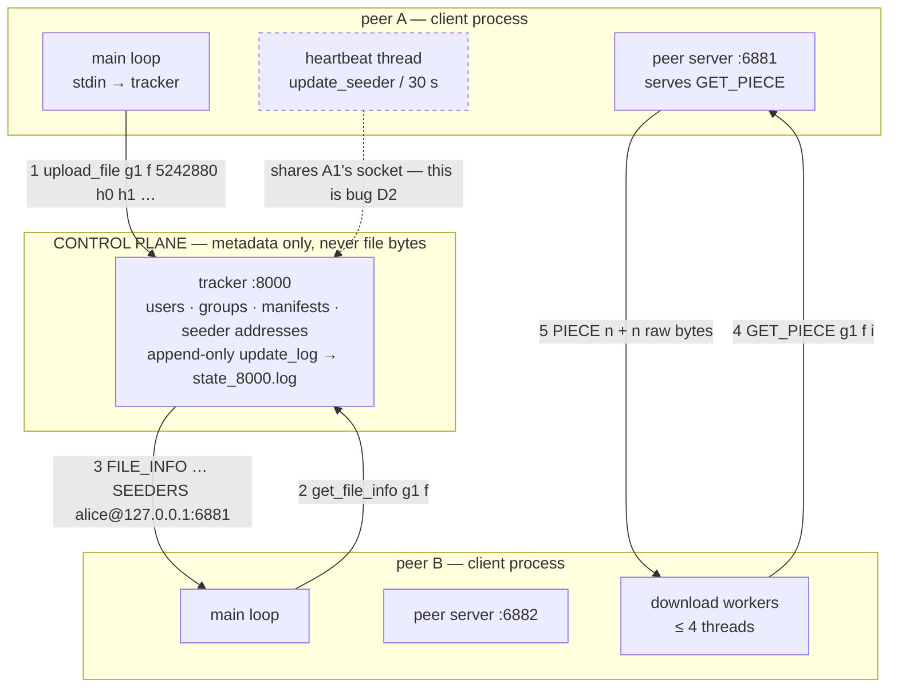
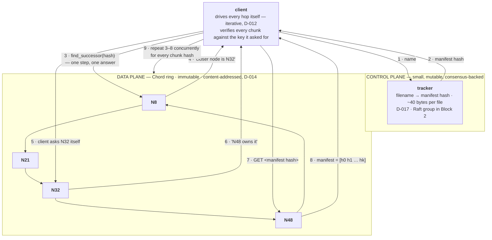

# Architecture — chord-dht-filesystem

The current design, and the log of every decision that produced it. This file is the source the
README's **Key Design Rationales** section is written from, and the source `DEFENCE.md` draws
its questions from.

> **State as of 23 Aug 2026.** What is documented below is the **legacy tracker-and-peers
> system** that exists today, because that is what the code actually does and a diagram of
> something unbuilt is not architecture. The **target** Chord architecture is drawn in Phase 1,
> **after** the five open forks are resolved and the Chord paper is read. Drawing it earlier
> would decide those forks by implication, which is exactly what R11 forbids.

---

## What this system does

A peer-to-peer file-sharing system. Files never live on a central server: each participant
stores files on its own disk and serves them directly to other participants. A **tracker**
process holds only metadata — which files exist, how they are split, the SHA-1 (Secure Hash
Algorithm 1) fingerprint of each piece, and which peers currently claim to hold them. To fetch
a file a peer asks the tracker who has it, then connects to those peers directly and pulls
different pieces from several of them in parallel, verifying each piece against its fingerprint
before writing it to disk.

**Where it is going:** the tracker's role as the single index is replaced by a **Chord
distributed hash table (DHT)** — a ring of nodes that between them own the whole key space, so
that finding which node holds a chunk is a routing problem solved in O(log N) hops rather than
a lookup in one process's memory. The tracker survives in reduced form as a control plane, to
be replicated with **Raft** in Block 2.

**Scope boundary — what it deliberately does not do:**

- **No storage engine.** Chunks are files on disk. No log-structured merge tree, no compaction,
  no write-ahead log. The interesting problems here are routing, replication and failure
  detection, and adding a storage engine would dilute all three.
- **No NAT traversal, no wide-area deployment.** Every peer is directly addressable. Hole
  punching and relays are a different project.
- **No encryption or authentication on the wire.** Stated as a limitation, not hidden. See
  `DEFENCE.md` — "what would you have to add to run this on the open internet?" is a question
  with a real answer, and it is a better answer than a half-built TLS integration.
- **No incentive mechanism.** BitTorrent's tit-for-tat choking algorithm is deliberately out of
  scope; peers are assumed cooperative.
- **Users, groups and authentication are being removed** (see D-004). They were a coursework
  requirement, not a distributed-systems one.

Non-goals matter. "Why didn't you build X?" is answered much better by a stated scope boundary
than by an apology.

---

## The diagram — the system as it exists today

Kept as diagram-as-text so it diffs in review and cannot silently drift from the design.



**Reading the request path:**

1. Peer A hashes its file in 512 KB pieces and sends the **manifest** — filename, total size,
   and one SHA-1 per piece — to the tracker. The file bytes do not move.
2. Peer B asks the tracker for that manifest.
3. The tracker replies with the piece hashes and the list of seeders, each as
   `username@ip:port`.
4. B's download workers connect **directly to A's peer server** and request pieces by index.
   Up to four workers run, pulling different indices concurrently.
5. A replies with a length-prefixed header and then the raw bytes. B verifies the SHA-1 before
   writing, and re-requests from a different seeder on mismatch.

The dashed edge is not part of the design — it is defect **D2** in `PROGRESS.md`, drawn in
because it is currently real.

---

---

## The target diagram — the system the five forks describe

Drawn **after** the forks were resolved, per R11: a diagram made earlier would have decided them
by implication. Kept as diagram-as-text so it diffs in review and cannot drift from the design.



The arrows inside the ring are **successor pointers**. They are the only routing state that has
to be correct; everything else is an accelerator.

**Reading the path.** Steps 1–2 are the only time the tracker is involved, and it returns 40
bytes. Steps 3–6 are the iterative lookup: each node answers *one* question and returns
immediately, and the **client** opens the next connection — which is what makes hop count a
number the client observes rather than one the ring reports. Steps 7–8 fetch the manifest, which
is itself just a chunk. Step 9 repeats the whole lookup-and-fetch for every chunk hash, issued
**concurrently**, because content addressing means consecutive chunks of one file live on
unrelated nodes and there is no locality to walk.

**What each node holds**, in strict order of how much it matters:

| Structure | Carries | If stale or wrong |
|---|---|---|
| **successor pointer** | correctness | wrong answers, returned confidently, undetectable |
| **successor list** (`r ≈ log₂N`) | survival of failure — **and it is the replica set** | node orphaned only if *all* `r` die within one period |
| **finger table** (`m` rows, ~`log₂N` distinct) | speed only | more hops, never a wrong answer |
| **predecessor** | knowing its own arc; joins | joins stall until repaired |
| **chunk store** | the data, keyed by `SHA-1` of its own contents | a failed hash check at the reader; try the next replica |

**What runs in the background on every node**, forever: `stabilize` every `T` seconds (asks the
successor for its predecessor, tightens the pointer, `notify`s), `fix_fingers` (refreshes one
finger per round), and `check_predecessor`. Failure detection rides on these plus **any** failed
call to the successor from any code path (D-013). Nothing is event-driven; everything is
re-derived, so the ring converges from any state.

**What this diagram deliberately does not show**, because they do not exist yet: the Raft group
behind the tracker (Block 2, subject to the 1 Nov trip-wire). Since Phase 4 each node in the drawing is a
process with several ring members — virtual nodes, D-047 — and a chunk's three copies are on three different
processes (D-048).

## Components

| Component | Responsibility | Owns | Talks to |
|---|---|---|---|
| `tracker` | Metadata index and peer discovery. Never touches file bytes. | `users`, `online_users`, `groups`, `group_files` (manifests + seeder sets), `user_address_map`, the append-only `update_log` persisted to `state_<port>.log` | clients (one detached thread each) |
| `client` — main loop | Reads stdin, sends commands, prints replies | `logged_in_user`, `current_sock` | tracker |
| `client` — peer server | Serves `GET_PIECE` to any peer that connects | nothing; reads from disk per request | other clients |
| `client` — download workers | Pull pieces in parallel, verify SHA-1, write at the right offset | one `DownloadTask` | other clients' peer servers |
| `client` — heartbeat thread | Re-announces seeded files every 30 s | `seeding_files` | tracker (**via the main loop's socket — defect D2**) |
| `sha1.h` | Header-only wrapper over OpenSSL `SHA1()`, hex-encoding the 20-byte digest | nothing | — |

---

## Open forks

**Nothing here is implemented until it is decided (R11).** Each fork moves to the decision log
below once resolved. All five are held open until the Chord paper has been read — a fork
decided before the paper is one that cannot be defended in December.

| # | Fork | Why it changes things downstream | Status |
|---|---|---|---|
| **F1** | **Iterative or recursive lookup?** Iterative: I ask a peer, it replies "closer node is N3", I ask N3 myself. Recursive: I ask a peer and it forwards on my behalf, the answer comes back down the chain. | Iterative makes hop counting trivial and failures easy to attribute, at one round trip per hop. Recursive is lower latency but timeouts and partial failures get much harder — **and it costs the easy hop measurement the headline benchmark depends on.** | **RESOLVED** — D-012 |
| **F2** | **Does the tracker know where chunks are, or only what chunks exist?** | Manifest-only keeps the ring the single source of truth and the Raft log small. Tracker-holds-placement means one lookup instead of O(log N) hops — but creates **two systems that can now disagree** about where a chunk lives. | **RESOLVED** — D-017 |
| **F3** | **Replication — the consistency/availability knob.** Synchronous write to all three successors; or write-one-and-propagate; or quorum with W=2, R=2. | Sync-to-all: any replica is correct, writes as slow as the slowest successor (consistent + partition-tolerant). Write-one: fast writes, stale reads, **needs read repair**. Quorum: more to implement, much more to talk about. **This is the most consequential decision in the design and the one the project round will land on.** | **RESOLVED** — D-014, D-015 |
| **F4** | **Who decides a peer is dead, and how long does it take?** Stabilisation period alone, or active heartbeats between successors. | Stabilisation alone is simplest and detection time is bounded by the period. Heartbeats detect faster but add background traffic and **force handling of a peer that is slow rather than dead** — which is the hard case. | **RESOLVED** — D-013 |
| **F5** | **Chunk size — what is a chunk, and why that number?** | Small chunks parallelise better and recover more cheaply but multiply lookups and metadata; large chunks mean fewer lookups but one slow peer dominates the transfer. **Pick a number now, then measure throughput at three sizes and let the plot justify it.** "512 KB because the assignment said so" and "64 KB because BitTorrent uses it" are both weak answers; a curve is a strong one. | **RESOLVED** — D-016 |

| **F6** | **The `update_seeder` desync — what should a peer do after it finishes downloading?** The client announces "I can seed this now" and never reads the reply; the tracker does not implement the command. Every reply after the first download is one behind. | This is not a typo, it is a missing piece of the protocol. Whatever is chosen sets the rule for **every** fire-and-forget message in the system — and the same shape recurs in D2's heartbeat. Deciding it once, deliberately, settles both. | **RESOLVED** — D-007 |
| **F6a** | **The heartbeat thread sends on the main loop's socket and ignores the reply**, so fixing F6 alone would re-create the desync every 30 seconds. | Sub-fork surfaced mid-implementation of F6 and stopped for (R6). | **RESOLVED** — D-008 |
| **F8** | **How does the tracker recover its state?** Replay re-ran every logged command through the live handler, which rejected all of them (defect R1). Options: a replay flag that makes the guards skip themselves; splitting admission from effect so recovery cannot reach a guard; or logging the effect rather than the request (event sourcing). | Sets whether the *class* of bug is avoided by remembering something or made impossible by structure — and the same question returns in Block 2, where Raft replicates log entries that other nodes must apply with no client attached. | **RESOLVED** — D-009 |
| **F9** | **How many lines is a reply?** Five tracker replies contain an embedded newline, so one command produces two lines and every later reply on that connection is one behind (defect R6). Options: fix the five strings; make the framing layer enforce the invariant; or length-prefix replies so the delimiter stops mattering. | Settles whether the rule lives in the framing layer or in every author's memory — and the same question returns on every new control message Chord adds. | **RESOLVED** — D-010 |
| **F10** | **What happens when the peer is gone?** Neither binary ignored `SIGPIPE`, so a `send` to a departed peer killed the process outright (defect R9). Options: ignore the signal process-wide; pass `MSG_NOSIGNAL` at every call site; or both. | Decides whether a remote party's ordinary behaviour can end this program — and the same question returns for every socket Chord adds. | **RESOLVED** — D-011 |
| **F7** | **What is on disk after a failed transfer?** Today: a full-size, zero-filled file, indistinguishable from a real one by size. | Sets whether the system is safe to use without reading its output carefully, and whether resumable downloads are possible later. Atomic rename is the standard answer and costs a story about the leftover `.part` file. | OPEN — decide before Phase 5 |
| **F11** | **Is a ring member its own process, or is a participant one process?** A standalone `node` daemon with `client` as the originator outside the ring, or the existing `client` peer-server thread grown into the ring node. | Sets per-node resident set size, and therefore the **maximum ring size** that fits in 3.4 GiB — which is the x-axis of the Phase 2 hop-count plot. Also decides whether Phase 2 edits a working 1013-line transfer path. | **RESOLVED** — D-018 |
| **F12** | **How wide is the identifier space?** Full 160-bit SHA-1 with hand-written modular arithmetic, a 64-bit truncation using the machine word's own wrap-around, or 128 bits via a compiler extension. | Sets every data structure and every line of arithmetic in Phase 2 — and decides whether the code underneath the hop-count measurement is hand-written or free. | **RESOLVED** — D-019 |
| **F14** | **The node's wire protocol.** Where the framing code comes from, what a lookup carries, and whether a node may claim ownership from its predecessor. | Decides whether invariant-enforcing code exists once or three times, whether Phase 3 needs a second message type, and whether a second pointer becomes correctness-critical. | **RESOLVED** — D-021 |
| **F17** | **What is this system, in one line?** Phase 1's decisions turned a BitTorrent-style swarm into distributed storage. Options: say so; make "peer-to-peer" true again; or keep the wording and defend it in Chord's sense. | Decides whether the first word of the resume survives questioning, and exposed a real alternative never weighed in Phase 1: trackerless BitTorrent. | **RESOLVED** — D-022 |
| **F18** | **Is deletion in scope, and when?** Unnaming a file, reclaiming unreferenced chunks, both, or neither. | Deduplication means deleting a file's chunks can destroy another file, and with no access control a delete command is a vandalism tool — so the obvious implementation is wrong twice. | **RESOLVED** — D-023: not in the MVP; owner-token unnaming plus a mark-and-sweep collector in Block 2, cut before Raft |
| **F15** | **How is a node-identifier collision detected and recovered from?** Detect at join by asking `find_successor(my_id)` and comparing addresses, then re-hash with a salt; or detect at ring construction only; or rely on the birthday bound alone, as the Chord paper does. | Salting trades away the property that an identifier is a function of its address. | **RESOLVED** — D-028: refused at join, and never adopted |
| **F13** | **What does a node know when it starts, on a fixed ring with no joins?** Full membership as a construction input; successor only, with tables built by real lookups; or the harness computing every table offline. | Decides whether the hop-count plot measures routing alone or routing tangled with bootstrap — and whether total routing state is O(N log N) or O(N²), which bounds the ring size the plot can reach. | **RESOLVED** — D-020 |
| **F16** | **How far does the hop-count curve go?** Real processes only, capped by RAM; or real processes extended by an in-process simulation over the same pure functions, plotted together so they can be shown to agree where they overlap. | Hop count is a deterministic function of the routing tables, so a simulation can reach N = 10⁶. Logged rather than decided by implication (R6). | **RESOLVED** — D-027 |
| **F19** | **The lookup originator.** (a) Where the loop lives; (b) connection handling across hops; (c) timeouts; (d) bounding a lookup that does not terminate; (e) what counts as a hop. | (a) decides whether the hostile cases can be tested without sockets; (b) decides how many failure signals one dead node produces; (e) shifts every point on the hop-count plot by one. | **RESOLVED** — D-024; part e in D-026 |
| **F20** | **Are the originator's socket timeouts set before or after `connect`?** Surfaced while building step 2.3: D-024 fixed the values but not the order. | On Linux a blocking `connect` honours `SO_SNDTIMEO`, so the order decides whether a host that never answers the handshake costs 5 s or about 127 s. | **RESOLVED** — D-025 |
| **F21** | **How does a node start and join?** Joins only; joins plus the Phase 2 fixed ring kept as a mode; and whether a joining node listens before or after it has a successor. | Decides whether the reconvergence benchmark starts from a known state, whether the Phase 2 suites survive, and what a node restarted at its old address answers. | **RESOLVED** — D-029 |
| **F22** | **How is a node's routing state protected now that a background thread writes it?** One mutex; a reader-writer lock; or copy-on-write snapshots. | Phase 2 needed no lock because all writes preceded the first reader. Copying a string while it is assigned is undefined behaviour, so this is correctness, not tuning. | **RESOLVED** — D-030 |
| **F23** | **Which messages does stabilisation add, and what do they carry?** The paper's separate predecessor and successor-list queries, or one combined query; identifiers carried or recomputed; how a client's failure report reaches a node; how a harness reads fingers. | Sets round trips per period, whether a client can evict a node, and whether finger convergence can be observed at all. | **RESOLVED** — D-031 |
| **F24** | **How long is the successor list?** The replication minimum (3); log₂ of the largest ring measured (8); or estimated at run time from the gap to the successor. | r is the exponent in the probability of a node being orphaned, and it is the replica set Phase 4 reads. | **RESOLVED** — D-032 |
| **F25** | **Is there a graceful leave?** Crash-only; departure messages to the neighbours; or departure with a data hand-off. | Decides whether the system has one recovery path or two, and what a planned shutdown costs. | **RESOLVED** — D-033 |
| **F26** | **How does `fix_fingers` proceed?** One finger per round (the paper); all fingers every round; or one lookup per round whose answer fills every finger it covers. | Sets how long a dead finger survives and the permanent background load per node. | **RESOLVED** — D-034 |
| **F27** | **The failure-handling mechanics D-013 left open.** How many strikes; whether a candidate successor is verified before adoption; whether a surprising `NOTIFY` triggers a check; what replaces an evicted finger; what a node does when its whole successor list is gone. | Decides how fast a dead node leaves, whether it can be re-adopted from a neighbour's stale pointer, and whether an orphaned node claims the whole ring. | **RESOLVED** — D-035 |
| **F28** | **What does an originator do when it reaches a dead node?** Fail; retry silently; report to the node that named it, then retry; or resume with an exclusion. | Under iterative routing nodes never see a client's failures, so this decides whether D-013's detection adapts to load at all. | **RESOLVED** — D-036 |
| **F29** | **Does the 65-request cap survive stale fingers?** Keep it; raise it; or drop it and rely on the progress check. | D-024 derived 65 for correct fingers and asked Phase 3 to revisit it; stale fingers can need up to N requests. | **RESOLVED** — D-037 |
| **F30** | **What does "reconverged" mean, and who decides?** Successor pointers only; every piece of routing state; a lookup sweep; or nodes reporting it themselves. | It is the definition behind the Phase 3 headline number, and decides whether the measuring instrument sits outside the thing measured. | **RESOLVED** — D-038 |
| **F31** | **What are the stabilisation period T and the node's call deadline, and how are they swept?** Precedent; a multiple of each other; or measured curves with selection rules fixed before measuring. | T sets every reconvergence number twice over, and the deadline decides whether a slow node is evicted while alive. | **RESOLVED** — D-039 (rules); values from `BENCHMARKS.md` §4 |
| **F32** | **What does a node do when every node it knew has gone?** Fall back to itself; stay orphaned; or stay orphaned and rejoin through remembered addresses. Surfaced by the churn tests, not foreseen. | Falling back to itself claims the whole ring and can recruit joiners into a second ring that stabilisation cannot merge. | **RESOLVED** — D-040 |
| **F33** | **The deadline rule had no solution.** Its named load (256 nodes at 50 ms) saturated the machine, and the slowest exchange there needs D ≥ 3.46 s. Use the largest candidate; add larger ones; drop 50 ms; or apply the rule to the loads the benchmark actually runs. | Decides the call deadline, and whether a rule fixed before measuring may be narrowed after it fails. | **RESOLVED** — D-041 |
| **F34** | **Both selection rules gave different answers when the benchmark was repeated.** The period rule's 1 s median target sits on T = 2000 ms's own median; the deadline rule keyed on the single slowest of ~70,000 samples. Keep them with more runs; pick between runs; instrument the nodes; or restate them in statistics that repeat. | Decides T and D, and whether the numbers behind them are reproducible. | **RESOLVED** — D-042 |
| **F35** | **How fast does stabilise walk back after a distant fallback?** One step per round (the paper); run to the fixed point within a round; rejoin as an orphan; or a longer list. Surfaced by a 256-node ring that took minutes to converge. | Sets recovery after more than r adjacent deaths, and how long a wired ring takes to start. | **RESOLVED** — D-043 |
| **F36** | **How does a chunk travel on the wire?** A length-prefixed body after a control line; the chunk encoded inside the line; or a separate data connection. | Decides whether a peer can size an allocation, how a short read is handled, and whether one socket carries two framing schemes. | **RESOLVED** — D-044 |
| **F37** | **How and where is a chunk kept on disk?** One file per chunk with a temporary name and an atomic rename; an append-only log; or memory only — and whether a write is flushed before it counts. | Decides what a crash mid-write leaves behind, what an acknowledged write promises, and whether a peer's key can name a path. | **RESOLVED** — D-045 |
| **F38** | **Who replicates a write, and where does W live?** The owner sending in parallel; the client writing every replica; or a chain — and W per node or per request. | Decides write latency (the slower of two parallel sends or the sum of a chain), who uploads the chunk how many times, and whether W values can be compared on one ring. | **RESOLVED** — D-046 |
| **F39** | **How do virtual nodes share a process?** One listening port per member; one port with requests addressed by identifier; one shared routing table per process; or full membership. | Decides whether the wire can say which members share a process (replica placement needs it), what a refused connection proves, and the background traffic per process. | **RESOLVED** — D-047 |
| **F40** | **Which members hold a chunk's replicas when one process has several members?** The next members regardless of process; the first distinct processes clockwise; a separate replica list; or a longer successor list. | With virtual nodes, adjacent members often share a process, so the naive rule puts two copies where one crash destroys both. | **RESOLVED** — D-048 |
| **F41** | **How does a read find a good copy?** One replica, checked locally, falling through; two replicas compared; all replicas at once; and where the list of replicas comes from when the owner is dead. | Decides read traffic, what happens in the window after an owner dies, and whether a quorum is needed at all. | **RESOLVED** — D-049 |
| **F42** | **How is RF = 3 restored after a death, and who is responsible?** A periodic full scan; an event when the successor list changes; both; every replica checking every chunk; or hash-tree comparison. | Decides how long a chunk stays one copy short, how much background traffic repair costs, and whether a silently lost file is ever found. | **RESOLVED** — D-050 |
| **F43** | **How many virtual nodes per process?** One; a large fixed number such as 256; a number read off a measured balance curve by a rule fixed first; or in proportion to capacity. | Load balance improves as 1/√V while every member adds its own stabilisation traffic. | **RESOLVED** — D-051 (rule); value in `BENCHMARKS.md` |
| **F44** | **How much of a chunk is in memory, and is it bounded?** The whole body, shared between parallel sends, capped per process; streamed to disk while hashing; uncapped; or a waiting queue. | Sets memory per node under write load, whether a client can make a node allocate without limit, and how many processes fit on this machine. | **RESOLVED** — D-052 |
| **F45** | **How are W, durability and re-replication measured?** A fresh ring per W, or all W on one ring under one failure; durability from copy counts, or by killing the coordinator at acknowledgement; and who judges that RF = 3 is restored. | Decides whether the W comparison is between settings or between rings, and whether a durability claim was tested or inferred. | **RESOLVED** — D-053 |
| **F46** | **What is a file's manifest, and what happens when it does not fit in one chunk?** A text manifest, split into a tree of manifests when large; a binary manifest; one flat manifest and a file-size limit; or a chain of manifests. | Decides the largest file the system can hold, how many round trips a download makes before its chunks can be fetched in parallel, and whether a manifest can be read and checked by hand. | **RESOLVED** — D-054 |

---

## Decision log

The heart of this file. One entry per resolved fork. Every entry names the rejected alternative
and its cost — an entry without one is not finished, because "what else did you consider?" is
the follow-up to every design answer.

### D-001 — Repository named `chord-dht-filesystem`
**Date:** 23 Aug 2026 · **Phase:** 0 · **Commit:** pending rename

**The fork:** the repository was called `os-assignment3`, which on a resume reads as coursework
and invites "so this was a class project?" as the opening question of the round.

**Options considered:**

| Option | What it means in practice | Cost |
|---|---|---|
| `chord-dht-filesystem` | Names the algorithm up front | Invites "why Chord and not Kademlia?" — but that is a prepared question, so the cost is negative |
| `distributed-p2p-filestore` | Names the domain, not the algorithm | Safer if the design drifts from strict Chord, but does not signal that a *named protocol* was implemented |
| `chord-raft-filesystem` | Names both planes | Strongest signal — but **promises Raft, which is item 1 in the cut order.** If Raft is cut the name writes a cheque the repository does not cash |
| `ringfs` | Short, product-like | Loses the free keyword match on "Chord" and "DHT" |

**Chosen:** `chord-dht-filesystem`

**Reasoning:** it states the scope in three words and commits only to what the MVP guarantees
by 28 Sep. The Kademlia comparison it invites is one to *want* — it is a question with a
prepared answer about XOR metric versus successor-ring topology.

**Rejected because:** `chord-raft-filesystem` names a component that the pre-agreed cut order
sacrifices first. A repository name is not the place to promise the most cuttable feature.

**What would change my mind:** if Raft ships and is solid by mid-October, renaming is one
command and the history survives.

**Evidence:** none — naming, decided on reasoning.
**Defence entry:** `DEFENCE.md` D-001

---

### D-002 — Phase 0 is a minimum viable resurrection, not a full repair
**Date:** 23 Aug 2026 · **Phase:** 0 · **Commit:** `e5a52fb`

**The fork:** the inherited system has at least fifteen identified defects (`PROGRESS.md`
§ Audit). How many get fixed before Chord work starts?

**Options considered:**

| Option | What it means in practice | Cost |
|---|---|---|
| Minimum viable resurrection | Fix the build (B1, B2), fix state replay (R1), fix the download path (R2). Stop when one file transfers end-to-end and verifies. | ~6–8 h. Leaves D1–D8 open — but most are in code the Chord rewrite deletes anyway |
| Full repair | Also restore multi-tracker sync, fix the desync properly, close the traversal hole, make downloads non-blocking | ~14–16 h. **Eats W1 and most of W2 and pushes Chord routing past the point where W5 is reachable** |
| Build-only, then straight to Chord | Fix compilation, write the postmortem, move on | ~2–3 h. But with no working download there is **no baseline throughput number**, and R13 says a before number is not optional |

**Chosen:** minimum viable resurrection.

**Reasoning:** the point of Phase 0 is not a good legacy system — it is (a) a debugging story
that actually happened and (b) a **before** number that every later benchmark is measured
against. Both need the download path working. Neither needs multi-tracker sync.

**Rejected because:** full repair spends 8 extra hours hardening code that Phase 5 rewrites.
Build-only saves 4 hours and forfeits the baseline, which is the more expensive loss.

**What would change my mind:** if isolating R2 turns out to need the desync fixed first, D2
gets promoted into Phase 0 and the extra hours come out of the 13 h of Block 1 slack.

**Evidence:** `BENCHMARKS.md` §1 — pending, that is the deliverable of this decision.
**Defence entry:** `DEFENCE.md` D-002

---

### D-003 — The uncommitted November tree is committed as-is, then fixed forward
**Date:** 23 Aug 2026 · **Phase:** 0 · **Commit:** `7f724c8`

**The fork:** 2,247 uncommitted lines sat in the working tree. They fixed two compile errors
(B3, B4) **and regressed three features** that existed at HEAD — `stop_share`, `update_seeder`
and `peer_reconnect_thread`.

**Options considered:**

| Option | What it means in practice | Cost |
|---|---|---|
| Commit as-is first | One honest `wip:` commit naming both what it fixed and what it regressed, then fix forward | An ugly commit sits in the history permanently |
| Reconstruct, then commit clean | Restore the three deleted functions from HEAD first, so one tidy commit lands | Reads better as a diff, but it is **a story about November written in August**, and it hides that the regression happened |
| Discard, start from HEAD | — | Not viable: HEAD does not compile at all, and it throws away real work |

**Chosen:** commit as-is, tagged `pre-resurrection`.

**Reasoning:** history is evidence (R18). An ugly-but-true commit is worth more than a tidy
invented one, and the regression is itself part of the debugging story — "I found my own
working tree had silently dropped three handlers" is a real answer about why uncommitted work
is a liability.

**Rejected because:** reconstructing would have made the diff look deliberate when it was not.
Under questioning that is a story that has to be maintained.

**What would change my mind:** nothing. This is settled.

**Evidence:** none — process decision.
**Defence entry:** `DEFENCE.md` D-003

---

### D-004 — Users, groups and authentication are dropped
**Date:** 23 Aug 2026 · **Phase:** 0 · **Commit:** pending — **after** the baseline is measured

**The fork:** the inherited system has user accounts, passwords, groups with owners, join
requests and an approval workflow. Does that survive the pivot to Chord?

**Options considered:**

| Option | What it means in practice | Cost |
|---|---|---|
| Drop groups and auth | The ring stores content-addressed chunks; the tracker owns the manifest | Deletes working code — but it stays in git history, so nothing is actually lost |
| Keep both, Chord underneath | Preserves working code, the pivot looks continuous | **Every** new subsystem — replication, stabilisation, read repair, anti-entropy — must respect group membership. Four subsystems taxed by a concern no interviewer credits |
| Keep auth, drop groups | Auth is cheap and answers "how do you stop anyone joining the ring?" | One extra concept to defend that the Chord literature has no opinion about |

**Chosen:** drop both.

**Reasoning:** they were a coursework requirement, not a distributed-systems one. Removing them
makes every paper and interview question about DHTs map straight onto the code, and shrinks the
surface that has to be defended for an hour.

**Rejected because:** keeping them costs hours in four separate subsystems for a feature that
earns no credit in a systems round.

**⚠ Sequencing constraint:** **this removal happens after the Phase 0 baseline is recorded, not
before.** The download path runs through `upload_file`, which checks group membership; deleting
that code first would destroy the "before" number that D-002 exists to produce.

**What would change my mind:** if an interviewer's stated focus were access control rather than
distributed systems — which, given the target companies, it is not.

**Evidence:** none — scoping decision.
**Defence entry:** `DEFENCE.md` D-004

---

## Invariants

Things that must always hold. Each is a candidate for a test, and each is something an
interviewer can probe. **Marked ✗ where the current code violates them** — those are the
Phase 0 work list.

| # | Invariant | Enforced by | Tested by | Holds? |
|---|---|---|---|---|
| I1 | A piece written to disk has a SHA-1 matching its manifest entry | check before `write_piece` in `download_piece_from_peer` | not yet | ✓ |
| I2 | **A failed download leaves no file behind** | nothing — `ftruncate` preallocates and nothing cleans up | not yet | **✗ R2** |
| I3 | **Tracker state after restart equals state before restart** | replay of `update_log` in `main` | not yet — `scripts/test-persistence.sh` in Phase 0 | **✗ R1** |
| I4 | A peer only ever serves bytes from files it has explicitly shared | nothing — `GET_PIECE` opens any path given | not yet | **✗ D3** |
| I5 | Malformed input from any peer cannot terminate a process | nothing — bare `stoull` throws in a detached thread | not yet | **✗ D4** |
| I6 | Every reply read by the client's main loop is the reply to the request it just sent | nothing — the heartbeat shares the socket | not yet | **✗ D2** |
| I7 | **A routing identifier decides which *node*; it never decides which *object*.** The chunk store is keyed by the full 160-bit hash | D-019 — truncation is applied to placement only; the store (D-045) names every file by the full 40-character key, validated before any path is built | `test-chunk` (keys, store), `e2e-chunk.sh` | ✓ |
| I8 | **"Am I alone in the ring?" is answered by comparing *addresses*, never identifiers alone** — because `(n, n]` evaluates to the whole ring, so `successor.id == my_id` silently means "I own everything". With virtual nodes (D-047) a ring member is an address *and* an identifier, and a process is an address | D-019, D-047 — `same_node` compares address and identifier, `same_process` the address | `test-stabilize`, `test-chunk` (siblings) | ✓ |

---

## Concurrency model

Asked about in nearly every systems interview, and the place where honest projects come apart
under questioning.

### Tracker

| Shared state | Protected by | Held for how long | Why this and not something finer/coarser |
|---|---|---|---|
| `users`, `online_users`, `groups`, `group_files`, `user_address_map` | `state_mtx` — one global mutex | the **entire** `handle_command` body | Coarse and honest. Every command is short and in-memory, so contention is low and correctness is obvious. A per-group or per-map lock would be faster and would need a stated lock order to stay deadlock-free — **not worth it until a benchmark says so**, which is the answer to "why not finer-grained locking?" |
| `update_log`, `next_seq`, the state file | `log_mtx` | one append | Separate from `state_mtx` so the disk write is not inside the state lock |
| `peer_sockets`, `peer_last_seq` | `peer_mtx` | one broadcast loop | Currently vestigial — the peer list is always empty (defect C1) |

**Lock ordering:** `state_mtx` → `log_mtx` → `peer_mtx`, and never the reverse.
`handle_command` takes `state_mtx` and calls `append_update_to_file`, which takes `log_mtx`.
`broadcast_sync` takes `log_mtx` then `peer_mtx`, and is called **after** `handle_command` has
returned and released `state_mtx`. Because every path acquires them in the same order, no cycle
exists and deadlock is impossible. **This is the property to state out loud when asked "how do
you know it can't deadlock?"** — the answer is a total order on locks, not "I tested it".

**Threads in the system:** tracker — one `accept` loop, plus one **detached** thread per
connected client, created at `tracker.cpp:466`. Client — the main stdin loop, one detached
peer-server `accept` loop, one detached thread per inbound peer connection, up to four
download workers (**joined**, not detached), and one detached heartbeat thread.

**Detached versus joined, and why it matters here:** a detached thread cannot be waited on and
cleans up its own resources when it returns. That is fine for a connection handler whose
lifetime is the connection. It is *not* fine at shutdown: nothing joins those threads, so the
tracker has no clean shutdown path at all — it is killed, mid-write if necessary. Worth naming
as a known limitation before someone finds it.

---

## Failure model

| Failure | Detected how | Detection time | Recovery | Measured in |
|---|---|---|---|---|
| Seeder dies mid-transfer | `recv` returns ≤ 0 in the piece loop | immediate | worker tries the next seeder for that piece | not yet |
| Seeder goes offline quietly | 30 s heartbeat stops | **never — the tracker does not expire stale seeders** | none; the peer stays in the seeder list forever | not yet |
| Tracker dies | client `send`/`recv` fails | immediate | client retries 3× then tries other trackers — **of which there are none (C1)**, so it exits | not yet |
| Piece arrives corrupted | SHA-1 mismatch before write | immediate | re-request from another peer | not yet |
| Tracker restarts | — | — | **replay is broken (R1); all groups and manifests are lost** | not yet |

**What this system does not survive:** tracker loss (it is a single point of failure — that is
precisely what Block 2's Raft group is for); a seeder that is alive but stalled, since there
are no timeouts anywhere on the peer path, only connection failures; and its own restart.

---

## Where it sits on the consistency/availability trade-off

**Currently: neither, honestly.** There is one tracker, so there is nothing to be consistent
*between*; and it is a single point of failure, so it is not available under its own failure
either. A single-node system does not have a CAP (Consistency, Availability, Partition
tolerance) position — CAP only says something once there is more than one replica and a
partition is possible.

Saying that plainly is a stronger answer than claiming a position the architecture does not
earn. **The real answer comes from F3**, which is where this system actually chooses, and it is
written here the moment F3 resolves.

**To flip it:** — pending F3.

---

### D-005 — Fix the build with the smallest change that is *true*, not the smallest change that works
**Date:** 1 Sep 2026 · **Phase:** 0 · **Commit:** this session

**The fork:** `client` failed to link with `undefined reference to SHA1`. Where does `-lcrypto` go?

| Option | What it means in practice | Cost |
|---|---|---|
| Add `-lcrypto` to `CXXFLAGS` | One line, works immediately, both binaries get it | Links a cryptography library into `tracker`, which hashes nothing today. Also conflates compile-time flags with link-time libraries, which is how a `Makefile` stops being readable |
| A separate `CRYPTO_LDLIBS`, applied to the `client` rule only | Names the dependency where it is real | Two lines instead of one, and it must be revisited when the tracker starts hashing |
| Move `sha1.h` to a real `sha1.cpp` and build `sha1.o` | Makes the original `Makefile` correct rather than deleting its claim | Solves a problem that does not exist — the header is genuinely header-only, and this adds a translation unit to justify a line that was simply wrong |

**Chosen:** a separate `CRYPTO_LDLIBS` on the `client` rule.

**Reasoning:** the `Makefile` should state what is true. `tracker.cpp` does not include `sha1.h`
and links clean without `-lcrypto` — verified, not assumed. The tracker *will* need SHA-1 in
Phase 2, when node identifiers and keys are hashed onto the ring; the flag gets added to its
rule then, when it is true. A dependency added early "because we'll need it" is a dependency
nobody can later explain.

**Rejected because:** the global-`CXXFLAGS` version is indistinguishable from not having
thought about it, and "why does your tracker link OpenSSL?" is a question with no good answer.

**What would change my mind:** the moment `tracker.cpp` hashes anything, which is Phase 2.

**Evidence:** `docs/failures.md` B1, B2. `make clean && make` builds both binaries with zero warnings.
**Defence entry:** `DEFENCE.md` D-005

---

### D-006 — A failing test is committed on purpose
**Date:** 1 Sep 2026 · **Phase:** 0 · **Commit:** this session

**The fork:** `scripts/e2e-edge.sh` sweeps file sizes across the piece boundary and currently
fails five of seven cases, because it found defects R3 and R4 which are not yet fixed. Does a
failing test get committed?

| Option | What it means in practice | Cost |
|---|---|---|
| Commit it failing, with the expectation documented in the script header | The known defect is pinned by something executable. Anyone who fixes R3 sees the row turn green | A red test in the repository, which looks like carelessness to someone who does not read the header |
| Hold it back until R3 and R4 are fixed | The repository is always green | The defect exists only as prose until then, and prose does not detect a regression |
| Mark the failing cases as skipped | Green, and the cases are still there | A skipped test is a test nobody looks at. The failure *is* the information |

**Chosen:** commit it failing, with the expectation stated in the script header and in
`docs/failures.md`.

**Reasoning:** the sweep is what found R3, and R3 is invisible to any test that transfers one
file. Its value is precisely that it is red. The output is also self-diagnosing — the one-row
shift in the size column names the defect without reading any code.

**Rejected because:** holding it back means the only record of R3 is a paragraph, and a
paragraph cannot tell you when the bug comes back.

**What would change my mind:** if the repository ever gets continuous integration that gates
merges, this moves behind an explicit `expected-failure` marker rather than a plain red.

**Evidence:** `docs/failures.md` R3, R4. `PROGRESS.md` error log E3.
**Defence entry:** `DEFENCE.md` D-006

---

### D-007 — Every request gets exactly one response, and it is read before the next is sent
**Date:** 2 Sep 2026 · **Phase:** 0 · **Fork:** F6

**The fork:** after a download completed the client sent `update_seeder` and never read
the reply. The tracker did not implement the command, answered `Unknown command`, and that
reply sat in the buffer — every later response was one behind, for the life of the connection
(defect R3).

| Option | What it means in practice | Cost |
|---|---|---|
| Implement it and read the reply | Tracker gains a real handler; client consumes the response | One round trip per completed download — **per file, not per piece**, so noise against a transfer that just moved megabytes |
| Delete the send | One line, desync gone | A peer that finishes downloading never announces it can seed. **Every future download still comes from the original uploader and the swarm never grows** — which removes the property that makes peer-to-peer worth building |
| One-way notification, tracker never replies | Fastest, no round trip | The protocol now has two classes of message. Anyone who later adds a reply to that command silently re-breaks every subsequent response |

**Chosen:** implement it and read the reply.

**Reasoning:** it keeps **one universal invariant** — every request is followed by exactly one
response, read before the next request is sent. A rule with no exceptions is one that cannot be
got wrong by the next person to touch the protocol. The measured cost is one round trip per
completed file.

**Rejected because:** deleting the send is cheapest and guts the swarm. The one-way variant is
fastest and buys that speed by introducing a special case, which is exactly the shape of the
bug being fixed.

**What would change my mind:** if announcements ever became high-frequency — per piece rather
than per file — the round trip would start to matter and a batched or one-way channel would
earn its complexity.

**Evidence:** `scripts/e2e-edge.sh` — 6/7 cases pass, up from 1/7; the one-row size shift that
was R3's signature is gone. Seeder set verified to grow: `alice@...:6881` before bob's
download, `bob@...:6882 alice@...:6881` after.
**Defence entry:** `DEFENCE.md` D-007

---

### D-008 — The announcer owns its own connection; sharing is removed rather than guarded
**Date:** 2 Sep 2026 · **Phase:** 0 · **Fork:** F6a

**The fork:** surfaced while implementing D-007 and stopped for, rather than decided in
passing (R6). The heartbeat thread wrote `update_seeder` down the **main loop's** socket and
ignored the reply (defect D2). Fixing F6 without touching it would have re-created the desync
on a 30-second timer.

Two facts found while investigating, both of which changed the options:

- `sock_mtx` was taken in **exactly one place** — the heartbeat's `send`. The main loop's
  send/recv pair took no lock at all. The lock everyone assumed was protecting the socket was
  serialising the heartbeat against nothing.
- There is **no `seeders.erase` anywhere** in the tracker. Nothing ever removes a seeder, so
  re-announcing achieved nothing. A heartbeat with no timeout on the receiving side is not a
  heartbeat; it is traffic.

| Option | What it means in practice | Cost |
|---|---|---|
| Widen `sock_mtx` to span send *and* receive | The lock finally covers the real transaction | The heartbeat briefly blocks the main loop, and one socket is still shared between two threads — the weaker shape |
| Delete the heartbeat until expiry exists | Removes code that has no effect today | Nothing re-populates the seeder set after a tracker restart; the feature returns with F4 |
| **Give the announcer its own connection** | One thread, one conversation, no sharing | An extra connection and socket per client |

**Chosen:** its own connection.

**Reasoning:** the invariant that broke is *send-then-receive as a pair*. **A mutex protects
state; this is a rule about sequence**, and no lock expresses it. Two threads cannot share one
request/response conversation regardless of locking, because thread A can consume thread B's
response. Removing the sharing makes the invariant hold by construction rather than by
discipline.

**Rejected because:** widening the lock makes the bug unreachable while leaving the bad shape
in place, and it is the fix that looks correct in review while still being one careless commit
away from breaking. Deleting the heartbeat is defensible today but throws away the mechanism
F4 needs.

**Implementation notes worth defending:**

- The announcer **reads and discards the tracker's `TRACKERS` greeting** on connect. Leaving it
  would put the new connection one reply behind from its first request — the same bug, on the
  connection built to avoid it.
- It waits on a `condition_variable` with a **predicate over a generation counter**, not a bare
  `wait_for`. A bare wait would (a) miss a notification that arrives before the first wait and
  (b) treat a spurious wake-up as a real change. The counter makes both correct.
- It **copies the seed list under the lock and releases before doing network I/O**. Holding
  `seeding_mtx` across a blocking `send`/`recv` would stall the main loop on every upload.
- `update_seeder` is **not written to the update log**. Which peer currently holds a file is
  **soft state** — true only while that peer is alive. Replaying it at startup would resurrect
  peers that are long gone. Durable state is "this file exists and here is its manifest".

**Known limitation, stated rather than hidden:** the announcer does not reconnect if its
connection drops; the peer then stops being re-advertised. Acceptable while nothing expires
seeders — it becomes real work the moment F4 lands.

**Evidence:** `BENCHMARKS.md` — pending. Verified functionally three consecutive runs.
**Defence entry:** `DEFENCE.md` D-007, D-009

---

### D-009 — Admission and effect are separate; recovery can only reach the effect

**Fork:** F8. **Date:** 6 Sep 2026. **Closes:** defect R1.

**The decision.** Every mutating command is split into an `apply_*` function that performs the
state transition and nothing else, and a set of admission checks that stay on the live path in
`handle_command`. Recovery has its own entry point, `replay_command`, which calls `apply_*`
directly and never calls `handle_command`.

**What the split means in practice.** A check belongs on the live path if it asks about the
*requester* or about *soft state* — "are you who you say you are?", "are you logged in?". A
check belongs in `apply_*` if it asks about *durable state* — "does this group exist?", "is
this user a member?" Those are deterministic: they were true when the command was accepted, so
they are true again when the log is replayed in the same order.

**Why this and not the smaller change.** The obvious repair is a `replaying` flag that makes
the guards skip themselves. It is twenty minutes of work and it leaves the guards in the
recovery path, disabled by a boolean. Every guard added later is a fresh opportunity to forget
the flag, and the failure is silent — which is exactly how R1 survived from November to
September without anyone noticing. Splitting the functions removes the possibility rather than
the symptom: recovery cannot skip a guard it has no code path to.

Two supporting changes turn "avoided" into "impossible":

- `handle_command`'s `bool record = true` parameter was deleted and `client_user` lost its
  default value, so the exact call that caused R1 — `handle_command(cmdline, "", false)` — **no
  longer compiles.**
- `replay_command` is an exhaustive, readable list of the six things recovery may do. Anything
  else is skipped with a message naming it, which also makes the tracker safe against the
  coursework-era log format that recorded reads and logins.

**Rejected: option A, a replay flag.** ~20 minutes instead of ~2 hours. Rejected because the
cost is paid later and silently, and because the guard-skipping flag is itself the bug pattern
that produced R1.

**Rejected: option C, log the effect rather than the request (event sourcing).** The tracker
would record `GROUP_CREATED g1 alice` instead of the client's `create_group g1 alice`, and
recovery would apply effects that have no notion of a requester at all. **This is the better
system and it is worth saying so.** It costs ~3 hours and a new on-disk format, spent on a
control plane that Block 2 replaces with a Raft-replicated tracker — and Raft brings the same
structure back for a stronger reason, because a follower applies log entries with no client
attached at all.

Option C also has a concrete correctness advantage that B does not: **an effect log cannot
drift.** `leave_group` picks the new owner with `*members.begin()`, whose result depends on
hashing rather than on anything recorded, so a replay may choose a different owner than the
live run did (defect R5). An effect log would have recorded the choice. B leaves that open; it
is registered rather than hidden.

**What the split forced into the open.** Classifying every line of every effect as durable or
soft caught `upload_file` writing soft state: it inserted the uploader into `fi.seeders` and
recorded an address in `user_address_map` alongside the manifest. Replaying that resurrects
peers that are long dead — the exact thing the `update_seeder` handler already refuses to do.
A flag would have replayed it and nobody would have looked.

---

### D-010 — A reply is exactly one line, and the framing layer guarantees it

**Fork:** F9. **Date:** 9 Sep 2026. **Closes:** defect R6.

**The decision.** `send_all` in `tracker.cpp` is the single place that frames a control reply.
It strips any terminator the caller supplied, replaces any remaining `\n` or `\r` **inside** the
payload with a space, logs loudly when it has to, and appends exactly one terminator. The
invariant "one command, one reply, one line" therefore holds regardless of what any handler
returns. The five reply strings that carried an embedded newline were fixed as well, so the
backstop stays silent in normal operation and fires only on a real bug.

**Why the invariant needs an owner.** The client reads a reply as bytes-up-to-newline. A reply
containing its own newline arrives as two replies, and every later reply on that connection is
one behind — permanently, on a connection that is otherwise healthy and answering. R6 and R3
are the same failure from opposite directions: R3 was a *caller* that never consumed its reply,
R6 is a *message* that contains the delimiter. Nothing on the wire says how many lines a reply
is, so any single violation by either party is unrecoverable.

**Rejected: option A, fix the five strings and stop.** Two minutes. Rejected because it removes
today's instances and adds no rule — the sixth such string reintroduces the defect, and the
failure is silent. This is the same shape as F8's rejected replay flag: a defect avoided by
everyone remembering, rather than made unreachable.

**Rejected: option C, length-prefixed replies** (`LEN <n>\n` then exactly n bytes). This is the
better protocol and the one the data path already uses for pieces, because it makes the
delimiter irrelevant rather than forbidden. It costs a change to every send and every receive
on both sides, in a week that belongs to Chord, and buys nothing until replies start carrying
arbitrary payloads. **Chosen for Phase 5, where the transfer layer is rewritten anyway** — and
recorded here so that "why not length-prefix everything?" has an answer with a date on it.

**Deliberately not applied to the client.** `client.cpp`'s `send_all` is the raw-byte sender
that carries piece contents, which contain newline bytes constantly. Stripping delimiters there
would corrupt every transfer. Delimiter sanitising is correct on a text control channel and
catastrophic on a binary data channel — which is the same distinction that made two framing
schemes necessary in the first place.

**Cost accepted.** A multi-line reply is now impossible by construction. Every current reply is
single-line, including the list replies, which are space-separated; if a future command needs
structured output, that is the trigger to take option C rather than to weaken this.

**Verified.** `scripts/e2e-framing.sh` drives a raw socket — not the client, which reads one
line per reply and would hide which side emitted the extra one — sends each of the five
malformed commands, and after each sends a probe whose reply is unmistakable. 11/11 pass on the
fix. **Run against the pre-fix binary the same suite fails 9/11**, showing the stream one behind
and then two behind, which is what makes it a regression test rather than a passing assertion.

---

### D-011 — A peer's disconnect is an error value, not a signal

**Fork:** F10. **Date:** 9 Sep 2026. **Closes:** defect R9.

**The decision.** Both binaries call `signal(SIGPIPE, SIG_IGN)` as their first act in `main`.
Writing to a socket whose peer has gone then returns `-1` with `errno == EPIPE` instead of
raising a signal, and the `if(n <= 0) return false` already present in every send loop handles
it correctly.

**What was actually wrong.** Nothing in the error handling. The check was there and it was
right — it never got to run, because the default disposition of SIGPIPE terminates the process
before `send` returns. Reproduced deterministically: a client pipelines 200 commands, reads
none, and closes with `SO_LINGER` set to zero so the connection is reset rather than
half-closed. The tracker dies with **exit 141 — 128 + 13, SIGPIPE**, sometimes on the first
command. **This kills the whole tracker, not the one connection's thread**, because a signal
disposition is a property of the process. Every other client's session dies with it.

**Why this is worth a decision entry rather than a one-line fix.** The defect is that a *remote
party's behaviour* was routed into a *local control-flow mechanism* that ends the program.
Nothing about a peer hanging up is exceptional — on the data path it is the common case, since
a downloading peer that has what it needs simply goes away. A design that treats the normal
behaviour of an untrusted party as fatal has the failure model inverted.

**Rejected: option B, `MSG_NOSIGNAL` on every `send`.** Local and explicit at each call site,
and it does not change process-global behaviour. Rejected because the suppression then has to be
remembered at every existing and future send — including the peer server's raw `send` calls in
`client.cpp` — and one miss reinstates the defect. That is the "avoided by remembering" pattern
rejected in D-009 and again in D-010; three decisions now share that reasoning.

**Rejected: option C, both.** No additional safety over A here, since A already covers every
send in both binaries. Worth revisiting only if this code ever becomes a library, where the
process-wide ignore would be imposed on someone else's program.

**Cost accepted.** The ignore is process-wide, so any future code in these binaries that
genuinely wants SIGPIPE — a shell-pipeline tool, say — no longer gets it. For a network server
that is the standard trade and it is not close.

**Verified.** `scripts/e2e-hangup.sh` reproduces the hangup and asserts two things, not one: the
tracker is still running, **and** it still accepts a new connection and answers it. A process
that survived but stopped serving would pass a liveness check and fail every user. Against a
build with the fix commented out, the same suite fails both, reporting exit 141 by name.

---

### D-012 — Lookups are iterative: the originator drives every hop

**Fork:** F1. **Date:** 12 Sep 2026. **Gates:** Phase 2 (W2), all Chord routing code.

**The decision.** `find_successor` is a **single-step** remote call. A node answers either "I am
the owner" or "here is a node closer than me", and returns immediately. The **originator** runs
the loop, opening a connection to each successive node itself. A four-hop lookup is four
request/response exchanges initiated by the client, not one call that fans out through the ring.

**Why.** Four reasons, in the order they carried weight.

1. **It makes the headline benchmark an observation rather than a self-report.** Phase 2's
   deliverable is *hop count versus ring size, plotted against log₂N*. Under iterative routing
   the client counts its own loop iterations — the measurement instrument sits **outside** the
   thing being measured. Under recursive routing the ring reports its own hop count in a field
   threaded through the messages, and the plot shows what the system says about itself. "How do
   you know that number is real?" has a good answer in the first case and a bad one in the
   second.
2. **Phase 3 is entirely about killing nodes.** Iterative gives exact failure attribution: a node
   times out and the originator knows precisely which one, and can retry immediately with the
   next finger it already holds. Recursive gives a timeout with no attribution — the worst
   possible property for the phase whose whole job is to measure what happens when nodes die.
3. **It fits the concurrency model that already exists.** Both binaries are thread-per-connection
   TCP. Under recursive routing every node on the path holds a **blocked thread** for the whole
   duration of the lookup; a ring under load would have threads waiting on threads waiting on
   threads. Under iterative routing every handler returns instantly and holds nothing. Choosing
   recursive would have meant either accepting that cost or rewriting the concurrency model —
   a cost invisible in a textbook comparison and very real here.
4. **Precedent, knowingly diverging from the paper.** The Chord paper's pseudocode is recursive
   (`return n'.find_successor(id)`). Kademlia — the DHT that actually shipped at scale, in
   BitTorrent and Ethereum — is **iterative**, for reasons 1 and 2. Diverging from the paper
   deliberately, and being able to name who else diverged and why, is stronger than following it.

**Rejected: option B, recursive.** Lower latency (roughly `hops × one-way` rather than
`2 × hops × one-way`), NAT-friendly since only the first hop must be reachable, and intermediate
nodes can cache what they forward. Rejected on three costs: **nested timeouts** — hop 3 stalling
blocks hops 2 and 1 and the originator, and deciding whose timeout fires and who retries is
genuinely hard to get right; **no failure attribution**; and **self-reported hop counts**, which
are exactly the number this project's first plot is made of.

**Rejected: option C, hybrid** (forward recursively, final node replies direct to the
originator). Cuts the return path, so it optimises **latency** — the one cost that is invisible
on loopback, where every number in this project is measured. It still leaves hop counts
self-reported and failure attribution absent, i.e. it optimises the thing that cannot be observed
here at the price of the two things that must be. A third message pattern to implement and debug
for no measurable gain.

**Cost accepted — stated up front rather than discovered.** **Two network traversals per hop
instead of one**, so lookup latency is roughly double recursive's, plus a connection setup per
hop unless connections are pooled. On loopback this is nearly free, and **`BENCHMARKS.md`
already declares at the top that loopback has no real network latency** — meaning the measurement
environment flatters this choice, and that flattery is declared rather than hidden. On a
wide-area deployment (~75 ms between regions, 4 hops) it is roughly 600 ms versus 375 ms. If the
ring is ever deployed on real VMs, the fix is **not** to change the routing model but to add a
short-TTL lookup cache at the originator: a stale entry costs one wasted hop and self-corrects,
because a bad routing hint can only cost hops and never correctness.

**What would change my mind:** ring members behind NAT, which makes iterative impossible because
the originator cannot reach hop 2. Noting that this scenario breaks the **data plane** harder
than the control plane — unreachable peers cannot accept transfers either — so it would need
STUN/TURN and hole punching regardless, and is not a routing decision.

**Evidence:** none yet — decided at design time (R11), before any Chord code exists. The hop
count plot in Phase 2 is the first evidence and is the reason for the choice.
**Defence entry:** `DEFENCE.md` D-012

---

### D-013 — Failure detection is opportunistic, and a refused connection is not a timeout

**Fork:** F4. **Date:** 12 Sep 2026. **Gates:** Phase 3 (W3), the reconvergence benchmark.

**The decision.** Two parts.

**(a) Stabilisation is the detection floor; any failed call to the successor is also evidence.**
The periodic `stabilize()` already calls `successor.predecessor` every `T` seconds, and a failure
there means the successor is gone. On top of that, **every** other code path that talks to the
successor — lookups, `notify`, chunk transfers — reports its failures to the same detector
instead of discarding them. So:

```
detection time = min( time to next stabilise , time to next natural traffic )
```

Detection is therefore **load-adaptive**: near-instant on a busy ring, degrading to plain
stabilisation on an idle one — where nobody is affected by the delay anyway.

**(b) `ECONNREFUSED` and a timeout are different evidence and are treated differently.**
A refused connection means the kernel on the far side actively sent a reset: **nothing is
listening**, which is proof rather than suspicion, and the node is evicted immediately. A
**timeout is ambiguous** — dead, slow, a lost packet, or a node whose CPU is contended — so it
marks the successor *suspect* and requires a second independent failure, or confirmation by the
next `stabilize`, before eviction. One timeout is not evidence.

**Why.** Detection speed only matters when somebody is affected, and somebody being affected
means traffic is flowing — which is exactly when opportunistic detection is fastest. Paying for
constant heartbeats buys speed during the periods when nobody would have noticed the delay.

**Rejected: option B, active heartbeats between successors** (ping every `H` seconds, evict after
`k` misses). It buys detection time `k × H`, decoupled from the stabilisation period. Rejected on
four costs: permanent background traffic of `N/H` messages per second whether or not anything is
wrong; **two more tuning constants that both need justifying**, and "3 misses at 1 second" is a
weak answer in a room; **designed-in false positives** — a slow node is evicted while still alive
and still serving, and since it is never told, there is a window where two nodes believe they own
the same range; and, decisively, **this machine would manufacture those false positives**, because
every peer in a test ring shares the same 8 cores and 3.4 GiB, so at any interesting ring size
nodes are intermittently slow by construction. Deaths generated that way are a **measurement
artefact of the test rig**, and they would end up on the plot.

**Rejected: option A, stabilisation alone.** This is the floor of the chosen design, not an
alternative to it — C is A plus information that A throws away. Rejected as a *complete* answer
because detection is then as slow as `T` even under heavy load, and `T` cannot be lowered to fix
that without raising background traffic for every node, forever, to speed up a rare event.

**Rejected: option D, a phi-accrual failure detector** (Cassandra's approach: track the history
of reply latencies and emit a continuous suspicion level rather than a binary verdict, letting
the threshold adapt as the network slows). It is the better detector on a real network, and it is
rejected only because of where this is measured: **loopback has essentially no jitter**, so
phi-accrual degenerates to a fixed timeout wrapped in statistics. Significant work for no
improvement in the only environment that produces numbers. **Kept as the answer to "what would
you do differently on a real network?"** — the honest weakness of a fixed timeout is that it
assumes a stationary latency distribution, and a wide-area network does not have one.

**Cost accepted.** Two.

1. **Detection time becomes a distribution rather than a constant**, because it depends on
   workload. Reconvergence under load and reconvergence when idle are two different measured
   numbers. That is less convenient for a resume line and more honest; both get published, with
   the explanation of why they differ.
2. **Every call site touching the successor must report its failures**, which is the
   "must-remember-at-every-call-site" shape rejected in D-009, D-010 and D-011. **Mitigated the
   same way D-010 was:** a single wrapper function owns every successor call and does the
   reporting inside itself, so the discipline lives in one place rather than in every author's
   memory.

**Two sub-decisions that come with it.**

- **`T`, the stabilisation period, is a measured number, not a guess.** It does double duty: it
  bounds worst-case detection *and* sets the repair rate at one node per round (see the C8
  derivation in `PROGRESS.md`), so it appears twice in the reconvergence figure. Phase 3 plots
  reconvergence against `T` and the value is picked off the curve — the same discipline as F5's
  chunk size.
- **An evicted node is never told it was evicted.** If it was only slow, it re-inserts itself on
  its own next `stabilize`, because `notify` will be accepted by whoever is now its successor.
  There is no eviction protocol and no un-eviction protocol, and therefore no message that can be
  lost. This is the level-triggered property of D-013's parent design doing the work: a node
  rejoins after a false positive exactly the way it joined in the first place.

**What would change my mind:** a deployment where the ring is spread across a real wide-area
network with genuine latency variance. Then the fixed timeout underlying the "suspect" state is
the weak component, and phi-accrual earns its complexity.

**Evidence:** none yet — decided at design time (R11). Phase 3's reconvergence-versus-`T` plot,
taken both idle and under load, is the first evidence.
**Defence entry:** `DEFENCE.md` D-013

---

### D-014 — Chunks are content-addressed: the key is the hash of the value

**Fork:** F3a, surfaced while preparing F3 and decided before it. **Date:** 12 Sep 2026.
**Gates:** F3, F2, F5, and the whole data plane.

**The decision.** A chunk's distributed-hash-table key is **`SHA-1(chunk contents)`**, so a
chunk's position on the ring is determined by its own bytes. A file's manifest is the ordered
list of its chunk hashes — which the existing system already computes and already verifies.

**What this buys, and it is structural rather than incremental.**

1. **Two replicas can never disagree.** The value stored at key `abc123…` is by definition the
   bytes that hash to `abc123…`. There is no newer version of them. **Conflicts do not exist**,
   so there is no versioning, no timestamps, no vector clocks, no last-write-wins and no conflict
   resolution anywhere in the data plane.
2. **Reads are self-verifying.** A client hashes what it received and compares it to the key it
   asked for. A corrupt, truncated or simply wrong answer is detected **locally by the reader**,
   with no second replica consulted. This is what makes `R = 1` safe.
3. **Deduplication is free.** Identical chunks in different files land on the same key and are
   stored once.

**The consequence that reframes F3.** The quorum inequality `W + R > RF` exists to guarantee that
a read set overlaps a write set **so that a read sees the latest version**. With immutable
content-addressed values there is no latest version, so the inequality is not satisfied or
violated — **it is inapplicable**, and `W` and `R` stop being coupled. `W` buys **durability**;
`R` buys **availability**; they are set independently. Being able to say why the rule does not
apply is a stronger position than applying it by reflex.

**Rejected: key = `(file_id, chunk_index)`.** A smaller change — the current protocol already
requests pieces by index (`GET_PIECE <group> <file> <i>`). Rejected because the value at a key
then **changes** when the file is overwritten, which reintroduces mutability, and with it
conflicting replicas, versioning, clock skew, read repair and the full quorum machinery. It would
mean *choosing to have* a consistency problem, and paying for it in a Phase 4 budget of 9 h that
already contains virtual nodes.

This is the same structural move as **D-009** (make the bug unreachable rather than avoidable),
**D-010** (put the invariant in the framing layer rather than in every author's memory) and
**D-011** (remove the failure mode rather than remember to suppress it). Four decisions in this
project now share that reasoning, and that consistency is itself worth stating.

**Cost accepted.**
- **No in-place update.** A changed file produces new keys; the superseded chunks are garbage
  until something collects them. No garbage collector is planned — stated as a scope boundary
  rather than hidden.
- **Placement is not influenceable.** A chunk goes where its hash sends it, by construction.
- **The lookup path changes** from index-keyed to hash-keyed, so the legacy `GET_PIECE` protocol
  does not survive Phase 5 unchanged.

**What this does to the CAP conversation — it moves it, and improves it.** The data plane no
longer has a consistency problem to discuss. The **metadata** does: the manifest and the seeder
list are mutable, and that is the plane Raft replicates. So the answer to "where does this sit on
the consistency/availability trade-off" becomes *"deliberately in two different places — the data
plane is content-addressed and immutable, so it is tuned purely for durability and availability;
the control plane is mutable, so it gets consensus. Two planes, two answers, chosen rather than
inherited."*

**Naming note.** Standard quorum notation uses `N` for the replication factor, and this project
already uses `N` for **ring size**. All documents use **`RF`** for replication factor and never
`N`, because two similar-looking values meaning different things is the R10 hazard that has
already bitten this codebase.

**Evidence:** none yet — design time (R11). Phase 5 measures the deduplication rate.
**Defence entry:** `DEFENCE.md` D-014

---

### D-015 — `RF = 3`, `W = 2`, `R = 1`, and `W` is a runtime parameter

**Fork:** F3. **Date:** 12 Sep 2026. **Depends on:** D-014 (content addressing).
**Gates:** Phase 4 (W4).

**The decision.** Three copies of every chunk — the owner plus its first two successors, which
D-014 and the successor list make the same set. A write is acknowledged when **the owner and at
least one successor** hold it; the third copy propagates in the background. A read consults
**one** replica, and on a failed hash check moves to the next. **`W` is a configuration value,
not a literal**, so it can be swept.

`R = 1` needs no defending: D-014 makes reads self-verifying, so a wrong answer is caught locally
by the reader. That is a retry loop, not a quorum.

**The mechanical detail that drives the latency arithmetic.** The owner writes its own copy
locally and sends to both successors **in parallel**. So `W = 2` waits for the **first** of the
two successors to answer — `min` of two round trips — while `W = 3` waits for both, `max` of two.
On a test host where every peer contends for the same 8 cores, one peer being briefly very slow
is the normal case, so the gap between `min` and `max` is large and `W = 2` is materially faster
than the name suggests.

**Why `W = 2`.** It is the point at which **an acknowledged write is a true statement** and a
single failure does not stop you.

**Rejected: `W = 1`, write-one-and-propagate.** Fastest writes, highest write availability, least
code. Rejected because its failure mode is **silent data loss on an acknowledged write**: the
owner accepts, reports success, and dies before propagating. For a file system, a system that
lies to the client about durability is the worst class of defect — the same category as D-010,
where the tracker kept answering confidently and every answer was wrong.

**Rejected: `W = 3`, synchronous to all.** Survives two simultaneous failures and keeps all three
replicas current. Rejected because **a write then fails whenever any one successor is down** —
which, during churn or mid-stabilisation while a successor pointer is still tightening, is a
meaningful fraction of the time — and because write latency becomes the `max` of two round trips,
so one slow peer dominates every write. It buys protection against a *second* simultaneous
failure by making writes fail during every *first* one.

**Cost accepted.**
- **The advertised `RF = 3` is briefly untrue on every write**, not only after a failure: between
  acknowledgement and background propagation there are two copies, so the system tolerates one
  further failure rather than two. This is the C9 degraded-window property, and the response is
  to **measure the window** rather than assume it away.
- **If both successors are unreachable, `W = 2` is unsatisfiable and the write fails loudly.**
  That is the availability cost and it is the correct behaviour, since the alternative is `W = 1`
  lying about it.

**Why `W` is configurable — this is half the decision.** Making `W` a parameter costs a variable
instead of a literal and converts the fork into a measurement: sweep `W ∈ {1, 2, 3}` and plot
**write latency** and **write success rate while a node is being killed**. That plot closes the
`WEAK` entry standing in `DEFENCE.md` since before the portfolio work began — *"where does this
sit on the consistency/availability trade-off, and how would you flip it?"*, marked
`WEAK — blocked on F3`. With a configurable `W` the answer stops being an opinion: **here, this
is the knob, and this is the measured cost of each setting.**

**Named but not built: hinted handoff** (Dynamo's technique — if a successor is down, write the
copy to the next node along with a note saying who it really belongs to, and forward it when that
node returns). It raises write availability without lowering `W`. It is the answer to "what would
you do if `W = 2` writes were failing too often?", and it is deliberately out of a 9 h Phase 4
that already contains virtual nodes.

**Evidence:** `BENCHMARKS.md` §6 (`7d99fc0`): with one replica dead W = 2 acknowledged 300/300 writes and W = 3
244/300; W = 1 answers in 14 ms against 31 ms, and its acknowledged chunk is on one disk for a median 18 ms (the
degraded window); killing the coordinator at the acknowledgement left no other copy in 20 of 20 W = 1 trials and at
least two in every W = 2 and W = 3 trial. W = 2 and W = 3 cost the same with healthy replicas on loopback.
**Defence entry:** `DEFENCE.md` D-015

---

### D-016 — 512 KB chunks, held constant for the headline claim and swept separately

**Fork:** F5. **Date:** 12 Sep 2026. **Gates:** Phase 5 (W5).

**The decision.** Chunks are **512 KB** — the size the existing code already uses. Phase 5 sweeps
`{64 KB, 256 KB, 512 KB, 2 MB, 8 MB}` as a **separate experiment**, with parallelism held
constant, and the curve is published whatever it shows.

**Why 512 KB, and the reason is experimental rather than technical.** The Phase 0 baseline —
**71.2 MB/s at 100 MB, commit `e381179`** — was measured at 512 KB. Phase 5's headline claim is
parallel transfer against that baseline. **If Phase 5 changed chunk size *and* added parallelism,
the improvement could not be attributed to either.** Two variables moved, and the resulting number
is indefensible. So chunk size is pinned at 512 KB for the before/after, and swept afterwards with
parallelism fixed. One controlled variable per claim.

**Five sweep points, not three**, roughly log-spaced, because three points cannot distinguish a
curve with a knee from a straight line — and the knee is the entire justification for whatever
number ends up in the README.

**The interaction that makes chunk count more expensive here than in a textbook.** D-012 chose
iterative routing, so a lookup costs `2 × hops` network traversals rather than `hops`. On a
20-node ring that is `2 × log₂20 ≈ 9` round trips **per chunk**. At 64 KB, a 100 MB file is 1,600
chunks and therefore ~14,400 round trips of pure lookup before any payload moves; at 4 MB it is
~225. Chunk size is not only an I/O parameter here — it is a **routing-load parameter**, and that
is a direct consequence of D-012.

**And the interaction with D-014.** Content addressing means consecutive chunks of one file hash
to unrelated ring positions, so there is **no locality to exploit** — every chunk is an
independent lookup to an arbitrary node. The mitigation is that the manifest supplies every hash
up front, so all lookups can be issued **concurrently** rather than serially. That is a Phase 5
implementation requirement created by two earlier decisions meeting, and it is recorded here so it
is designed rather than discovered.

**Rejected: 64 KB.** Best parallelism, cheapest recovery, finest deduplication granularity.
Rejected because lookup traffic dominates at this chunk count under iterative routing, manifests
grow to 32 KB for a 100 MB file, and per-chunk syscall overhead becomes visible against the
payload.

**Rejected: 4 MB.** Minimal lookups, tiny manifests, excellent sequential disk I/O. Rejected
because one slow peer then dominates an entire transfer, recovery from a failed chunk is coarse,
and deduplication almost never hits — a 4 MB span rarely repeats, so D-014's free dedup becomes
theoretical.

**Stated before the data exists, so it is not a surprise:** on loopback this curve may come out
**nearly flat**, because there is no network latency for larger chunks to amortise and the page
cache absorbs much of the I/O difference. **If it is flat, that is the finding** — "chunk size
barely matters on loopback, here is why, and here is what would change on a real network" is an
honest result, and reporting a flat curve as flat is worth more than tuning until something looks
interesting.

**Touches an open defect.** R4, the zero-byte file, is still the one deliberate failure in
`scripts/e2e-edge.sh`. A 0-byte file is 0 chunks, and under D-014 the empty chunk has a perfectly
well-defined hash. F5 and R4 meet in Phase 5, where the transfer layer is rewritten anyway.

**Evidence:** the Phase 0 baseline at 512 KB already exists (`BENCHMARKS.md` §1). The sweep is
Phase 5.
**Defence entry:** `DEFENCE.md` D-016

---

### D-017 — The tracker is a mutable namespace over an immutable store

**Fork:** F2. **Date:** 12 Sep 2026. **Depends on:** D-014. **Gates:** Block 2, and the Raft work.

**The decision.** The tracker holds exactly one thing: **`filename → manifest hash`**, about
40 bytes per file. The **manifest itself is a content-addressed object stored in the ring**, like
any chunk, and fetching it is an ordinary lookup. The tracker holds no placement information at
all, because D-014 makes a chunk's location computable — it is `successor(SHA-1(chunk))`.

The read path:

```
tracker:  "myfile.iso"   →  manifest hash        (~40 bytes, one round trip)
ring:     manifest hash  →  the manifest         (an ordinary chunk lookup)
ring:     each chunk hash →  the chunk           (concurrent lookups)
```

**Why.** It makes the **mutable surface of the whole system as small as it can possibly be** — a
filename and a hash. The mutable surface is precisely what needs consensus, what can be
inconsistent, and what Block 2's Raft work has to replicate. Everything beneath it is immutable
and therefore conflict-free.

**This is Git's data model**, and the parallel is exact and worth stating: content-addressed
immutable objects (blobs, trees) with a small mutable namespace layered on top (refs and branch
names). Only the namespace needs consensus.

**What it buys.**
- **Tracker state is `O(files) × 40 bytes`**, not `O(total chunks)`. The Raft log stays small,
  which is exactly what the original fork text predicted manifest-only would buy — and given the
  1 Nov Raft trip-wire, a small log materially improves the odds Raft survives at all.
- **It removes `SCALE_NOTES.md` bottleneck #2 structurally rather than mitigating it.** That entry
  reads *"tracker builds a multi-MB string under `state_mtx`; response may exceed what the
  client's line reader tolerates."* Under D-017 no multi-MB string is ever built, anywhere.
- **Manifests inherit replication for free.** They are chunks, so they get `RF = 3`, `W = 2`, the
  hash check and the same availability as any other object. No special-casing.
- **The tracker leaves the data path.** It is consulted once per file, for 40 bytes.

**Rejected: the tracker holds placement (chunk hash → node).** One lookup instead of `O(log N)`
hops. Rejected because it creates **two systems that can disagree** about where a chunk lives —
and the ring is right by construction while the tracker's copy is a cache that goes stale on
every join, every failure and every stabilisation round. It also re-centralises the exact thing
Chord exists to decentralise: if the tracker knows every chunk's location, the ring is decoration.

**Rejected: the tracker holds full manifests in its own state.** Simple, closest to the current
code, one round trip for everything. Rejected because tracker state — and therefore the Raft log
— would grow with total chunk count (a 10 GB file at 512 KB is 20,000 hashes in one record), it
preserves bottleneck #2 verbatim, and it keeps the tracker on the critical path serving
payload-sized responses.

**Cost accepted.**
- **One extra round trip**: name → hash, then hash → manifest.
- **The ring serves a non-uniform object.** A manifest for a large file is ~32 KB sitting among
  512 KB chunks. Harmless, but it means "every value is a chunk" is not quite true and the code
  should not assume a fixed size.
- **The tracker becomes required for discovery.** A manifest hash means nothing to a human, so
  there is no browsing the system without the namespace. The trade is deliberate: that is the
  component being made highly available with consensus.

**The answer this produces to "what is the tracker for?"** — *"It is a mutable namespace over an
immutable store. Human names change; content does not. The only thing that needs consensus is the
mapping between them."*

**Evidence:** none yet — design time (R11). Tracker state size versus file count is a Phase 5
measurement and is the direct evidence for the `O(files)` claim.
**Defence entry:** `DEFENCE.md` D-017

---

### D-018 — A ring member is its own process, and the routing primitives are pure functions

**Fork:** F11. **Date:** 12 Sep 2026. **Gates:** Phase 2 (W2) and every file added from here on.

**The decision, in two parts.**

1. **A ring member is a standalone `node` binary.** `client` stays the user-facing command-line
   program and is the *originator* of lookups — outside the ring, exactly as the target diagram
   already draws it. A participant who both stores chunks and uses the system runs two processes.
2. **The routing primitives are free functions in `chord.h` / `chord.cpp`** — the wrap-around
   interval test, identifier arithmetic, `closest_preceding_finger` — each taking the state it
   needs as explicit arguments. Node state, the socket server and `main` stay in `node.cpp`.
   **There is no `ChordNode` class and no library interface.**

**Why part 1.**

- **Maximum ring size is the x-axis of the Phase 2 plot, and it is set by free RAM (~3.4 GiB).**
  A node binary with no download worker pool, no stdin loop and no tracker session has a far
  smaller resident set size than `client`. Per-node RSS is *measured* in Phase 2 and the ceiling
  derived from it rather than guessed, per the environment constraint already recorded.
- **The experiment needs no tracker and no login.** N nodes on N ports, started and killed by a
  script. Under option B every data point requires N full clients with stdin attached.
- **It keeps Phase 2 away from working code.** Adding routing to `client.cpp` means editing 1013
  lines that five green suites hang off, during the phase whose deliverable is a correctness
  claim about something else entirely.
- **Precedent.** Cassandra ships the `cassandra` daemon and `cqlsh`; IPFS ships `ipfs daemon` and
  the `ipfs` command. A storage-and-routing daemon separate from its client is the normal shape.

**Why part 2, and what was deliberately *not* done.**

- **Pure functions over explicit arguments make no promise about what a node is.** That matters
  because Phase 4 changes it: virtual nodes mean one process hosting many ring identities, and a
  header declaring "a node has an identifier and a finger table" is a promise Phase 4 breaks.
  A class with a published interface would have to be rewritten; free functions just get called
  with different arguments.
- **It gives step 2.4 an in-process test for the wrap-around interval test** — the single piece of
  Phase 2 most likely to be silently wrong, and precisely the class of structural bug that only
  *constructed* data finds, never sampled or random data.
- **D-012 is what makes this cheap, and that is the part worth saying aloud.** Under iterative
  routing the node-side answer is pure local computation — "I own it, or here is someone closer" —
  so the tested functions never touch a socket and need no fake network. Under recursive routing
  `find_successor` would call the next node, and testing it in-process would have required an
  interface and a mock object: a real abstraction bought at real cost. A fork resolved for
  benchmark reasons paid for this one.

**Rejected: option B — extend `client`, one process per participant.** The existing peer-server
thread grows into the ring node; no duplicated configuration, and the transfer path is already
there. Rejected on three costs: a heavier process per ring member and therefore a **shorter
headline plot**; a test harness that must drive N stdin loops and N tracker logins for every data
point; and the risk of breaking a working transfer path while building routing.

**Rejected: everything in one `node.cpp`.** Commits to no interface at all, which is a genuine
advantage, and extracting a seam later is cheap in a single-consumer repository. Rejected only
because step 2.4 wants the in-process test *anyway*, and the narrowed split — pure functions, no
type — costs about twenty minutes of `Makefile` work and carries none of the design commitment
that a class would.

**A correction worth recording, because it is the kind that gets caught in a room.** These two
were first posed as three peer options: separate binary, extend `client`, and "a Chord library".
The first and third are **not rival architectures** — they produce the same binary, the same
process model and the same numbers, and differ only in which file the code sits in. The genuine
fork was one process versus two; file layout is a sub-choice underneath it. The answer to "why
don't real systems do the library version?" is that **they do** — Cassandra's routing logic is not
welded into `main()` — but what they do not do is publish a stable interface before a second
consumer exists, which is a different thing from splitting a file.

**Cost accepted, stated up front.**

- **A participant runs two processes**, so there is no single "join the network" command. The
  deployment kit and any `docker compose` file must start both.
- **`client`'s peer server and the node's chunk store will overlap in Phase 5**, when transfer
  moves onto the ring, and one of them has to move or die. That is a scheduled duplication, not
  an oversight — it is named here so it is not rediscovered as a surprise.
- **A third object file and a hand-written header-dependency rule in the `Makefile`.** That is the
  exact mechanism behind defects B1 and B2, so the rule is written deliberately and
  `make clean && make` is verified rather than assumed.

**What would change my mind:** Phase 5 finding that the chunk store and the transfer path cannot
be sensibly split across two processes — in which case the merge is `client` linking `chord.o`,
which part 2 already leaves open.

**Evidence:** none yet — design time (R11). Per-node RSS, and the maximum ring size derived from
it, are the first evidence and are measured in Phase 2.
**Defence entry:** `DEFENCE.md` D-018

---

### D-019 — The ring is 64 bits wide; keys stay 160 bits wide

**Fork:** F12. **Date:** 12 Sep 2026. **Gates:** Phase 2 (W2), every identifier-handling line in
the project.

**The decision.** `m = 64`. A **routing identifier** is the top 8 bytes of a SHA-1 digest, held in
a `uint64_t`. A **key** remains the full 160-bit digest, 40 hexadecimal characters, exactly as
D-014 defines it. Finger tables have 64 rows.

**The distinction the whole decision rests on — identity versus placement.**

- A chunk's **identity** is `SHA-1(contents)`, 160 bits. It is what the reader re-hashes to verify
  what came back, and it is what a node stores it under.
- A chunk's **placement** is which node holds it, and that is decided by where its identifier
  lands on the ring.

Nothing requires the ring to have as many points as the key has bits. Truncating for placement
does not weaken verification, because verification never looks at the truncation. This is why
64 bits is not a shortened hash — it is a shortened *address*.

**Why.** The arithmetic, and specifically what a bug in it would do.

- **Unsigned integer overflow in C++ is defined to wrap modulo 2ⁿ** (signed overflow is undefined
  behaviour and must never be used for an identifier). So at `m = 64` the ring **is** the machine
  word: `n + (1ULL << i)` is ring arithmetic, computed by the CPU's fixed-width adder, which
  discards the carry out of bit 63 for free. There is no modular-arithmetic code to write, and
  therefore none to get wrong.
- At `m = 160` the finger offset `n + 2^i mod 2^160` is a hand-written carry-propagation loop over
  a 20-byte array — about ten lines, plus the tests that prove it.
- **The size of that code is not the argument; what a bug in it does is.** 7.3 established that
  the finger table is *self-validating*: every entry is checked against `(my_id, k)` before use, so
  a wrong finger can only cost hops, never correctness. That is a gift everywhere else and a trap
  here. A carry bug produces wrong finger entries, routing still returns the right node, nothing
  crashes, no test fails — and **the hop count silently inflates.** Hop count is the entire output
  of Phase 2. The 160-bit path's failure mode is silent corruption of the one number the phase
  exists to produce, in code that has no natural alarm.
- **Collision headroom is ample and it was checked, not assumed.** By the birthday bound, 100,000
  ring identities — a 1000-node ring at Phase 4's ~100 virtual nodes each — collide in 2⁶⁴ with
  probability ≈ 3 × 10⁻¹⁰.
- **Precedent.** Cassandra's default partitioner (`Murmur3Partitioner`) produces **64-bit** tokens,
  and production clusters run thousands of nodes at 256 virtual nodes each — a quarter of a million
  identities in a 2⁶⁴ space. A 64-bit ring is what the most widely deployed consistent-hashing
  system in production actually ships.

**Rejected: option A, the full 160 bits.** What the Chord paper specifies, and unimpeachable on
"did you use the whole hash". Rejected on the failure mode above: it puts hand-written carry
propagation directly underneath the phase's only measurement, where a bug is invisible. The
honest accounting of the extra work is smaller than it first appears — comparison is `memcmp`
(byte order is numeric order, the digest being big-endian), printing already exists in `sha1.h`,
and digest-to-identifier is *free* at 160 bits and costs three lines at 64 — so the real delta is
one carry loop, roughly 60–80 lines with tests against roughly 5. That was stated plainly at the
time so the choice was made on the true number rather than on a scare.

**Rejected: option C, `unsigned __int128`.** Native arithmetic at 128 bits, available on this
aarch64 toolchain. Rejected because it is a GCC/Clang extension rather than standard C++17, and
it has **no stream output operator and no literal suffix** — so printing one for a log line or a
wire message is hand-written conversion, which is the same category of code option B was chosen to
remove, bought for headroom that is already unreachable at 64.

**Rejected outright, on a number, before it was offered: 32 bits.** Phase 4's virtual nodes put
~100 identities in each process, so a 1000-node ring is ~100,000 identities. In a 2³² space the
birthday bound gives roughly a **69 % chance of at least one node-identifier collision** — ambiguous
arc ownership as the *expected* outcome. It would have worked perfectly until Phase 4 and then
broken subtly, which is the worst available shape for a defect.

**What a collision does, and the two invariants that contain it.** Two *chunks* sharing a routing
identifier is harmless — they route to the same node, which stores them under their distinct full
keys. Two *nodes* sharing one is not. The sharpest mechanism is not ambiguity but a line of code:
the standard interval test evaluates `(n, n]` as the **entire ring**, because that is how a
single-node ring is expressed. So a node whose successor shares its identifier concludes it owns
every key in existence, confidently and silently. Hence **I7** and **I8** below. `I8` alone
downgrades a collision from "one node swallows the ring" to "two nodes disagree about a boundary",
and costs nothing, because the operating system already guarantees `ip:port` uniqueness far more
strongly than a hash does.

**Cost accepted.** "You didn't use the whole hash" is a question that will be asked, and the
identity-versus-placement answer has to be *given* rather than assumed. Detection and recovery from
a node-identifier collision is real work, deferred to Phase 3 as **F15** rather than settled here by
implication.

**Evidence:** none yet — design time (R11). The hop-count plot is the first evidence; a per-node
RSS measurement in 2.5 sets the maximum ring size the plot can reach.
**Defence entry:** `DEFENCE.md` D-019

---

### D-020 — In Phase 2 the ring is wired from a membership file that no node keeps

**Fork:** F13. **Date:** 12 Sep 2026. **Gates:** Phase 2 (W2), the hop-count experiment.

**The decision.** Every node is launched with a file listing every `ip:port` in the ring. At
startup it hashes them, sorts, locates itself, and computes its predecessor, successor and all 64
finger entries with the pure functions in `chord.cpp`. **The list is a local variable inside the
bootstrap function**, so it is destroyed by scope when that function returns — it never becomes a
field of the node. A node's persistent state is only ever the five Chord fields.

**Why.**

1. **It isolates the variable.** Phase 2 asks *"does routing take log₂N hops when the table is
   correct?"* Phase 3 asks *"does stabilisation converge to a correct table?"* Two experiments,
   one variable each — the same principle D-016 used to pin the chunk size. A correct-table hop
   count is also the **"before"** that Phase 3's churn numbers are measured against; without it,
   degradation under churn has nothing to degrade *from*.
2. **Total routing state stays O(N log N) rather than O(N²), and that is the x-axis.** A
   membership entry is ~40 bytes. At 8192 nodes the finger tables routing actually reads cost
   21 MB; a retained membership list in every node costs **2.7 GB** — most of this machine's
   3.4 GiB. D-018 established that maximum ring size is bounded by free RAM and that maximum ring
   size *is* the x-axis of the plot, so retaining the list visibly shortens the curve. Keeping it
   would also make the system's steady state the full-membership design that `SCALE_NOTES.md`
   already records as the rejected alternative to Chord.
3. **It makes one specific bug impossible rather than forbidden.** A list held as node state can
   be scanned directly by `find_successor` to return the true owner in O(1) — correct, passing
   every test, and silently reducing the measured hop count to 1. Lifetime removes the
   possibility; discipline only forbids it. Same principle as D-009.
4. **It answers the obvious attack factually.** *"Your nodes know the whole membership, so the hop
   count is theatre."* → at the moment any lookup is served, the process does not hold the
   membership. That is checkable; "we have it but we don't use it" is not.

**Rejected: option B, successor only, tables built by real lookups.** No node ever holds global
membership, and `fix_fingers` is needed in Phase 3 anyway. Rejected on arithmetic: at startup no
node has fingers, so every lookup degenerates to an O(N) successor walk — a 1000-node ring building
64 fingers each is 64,000 lookups, the early ones up to 1000 hops apiece, so the ring takes longer
to bootstrap than to measure. It also **conflates bootstrap failure with routing failure** in the
phase whose entire output is hop count.

**Rejected: option C, the harness computes every table and hands each node its own.** No amnesia to
explain. Rejected because it creates **two implementations of the finger rule** — harness and node
— that can disagree, and a disagreement produces exactly the silent hop inflation D-019 was chosen
to avoid, plus N config files of 64 lines to keep in step.

**The thing kept out of the node deliberately.** A node holding the list could self-check that the
node it routed to really is the owner. That oracle is worth having — but it belongs in the
**harness**, which has the list and can compute the true owner independently. The checker must not
be the thing being checked, for the same reason D-012 put the measuring instrument outside the
measured system.

**Cost accepted.** The bootstrap path is Phase 2-only scaffolding, deleted in Phase 3 when joins
and `fix_fingers` replace it — roughly 20 lines written to be thrown away. And the *"you know the
whole membership"* question has to be answered rather than avoided; the answer is good, but it has
to be given.

**Evidence:** none yet — design time (R11). The hop-count plot is the evidence, and the real
membership test is the harness oracle in step 2.4.
**Defence entry:** `DEFENCE.md` D-020

---

### D-021 — The node's wire protocol: one framing copy, identifiers on the wire, successor-only ownership

**Fork:** F14 (three parts). **Date:** 13 Sep 2026. **Gates:** step 2.1c, every Chord message.

**F14a — framing lives in a new `net.h` / `net.cpp`, used by the node only.** One tested copy
enforcing D-010 (a reply is exactly one line) and D-011 (a departed peer is an error value, not a
signal). `client.cpp` and `tracker.cpp` keep their own copies for now, and moving them onto it is a
separate, deliberate step.
- *Found while deciding:* the framing layer was **already duplicated**. Client and tracker each
  have a `send_all`, with different signatures, and D-010's guarantee lives in the tracker's copy.
- *Rejected — copying into `node.cpp`:* three copies of invariant-enforcing code, where a fix to
  one does not reach the others.
- *Rejected — migrating all three now:* touches both working binaries and five green suites during
  the routing phase, for about an hour the phase does not have.
- *Cost accepted:* three copies exist until the migration happens. **Logged as a known duplication,
  not an oversight.**

**F14b — `FIND_SUCCESSOR` carries the 16-hex-character routing identifier, not the 40-character
key.**
- Phase 3's `fix_fingers` looks up finger *starts*, which are ring positions with no chunk key
  behind them. A key-carrying message cannot express that lookup and would force a second message
  type.
- This follows I7: routing only ever asks *which node*.

**F14c — a node decides ownership from its successor pointer alone.** The rule is `k ∈ (me,
successor]` → "my successor owns it", otherwise → "ask this closer node". That is the Chord paper's
rule.
- *Rejected — also answering "I own it" when `k ∈ (predecessor, me]`:* it saves a hop only when
  the originator's *first* contact happens to be the owner, about 1/N of lookups, because
  closest-preceding routing always stops short of the owner. The price is that the **predecessor
  becomes correctness-critical**, so a stale predecessor would confidently claim keys it does not
  own.
- It would break the 7.1 invariant that only the successor pointer must be right, for a negligible
  gain.

**Evidence:** none yet — design time (R11).
**Defence entry:** `DEFENCE.md` D-021

---

### D-022 — The system is described as distributed storage, not peer-to-peer file sharing

**Fork:** F17. **Date:** 13 Sep 2026. **Gates:** the README headline, the pitch in `CLAUDE.md`
and `PROMPT.md`, and the resume line.

**What prompted it.** Chaitanya asked what the project is turning into. The honest answer is that
Phase 1's decisions moved it from a BitTorrent-style swarm to **distributed storage**. No single
decision did it; four did together:
- **D-014:** a chunk's location is computed from its hash.
- **D-015:** every chunk has exactly three copies, whatever its popularity.
- **D-017:** nothing records who holds what.
- **D-018:** downloaders sit outside the ring and serve nobody.

The closest real systems are **Dynamo** for placement and **Git** for the data model. The old
pitch opened with "peer-to-peer", which invites an interviewer who means BitTorrent to argue about
the first word of the resume.

**The decision (option A).** Describe it as what it is: fault-tolerant distributed file storage,
with content-addressed chunks on a Chord ring and three-way replication. The BitTorrent origin
stays in the README as history. "Is it P2P?" gets a prepared follow-up: *in Chord's sense, yes —
symmetric nodes, no central index; in BitTorrent's sense, no — placement is by hash with a fixed
replica count, and popularity-scaled capacity was traded for durability.*

**Rejected: B — make "peer-to-peer" true in the BitTorrent sense.** Downloaders would run nodes and
serve chunks they have fetched, so popular files gain sources. Content addressing makes that cache
trivially safe. Rejected because discovering those extra holders needs a placement index — the
thing D-017 rejected — and it is Phase 5+ work below the cut line.

**Rejected: C — keep the wording, defended in Chord's sense.** The Chord paper's title is literally
*"A Scalable Peer-to-peer Lookup Service"*, so it is true. Rejected because it spends line one of
the resume on a definitional argument, and R15 says the most conspicuous item should be the thing
he most wants to be asked about.

**What the shift cost, stated plainly.** BitTorrent's defining property: **serving capacity that
grows with demand.** A file downloaded a million times still has three copies.

**What it bought.**
- A file survives every one of its uploaders going offline.
- Reads are self-verifying.
- Identical content is stored once.

**The trust model now fits one operator, not volunteers.** Every node is assumed honest, nobody is
incentivised to store strangers' chunks, and nothing is encrypted. On volunteer machines all three
break. This is a scope statement, not a flaw to hide.

**Rejected in hindsight — not weighed at the time: trackerless BitTorrent.** BitTorrent already
replaces its tracker with a DHT: Mainline DHT, a Kademlia variant. Keeping the swarm and moving
only peer discovery into the ring was a real, cheaper alternative. **It was never presented as a
fork in Phase 1**, so this entry is written after the fact and is labelled that way rather than
passed off as deliberation.
- *The reasoning that rejects it now:* Mainline DHT stores **who has the file** — peer lists, which
  go stale as peers come and go — while the data still lives only on seeders. Availability
  therefore still depends on people staying online. This design stores **the data itself** in the
  ring, replicated, so a file outlives its uploaders. That is the fault-tolerance property the
  project exists for.
- *The price:* popularity no longer adds capacity, as above.

**Evidence:** none — this is a positioning decision. The durability claim it rests on is measured
in Phase 4 (reads succeeding after replica owners are killed).
**Defence entries:** `DEFENCE.md` D-022, and the trackerless-BitTorrent entry marked `WEAK`.

---

### D-023 — No deletion in the MVP; owner-token unnaming and a mark-and-sweep collector in Block 2

**Fork:** F18. **Date:** 13 Sep 2026. **Gates:** the Phase 5 scope, the Block 2 plan, and the cut
order.

**What prompted it.** Chaitanya pointed out that deletion is needed for two reasons: storage would
otherwise grow forever, and a user should be able to remove a file uploaded by mistake. Until now
it had only been settled by accident. D-014 listed "superseded chunks are garbage, no collector" as
a cost, and user-facing delete was never presented as a fork.

**Deletion is two separate problems.**
- **Unnaming** — removing `movie.mp4 → <manifest hash>` from the tracker. This is what a user means
  by "delete".
- **Reclaiming** — freeing chunks that no remaining file references. This is what bounds storage.

**Two traps that make the obvious implementation wrong.**
1. **Deleting a file's chunks can destroy someone else's file.** Content addressing stores
   identical content once. If two people upload the same movie, their manifests list the same
   chunks, so "delete every chunk in my manifest" deletes the other person's file too.
2. **Without access control, `delete` is a vandalism tool.** D-004 dropped users and
   authentication, so anyone who can name a file could remove it. Any delete must at least prove
   ownership of the name.

**The decision (option A now, B and C later).**
- **MVP, 28 Sep:** no deletion. Storage grows, and an accidental upload stays downloadable. Both
  are stated limitations, not hidden ones.
- **Block 2, option B — unnaming with an owner token.** At upload the tracker returns a random
  secret, and delete requires it. This proves ownership without reintroducing user accounts.
  Deleting a name orphans its chunks rather than freeing them.
- **Block 2, option C — a mark-and-sweep collector, in the style of `git gc`.**
  - *Mark:* every chunk hash reachable from any live name's manifest, manifests included.
  - *Sweep:* each node deletes the chunks it holds that are not in that set.
  - *Grace period:* only chunks **older than a grace period** are deleted. An upload in flight has
    stored its chunks before registering its name, so without this they look unreferenced and are
    deleted mid-upload. Git's prune expiry exists for exactly this race.
  - *A node that is down during a sweep* simply keeps its orphans until the next one. That is a
    leak, never data loss — the safe direction to fail in.
- **Cut order:** B and C go in **before Raft**, so they are cut first. Raft is the stronger
  interview item, and a collector designed but not built is defensible on paper.

**Rejected: option B in the MVP.** About 2–3 h added to Phase 5, already the most loaded phase at
12 h, while the plan runs about two weeks behind and the MVP is on the never-cut list.

**Rejected: B and C both in the MVP.** About 8–11 h. It would almost certainly displace protected
work.

**Rejected outright: per-chunk reference counts.** It puts a mutable counter on every chunk,
replicated three times, which brings back the replica-disagreement problem D-014 removed. A crash
between registering a name and incrementing the counts either leaks chunks or deletes one still in
use — and the second failure is data loss, the unsafe direction.

**Evidence:** none — design time. If built, the numbers owed are storage reclaimed per sweep, sweep
duration against total chunk count, and a test proving a chunk shared by two files survives
deleting one of them.
**Defence entry:** `DEFENCE.md` D-023

---

### D-024 — The lookup originator: a transport-agnostic module, and a fresh connection per hop

**Fork:** F19, parts a–e. **Date:** 13 Sep 2026. **Gates:** step 2.3, the Phase 2 benchmark
harness, and Phase 5's client. Part c is refined by D-025 (the timeouts are set before `connect`),
and the count left open in part e is fixed by D-026.

**F19a — the loop is a module, `lookup.h` / `lookup.cpp`, with the request/reply exchange passed
in.**
- One function drives a lookup from a starting node to `OWNER` and returns the owner, the nodes
  visited, and an error.
- The single operation "send this line to this peer and return its reply" is a parameter. Real
  sockets supply it in production; tests supply a ring built in process from `route_step`.
- A thin `lookup` binary reads many keys from standard input per run, so a sweep does not start a
  process per lookup. `client` links the same object file in Phase 5.
- *Why:* the cases that most need testing — a reply pointing backwards, a node naming itself, a
  malformed reply — cannot be produced by a correct ring of real processes. With the transport
  injected they are a few lines of constructed data. This extends D-018 from the node to the
  originator: routing logic never touches a socket.
- *Rejected — the loop written in a standalone binary's `main`:* fewest lines now, but testable
  only through real sockets, and Phase 5 would copy it into `client`, the duplication D-021 already
  records for framing.
- *Rejected — the loop written into `client.cpp` now:* that file has its own older framing copy
  (D-021), so this either uses it or starts the deferred migration, and it edits the working
  transfer path during the routing phase.
- *Cost accepted:* two files, a Makefile target, and one level of indirection (`std::function`) on
  a path whose latency Phase 2 does not measure.

**F19b — in Phase 2 each hop opens a fresh connection and closes it after the reply. Connection
reuse is added later, and only if a measured latency figure justifies it.**
- *Why:* the Phase 2 result is hop count, which connection handling cannot change, so reuse buys
  nothing that is measured. And each connect is fresh evidence about exactly one node: under D-013
  a refused connection is proof of death, and one event produces one signal to interpret.
- *Rejected — a connection cache keyed by address:* cheaper per hop, but a cached socket to a node
  that has since died fails on `send` or `recv` (a reset, a broken pipe, or a zero-byte read)
  rather than on `connect`. One event then has several signals, and telling a stale socket from a
  dead node needs a retry on a fresh connection — an ambiguity Phase 3's failure detector would
  inherit.
- *Cost accepted:* a TCP handshake per hop. And the originator closes first, so it holds every
  finished connection in `TIME_WAIT` for 60 s; a sweep can open more connections to one node than
  the 28,232 ephemeral ports (32768–60999) in that window. On this machine
  `net.ipv4.tcp_tw_reuse = 2`, which lets the kernel reuse `TIME_WAIT` ports **for loopback traffic
  only**, so the benchmark is safe here and the limit returns on a real network. Recorded in
  `SCALE_NOTES.md`.

**F19c — a fixed 5 s receive and send timeout on every originator socket, as a hang guard. A
connect deadline is scheduled into Phase 3.**
- `SO_RCVTIMEO` and `SO_SNDTIMEO` make a blocked `recv` or `send` give up. A timeout is reported as
  its own error, naming the node, and never merged with a refused connection: D-013 treats the two
  as different evidence.
- 5 s is a backstop set far above any loopback reply, not a failure-detection threshold. Phase 3
  replaces it with a measured value.
- *Why this covers Phase 2 completely:* on loopback a connection to a missing node is refused at
  once, and a frozen node's kernel still completes the handshake, so the only possible hang is at
  the read.
- *What it does not cover* (as first written; **D-025 closes this on Linux**): a machine that
  vanishes on a real network, where nothing answers the handshake. With `tcp_syn_retries = 6` on this kernel, `connect` blocks for about 127 s
  (1 + 2 + 4 + 8 + 16 + 32 + 64), calculated from the setting rather than measured.
- *Scheduled:* a non-blocking connect with a `poll` deadline, inside the single successor-call
  wrapper D-013 already requires, in **Phase 3**, estimated at 45 min. That is where the deadline's
  value is measured and where killed nodes make it testable.
- *Rejected — no timeout:* a stuck node hangs a benchmark silently, and an outer `timeout` kills the
  run without saying which node stalled.
- *Rejected — a non-blocking connect with a deadline now:* about 45 min added to a phase already over
  budget, a deadline value chosen before Phase 3 can measure one, and probably untestable here,
  because it needs an address that silently drops packets.

**F19d — every reply is checked for progress, and a lookup is capped at 65 requests.**
- A `NEXT` reply must name a node strictly inside `(current, k)`. An `OWNER` reply must name a node
  with `k ∈ (current, owner]`. Anything else fails the lookup with an error naming the node that
  sent the reply.
- `route_step` satisfies both even with stale tables: it only picks fingers inside `(self, k)`, and
  its successor fallback lies in that arc whenever the node is not the owner. So a violation means
  a buggy or dishonest node, never merely a stale one.
- The distance to `k` strictly shrinks, so no node can be visited twice. A cycle is impossible by
  construction rather than detected after the fact.
- *The cap.* Let `p` be `k`'s predecessor. With correct fingers, each `NEXT` more than halves the
  remaining clockwise distance to `p`: if `p` lies in `[n + 2^i, n + 2^(i+1))`, finger `i` lies in
  `[n + 2^i, p]`, so the jump covers at least `2^i`, which is more than half of `p − n`. That distance
  starts below 2^64, so at most 64 `NEXT` replies reach `p`, and `p` answers `OWNER`: **65 requests**.
  More than that on a fixed ring is a bug. Phase 3 revisits the value, because stale fingers can
  legitimately need more.
- *Rejected — a fixed hop cap alone:* the value would be arbitrary, and exceeding it says nothing
  about which node misbehaved.
- *Rejected — a visited set:* it catches a repeated node exactly, but not a node that keeps naming
  new addresses, and it reports a symptom rather than the node at fault.

**F19e — the loop records every node it queried; which count is plotted is decided in step 2.5.**
- Requests sent and node-to-node jumps differ by exactly one on every lookup, so both derive from the
  recorded path.
- The plotted definition is fixed before the first benchmark number is taken, against the Chord
  paper's own definition of path length.
- The path is also what names the failing node in Phase 3 (D-012, reason 2), so recording it costs
  nothing extra.
- *Rejected — fixing one count now:* it would choose a definition before checking the one it is
  compared against, and an off-by-one shifts every point on the plot.

**Evidence:** none yet — design time. Step 2.4's in-process tests with constructed replies are the
first evidence for F19a and F19d.

---

### D-025 — The originator's timeouts are set before `connect`, so one 5 s deadline also bounds the handshake

**Fork:** F20, surfaced while building step 2.3. **Date:** 7 Oct 2026. **Gates:** the socket
transport in `net.cpp`, and the connect-deadline item D-024 scheduled into Phase 3.

**The decision.** The transport creates the socket, sets `SO_RCVTIMEO` and `SO_SNDTIMEO` to 5 s,
and only then calls `connect`. On Linux a blocking `connect` honours the send timeout: socket(7)
states that when it expires, `connect` fails with `EINPROGRESS`. That error is reported as a
**timeout**, the same class as a stalled read, and never as a refusal.

**Checked on this machine before deciding**, with a 2 s timeout:

| Target | Timeout set before `connect` | Result |
|---|---|---|
| `127.0.0.1:1` (nothing listening) | yes | `ECONNREFUSED` after 0.00 s |
| `10.255.255.1:80` (nothing answers) | yes | `EINPROGRESS` after 2.01 s |
| `192.0.2.1:80` (documentation range, nothing answers) | yes | `EINPROGRESS` after 2.01 s |
| `192.0.2.1:80` | no | still blocked when killed at 8 s |

**Why.** D-024 F19c recorded that a vanished host blocks `connect` for about 127 s on this kernel,
and scheduled a non-blocking connect with a `poll` deadline into Phase 3. Setting the same options
one line earlier closes that gap now, on the platform this project runs on, with no new code path.
What is left for Phase 3 is choosing the value from a measurement, not building the mechanism.

**Rejected: set the options after `connect`.** This is what the D-024 text implied. It changes
nothing on loopback, but it keeps the 127 s hang on a real network for no benefit.

**Rejected: a non-blocking `connect` with a `poll` deadline, now.** It is portable to kernels that
ignore `SO_SNDTIMEO` during `connect`, and it would allow a connect deadline separate from the read
deadline. On Linux it behaves identically, and it is about 45 minutes of code with its own error
paths (`getsockopt(SO_ERROR)` after `poll`).

**Cost accepted.**
- **The behaviour is Linux-specific.** POSIX does not promise that `connect` honours `SO_SNDTIMEO`,
  so on another kernel the 127 s hang returns. The project builds and runs only on Linux.
- **`EINPROGRESS` on a blocking socket is surprising.** It normally means "a non-blocking connect
  has started". The mapping is commented where it happens, because a reader who does not know
  this rule would classify it as an unknown failure.
- **One value covers connect, send and receive.** Phase 3 may want a shorter connect deadline than
  read deadline; that split is the point where the `poll` version earns its cost.

**Evidence:** the table above, and a regression test. `test-net` connects to `192.0.2.1:80` with a
300 ms deadline and requires a timeout within 2 s. With the options moved after `connect` on purpose
(a mutation test), that same call blocked for **133.7 s** before failing. That measures the hang this
decision removes; the 127 s in D-024 was calculated from `tcp_syn_retries`. The 5 s value itself
remains a backstop, not a failure-detection threshold (D-024 F19c).

---

### D-026 — A hop is a finger followed: the plotted hop count is requests minus one

**Fork:** F19e. **Date:** 7 Oct 2026. **Gates:** every number on the hop-count plot.

**The decision.** For each lookup the originator records the path of every node it queried. Two
counts come from it, and both are kept in the raw data:

- **requests** — the number of `FIND_SUCCESSOR` messages sent, which is the path length in nodes
  queried;
- **hops** — the number of `NEXT` replies followed, which is **requests − 1**.

**The plotted and quoted figure is hops.**

**Why: it is the quantity the Chord paper measures.** Stoica et al. (SIGCOMM 2001, §6.3) define
path length as "the number of nodes traversed during a lookup operation", and explain the observed
mean of about ½ log₂ N this way: "the number of fingers we need to follow will be the number of ones
in the binary representation of the distance from node to query. Since the distance is random, we
expect half the log N bits to be ones." So the counted unit is a **finger followed**.

Mapping that onto this design, step by step:

1. In the paper the query starts **at** a ring node, which costs no traversal. Here the originator
   sits outside the ring (D-018), so its first request reaches the start node. That request
   corresponds to the paper's starting point, not to a finger.
2. Each `NEXT` reply is one finger followed: the node handed the lookup to its closest preceding
   finger.
3. The lookup ends when the key's predecessor answers `OWNER` with its successor. The owner itself
   is never contacted, in the paper or here.

So fingers followed = `NEXT` replies = requests − 1.

**A numerical check, not only a reading.** On 1024 random nodes the in-process routing simulation
measures a mean of 5.90 requests, which is 4.90 hops, against ½ log₂ 1024 = 5. Counting requests
would sit about one above the paper's curve at every N, an offset produced by definitions rather
than by routing.

**Rejected: plot requests.** Requests are what a client pays in round trips, so they are the
latency-relevant count, and they are reported alongside. As the plotted figure they would shift
every point up by one against the paper's curve, and anyone comparing the two would see a constant
gap with no routing explanation.

**Rejected: count the data fetch from the owner.** That is a Phase 5 transfer, not routing, and the
paper does not count it.

**Cost accepted.**
- **The paper's wording is looser than its explanation.** "Nodes traversed", read literally, could
  include the start node. The decision follows the paper's own derivation of ½ log₂ N, and the
  simulation agrees with that reading. The ambiguity is stated here rather than hidden.
- **Earlier test outputs counted requests.** The step 2.2 figures (mean 2.37 on 8 nodes, 5.90 on
  1024 in-process) were requests. Test output now labels those counts "requests", so the two
  counts never share a name.

**Evidence:** the 1024-node simulation figure above; the full curve is `BENCHMARKS.md` §2, where
hops sit at 0.10–0.19 below ½ log₂ N at every ring size from 32 to 2²⁰, and requests sit one above
hops at every point.

---

### D-027 — The hop-count curve: real processes to a measured memory ceiling, then the same code in one process to 2²⁰ nodes

**Fork:** F16. **Date:** 7 Oct 2026. **Gates:** step 2.5, the hop-count benchmark.

**The decision.** The plot carries two series, each drawn from the same kind of workload:

1. **Real processes.** N `node` processes on loopback, queried by the `lookup` tool over TCP, for
   N in powers of two up to a ceiling **derived from measured per-node memory** rather than chosen.
2. **In-process replay.** `sim-hops` parses a membership file with `parse_members`, builds each
   asked node's table with `build_fingers`, decides its answer with `route_step`, and runs the loop
   with `lookup()`, the same function the `lookup` tool runs. Only the transport differs: a function
   call instead of a connection. N runs from 2 to 2²⁰ (1,048,576).

Agreement is shown two ways. **Every real ring is also replayed in `sim-hops` with the identical
workload, and every lookup must return the same owner by the same path, node for node.** Separately,
the two curves overlap on the plot wherever both exist.

**Why.**
- **Hop count is a deterministic function of the membership, the start node and the key.** The
  process boundary adds a transport and nothing else. The transport is tested on its own
  (`test-net`, `e2e-chord.sh`), so what the replay leaves out is covered elsewhere.
- **A logarithm needs doublings to be visible.** Processes on this machine reach ten doublings
  (2 to 2048 nodes, measured in `BENCHMARKS.md` §2); the replay reaches nineteen (2 to 2²⁰). A curve
  that keeps tracking ½ log₂ N for nineteen doublings is a much stronger claim than one that stops
  where memory does.
- **The replay is not a model.** It is the shipped routing code with a different transport, so a
  disagreement with the real ring would be a real bug, not a modelling error.

**Rejected: real processes only.** No simulation to defend, but the curve stops at the memory
ceiling, which is a property of this laptop rather than of the design.

**Rejected: simulation only.** It reaches any N cheaply, but the plot would then never touch the
system that actually runs, and "a simulation of the design" is not evidence that the binaries
behave that way.

**Rejected: a faster purpose-built simulator** (integer indices instead of addresses, fingers
precomputed in flat arrays). It would be several times faster, and it would be **a second
implementation of the finger rule**, the thing D-020 refused because two implementations can
disagree silently and inflate hop counts.

**Cost accepted.**
- **The simulated series measures routing, not the network.** It is labelled as in-process on the
  plot and in `BENCHMARKS.md`.
- **`sim-hops` renders replies itself**, three lines that mirror `node.cpp`. A change to the node's
  rendering would not reach the simulator by itself. The per-lookup replay of every real ring is what
  would catch such a divergence.
- **`sim-hops` rebuilds a node's 64 fingers each time that node is asked**, trading CPU for memory:
  64 fingers kept for each of 2²⁰ nodes would be about 3 GB, more than the memory budget.

**Evidence:** `BENCHMARKS.md` §2, at `e042857`. Every one of the 135,168 lookups on real rings (2 to
2048 nodes) was reproduced exactly by the replay, and the curve reaches 9.87 hops at 2²⁰ nodes.

---

### D-028 — An identifier collision at join is refused, not repaired

**Fork:** F15. **Date:** 7 Oct 2026. **Gates:** the join path (Phase 3).

**The decision.** Two parts, both comparing addresses for identity (I8).

1. **At join.** A joining node looks up its own identifier. If the owner it is given carries the
   same identifier at a different address, the node refuses to join: it exits with an error
   naming both addresses, and the operator starts it on another port.
2. **Always.** No node adopts a peer that carries its own identifier at another address — not as
   successor, predecessor or finger — and it logs the attempt.

**Why.**
- **The probability is negligible, and it was computed rather than assumed.** By the birthday
  bound, 100,000 identities in 2⁶⁴ collide with probability about 3 × 10⁻¹⁰ (D-019). An event that
  rare needs a loud, correct response, not an automatic one.
- **Refusing keeps the identifier a pure function of the address.** Every node, every test oracle
  and every harness computes SHA-1("ip:port") and gets the same answer, with nothing extra stored
  or carried.
- **The join lookup already returns the information.** If a node with my identifier exists, it is
  the owner of my identifier, so the lookup a join performs anyway finds it.

**Rejected: re-hash with a salt** (identifier = SHA-1("ip:port#n"), raising n until it is free).
Automatic, but the identifier is no longer derivable from the address. Every harness oracle would
have to learn each node's salt from the node itself, which puts the node's own report inside the
checker. And two colliding nodes joining at the same moment both see no collision, so salting at
join is not complete either.

**Rejected: rely on the birthday bound alone**, as the Chord paper does. Free, but the failure is
silent: two nodes sharing an identifier disagree about a boundary, and nothing reports it.
Detection costs one comparison on a lookup the join performs anyway.

**Cost accepted.**
- A collision stops a node from starting and needs an operator. At 3 × 10⁻¹⁰ that is accepted.
- **Two colliding nodes joining at the same moment are not caught at join**: each looks before the
  other is reachable. Part 2 contains that case — neither adopts the other, so neither concludes it
  owns the whole ring — but the arc between them stays ambiguous until one is restarted. Logged,
  not repaired.

**Evidence:** in-process tests construct the collision with chosen identifiers, since real SHA-1
output never produces one.

---

### D-029 — A node starts one of four ways, and listens only once it has a successor

**Fork:** F21. **Date:** 7 Oct 2026. **Gates:** `node`'s command line, and every Phase 3 test
and benchmark.

**The decision.**

| Command | Starting state | Maintenance thread |
|---|---|---|
| `node <ip> <port> <membership-file>` | Phase 2's fixed ring, wired from the file (D-020) | none — unchanged, so the hop-count benchmark and its suites run as before |
| `node <ip> <port> --create` | a ring of one: the successor is the node itself, no predecessor | yes |
| `node <ip> <port> --join <ip:port>` | successor found by looking up the node's own identifier through the known node; no predecessor | yes |
| `node <ip> <port> --wired <membership-file>` | the fixed-ring state plus a successor list, then maintained | yes |

The join lookup is `lookup()` from `lookup.cpp`, the loop the client runs. **A joining node does
not listen until that lookup has returned a successor**, so until then a connection to its address
is refused. A join that cannot complete is retried, one period apart, up to 30 times, and then the
node exits with an error.

**Why.**
- **The fixed ring stays as a mode** because the Phase 2 result is defined on it (D-020), and the
  hop-count benchmark, `e2e-node.sh` and `e2e-chord.sh` need tables that do not change under them.
  `e2e-chord.sh` kills a node and checks the path that still leads to it; a maintained ring would
  repair that path away.
- **The wired, maintained mode gives the reconvergence benchmark a known, correct starting state in
  seconds.** A 256-node ring built by joins is itself a convergence experiment, because every early
  table is stale, so a kill measured on top of one would measure two things at once. That is D-020's
  argument applied to Phase 3.
- **Joins are what the system does in use**, so `--create` and `--join` are tested end to end with
  real processes, including joins into a running ring and a node rejoining at its old address.
- **Listening only after the join removes a real hazard.** A node restarted at the same address
  before the ring notices its death is still named by its predecessor. If it answered while it still
  believed it was alone, `(n, n]` would make it claim every key, and the join lookup routed through
  it would return itself. Not listening means its old entry is refused, which is proof of death
  (D-013), so the ring evicts it, and the join is retried until the answer is no longer its own
  address.

**Rejected: joins only**, every ring built by joining. One code path, but the benchmark's starting
state would depend on how well a mass join had converged, and the Phase 2 suites would lose the
fixed tables they test against.

**Rejected: remove the fixed ring.** The Phase 2 numbers could no longer be reproduced with the
current binary.

**Rejected: listen first, then join** (the paper's order). Simpler, and wrong under a fast restart,
for the reason above.

**Cost accepted.**
- Four starting modes: a longer `main`, and every mode needs a test.
- The wired mode reads a membership file, which a deployed ring would not have. It exists for the
  benchmark's starting state, and the list still dies by scope (D-020).
- A join gives up after 30 attempts. A ring that cannot answer one lookup for that long is
  reported, not waited on forever.

**Evidence:** none yet — design time. The join, rejoin and concurrent-join cases are tested in
`scripts/e2e-churn.sh` and in process.

---

### D-030 — One mutex per node's routing state, never held across a network call

**Fork:** F22. **Date:** 7 Oct 2026. **Gates:** the node's concurrency model from Phase 3 on.

**The decision.** A node's mutable routing state — predecessor, successor list, fingers, and the
failure detector's strikes — sits behind one `std::mutex`. Handler threads take it to compute a
reply (`route_step` runs under it) or to copy what they need. The maintenance thread takes it to
copy state before a call and to apply the result after. **No thread holds it during a network
call.** Because the state can change while a call is in flight, every result is applied only if the
state it was computed from is still current — a stabilise answer, for example, is applied only if
the node it was asked of is still the successor — and is otherwise discarded, to be asked for again
next round.

**Why.**
- **Phase 3 adds a writer.** In Phase 2 every field was written before the first reader thread
  existed, so no lock was needed. Now the maintenance thread rewrites the successor while handler
  threads read it, and copying a `std::string` while another thread assigns it is undefined
  behaviour — the copy can read a buffer that has just been freed — not merely a stale value.
- **The critical sections are microseconds**: a 64-entry scan, or a copy of a few addresses.
  Time goes on network calls, and those are outside the lock.
- **Not holding the lock across I/O keeps one slow peer from stalling every request.** A maintenance
  call to a frozen node can take the whole deadline; with the lock held, every lookup the node
  answers would wait that long.
- **One lock has no lock order, so it cannot deadlock with itself.** The in-process tests also
  enforce the I/O rule: they run every node on one thread, so a call made while holding the lock
  would re-lock the same mutex — formally undefined behaviour, a hang in practice — and the test
  would not pass.

**Rejected: `std::shared_mutex`** (many readers or one writer). Readers would not block each other,
but they barely hold the lock, and a shared mutex costs more per acquisition than a plain one. It
buys concurrency where there is no measurable contention.

**Rejected: copy-on-write snapshots** (a `std::shared_ptr<const State>` swapped atomically). Readers
never block, but every update copies the whole state, and C++17's atomic `shared_ptr` functions are
implemented in libstdc++ with a hidden pool of mutexes, so it is a lock plus a copy.

**Rejected: hold the lock for a whole maintenance round.** The easiest to reason about, and it
would queue every lookup behind a network call.

**Cost accepted.**
- **The check-then-act gap is real**: state read before a call may be stale when the reply arrives.
  It is handled by re-validating at every point a result is applied — a discipline written into
  each one, and therefore the place a mistake would go.
- Handlers and the maintenance thread contend on one lock. Not measured, because nothing suggests it
  matters at these sizes.

**Evidence:** a ThreadSanitizer build of the node (`make tsan`), driven through the churn suite.

---

### D-031 — Phase 3's messages: `NEIGHBOURS`, `NOTIFY`, `SUSPECT`, and a read-only `FINGERS`

**Fork:** F23. **Date:** 7 Oct 2026. **Gates:** the node protocol (extends D-021).

**The decision.** Four new requests, each one line answered by one line (D-010). A *peer* on the
wire is `<16-hex id> <ip> <port>`, exactly as in `FIND_SUCCESSOR` replies.

| Request | Reply | Sent by |
|---|---|---|
| `NEIGHBOURS` | `NEIGHBOURS <pred> <n> <succ_1> … <succ_n>`, where `<pred>` is a peer or `NONE` | a node's stabilise, to its successor |
| `NOTIFY <peer>` | `OK` | a node's stabilise, to its successor: "I believe I am your predecessor" |
| `SUSPECT <ip> <port>` | `OK` | an originator, to the node that named a node it could not reach (D-036) |
| `FINGERS` | `FINGERS <n>` then `<i> <peer>` per run of equal fingers, `i` being where the run starts | test and benchmark harnesses only |

Replies are parsed as strictly as lookup replies: single spaces, exact word counts, canonical
addresses, ports without sign or leading zero.

**Why.**
- **One round trip per stabilise round instead of two.** The paper asks the successor for its
  predecessor and, separately, for its successor list. `NEIGHBOURS` returns both from one snapshot
  taken under the successor's lock, so the two cannot contradict each other.
- **Messages carry identifiers** rather than having the receiver hash the address, as
  `FIND_SUCCESSOR` replies already do (D-021). Deriving an identifier stays the business of the node
  that owns it, which is exactly what Phase 4's virtual nodes change.
- **`SUSPECT` is a hint, not a verdict.** The receiver probes the named node itself and acts only on
  its own evidence. A message that evicted a node on someone else's word would let any client
  remove any node.
- **`FINGERS` is read-only and exists for the harness**, which decides whether a table is correct by
  comparing it with an oracle computed from the live membership (D-038). Runs keep it short: about
  log₂ N distinct fingers rather than 64 lines of repeats.

**Rejected: separate `GET_PREDECESSOR` and `GET_SUCCESSORS`.** The paper's shape: two connections per
round, and two snapshots that can disagree.

**Rejected: receivers recompute identifiers from addresses.** It would catch a node lying about its
identifier, and it would fix the derivation into every receiver.

**Rejected: no finger query, with finger convergence inferred from lookups.** A lookup sweep
confirms routing (D-038 runs one), but it cannot say which finger of which node is wrong.

**Cost accepted.**
- **A line is at most 1024 bytes (`MAX_LINE`), so the successor list is capped at 16 entries.** A peer
  is at most 39 bytes on the wire (16 + 1 + 15 + 1 + 5, plus a separator), so 16 entries and a
  predecessor fit with room to spare. A `FINGERS` reply that would not fit is refused with `ERR`;
  that takes more than about 24 distinct fingers, which means rings of millions of nodes.
- Identifiers are believed as stated, as they already are in lookup replies.

---

### D-032 — The successor list holds 8 entries by default

**Fork:** F24. **Date:** 7 Oct 2026. **Gates:** survival of failures, and the replica set in
Phase 4.

**The decision.** Each node keeps the next r live nodes clockwise, obtained each round by taking
its successor's list, putting the successor in front, and cutting the result at r. r is 8 by
default and set with `--succ <1..16>`.

**Why.**
- **The list is what lets a node survive its successor's death**: it moves to the next live entry in
  the same round. A node is orphaned only if all r successors die within one stabilisation period.
- **r enters as an exponent.** If nodes fail independently, each with probability p within a period,
  a node is orphaned with probability pʳ. If half the ring fails at once, (½)⁸ = 1/256. The Chord
  paper's choice, r = O(log N), gives about one orphan in expectation after that event when
  r = log₂ N, and 8 is log₂ of 256, the largest ring the Phase 3 benchmark runs.
- **It is also the replica set**: D-015 places a chunk on its owner and the next two nodes, so r must
  be at least 2, and 8 leaves room to fail over after replicas die.

**Rejected: r = 3**, the replication minimum. Two adjacent deaths, the common case when many nodes
fail together, would leave a node one failure from orphaned.

**Rejected: r estimated at run time from the gap to the successor** (N ≈ 2⁶⁴ ÷ gap). It adapts to
ring size, but one gap is a noisy estimate, wrong by a factor of several, and a list length that
changes from round to round makes convergence harder to measure.

**Cost accepted.**
- Eight peers on every `NEIGHBOURS` reply, about 320 bytes per stabilise round.
- **After a death, a list takes about r rounds to be correct everywhere**, because each node learns
  the change from its successor one round after its successor does. Measured as the second milestone
  of D-038.
- **The exponent assumes independent failures.** Correlated failures — one rack, one switch — defeat
  it, and placement by hash cannot be steered around racks.

---

### D-033 — Leaving is crashing: there is no departure protocol

**Fork:** F25. **Date:** 7 Oct 2026. **Gates:** how a node leaves the ring.

**The decision.** A node leaves by stopping. `SIGTERM` and `SIGINT` keep their default action: the
process ends, the kernel closes its listening socket, and the next connection to its address is
refused. Its neighbours repair the ring exactly as they repair any death.

**Why.**
- **The crash path must exist and be fast whatever else is built**, because crashes are not
  announced. A departure protocol would be a second path to the same end state, exercised far less
  often than the first.
- **A clean exit is already the best case of a crash.** A refused connection is proof of death
  (D-013), so the predecessor evicts the node at its next stabilise without the second strike a
  timeout needs. A departure message would save at most one period.
- **It is the crash-only design argued by Candea and Fox**: if stopping and crashing are the same
  event, the recovery code runs every time anything stops, and so it stays correct.

**Rejected: a graceful leave** (`LEAVING` messages telling the predecessor its new successor and the
successor its new predecessor). It saves up to one period per planned departure. It costs signal
handling — a handler may call only async-signal-safe functions, so it needs a self-pipe or a
dedicated `sigwait` thread — two more messages, and the case where those messages are lost, which
falls back to the crash path anyway.

**Rejected for now: leaving with a data hand-off.** Moving a node's chunks to its successor before
it exits is what makes a graceful leave worth having, and it belongs with replication in Phase 4,
where three replicas already cover a departure.

**Cost accepted.** A planned departure leaves the ring briefly wrong — the predecessor names the
departed node as an owner until its next stabilise — exactly as a crash does. It is the same event
as the benchmark's kill, so it is measured.

---

### D-034 — `fix_fingers`: one lookup per round, and its answer fills every finger it covers

**Fork:** F26. **Date:** 7 Oct 2026. **Gates:** how long a stale finger survives; background load.

**The decision.** Each round, a node looks up the start of the next finger it has not refreshed,
`finger_start(n, i)`, with the same `lookup()` loop clients use, starting at itself. The owner `o`
fills finger `i` **and every following finger whose start also lies in `(n, o]`**, because they have
the same owner. The next round continues after the last finger filled, wrapping back to finger 1.
Finger 0 is the successor, and stabilise sets it.

**Why.**
- **Fingers are mostly repeats.** Of 64 starts only about log₂ N have distinct owners: the low
  fingers start a few units past `n` and all resolve to the successor. Filling forward refreshes a
  whole table in about log₂ N rounds instead of 64.
- **It is exact, not a heuristic.** If `o` is the first node at or after start `i`, and start `j`
  lies between start `i` and `o`, then no node lies between start `j` and `o` either, so `o` owns
  start `j` too.
- **One lookup per round keeps the background cost the paper's.**
- **A failed `fix_fingers` lookup is evidence too** (D-013): if it ends in a refusal, the node that
  refused is evicted from this node's tables, because a refusal is proof.

**Rejected: one finger per round** (the paper). 64 rounds per refresh — 64 s at a 1 s period —
most of them re-confirming that the low fingers equal the successor.

**Rejected: every finger every round.** The fastest repair, at 64 lookups per node per period,
permanently, to speed up a rare event.

**Cost accepted.**
- A finger pointing at a dead node survives until the cycle reaches it — about log₂ N periods —
  unless a refused lookup or a `SUSPECT` hint finds it first. Measured as D-038's third milestone.
- The lookup starts at the node itself, which costs one loopback connection to its own listener. It
  keeps one lookup path (the client's) instead of adding a special case.

**Refined while building, 7 Oct 2026.** A finger whose lookup fails is **skipped until the next
cycle**, not retried every round. The first version retried the same finger, so one finger whose
repair kept failing stopped every later finger from ever being refreshed — seen on a real ring as a
single wrong finger that persisted for 20 s after a node froze. Cost: a finger whose lookup fails
transiently waits one cycle, about log₂ N periods, instead of one. This and D-035's per-finger strikes
are independent defences: the in-process test of this stall passes with either one removed and fails
only with both removed.

---

### D-035 — Failure handling: one strike for a refusal, two for anything else, and nothing adopted unverified

**Fork:** F27, the mechanics D-013 left open. **Date:** 7 Oct 2026. **Gates:** how fast a dead
node leaves the ring, and whether it can come back by accident.

**The decision.** Every call a node makes to another node goes through one function that reports the
outcome to the failure detector — D-013's answer to "every call site must remember".

1. **A refusal evicts at once.** Anything else that is not a valid reply — a timeout, a closed
   connection, an `ERR`, a garbled line — is a **strike**. Two consecutive strikes against the
   successor or the predecessor evict it. A valid reply clears the strikes.
2. **Eviction removes the node everywhere**: successor list, predecessor, fingers. A finger that
   pointed at it is replaced by the node that followed it in the successor list when that is known,
   and otherwise by the successor, which is always a valid if slower next hop.
3. **When the successor is evicted, stabilise moves to the next entry in the same round**, so k
   adjacent refused nodes cost one round, not k.
4. **A candidate successor is verified before it is adopted.** When the successor reports a
   predecessor `x` lying between this node and the successor, this node pings `x` and adopts it only
   if `x` answers.
5. **A `NOTIFY` from a node that is not closer than the current predecessor triggers a ping of the
   current predecessor**, and the notifier replaces it if that ping is refused.
6. **The predecessor is pinged every round** (the paper's `check_predecessor`), under the same rules.
7. **If every entry in the successor list is gone**, the node takes the nearest node it still knows
   clockwise — among its fingers and predecessor — and stabilise tightens the pointer inward from
   there. Only a node that knows nobody falls back to itself.

**Why each part.**
- **1** is D-013(b): a refusal is proof, a timeout is suspicion, and the second strike is "a second
  independent failure, or confirmation by the next stabilise".
- **4** closes a window the paper leaves open. P evicts dead X and moves to S, but S still names X as
  its predecessor until S notices; the paper's stabilise would then adopt X again, and P would point
  at a dead node for another round. The ping costs one connection, only when the successor is about
  to change, which is rare.
- **5** is opportunistic detection: a notify from an unexpected node is evidence that something
  changed, so it is checked when it arrives instead of at the next round.
- **7**: falling back to itself would make the node claim the whole ring, `(n, n]`. Any known node
  clockwise is a safe start, because stabilise only ever moves the pointer inward.

**Rejected: the paper's mechanics alone** (stabilise and `check_predecessor`, no verification, no
probe on notify). Fewer messages, slower repair, and a window in which a dead node is re-adopted.

**Rejected: evict on one timeout.** Faster for frozen nodes. On this machine every node shares eight
cores, so a scheduling stall would evict live nodes — D-013's argument.

**Cost accepted.**
- A frozen node is evicted after two strikes: about two periods plus two deadlines, not one.
- After more than r adjacent deaths, recovery from fingers depends on the predecessors of the nodes
  fallen back on being right. Likely, not guaranteed.

**Refined while building, 7 Oct 2026 — four corrections, each found by a test rather than by review.**
- **Strikes count against every peer a node holds — successor, predecessor or finger — not only the
  two neighbours.** Found on a real ring (`e2e-churn.sh`): after a node was frozen, a third node's
  finger kept pointing at it for 20 s. Repairing a finger is a lookup, the lookup was routed through
  the frozen node by another stale finger, it timed out, and a timeout against a mere finger target
  counted for nothing, so the same failure repeated every round.
- **Any failure the last node asked can be blamed for is a strike against it** — no answer, `ERR`, a
  garbled or backwards reply — not only an unreachable node. Otherwise a finger pointing at an orphan,
  which answers `ERR` (D-040), could never be repaired.
- **When a call evicts the successor for any reason — a refusal or a second strike — stabilise moves to
  the next entry in the same round.** The first version did this only for a refusal; a frozen
  successor then cost one more round than necessary. Found by the in-process frozen-node test.
- **A `NOTIFY` probe that leads to the old predecessor's eviction, by refusal or by a second strike,
  installs the notifier.** The first version did so only on a refusal, which left the slot empty for
  a round after a second strike. Same test.

---

### D-036 — An originator that reaches a dead node tells the node that named it, then retries

**Fork:** F28. **Date:** 7 Oct 2026. **Gates:** lookup success during churn, and whether D-013's
detection adapts to load under iterative routing.

**The problem.** D-013 relied on natural traffic to speed up detection: any failed call to a
successor is reported to the detector. But under iterative routing (D-012), lookup traffic does not
flow between nodes. The originator talks to every node itself, so a node never sees a client's
failed connection. Left alone, client lookups would add nothing to detection in Phase 3, and
reconvergence under load would equal reconvergence when idle. The two decisions, each sound alone,
conflicted, and it surfaced only when the stabilisation path was designed.

**The decision.** `lookup_with_recovery()` wraps `lookup()`. If a lookup fails because a node it
was sent to could not be reached — refused, timed out or closed — and an earlier node had named it,
the originator sends `SUSPECT <ip> <port>` to the node that named it, then retries the whole lookup
from the start, up to a given number of attempts. The node receiving `SUSPECT` pings the suspect
itself and evicts it only if the ping is refused (D-031). `lookup()` is unchanged, so the Phase 2
benchmark and `sim-hops` are unaffected. The `lookup` tool takes `--retries <n>`; the default 0 is
Phase 2's behaviour.

**Why.**
- **It makes detection load-adaptive again.** On a busy ring the node holding a dead successor or
  finger learns of it within one client round trip, and the retry routes around it.
- **The node acts only on its own evidence.** A client cannot evict anyone by claiming they are
  dead; it can only cause a ping.
- **Retrying from the start needs no change to `FIND_SUCCESSOR`** and leaves the progress check
  exactly as it was.

**Rejected: fail the lookup** (Phase 2's behaviour). Simple and honest, and every lookup through a
dead node then fails until maintenance reaches it — for a finger, up to about log₂ N periods.

**Rejected: retry without telling anyone.** The retry takes the same path to the same dead node
until the ring repairs itself, so it only adds waiting.

**Rejected: resume at the previous node with an exclusion** (`FIND_SUCCESSOR k AVOID <node>`), the
paper's "try the next best finger". It saves the hops before the failure, and changes the request
format, the node's routing decision and the progress check, to save a few round trips.

**Cost accepted.**
- A retried lookup pays its earlier hops again.
- `SUSPECT` lets any client make a node send one ping per message; there is no rate limit.
- **A dead owner is never contacted during routing** — its predecessor answers `OWNER` for it — so a
  lookup for a dead node's keys returns that node until the predecessor stabilises. Phase 5's data
  fetch is what contacts the owner, and its failure will feed the same hint.

---

### D-037 — The 65-request cap stays during churn

**Fork:** F29 (D-024 asked Phase 3 to revisit the cap). **Date:** 7 Oct 2026. **Gates:** lookups and
`fix_fingers` while tables are stale.

**The decision.** `MAX_REQUESTS` stays 65. A lookup that needs more fails with `too-many-requests`,
and the churn benchmark counts how often that happens.

**Why.**
- **65 is derived and tight for correct fingers** (D-024). With stale fingers the progress check
  still guarantees termination — the distance to the key strictly shrinks, so no node is asked
  twice — but the bound becomes N, a walk along successor pointers.
- **A lookup needing more than 65 requests during churn is evidence of a badly stale ring.** Failing
  it with the reason named is more useful than waiting through a walk of the ring, and with D-036's
  retry the next attempt may take a repaired path.
- **The cap is also the defence against a node that keeps naming new, invented nodes** (the
  creeping-liar test). Raising it lengthens that.

**Rejected: raise the cap** (to 1024, say). Fewer failures during heavy churn, a weaker defence, and
a number with no derivation.

**Rejected: no cap, relying on the progress check.** Termination is guaranteed only if the nodes
named are real; a liar can name new identifiers for ever.

**Cost accepted.**
- A ring built by many simultaneous joins, before `fix_fingers` has run, can need more than 65
  requests for some lookups — joins included, which are retried (D-029). The benchmark's wired start
  avoids this.
- `fix_fingers` uses the same loop and the same cap; a lookup that fails is retried next round.

**Evidence:** the count of `too-many-requests` failures in the churn benchmark.

---

### D-038 — "Reconverged" is three milestones, judged by an oracle in the harness

**Fork:** F30. **Date:** 7 Oct 2026. **Gates:** the reconvergence benchmark (`BENCHMARKS.md` §4).

**The decision.** After a node is killed, the harness computes the correct state of every live node
from the set of live addresses alone — SHA-1 of each, sorted — and polls every live node until its
state matches. It records three times:

1. **Ring correct** — the headline. Every live node's successor and predecessor equal the oracle's.
   This is Chord's correctness condition: with right successors, every lookup reaches the right owner.
2. **Successor lists correct.** Every live node's list equals the next min(r, N − 1) live nodes.
3. **Fingers correct.** Every live node's 64 fingers equal the oracle's.

A milestone counts only once it **stays** true at every later poll for at least two periods, so a
state that flickers to correct and back is not reported as converged.

**How each is observed**, through production paths wherever one exists. The successor: the node is
sent `FIND_SUCCESSOR <its own id + 1>`, which it answers from its successor pointer in the code path
lookups use. The predecessor and list: `NEIGHBOURS`, the message stabilise itself relies on.
Fingers: the read-only `FINGERS`. The node reports what it holds; the harness decides whether that
is right. After the last milestone, lookups from every live node must return the oracle's owner.

**Time** runs from the moment SIGKILL has been delivered to the end of the first poll at which the
milestone holds (and keeps holding). It is an upper bound with a resolution of one poll, and the
poll duration is reported with every number.

**Why.**
- **The oracle lives outside the node**, for D-020's reason: the checker must not be the thing being
  checked. A node asserting "I am converged" would be measuring itself, and no node can know anyway:
  convergence is a property of the whole ring.
- **Three milestones because they repair at different speeds and mean different things**:
  correctness in about one or two periods, the list in about r, fingers in about log₂ N. One number
  would hide two of them.

**Rejected: successor pointers only.** Chord's correctness condition, but it hides how long a second
failure would be dangerous (lists) and how long lookups are slow (fingers).

**Rejected: a lookup sweep only.** Behavioural and convincing, but it cannot say which node is wrong,
and a sweep large enough to touch every node's arc is slow enough to blur the timing.

**Cost accepted.**
- Polling is load: three connections per live node per poll. None of these messages contacts a
  third node, so polling cannot itself speed up failure detection, but it costs CPU.
- The resolution is one poll, which grows with N.

---

### D-039 — The stabilisation period and the call deadline come off measured curves, by rules fixed before measuring

**Fork:** F31. D-013 required the period T to be measured, and D-024/D-025 left the node's call
deadline to be chosen in Phase 3. **Date:** 7 Oct 2026. **Gates:** every reconvergence number.

**The decision.** Both are command-line parameters, `--period <ms>` and `--timeout <ms>`. Their
defaults are picked from the Phase 3 benchmark by rules written down here, before any number was
taken:

- **The deadline D** bounds connect, send and receive on every node-to-node call (set before
  `connect`, as in D-025). It is the smallest of 100, 200, 500 and 1000 ms that is at least **ten
  times the slowest node-to-node exchange observed** while the heaviest benchmarked ring runs (256
  nodes at the shortest period swept).
- **The period T** is the **longest swept period whose median time to "ring correct" after one node
  is killed (64 nodes, idle) is at most 1 s**, provided no live node is wrongly evicted in any run
  at that period. Longest, because a longer period is cheaper; 1 s, because that window bounds how
  long a dead node's keys resolve to it. The per-node CPU cost of each period is measured alongside,
  so the price of the target is visible.

**Scheduling.** A round starts T after the previous one finished (a fixed delay), and each node's
first round starts after a random delay in [0, T), so nodes started together do not run their
rounds in step.

**Why.**
- **T does double duty** (D-013): it bounds how long a death goes unnoticed on an idle ring and sets
  how fast the repair spreads, one node per round. Reconvergence grows linearly with T while
  background cost falls as 1/T, so neither curve has a knee on its own. A rule stating the target is
  what turns two curves into one value, and writing it first stops the data choosing the rule.
- **D only matters for nodes that stop answering without refusing** — frozen or partitioned, not
  killed. Too short, and a stall on eight shared cores becomes a false strike; too long, and a frozen
  node takes two deadlines longer to evict. Ten times the worst observed exchange is a margin over
  the slowest thing this machine was seen to do, not over its average.

**Rejected: T and D by precedent** (a 1 s period, a 5 s deadline). Numbers with no derivation for
this system.

**Rejected: D as a multiple of T.** Couples two quantities measuring different things: how often to
check, and how long a healthy reply can take.

**Rejected: a fixed rate instead of a fixed delay.** A round delayed by a deadline would be followed
by rounds run back to back to catch up, exactly when a peer is already slow.

**Cost accepted.**
- Both values are measured on loopback with every node on one machine, so they transfer to a real
  network only as a method, not as numbers.
- The 1 s target is a stated objective, not derived from anything deeper. The curve is published so
  a different objective can be read off it.

**Evidence:** `BENCHMARKS.md` §4. The rules as first written failed twice and were restated (D-041, D-042);
applied in code at `b171554` they chose **T = 1000 ms** (9 of 10 runs repaired within 1 s; 2000 ms: 4 of 10) and
**D = 200 ms** (ten times the 99.9th-percentile exchange was 55 ms; the slowest exchange 116.7 ms). These are the
node's defaults. One of five 256-node runs then logged 77 evictions of live nodes at that deadline, which the
rule's no-false-eviction check, run only on 64 nodes, does not cover. Re-run with logs kept (`BENCHMARKS.md` §4a),
it recurred in 2 of 50 runs, each time during a 5–9 s machine-wide stall in the kernel that starved every process on
the host; the failure detector evicted peers that had not answered for seconds, as specified. The deadline is kept:
a stall that long is indistinguishable from a freeze by any deadline short enough to detect a freeze in seconds.

---

### D-040 — A node that has lost every node it knew refuses to route, and rejoins through addresses it remembers

**Fork:** F32, surfaced by the in-process churn tests while D-035 was being built. **Date:**
7 Oct 2026. **Gates:** what a node does after D-035's last fallback fails.

**What the tests found.** D-035 part 7 said a node whose whole successor list has died falls back
to the nearest node it knows, and "only a node that knows nobody falls back to itself". The first
implementation did exactly that, and the random-churn test showed what it costs. A newcomer knows
one node, its successor, until its first round. If that node dies first, the newcomer falls back to
itself, and `(n, n]` makes it claim the whole ring. Worse, a later join routed through it receives
`OWNER <itself>`, and the two form a **separate two-node ring** — seen in the test as nodes 21 and
23 pointing only at each other — which stabilisation can never merge back, because no pointer
leads from one ring to the other.

**The decision.** Three parts.

1. **Orphaned, not alone.** When eviction leaves a node with no other node it knows, it marks itself
   *orphaned*. An orphan answers `ERR` to `PING`, `FIND_SUCCESSOR`, `NEIGHBOURS` and `NOTIFY`, so it
   routes nothing and recruits nobody. Refusing `PING` matters: an orphan that still answered it was
   kept by its neighbours' liveness checks and re-adopted by their verify-before-adopt (D-035), and
   its own rejoin then waited for ever for the ring to forget it — a livelock, also found by the test.
2. **Rejoin through remembered addresses.** Every node keeps up to 32 addresses it has seen — the node
   it joined through, its successors, its predecessors, and the owners its finger lookups returned —
   newest first. An orphan does no maintenance; each round it runs the join procedure (D-029) through
   the next remembered address.
3. **A newcomer copies its successor's list at join**, with one `NEIGHBOURS` call, instead of waiting
   for its first stabilise. It no longer depends on one node during its first period. There is no
   `NOTIFY` at that point: the newcomer is not listening yet, and a successor that accepted it as
   predecessor would ping it, be refused, and evict it.

**Why.**
- **A node cannot tell "everyone else died" from "I am cut off".** Claiming the ring is right in the
  first case and builds a second, disjoint ring in the second. Refusing to route is wrong only in the
  first case, and then only until an operator restarts a node with `--create`. This chooses
  consistency over availability for a node that has lost contact, which is the side a storage system
  should be on.
- **Rejoining reuses the join path**, which already handles a contact that is dead, a ring that still
  names this address, and a collision.

**Rejected: fall back to itself** (the first implementation). Available, and it splits the ring
silently.

**Rejected: stay orphaned with no rejoin.** Safe, and a node that loses its neighbourhood for one
moment is lost for good.

**Rejected: let orphans elect one of themselves to re-create the ring.** That needs the orphans to
agree on which one, the agreement problem the Raft work in Block 2 exists for, and under a partition
it would build exactly the second ring this decision prevents.

**Rejected for now: a configured seed list** (Cassandra's approach: a few well-known addresses every
node can always rejoin through). It is the operational answer to a stranded orphan, and belongs with
the deployment kit, where there is an operator to configure it.

**Cost accepted.**
- **A stranded orphan — one whose every remembered address is dead or orphaned — stays out of the
  ring.** Under the test's deliberately harsh churn (16 to 48 nodes, a death or a freeze in about one
  step in five, some nodes frozen for long stretches), 191 of 200 histories converge once quiet; the
  other 9 are all stranded: 5 single orphans whose whole remembered world died while they were frozen,
  and 4 total collapses in which every survivor of a ring cut down to 4–6 nodes was orphaned.
- **The last survivors of a total collapse refuse service** instead of forming a ring. An operator
  restarts one with `--create`.
- An orphan costs one refused connection per round while its contacts are dead.

**Evidence:** `test-stabilize`: the orphan test (a newcomer whose eight known nodes die is orphaned,
refuses to route, and rejoins through the node it first joined through), and the churn property test
(200 histories; every one that does not converge is shown to contain a stranded orphan; no running
node ever claims the ring while others are in it).

---

### D-041 — The deadline rule is applied under the loads the benchmark actually runs

**Fork:** F33, surfaced by the first calibration run. **Date:** 7 Oct 2026. **Gates:** the value of the
node-to-node call deadline D (D-039).

**What happened.** D-039 fixed the rule before measuring: D is the smallest of 100, 200, 500 and 1000 ms
that is at least ten times the slowest node-to-node exchange observed "while the heaviest benchmarked ring
runs (256 nodes at the shortest period swept)". The first calibration, 256 nodes at 50 ms, measured a
slowest exchange of 345.5 ms (median 4.3 ms, 99th percentile 92.8 ms), which needs D ≥ 3.46 s — above
every candidate. The rule had no solution. The reason is itself a result: 256 nodes each running a round
every 50 ms drove the load average to 66 on eight cores. That configuration saturates the machine, and the
rule's wording had named it without anyone checking that it was runnable.

**The decision.** The rule is applied to the configurations the benchmark actually runs: the heaviest
point of the period sweep (64 nodes at 50 ms) and the heaviest point of the ring-size sweep (256 nodes at
the chosen period). The larger of their slowest exchanges decides D. The 256-node, 50 ms calibration is
kept and reported, as the measured limit of this machine. The period sweep runs at D = 200 ms, the value
the rule gives for its own heaviest point, so its "no live node wrongly evicted" condition is tested at a
deadline no more lenient than the final one.

**Rejected: D = 1000 ms, the largest candidate.** It gives a margin of 2.9 times the slowest exchange, under
a load no benchmark runs, and departs from the rule's stated margin without a reason.

**Rejected: add larger candidates** (2 s, 5 s). It keeps the wording and gives D ≈ 5 s, which makes a frozen
node take two 5 s deadlines to leave, to protect against a load the benchmark never applies.

**Rejected: drop 50 ms from the period sweep**, so that "the shortest period" is a runnable one. It hides
the result that 50 ms is where this machine runs out of cores.

**Cost accepted.** This changes a rule after seeing data, which is the thing writing the rule first was meant
to prevent. It is stated here rather than made silently, the original wording and the measurement that broke
it are both kept, and the change narrows the rule's scope without touching its margin.

**Evidence:** `BENCHMARKS.md` §4, the calibration table.

---

### D-042 — The selection rules are restated in statistics that a repeat run reproduces

**Fork:** F34, surfaced by running the whole benchmark a second time. **Date:** 7 Oct 2026. **Gates:** the
values of the stabilisation period T and the call deadline D. Supersedes the statistics in D-039 and D-041;
their targets (a 1 s window, a tenfold margin) are kept.

**What happened.** The benchmark was run twice on identical node code, with the rules of D-039 and D-041:

| | First run | Second run |
|---|---|---|
| Median time to ring correct, 64 nodes, T = 1000 ms (5 runs) | 0.37 s | 0.54 s |
| Median time to ring correct, 64 nodes, T = 2000 ms (5 runs) | 1.37 s | **0.96 s** |
| T chosen by "longest period with median ≤ 1 s" | 1000 ms | **2000 ms** |
| Slowest of ~70,000 exchanges, converged 64-node ring at 50 ms | 19.6 ms | **241.0 ms** |
| 99.9th percentile of the same | 4.3 ms | 3.8 ms |

**Both rules gave different answers on a repeat, so neither was measuring a property of the system.**
- **The period rule was ill-conditioned.** After a kill, the ring is correct once the dead node's
  predecessor runs its next round, which falls anywhere in the period. So the median time is a fixed
  fraction of T (0.4–0.7 T measured above 200 ms), and a 1 s target sits right on T = 2000 ms's median. With
  five runs, whether 2000 ms passes is a coin toss.
- **The deadline rule keyed on a single sample.** The maximum of tens of thousands of exchanges, timed from a
  Python process, is set by the rarest pause anywhere in the path, including the measuring process's own,
  and changed twelvefold between runs while the 99.9th percentile moved by 12 %.

**The decision.**
- **T is the longest swept period at which at least 9 of 10 runs reach "ring correct" within 1 s**, with no
  live node wrongly evicted in any run. The 9th of 10 sorted runs is a one-sided 99 % upper confidence bound
  on the median (it falls below the median only if 9 or 10 of 10 fair coin tosses land the same way, 1.1 %),
  so the rule now asks for the target to be met with confidence rather than on a coin toss. The period sweep
  runs 10 times per period instead of 5.
- **D is the smallest of 100, 200, 500 and 1000 ms that is at least ten times the 99.9th-percentile exchange
  and longer than the slowest exchange observed**, under each load the benchmark runs (D-041). The first
  clause keeps D-039's tenfold margin on a statistic that repeats; the second keeps the property that
  mattered — no exchange ever observed would have timed out.

**Rejected: keep the rules and run more repetitions.** More runs make the period rule's median more precise,
but a target sitting on the median stays a coin toss however precisely it is estimated; and the maximum only
grows with more samples.

**Rejected: report both runs' choices and pick one.** That is choosing after seeing the data, with extra
steps.

**Rejected: measure exchanges inside the nodes**, removing the measuring process from the timing. More
accurate, and it needs instrumentation in the node's hot path to fix a rule, when a robust statistic fixes
it without touching the node.

**Cost accepted.** This is the second change to a rule after seeing data (D-041 was the first). The defence is
what triggered it: the same rule, on the same code, produced two different answers, which is a reproducibility
failure rather than a disliked value. Every version of the rules, and both runs' data, are kept. The new rules
were fixed before the final run, which is the one reported.

**Evidence:** the table above; `BENCHMARKS.md` §4 for the final run.

---

### D-043 — Stabilise runs to its fixed point within a round, not one step per round

**Fork:** F35, surfaced by the reconvergence benchmark. **Date:** 7 Oct 2026. **Gates:** recovery after
more adjacent deaths than the successor list holds, and the start of a wired ring.

**What the benchmark found.** In 3 of 5 runs a 256-node wired ring did not converge from start-up within
60 s, and once it was still half wrong after 120 s. A diagnostic run caught the state: one successor cycle
of 245 nodes, winding exactly once round the identifier space, with 11 nodes off it — not a "loopy" ring,
and not a split. The log of the node responsible showed the mechanism: it had started before its 8
successors and several fingers were listening, evicted each on a refusal, fallen back to a node most of the
way round the ring (D-035 part 7), and was then **walking back one node per period** — the paper's
stabilise takes one inward step per round, so a distant fallback costs O(distance) periods. The same walk
explains the adjacent-kill results at `5b6830d`: 8 adjacent deaths (the whole list) took a median of 1.49 s
and 9 took 2.99 s, with a worst run of 7.6 s, against 0.29 s for 4.

**The decision.** In one stabilise round, after adopting a closer successor, the node asks that new
successor too, and keeps going until no closer live node is named — at most 64 inward steps per round. Every
step is an ordinary stabilise step: the candidate must lie strictly between the node and its current
successor, and must answer a ping before it is adopted (D-035). Because each step moves strictly inward, the
loop ends.

**Rejected: the paper's one step per round.** Simplest, and the measured cost above.

**Rejected: treat an exhausted list as orphaned and rejoin (D-040's path).** A join looks up the node's own
identifier, and while the node is still in other nodes' tables that lookup comes back to the node itself,
so it would first have to be evicted — two strikes — and would refuse to route meanwhile.

**Rejected: a longer successor list.** Makes exhaustion rarer, does nothing for a node that starts before
its neighbours, and leaves the walk as slow as it was.

**Cost accepted.**
- A round can now make up to 64 extra round trips (two per step: the question and the ping). In steady state
  it makes none: a step only happens when a closer node exists.
- A hostile successor cannot keep a node walking: each candidate must answer a ping from an address
  strictly closer, and the walk is capped.

**Evidence:** two in-process tests written against the old code first. Six adjacent deaths with r = 4, ten
rings of 64: ring correct after at most **5 rounds before, 1 after**. A ring of 128 in which half the nodes
start three rounds late: fully correct after at most **64 rounds before, 12 after**. The real-process
before and after are in `BENCHMARKS.md` §4.

---

### D-044 — Chunks travel as a header line followed by exactly the number of bytes it names

**Fork:** F36. **Date:** 8 Oct 2026. **Gates:** every chunk message in Phase 4, and Phase 5's transfer path.

**The decision.** The chunk plane uses the node's existing line protocol for every header and reply, and
a message that carries a chunk names the body's length as the **last word of its header line**, followed by
exactly that many raw bytes:

```
PUT <key> <w> <length>\n<length bytes>     ->  OK <copies>        | ERR <reason>
STORE <key> <length>\n<length bytes>       ->  OK                 | ERR <reason>
GET <key>                                  ->  CHUNK <length>\n<length bytes> | MISSING | ERR <reason>
HAVE <key> [<key> ...]   (1 to 20 keys)    ->  HAVE <one 0/1 digit per key>
```

`<key>` is the chunk's full SHA-1 as 40 lowercase hexadecimal characters (D-014, I7). `PUT` asks the
receiving node to coordinate a replicated write (D-046); `STORE` asks it to keep one copy and forward
nothing, so a replica can never start a second round of forwarding. Which verbs carry a body, and where
the length sits, is defined in one function shared by the sender and the receiver.

**Three rules the framing enforces.**
1. **The length is checked before anything is allocated.** A body longer than `MAX_CHUNK` (512 KiB, D-016)
   is refused on the header alone, so a peer cannot choose how much memory this node allocates — defect
   R7's lesson from the legacy transfer path, applied from the start.
2. **The body is read until exactly `length` bytes have arrived.** `recv` may return fewer bytes than
   asked; a short read is a loop, and a peer that closes mid-body is a failed transfer, never a short chunk.
3. **The header reader never reads past its newline.** `recv_line` takes one byte per call (D-021), so
   the body's first byte is still in the socket when the header has been parsed. A buffering line reader
   would have swallowed the start of the body.

**Rejected: the chunk inside the line, hex- or base64-encoded.** One framing scheme instead of two. It
doubles (hex) or adds a third (base64) to every transfer, and a 512 KiB chunk becomes a 700 KiB to 1 MiB
line, so `MAX_LINE` — which exists to stop an unbounded line from exhausting memory — would have to go.

**Rejected: a separate data connection, announced on the control connection.** Keeps control lines
small and lets a body stream to disk. It needs a second listening socket or port negotiation per
transfer, and two connections whose failures have to be matched up, for no gain at 512 KiB.

**Cost accepted.**
- Two framing schemes now coexist on one socket, chosen by the verb. Every new body-carrying verb has to
  be added to the one function that knows which verbs carry bodies.
- A chunk is at most 512 KiB. D-017 stores a file's manifest as a chunk, so one manifest holds at most
  12,800 chunk hashes — a 6.25 GiB file. A larger file needs a manifest split across chunks; that belongs
  to Phase 5, where manifests are built.
- A peer that sends the body slowly holds a thread until each `recv` times out; there is a deadline per
  system call, not per body.

**Evidence (8 Oct, `1328ce0`, `52a3f32`):** `test-chunk` checks the length rule on every boundary (0, exactly
524,288, 524,289, leading zeros, signs, eight digits, a trailing space), reassembles a 300 KB body sent in uneven
pieces over a real socket, and reads a peer that hangs up after 400 of 1,000 bytes as a failed transfer. On real
processes (`e2e-chunk.sh`) a node refuses a 512 KiB + 1 header before reading a byte, and survives a client that dies
mid-body with no file and no temporary file left. A mutant with the limit off by one was caught by both layers.

---

### D-045 — The chunk store is one file per chunk, written to a temporary name, flushed, then renamed

**Fork:** F37. **Date:** 8 Oct 2026. **Gates:** every byte a node keeps.

**The decision.** A node started with `--store <dir>` keeps each chunk as one file,
`<dir>/<first two hex characters>/<40-character key>`. A write goes to `<dir>/tmp/<key>.<unique suffix>`,
is flushed to disk with `fsync`, renamed over the final name, and the directory holding it is flushed too;
only then is the write reported as stored. A node without `--store` answers every chunk request with an
error and touches no disk, so every earlier mode and measurement is unchanged.

**The key is validated before it reaches the filesystem.** Exactly 40 characters, each `0-9` or `a-f` —
lowercase only, so one chunk cannot have two names. Anything else, including `../`, a slash, uppercase or
a 39-character key, is refused before a path is built. The key is the only peer-supplied part of any path.

**Why each part.**
- **Rename is the commit point.** `rename(2)` within one filesystem replaces the destination atomically:
  a reader sees the old file or the new one, never half of either. A node killed mid-write leaves a
  temporary file — never a final-named file holding part of a chunk. Temporary files left by a crash are
  deleted at start-up.
- **`fsync` before reporting success,** because "stored" is what an acknowledged write (D-015) counts.
  Without it the bytes sit in the page cache: they survive the process being killed, which is the failure
  this project tests, but not a power cut — and replicas in one rack lose power together. The directory
  is flushed as well, because the rename itself is a directory change. Measured on this machine (one
  sample of 40 writes of 512 KiB, taken while another benchmark ran — **an estimate of the order of
  magnitude, not a benchmark**): about 1.2 ms per write without `fsync`, 6.0 ms with the file flushed, 9.7 ms
  with the directory too. The write-latency benchmark measures it properly.
- **Two-character fan-out** keeps any one directory to 1/256 of the chunks. ext4 copes with large
  directories, but a listing or a scan of one directory of a million files is slow everywhere else.
- **An index in memory:** the set of keys held, loaded by listing the directories at start-up and updated
  on every store. Sorted by key, which for lowercase fixed-width hexadecimal is also numeric order, so the
  keys in one arc of the ring are a range query (repair, D-050).

**Two concurrent writes of the same chunk** each write their own temporary file and each rename it. The
last rename wins, and both wrote the same bytes — the key is the hash of the contents (D-014) — so the
result is the same either way. A write of a chunk already held does nothing more than check that the file
exists. A corrupt file on disk is not overwritten by this path; it is found by the scrub in D-050.

**Rejected: an append-only log with an index (Bitcask's design).** One file and sequential writes. It needs
compaction to reclaim space, a recovery scan of the log at start-up, and care that a torn final record is
discarded — a storage engine, which the project's scope rules out.

**Rejected: chunks in memory only.** Fastest, and a restart loses everything. A node holding 1,000 chunks of
512 KiB needs 500 MiB; at three replicas the benchmarks would not fit in this machine's memory.

**Rejected: no `fsync`.** Five to eight times faster per write, and "stored" would then mean "in a page
cache". Kept as the stated alternative if write latency ever matters more than surviving a power cut.

**Cost accepted.** Two flushes per stored chunk; the store keeps one directory entry per chunk; and
nothing ever deletes a chunk (D-023), so storage only grows.

**Evidence (8 Oct):** 40-character traversal keys, uppercase, 39 characters and an embedded NUL are refused before a
path is built (in process and on real processes, with a sentinel file checked); a restart removes a left-over temporary
file and reloads the index; eight threads writing one chunk at once leave one file. A mutant accepting any 40
characters was caught by both layers — after the in-process test was fixed: its first version used a traversal key
too short to reach the character check. Cost of the flushes: part of every write latency in `BENCHMARKS.md` §6.

---

### D-046 — The owner coordinates a write: it stores its copy, sends the others in parallel, and answers after W

**Fork:** F38. **Date:** 8 Oct 2026. **Depends on:** D-014, D-015. **Gates:** the write path and the `W` sweep.

**The decision.** A client looks up the owner of `SHA-1(chunk)` and sends it `PUT <key> <w> <length>` with
the body. The node that receives it:
1. checks the key, the length and then the hash of the body against the key — a mismatch is refused, so a
   chunk is never stored under a name it does not hash to;
2. stores its own copy (D-045) — copy 1;
3. sends `STORE <key> <length>` with the same body to each other member of the replica set (D-048),
   **in parallel**, one thread each;
4. answers `OK <copies>` as soon as `w` copies are confirmed, its own included, or `ERR` once enough
   replicas have failed that `w` can no longer be reached;
5. keeps waiting for the remaining replicas after answering, and logs how long the last one took — the
   window in which fewer than `RF` copies exist.

**`w` travels in each request** (1, 2 or 3; the client's default is 2). D-015 made `W` a runtime parameter;
putting it in the request rather than on the node's command line lets one ring, under one failure, serve
writes at every `W` — so the sweep compares settings on the same ring and the same kills, and an
application could ask for more durability for some writes than others (Cassandra's per-request consistency
level is the precedent).

**If the owner cannot be reached,** the client tells the member that answered its lookup (`SUSPECT`, D-036) and
sends the write to the next distinct process in that member's successor list, which coordinates it with its own
replica set — the same fall-through a read uses (D-049), so a write is not refused during the window before a dead
owner is evicted. An owner that **answers** `ERR` because it could not reach `w` copies has given the answer: the
client does not try another coordinator, which would face the same replicas and scatter extra copies. The one
exception is `ERR busy` (D-052), which says nothing about the replicas.

**A failed write is not rolled back.** If only one of two needed copies is confirmed the client gets `ERR`,
and the copy that was written stays. Nothing can be inconsistent about it — it is the right bytes under the
right name — and the client's retry or the next repair (D-050) completes it.

**Rejected: the client writes every replica itself.** Saves the owner's forwarding hop and keeps nodes
simpler. The client then has to learn the replica set (another request), push the body three times over its
own link instead of once, and carry the `W` logic; and a client that dies after one copy leaves the other
replicas to repair. D-015 already put the coordination on the owner.

**Rejected: chain replication** (owner → second → third, the acknowledgement travelling back). Each link
carries the body once, and the tail can serve reads that are guaranteed complete. But latency becomes the
**sum** of the hops rather than the slower of two parallel sends, a slow middle node delays every write
through it, and `W` stops meaning "the first `W` copies to finish" — with immutable chunks there is no order
for the chain to protect.

**Rejected: `W` on the node's command line.** Simpler request; but comparing `W` values would need a fresh
ring per value, and the comparison would then be between rings rather than between settings.

**Cost accepted.**
- The owner sends the body twice, so its outgoing traffic per write is twice the chunk.
- A client's lookup can be stale for up to a period after a join or a failure, so a `PUT` can land on a node
  that is not the owner. That node coordinates anyway, with its own replica set; the copies are real, and
  repair (D-050) moves them to where they belong.
- `W = 3` with a dead or frozen replica fails after the call deadline: the price of insisting on three.

**Evidence (`BENCHMARKS.md` §6, `7d99fc0`):** the coordinator answers a W = 2 write of 512 KiB in 31 ms (median) and
a W = 1 write in 14 ms; with one replica killed, W = 2 acknowledged 300 of 300 writes and W = 3 244 of 300. One
prediction failed: W = 2 is **not** faster than W = 3 while both replicas are healthy (31 vs 32 ms), because on loopback
the two replicas are equally fast, so the faster and the slower of two parallel copies take about the same time.

---

### D-047 — Virtual nodes: several ring members per process, one listening socket, requests addressed by identifier

**Fork:** F39. **Date:** 8 Oct 2026. **Depends on:** D-018 (routing primitives are free functions), D-019.
**Gates:** load balance, replica placement (D-048), and every message.

**The decision.**
1. **Identity.** A process at `ip:port` started with `--vnodes V` is `V` ring members. Member 0 keeps the
   identifier it always had, `SHA-1("ip:port")`; member `i ≥ 1` is `SHA-1("ip:port#i")`. The `#` cannot occur
   in a dotted quad or a port number, so no member of one process can hash the same string as a member of
   another. A process whose own members collide refuses to start.
2. **One listening socket per process; every request names its member.** A request to a ring member is
   prefixed `TO <16-hex identifier> `, added by the transport from the `Peer` it is sending to, so routing
   code and lookup code do not change. A request without the prefix goes to member 0, so a tool that predates
   virtual nodes still talks to the process's own address identity. A request for an identifier the process
   does not have is answered `ERR`, which the sender counts as a strike against that member. Chunk requests
   (D-044) are addressed to the process, not a member: the store belongs to the process.
3. **Each member keeps its own Phase 3 state** — predecessor, successor list, fingers, strikes — and runs the
   same maintenance round as before. One maintenance thread per process runs each member's round in turn.
4. **A member is an address and an identifier; a process is an address.** Routing state compares members
   (two members of one process are different ring members). Failure evidence is split by what it is
   evidence of: **a refused connection proves nothing is listening at that address, so every member of that
   process is evicted at once**; a timeout or a bad reply is about one exchange with one member, so the strike
   counts against that member. A node never strikes or evicts a member of its own process — it is that
   process. "Am I alone?" still compares addresses and identifiers, never identifiers alone (I8).
5. **Starting.** `--join` joins each member separately through the contact before the process listens
   (D-029). `--wired` reads a membership file of processes and expands every process into its `V` members,
   so every node must be started with the same `V`. The fixed-ring mode of Phase 2 stays one member per
   process. The default is set by D-051.

**Why one socket and an identifier on the wire.** Replicas must be placed on distinct *processes* (D-048), so
anything that sees the ring must be able to tell which members share a process. With one socket per process,
the address is the process, for free, everywhere a `Peer` already travels.

**Rejected: one listening port per member.** No change to any message — each member is a Phase 3 node that
happens to share a process. But then an address no longer identifies a process, and every peer and the
harness would need a second identity on the wire to keep replicas apart, which is the change this option
was meant to avoid; and a process would hold `V` listening sockets.

**Rejected: one routing table per process** (every member's fingers pooled, and a lookup answered from
whichever member is closest to the key). Fewer hops and `V` times less finger maintenance — the Chord paper
suggests it. It changes the routing rule underneath the hop-count measurement and the progress checks the
originator applies, so it is left as an optimisation to measure separately.

**Rejected: tokens with full membership** (Dynamo's and Cassandra's design: every node knows every token and
routes in one hop). It is the O(N) membership per node that D-020 and the scale notes reject for this design.

**Cost accepted.**
- Maintenance traffic per process grows `V`-fold: each member stabilises, checks its predecessor and repairs
  a finger every round. On one host that is `N × V` members' worth of background load.
- Joining takes `V` lookups; every request carries 22 more bytes.
- A peer can address any member of a process, including one the process does not have; that costs one `ERR`.

**Evidence (8 Oct):** in process, a ring of 8 processes × 4 members is correct again within two rounds after a process
dies and every lookup reaches the oracle's owner; a timed-out sibling is never struck; a refusal evicts a whole
process and a timeout one member. The Phase 3 suites pass unchanged with one member per process. On real processes,
`e2e-chunk.sh` runs 6 × 4 members, also under ThreadSanitizer. Mutants that ignore the `TO` prefix, cut a successor
list at a sibling, or strike a sibling are each caught.

---

### D-048 — A chunk's replicas are the first three distinct processes clockwise from its key

**Fork:** F40. **Date:** 8 Oct 2026. **Depends on:** D-015, D-047. **Gates:** what `RF = 3` means.

**The decision.** The replica set of a key `k` is built by walking the ring clockwise from the owner of `k`
(the first member at or after `k`) and taking each member whose **process** has not been taken yet, until
three processes are found. The owner computes it from its own successor list (D-032, eight entries): itself,
then each entry whose address differs from every process already chosen. If the list holds fewer than three
distinct processes, the set is smaller — degraded, and logged — but never contains one process twice.

**Why distinct processes.** With virtual nodes, two adjacent members often belong to one process: with `V`
members per process and `P` processes, a given member's successor belongs to the same process with
probability about `1/P`. Taking "the next two members" would then put two copies in one process, and one
crash would destroy two of the three. `RF = 3` is a claim about failures survived, so it has to count failure
domains — here processes, the only failure the system can tell apart. On a real deployment the same rule
would count machines or racks, which is the reason the comparison is by address rather than by identifier.

**Rejected: the next `RF − 1` members, whatever process.** The Chord paper's successor-list replication,
correct without virtual nodes and silently wrong with them.

**Rejected: a separate replica list maintained by stabilise,** with same-process members filtered out of the
successor list itself. Then the successor list would no longer list the next members of the ring, which is
what routing correctness and repair after a death depend on (D-035).

**Rejected: a longer successor list when virtual nodes are on.** Makes a shortfall rarer at small `P`, at the
cost of a longer `NEIGHBOURS` reply every round. The shortfall is measured first (D-051's simulation counts
how often eight members hold fewer than three processes) and the list stays at eight unless it shows up.

**Cost accepted.** On a ring of fewer than three processes, `RF = 3` cannot be met and is not pretended: the
set is as large as the ring allows and the write's `W` decides whether that is acceptable. The rule needs
every node to agree on the ring locally, which they do only after stabilisation — during repair, two nodes can
compute different sets for one key, and repair (D-050) settles it.

**Evidence (8 Oct):** the replica set of every member on 30 random rings (3–16 processes, 1–8 members each, 1,193
sets) equals a brute-force oracle and never repeats a process; a mutant comparing members instead of processes is
caught. On a real ring every chunk's copies are on exactly the oracle's three processes (`e2e-chunk.sh`), and the
load-balance simulation, which uses this rule, matched 2,000 real chunks file for file (`BENCHMARKS.md` §6).

---

### D-049 — A read asks one replica, checks the hash itself, and falls through to the next on any failure

**Fork:** F41. **Date:** 8 Oct 2026. **Depends on:** D-014, D-015, D-048. **Gates:** the read path; Phase 5's
parallel fetch.

**The decision.** To read key `k`, the client looks up `k`. The lookup's last answer comes from the member
just before `k`, which answers `OWNER <o>`. The client sends `GET <k>` to `o`'s process, hashes the bytes it
receives and compares the result with `k`. If the connection fails, the reply is `MISSING` or `ERR`, or the
hash differs, the client asks that last member for `NEIGHBOURS`, whose successor list begins with `o`, takes
the distinct processes from it in order (D-048's rule), and tries each in turn. The first chunk whose hash
matches is the answer. Every replica failing, or every replica answering wrongly, is a read failure that names
each replica and what it did.

**Why the replica list comes from the member before the key.** If the owner is dead it cannot be asked for its
successors. The member that answered `OWNER` is the owner's predecessor; its successor list is the owner
followed by the next members — the replica set, from a node that has just shown it is alive. It costs one
extra round trip, paid only when the first replica fails.

**Rejected: `R = 2`, compare two replicas.** Detects nothing that hashing does not: with content addressing a
wrong answer cannot hash to the key, so a single replica checked locally is as strong as any number compared
(D-014). It doubles read traffic.

**Rejected: ask all replicas at once, take the first good answer** (hedged reads). Lowest tail latency, and a
common answer to a slow replica. Triples the read traffic of every read to speed up the rare one. Phase 5's
parallel transfer may revisit it with a delay before the hedge.

**Rejected: the owner returns its replica list with `MISSING`.** One message fewer, but useless in exactly the
case that needs it — the owner being dead.

**Cost accepted.** A read of a key whose owner has just died pays a failed connection, one `NEIGHBOURS` and a
second `GET`. Until the owner's predecessor has evicted it, the lookup still names the dead owner (D-036's
window); the fall-through serves the read from the next replica during that window instead of failing it.
A read does not repair what it finds wrong; repair is the scrub's and the owner's job (D-050).

**Evidence (8 Oct):** with the owner's copy corrupted on disk, a read is served by the next replica and records why;
with the owner and the second replica killed, a read is served at once by the third (real processes); with every
copy corrupt the read fails naming all three. Mutants that skip the hash or never fall through are caught.

---

### D-050 — Repair is driven by each chunk's owner: checked whenever its arc or replica set changes, and in a periodic full scan

**Fork:** F42. **Date:** 8 Oct 2026. **Depends on:** D-046, D-048. **Gates:** whether `RF = 3` is restored after
a death, and the re-replication benchmark.

**The decision.** Each process runs a **repair thread**, separate from the maintenance thread, once per
period:
1. **Owner check, level-triggered.** For each of its members `v` with a known predecessor `p`, the process
   owns the arc `(p, v]`, and `v`'s replica set is computed by D-048's rule. If `p` or the replica set differs
   from what was last checked for `v`, every chunk it holds in that arc is checked: it asks each other replica
   `HAVE` (up to 20 keys per request) and sends `STORE` for each one missing.
2. **Full scan, every `--scan` rounds** (default 60): the same owner check for every arc regardless of change;
   a **scrub** that re-hashes every local chunk and replaces any file that no longer matches its key with a copy
   read through the ring — a read that verifies the hash itself (D-049); and a **hand-off** for every chunk the
   process holds but does not own — it looks up the chunk's owner and, if the owner lacks it, sends it as a
   `PUT`, so the owner replicates it to its whole replica set at once. Keys are taken in order, so one lookup
   covers every key up to the owner it names.
3. Nothing is ever deleted except a corrupt file found by the scrub, which is replaced. A chunk held by more
   than three processes stays (D-023).

**Two details found while writing the tests, by tracing them before running them.** A scrub that only deleted a bad file would leave that replica
missing until the owner's next full scan, because nothing about the ring changed; so the scrubbing process
fetches a verified copy itself. And a hand-off sent as a plain `STORE` would give the owner one copy and
nobody else, for the same reason; sent as `PUT`, the owner's coordination places all three.

**Why the owner.** One process checks each chunk, rather than all three. And after a death the new owner
already has a copy: the replica set was the first three distinct processes from the key, so when the owner's
process dies, the next member with a copy — the old second replica — becomes the owner, sees its arc grow
and its replica set change, and copies the chunk to the new third process.

**Why "changed since last checked", evaluated every round, and not an event.** The check compares the current
arc and replica set with the last ones checked, so a change is never missed for having happened while the
thread was busy — the same level-triggered shape as stabilisation. The full scan covers what no ring change
reveals: a file lost or corrupted on a process that stayed up, and chunks left on a process that no longer
owns them after a join.

**Rejected: periodic full scan only.** Simplest, and repair after a death waits up to a whole scan period.

**Rejected: every holder checks every chunk every round.** Three times the `HAVE` traffic, forever.

**Rejected: hash-tree (Merkle) comparison between replicas,** Dynamo's anti-entropy: replicas compare hashes
of key ranges and exchange only differences, so a check costs O(differences) rather than O(chunks). The right
answer at scale; named as the way this grows, and not built for chunk counts a laptop holds.

**Rejected: repair inside the maintenance round.** Moving many chunks would delay stabilisation, so a death
would slow the repair of the ring itself.

**Cost accepted.**
- A full scan re-hashes everything the process holds (about 1 s of CPU per GiB at OpenSSL's SHA-1 speed —
  `ESTIMATE`) and sends a `HAVE` for every owned chunk.
- An arc check after a change sends `HAVE`s for every chunk in the arc, not just the affected ones.
- Repair takes the owner's view of the ring; during reconvergence two processes may each think they own a key
  and both push it. `STORE` is idempotent, so the cost is traffic, not damage.
- Extra copies are never reclaimed.

**Evidence (`BENCHMARKS.md` §6, `7d99fc0`):** after one of 16 processes dies, every chunk it held is back on three
correct live processes in a median of 2.2 s (eight members per process) and 1.9 s (one). Found by the real-process
suite: a copy that failed its hash during an arc check was removed but not replaced, and when the only good copies
were then killed the chunk was gone; the check now replaces it with a verified copy, as the scrub does.

---

### D-051 — The number of virtual nodes per process comes off a measured curve, by a rule fixed before measuring

**Fork:** F43. **Date:** 8 Oct 2026. **Depends on:** D-047. **Gates:** `--vnodes`' default, and the
load-balance result.

**The decision.** `V` is the **smallest power of two for which the coefficient of variation of chunk copies
stored per process is at most 0.25**, in the median of 20 address sets, at both 16 and 64 processes, with
`RF = 3` placed by D-048's rule. The coefficient of variation (standard deviation divided by mean) is used
rather than the busiest process's share because a maximum is the least repeatable statistic there is — the
lesson of D-042. Until it is measured the code's default stays 1, and the benchmark step replaces it with the
rule's result, as D-039's period and deadline were.

**How it is measured.** Placement is a pure function of the addresses and the keys, so it is computed in
process with the node's own identifier functions, for `V ∈ {1, 2, 4, …, 128}`, 20 address sets of the form the
benchmarks use, and 100,000 random keys: per process, keys owned and copies stored, summarised as maximum over
mean and coefficient of variation. A real ring then checks the simulation: chunks are written through the
nodes, and every process's store must hold exactly the number of files the simulation predicts for those
addresses and keys. The cost side is measured on real processes: idle CPU per process against `V`.

**Why 0.25.** It is a target, not a derived number, and is stated as one. With a coefficient of variation of
0.25 the busiest of 64 processes stores about 1.6 times the mean (normal approximation, `ESTIMATE`), against
several times the mean with one member per process. Theory gives the shape to expect: one member's share of
the ring is roughly exponential (coefficient of variation 1), and a sum of `V` independent shares has a
coefficient of variation of `1/√V`, so for owned keys the rule lands near `V = 16`; stored copies average three
arcs and may need fewer.

**Rejected: `V = 1`.** No extra traffic; the busiest process holds several times its share, and the slowest
disk fills first.

**Rejected: a large fixed `V` such as 256** (Cassandra's long-time default). Near-perfect balance, but every
member here runs its own stabilisation, so 256 members per process is 256 times the background traffic —
Cassandra can afford it because its nodes exchange membership by gossip rather than maintaining Chord tables
per token, and it has since lowered the default to 16.

**Rejected: `V` proportional to each machine's capacity.** The real advantage of virtual nodes on mixed
hardware, and unnecessary when every process is identical.

**Cost accepted.** The rule's threshold is a choice, and the value is good for 16 to 64 processes; the curve
is published so another target can read its own `V` from it. Every earlier experiment ran with one member per
process; their harnesses pass `--vnodes 1` explicitly once the default changes.

**Evidence (`BENCHMARKS.md` §6, `7d99fc0`):** the rule chose **V = 8** — median coefficient of variation 0.203 at both
16 and 64 processes, against 0.273 and 0.277 at V = 4. The busiest of 64 processes stores 1.52 times the mean, against
2.80 with one member. Owned-key spread followed 1/√V to within 0.01 at every V. Cost: about half a percent of a core per
member at T = 1 s. The default was set to 8 at `6692a3e`; earlier harnesses pass `--vnodes 1`.

---

### D-052 — A chunk in flight is held whole in memory, shared between its parallel sends, and capped per process

**Fork:** F44. **Date:** 8 Oct 2026. **Gates:** memory per node under write load, and how many processes the
benchmarks can run.

**The decision.**
- A node receiving a chunk reads the whole body (at most 512 KiB) into memory, hashes it, then writes it. A
  coordinator sends that one buffer to both replicas through a shared, read-only pointer, so a write occupies
  one chunk's memory, not three.
- At most **32 chunk bodies** are held at once per process — about 16 MiB. A request that would exceed it is
  answered `ERR busy` **without its body being buffered**: the body's bytes are read in 4 KiB pieces and thrown
  away, so the connection stays in step and the answer is not lost. (Closing instead would leave unread bytes in
  the socket, and Linux answers a close with unread data by resetting the connection, which can destroy the
  `ERR busy` before the sender reads it.) The sender treats `busy` as a failed copy. The count is a single atomic
  counter, incremented and checked in one indivisible step.
- The store is on disk; the only per-chunk memory is its key in the index (about 100 bytes with the set's
  overhead — `ESTIMATE`). Benchmarks put every store under one scratch directory, removed afterwards.

**Rejected: stream the body to a temporary file while hashing incrementally.** Constant memory per transfer.
The coordinator would then have to read the file back to forward it, or forward while receiving and undo the
forwarding when the hash turns out wrong — and a chunk is only 512 KiB.

**Rejected: no cap.** A burst of writes, or a hostile client opening many connections, could make a node allocate
without limit; one-thread-per-connection already has that shape (see the scale notes), and memory would make it
worse.

**Rejected: a bounded queue that makes callers wait.** Smooths bursts, but a caller waiting on a full queue holds
its connection and thread, and the sender's deadline expires anyway — a slow failure instead of a fast one.

**Cost accepted.** 32 is a choice sized to this machine (16 MiB per process, a few hundred MiB for a benchmark
ring), not derived from a workload. Under a burst larger than 32 concurrent chunks per process, writes fail with
`busy` and must be retried.

**Evidence (8 Oct):** 32 bodies announced and withheld make the 33rd `ERR busy`, and its drained connection still answers
a `PING` (real processes); 64 threads × 20,000 attempts never hold more than 32 slots. A mutant that checks and then
increments in two steps survived both the stress test and ThreadSanitizer — a race on an atomic is not a data race, so
the sanitizer cannot see it, and the window is too narrow to hit; the single `fetch_add` is correct by construction,
not by test. The `ERR busy` reply was not lost on loopback even when the connection was closed instead of drained.

---

### D-053 — W is compared on one ring under one failure, and repair is judged from outside by the same kind of oracle

**Fork:** F45. **Date:** 8 Oct 2026. **Depends on:** D-015, D-046, D-050. **Gates:** the Phase 4 results.

**The decision.**
- **The `W` sweep** runs `W = 1, 2, 3` interleaved — one write at each in turn — from the same client threads, on
  the same ring, during the same failure, so every setting sees the same conditions. A run has three phases on a
  ring of 16 processes: healthy; one replica-holding process **frozen** (SIGSTOP: connections are accepted by the
  kernel and never answered, so every call to it waits for the deadline); and one process **killed** (connections
  refused until the ring evicts it). Each write is a fresh random 512 KiB chunk. Reported per `W` and phase: write
  latency at the 50th and 99th percentile, the fraction acknowledged, and, from the coordinators' logs, how long
  after the acknowledgement the last copy landed.
- **Durability after a coordinator crash** is measured directly: for each `W`, a write is sent, and the moment its
  acknowledgement arrives the coordinating process is killed. Afterwards — before any repair can run — the harness
  asks every live process whether it holds the chunk. An acknowledged write with no surviving copy is a lost
  write. Repeated enough times per `W` to report a rate with its count.
- **Re-replication** is the time from killing one process until every chunk is held by all three of its correct
  replica processes among the live ones — computed by the harness from the live addresses with its own
  implementation of D-048's rule, and checked by asking each process `HAVE`. Like D-038, the instrument is outside
  the thing measured, and a milestone counts only once it stays true.

**Rejected: a fresh ring per `W`.** Simpler harness, and the differences between `W` values would include the
differences between rings and kill timings.

**Rejected: inferring durability from the copy count at acknowledgement.** `W` copies at acknowledgement is true by
construction; whether an acknowledged write survives its coordinator's death depends on what happened after the
acknowledgement, which only a kill can show.

**Cost accepted.** Sixteen processes on eight cores, not a cluster: the frozen-replica phase measures the deadline
as much as the protocol, and the coordinator-crash test measures a race between the kill and the background
copies on loopback, where a real network would make that window wider.

**Evidence:** `BENCHMARKS.md` §6, at `7d99fc0`.

---

### D-054 — A manifest is a text chunk listing keys and byte counts, and a large file gets a tree of them

**Fork:** F46. **Date:** 8 Oct 2026. **Depends on:** D-014, D-017, D-044. **Gates:** the upload and download
paths, and the largest file the system holds.

**The decision.** A file is cut into fixed-size chunks (512 KiB, D-016), each stored under its own hash. Its
**manifest** is itself a chunk in the ring (D-017), in this text format, every line ending in `\n`:

```
chordfs-manifest 1
size <bytes of the file this manifest covers>
chunk <chunk size in bytes>
kind data | index
entries <n>
<40-hex key> <bytes>          (n lines, in file order)
```

- In a **data** manifest each entry is a chunk of the file, and its byte count is the chunk size, except the
  last, which is 1 to chunk-size bytes. A zero-byte file has a data manifest with zero entries.
- In an **index** manifest each entry is another manifest, with the number of file bytes it covers; every entry
  but the last covers a whole number of chunks, so chunk offsets come out the same at every level.
- A manifest holds at most **8,192 entries**. The largest possible entry line is 62 bytes (a key, a space, a
  20-digit number, a newline) and the header at most 83, so 8,192 entries fit in 507,987 bytes, under the 512 KiB
  chunk limit (D-044). One data manifest covers 4 GiB; two levels, 32 TiB.
- **Building:** if a file has more than 8,192 chunks, the data entries are cut into data manifests of 8,192, those
  manifests become the entries of the next level, and so on until one manifest — the **root** — remains. The
  root's key is what the tracker stores. The fan-out is a parameter of the builder, so a test can force a tree
  with a ten-chunk file; a reader accepts any fan-out up to 8,192.
- **Reading is strict and happens before anything is written:** the magic line, canonical numbers only, entries
  equal to the count, sums equal to `size` (checked without overflow), the data-entry size rule, every key valid
  (D-045), at most four levels, and each child's own `size` equal to the byte count its parent gave it. The whole
  tree is fetched and checked — each manifest verified against its key like any chunk (D-049) — before the
  destination file is created.
- The manifest holds **no file name, timestamp or permissions**, so identical content produces an identical
  manifest, and the manifest deduplicates like any chunk (D-014). The name lives only in the tracker.

**Why a tree.** The root's key commits to every byte of the file: each entry is the hash of what it names, so
checking the root against the key the tracker gave checks everything below it, one level at a time. This is the
structure of a Git tree and of IPFS's file graph. And it costs one round trip per level, not per manifest: all the
manifests of a level are known as soon as their parent is read.

**Rejected: a binary manifest** (20 raw bytes per hash, about 26,000 entries per chunk). Two and a half times the
capacity per manifest, but capacity stops mattering once there is a tree, and a text manifest can be read and
checked by eye with `chunk get` — the same reason the control protocol is lines.

**Rejected: one flat manifest and a size limit.** The simplest code, and an honest limit — 4 GiB at this format, a
size a disk image or a video exceeds.

**Rejected: a chain of manifests, each naming the next.** As simple as a flat list to build, but a reader learns
each manifest only from the one before it, so a 40 GiB file waits for ten sequential fetches before its chunks can
be fetched in parallel; a tree waits for its depth.

**Cost accepted.**
- One extra fetch per level before the chunks (none for files under 4 GiB beyond the root itself).
- The client holds the whole chunk list in memory — key, offset and length, about 100 bytes per chunk, so
  roughly 200 KiB per GiB of file (`ESTIMATE`).
- The per-entry byte count is redundant in a data manifest (it follows from `size` and `chunk`); it is kept so that
  every level has one format and one checker, and so that a wrong count is detected rather than trusted.

**Evidence:** none yet — design time.
