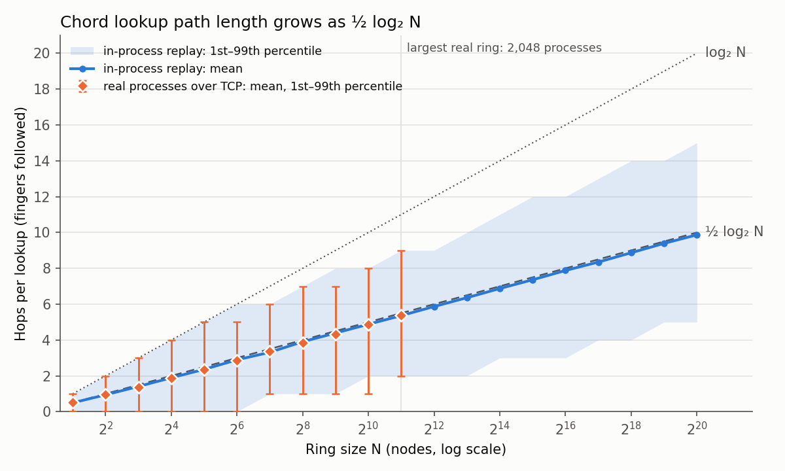
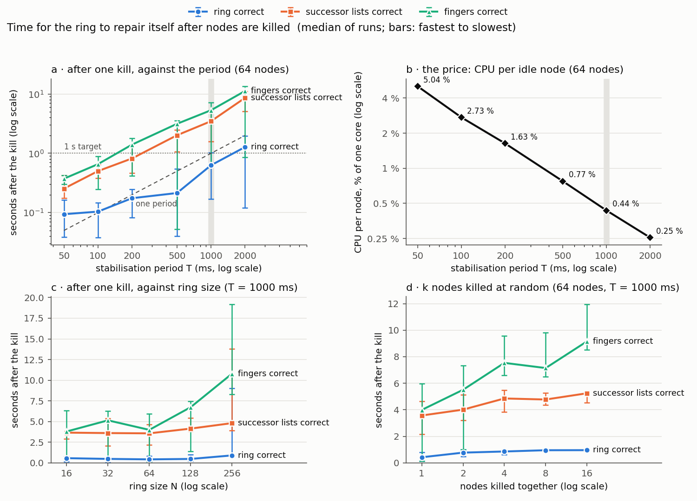
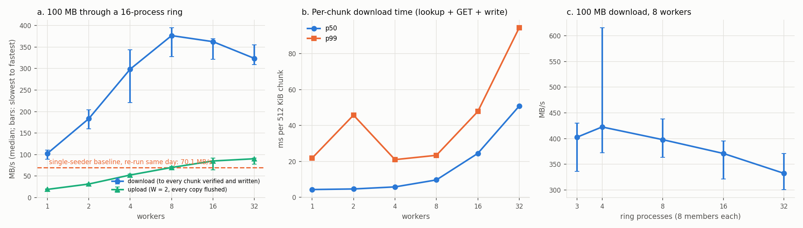
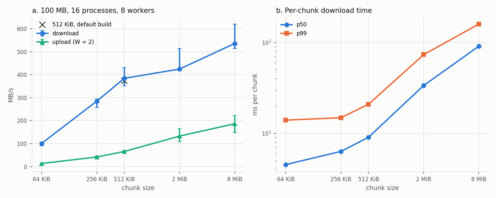
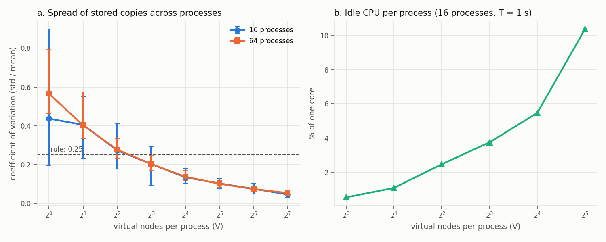
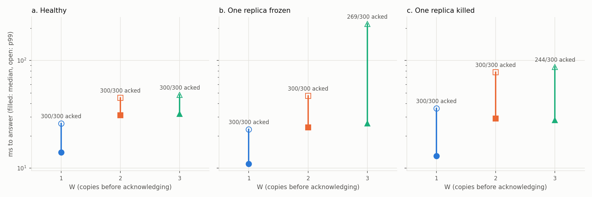
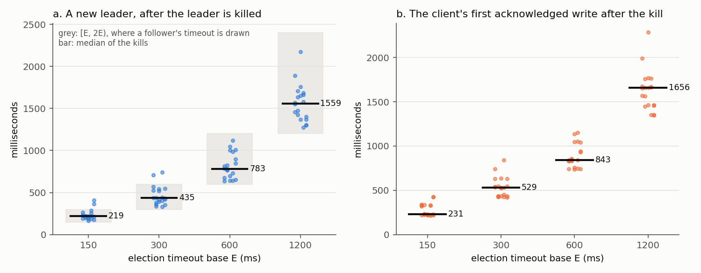
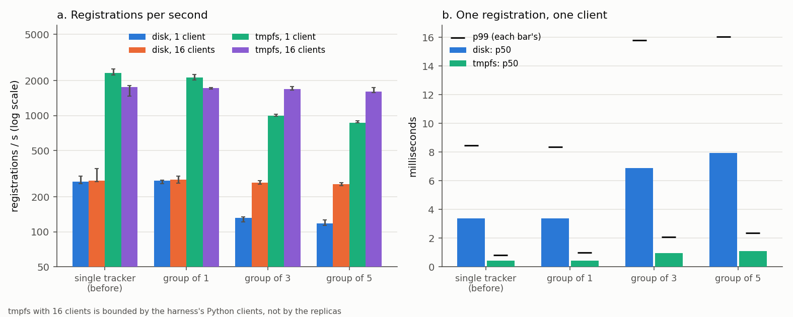
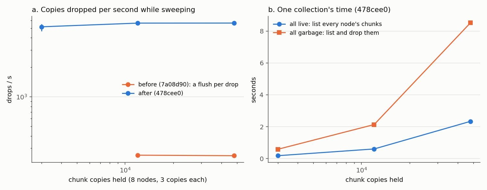
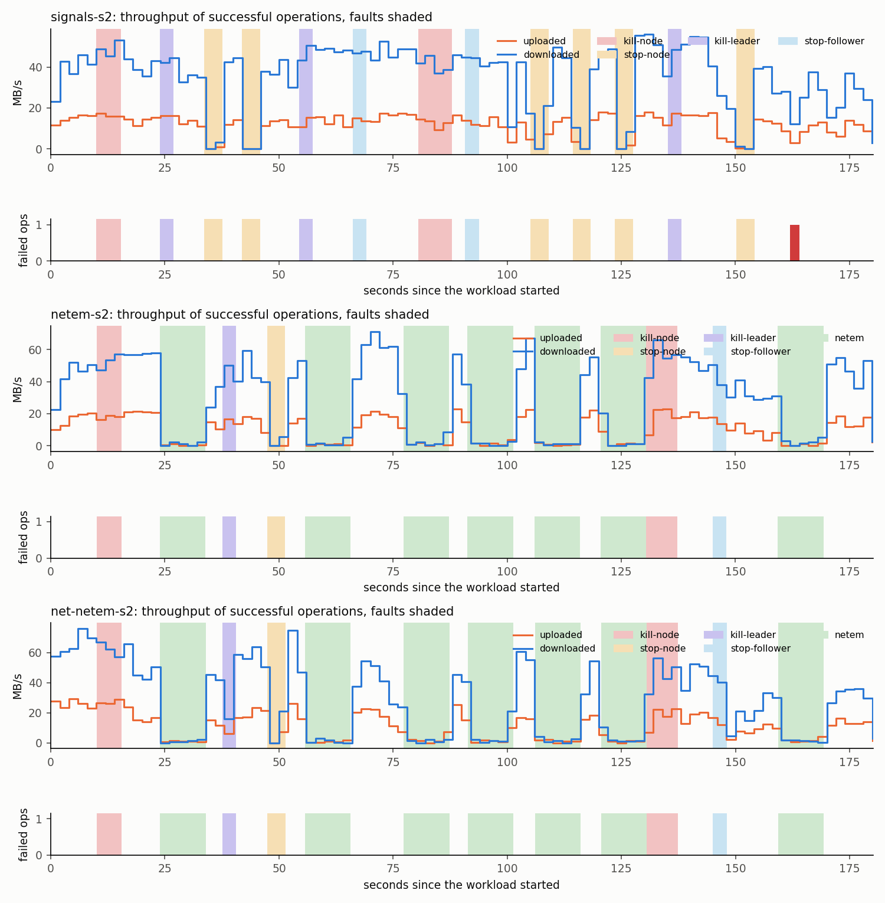

# Benchmarks — chord-dht-filesystem

**Every number here carries its method and the commit it was measured at.** A number that
cannot be tied to a commit cannot be reproduced, and one that cannot be reproduced cannot be
checked.

**Estimates are allowed and are labelled `ESTIMATE`.** An estimate is never presented as a
measurement.

> **Status:** every entry is measured — §1, the single-peer transfer baseline; §2, lookup hop count
> versus ring size; §4, time to reconverge after nodes are killed, and §4a, the 256-node false
> evictions explained; §5, parallel chunked transfer, deduplication and the tracker; §6, chunk
> placement, replication and repair; §7, the replicated tracker; §8, observability's cost; §9, deletion; §10, anti-entropy and the window with fewer than three copies; §11, fault injection. §1 was taken deliberately *before* any optimisation, because a
> "before" number cannot be recovered afterwards. (There is no §3; section numbers are kept stable
> because other documents cite them.)

---

## Measurement environment

Recorded once, so every number below is comparable and the hardware behind it is written down.

| | |
|---|---|
| Machine | 8 cores · 7.5 GiB RAM (**~3.4 GiB free**) · 909 GB free disk · **aarch64 (ARM64)** |
| Operating system | Ubuntu 24.04 under WSL2 (Windows Subsystem for Linux, version 2), kernel 6.6.87.1 |
| Toolchain | g++ 13.3.0, `-std=c++17 -Wall -pthread -O2`, linked against OpenSSL `libcrypto` |
| Topology under test | **All peers and the tracker are processes on this one host**, communicating over the loopback interface (`127.0.0.1`) |
| Repetitions per data point | 3 minimum — reporting the **median** of 3. Any point with >10% spread across runs gets re-run at 5 and the spread reported. |
| Input data | `testdata/`, regenerated by `scripts/make-testdata.sh`. Deterministic (AES-256-CTR over `/dev/zero`, fixed passphrase per file), so numbers are comparable across runs and machines. |

### Known distortions

**Everything runs on one laptop. This is the most important caveat on every number below.**
With every peer on one host, these numbers measure protocol overhead, not network behaviour.

| Distortion | What it does to the numbers | Which numbers it affects most |
|---|---|---|
| **Loopback, not a network.** No propagation delay, no packet loss, no reordering, MTU is 64 KB not 1500 bytes. | Throughput is **optimistically high** and latency **optimistically low**, by a wide margin. Anything sensitive to round trips — like iterative lookup, which costs one round trip per hop — looks far cheaper here than on a LAN, let alone a WAN. | Transfer throughput; lookup latency; anything per-hop |
| **All peers share 8 cores.** N peers means N processes contending for the same CPUs. | Beyond roughly 8 concurrent workers, added parallelism costs rather than gains — a scaling curve will bend for reasons that have nothing to do with the protocol. | Throughput vs peer count |
| **All peers share one page cache.** A "remote" peer serving a file often reads it from RAM that the requesting process already warmed. | Disk I/O is largely eliminated. Real seeders would hit disk. | Transfer throughput |
| **~3.4 GiB of free RAM caps ring size.** | Per-node memory is measured (§2) and the maximum ring size is **derived from it, not guessed**. If a hop-count curve needs more nodes than memory allows, that limit is reported alongside the plot. | Hop count vs ring size |
| **aarch64, not x86-64.** | SHA-1 throughput differs; OpenSSL uses ARMv8 crypto extensions where available. | Hashing cost as a fraction of transfer time |
| **`-O2`, not `-O3` or PGO.** | Deliberate: matches what a reviewer building from the README would get. | All |

**What would fix this:** running the ring on separate machines, which would turn these from
caveats into a comparison. That has not been done, so these distortions stand and are
disclosed rather than eliminated.

---

## Headline numbers

The headline results. Each links to its full entry below.

| Claim | Number | Before | Commit | Entry |
|---|---|---|---|---|
| *Single-peer transfer baseline, 100 MB* | **71.2 MB/s** (median of 3) | — this **is** the before | `e381179` | §1 |
| *Ring reconverges after node failure* | **0.63 s median** to every successor and predecessor correct, one of 64 nodes killed, 1 s stabilisation period (9 of 10 runs under 1 s) | 8 adjacent deaths, the whole successor list: 1.49 s, worst 4.14 s → **0.36 s**, worst 0.81 s (D-043) | `b171554` (before: `5b6830d`) | §4 |
| *Tracker failover, three Raft replicas* | **219 ms median** to a new leader after the leader is killed (164–407 ms, 20 kills, E = 150 ms); the client's first acknowledged write **231 ms** after the kill | the single tracker: no failover — down until restarted | `0d5c1c9` | §7 |
| *Tracker writes, three Raft replicas* | **131 registrations/s** at one client (p50 6.9 ms), **264/s** at 16 | the single tracker re-run at its own commit (`629e87e`): 269/s (p50 3.4 ms) and 276/s | `e3d6c65` | §7 |
| *Parallel chunked transfer, 100 MB* | **378 MB/s** download (median of 5; 16 processes × 8, 8 workers, 512 KiB chunks, every chunk hash-verified) — 293 MB/s including the final flush; uploads 77 MB/s with W = 2 flushed | **70.1 MB/s**, the single-seeder system re-run the same day at `e381179` (5.4×); and 103 MB/s for the same ring at 1 worker (3.7×, parallelism alone) | `2e7c445` | §5 |
| *Deduplication* | identical content: 100 % shared; an in-place edit: 199 of 201 chunks shared; **20 real commits of this repository as tar files: 1 of 97** | — measured against predictions stated first | `2e7c445` | §5 |
| *Virtual nodes even out storage* | busiest of 64 processes stores **1.52×** the mean with 8 virtual nodes per process; CV of copies per process **0.20** (median of 20 address sets; the real ring matched the simulation file for file) | **2.80×**, CV 0.57 with one member per process | `7d99fc0` | §6 |
| *Three copies restored after a process dies* | **2.2 s median** (1.8–2.9 s, 5 runs) from the kill until every chunk the dead process held is back on three correct live processes (16 processes × 8, 300 chunks of 512 KiB) | — | `7d99fc0` | §6 |
| *W: what it buys* | with one replica dead, W = 2 acknowledged **300/300** writes and W = 3 **244/300**; W = 1 answers in 14 ms against 31 ms but each acknowledged chunk is on one disk for ~18 ms | — a trade-off curve, not an optimisation | `7d99fc0` | §6 |
| *Observability's cost on the transfer path* | **none measurable**: 100 MB download 375 vs 384 MB/s, 10 MB 287 vs 284 (medians of 10 and 20 alternating runs, spread ±25 %); a scrape p99 under 2.4 ms during transfers | the commit before it (`f1ad66f`) | `dcf18f8` | §8 |
| *Storage reclaimed by a collection* | **exactly what only the deleted files used**: 62,928,030 bytes on disk, 3 of 3 runs, equal to the collector's report; every remaining file whole | — | `478cee0` | §9 |
| *A collection's sweep* | **5,634 copies dropped a second**; 48,009 copies collected in 8.5 s | 255 a second, a directory flush per drop (`7a08d90`) — 22× | `478cee0` | §9 |
| *Repair's full scan of a healthy ring* | **29,928 bytes** a scan (258 one-line digests) for 12,288 copies on 8 nodes | 813,636 bytes, 932 `HAVE` listings (`854e2b0`) — 27× | `bc1e6c7` | §10 |
| *Acknowledged with fewer than three copies* | p50 **0 ms**, p99 5–7 ms from acknowledgement to the third copy (W = 2, 4,097 writes) | — | `bc1e6c7` | §10 |
| *Faults under load* | **0 acknowledged names or bytes lost** in 6 runs, 75 kills, freezes, leader kills and 10 s episodes of 5 % loss; three copies back within 5 s of the last fault; 3 of 7,684 uploads failed, none acknowledged | — | `2cdd569` | §11 |
| *Timers under 5 % loss* | real-network profile: **14 strikes, 1 false eviction, 6 elections** in a run | the loopback defaults: 492, 69, 247 | `c6242fe` | §11 |
| *Lookup hops track ½ log₂ N* | **9.87 hops mean** at 2²⁰ nodes (½ log₂ N = 10); **5.38** on 2048 real processes (½ log₂ N = 5.5) | — a scaling curve, not an optimisation | `e042857` | §2 |

---

## Entries

### §1 · Single-peer transfer baseline — **MEASURED 9 Sep 2026**

**Question this answers:** how fast is the inherited system before anything is optimised? Every
later claim of improvement is measured against this, and it cannot be recovered once the code
changes.

**Commit:** `e381179` — taken on a clean working tree; the harness prints a warning into its own
output if the tree is dirty, because a number that cannot be tied to a commit cannot be
reproduced.
**Harness:** `scripts/bench-baseline.sh`, committed before the run.
**Host:** aarch64, 8 cores, 7.5 GiB RAM, kernel 6.6.87.1 under WSL2. Timer sanity was verified
immediately beforehand — `sleep 2` measured 2.008 s and the monotonic and wall clocks agreed, so
this is not one of the runs distorted by an earlier host timer fault, during which `sleep 2` took about 5 s.

**Method.** One tracker, one seeding peer, one downloading peer, all on this host, at the
inherited 512 KB piece size. Timing starts immediately before the `download_file` command is
written to the driving pipe and stops when the downloading client reports every piece verified.
The SHA-1 is then checked against the source and a mismatched run is discarded rather than
reported — the time taken to produce a wrong file is not a throughput. **Every repetition uses a
completely fresh tracker and pair of peers**, because a downloader announces itself as a seeder
on completion and would otherwise serve the next repetition from its own copy.

**How completion is detected, and why it is not the obvious way.** The first version of this
harness waited for the destination file to reach its expected size and reported **165 MB/s for
1 MB**. That was the time to *preallocate*: the client `ftruncate`s the destination to full size
before fetching a single byte (defect R2b), so the file is full-size instantly and full of
zeros. The SHA-1 check did not catch it because the real transfer completed during the
`sha1sum` call. **Size is never evidence of completeness** — the harness now waits for the
client's own "every piece verified" signal, and the wrong version is documented in its docstring
so it is not reinvented.

| Configuration | Runs (s) | Median (s) | Throughput (MB/s) |
|---|---|---|---|
| 1 MB, 1 seeder | 0.065 · 0.048 · 0.037 | 0.048 | **20.9** |
| 10 MB, 1 seeder | 0.178 · 0.268 · 0.216 | 0.216 | **46.2** |
| 100 MB, 1 seeder | 1.565 · 1.277 · 1.404 | 1.404 | **71.2** |

**What the shape says.** Throughput more than triples from 1 MB to 100 MB. That is fixed cost
being amortised, not the transfer getting faster: each download pays a tracker round trip, a TCP
connection to the seeder, and a manifest parse before any bytes move, and at 1 MB those dominate
a transfer that is only two pieces long. The right reading of the 1 MB row is *"this system has
a per-transfer overhead of roughly 30-40 ms"*, not *"it runs at 21 MB/s"*.

**Limits of this number:**
- **Three repetitions is thin**, and the spread is wide — the 1 MB figure ranges 15.3-27.3 MB/s,
  a factor of 1.8 between the best and worst run of an identical workload. The median is
  reported rather than the best; the range is reported rather than hidden.
- **One seeder means no parallelism.** The worker pool is capped at `min(peers, 4)`, so with a
  single seeder exactly one worker runs and the pieces are fetched sequentially. This is
  therefore a *sequential* baseline, which is exactly the right "before" for the Phase 5 claim
  about parallel chunked transfer.
- **The source file is in the page cache**, having just been written by the corpus generator, so
  the seeder's disk read is free. A cold-cache figure would be lower.
- **Loopback is not a network.** No propagation delay, no packet loss, and both peers contend
  for the same eight cores and the same memory bandwidth. See the distortions section above.

**What this number does not show.** It is one host, one seeder and one cached file over
loopback, so it is a baseline rather than a performance claim. Its value is the comparison: the
parallel-transfer result in Phase 5 is measured the same way, at the same piece size, against it.

---

### §2 · Lookup hop count versus ring size — **MEASURED 7 Oct 2026**

**Question this answers:** does a lookup on this ring take about ½ log₂ N hops, as the Chord paper
reports, and does that hold beyond the ring sizes that fit on one machine as processes?

**Commit:** `e042857`, clean working tree, binaries rebuilt with `make clean && make` immediately
before the run. **Harness:** `scripts/bench-hops.py` (committed in `e042857`), plot
`scripts/plot-hops.py`. **Host:** the measurement environment above. Timer sanity checked
immediately before: `sleep 2` measured 2.000 s on both clocks. Total run time 6 min 12 s.

**What a hop is.** The number of `NEXT` replies the originator follows, which is the number of
fingers followed and equals requests − 1 (D-026). It is the quantity the Chord paper's
½ log₂ N describes. Mean **requests** are exactly one higher at every point and are recorded in
`docs/figures/hops-vs-n.csv`.

**Method.**
- **Ring sizes:** N = 2¹ … 2¹¹ as real processes, N = 2¹ … 2²⁰ in process. Three rings per size,
  made different by their addresses: real ring r uses `127.1.r.1` with ports from 20000, and
  simulated ring r uses `10.r.x.y`. Identifiers are SHA-1 of the address, as in production.
- **Workload, identical in shape for every ring:** up to 64 start nodes drawn at random from the
  ring, and 4096 / starts random 64-bit keys from each, so **4096 lookups per ring and 12,288 per
  data point**. Seeded by (N, ring), so a rerun reproduces every key.
- **Real series:** N `node` processes on loopback, queried by the `lookup` tool, one fresh TCP
  connection per request.
- **In-process series:** `sim-hops`, with the same `parse_members`, `build_fingers`, `route_step`
  and `lookup()` as the real path, and a function call where the socket was (D-027).
- **Checks on every lookup:** the owner equals an independent oracle written in the harness
  (nearest node clockwise of the key, by SHA-1 computed in Python); the path starts at the chosen
  start node; hops = requests − 1. On real rings, the path also equals a model of the finger rule,
  node by node. **Every real ring was replayed through `sim-hops` with the identical workload, and
  its output compared line for line.**
- **Statistics:** the mean, and nearest-rank 1st, 50th and 99th percentiles, pooled over the
  12,288 lookups at each size.

**Result. 380,928 lookups, 0 wrong owners, 0 wrong paths, and 135,168 of 135,168 real lookups
reproduced exactly by the in-process replay.**

| N | Series | Mean hops | ½ log₂ N | p1 | p50 | p99 | Max | Mean requests |
|---:|---|---:|---:|---:|---:|---:|---:|---:|
| 8 | real | 1.38 | 1.5 | 0 | 1 | 3 | 3 | 2.38 |
| 64 | real | 2.87 | 3.0 | 0 | 3 | 5 | 6 | 3.87 |
| 256 | real | 3.86 | 4.0 | 1 | 4 | 7 | 8 | 4.86 |
| 1024 | real | 4.85 | 5.0 | 1 | 5 | 8 | 10 | 5.85 |
| **2048** | **real** | **5.38** | 5.5 | 2 | 5 | 9 | 11 | 6.38 |
| 2048 | in-process | 5.36 | 5.5 | 2 | 5 | 9 | 11 | 6.36 |
| 16,384 | in-process | 6.87 | 7.0 | 3 | 7 | 11 | 13 | 7.87 |
| 131,072 | in-process | 8.35 | 8.5 | 4 | 8 | 13 | 15 | 9.35 |
| **1,048,576** | **in-process** | **9.87** | 10.0 | 5 | 10 | 15 | 18 | 10.87 |

Every size is in `docs/figures/hops-vs-n.csv`; every lookup is in `bench/raw/hops-e042857.csv`
(not committed, and regenerated by rerunning the harness at this commit).

**What the shape says.**
- **Mean hops track ½ log₂ N across nineteen doublings**, from 2 nodes to 1,048,576. Each doubling of
  the ring adds about half a hop.
- **The mean sits slightly below ½ log₂ N,** by 0.10–0.19 hops at every N ≥ 32, in both series.
  This is observed and not yet explained, so it is reported as a measurement rather than a
  derivation. The paper itself says "about ½ log₂ N".
- **The tail grows logarithmically too.** p99 is 15 hops at 2²⁰, below log₂ N = 20, and the worst
  single lookup out of 12,288 there took 18.
- **The real and in-process series agree** wherever both exist. Their rings differ, so their means
  differ slightly (5.38 against 5.36 at 2048). On identical rings, the replay reproduced every one
  of the 135,168 real lookups exactly.

**Per-node memory, and why the real series stops at 2048.** Memory per `node` process, as a median
over up to 64 sampled processes per ring:

| N | Resident set | Proportional set | Fall in `MemAvailable` per node | Slowest of 3 ring start-ups |
|---:|---:|---:|---:|---:|
| 256 | 6528 KiB | 777 KiB | 870 KiB | 0.4 s |
| 1024 | 6656 KiB | 869 KiB | 963 KiB | 2.9 s |
| 2048 | 6784 KiB | 950 KiB | 1063 KiB | 7.6 s |

The resident set counts the shared libraries (`libstdc++`, `libcrypto`) in full for every
process. The proportional set divides them among the processes that share them, and is the
honest per-node figure. The fall in `MemAvailable` also includes kernel per-process memory, and
below about 256 nodes it is noisy enough to be meaningless (it is in the CSV, but not used).

The ceiling is derived, not chosen: of the documented ~3.4 GiB free, 1 GiB is held back for the
originator, the oracle, the page cache and noise, which leaves about 2.4 GiB. 2048 nodes at about
1.04 MiB each is about 2.1 GiB, which fits. 4096 nodes would cost at least 4.2 GiB, more than the
entire budget, because the per-node figure is still rising with N (`SCALE_NOTES.md`, 7 Oct). On
the day of the run the machine reported about 8.7 GiB available, more than documented. The
ceiling follows the documented budget, not one good day.

**Limits of this number:**
- **The in-process series measures routing, not the network.** It shares every line of routing
  code with the real ring, but not the sockets. The sockets are tested separately (`test-net`,
  `scripts/e2e-chord.sh`).
- **These rings are fixed and their tables are correct by construction** (D-020). This is the
  best case. Phase 3 measures what stale tables during churn cost against it.
- **Ring-to-ring spread exceeds 10 % at small N.** The means of the three rings differ by 13.3 %
  at 16 real nodes and by 22.1 % at 8 simulated ones. From 128 nodes up the spread is below 4 %,
  and from 4096 below 1.5 %. This differs from §1's spread: hop count is deterministic for a
  given ring, so a rerun reproduces it exactly. The spread is real variation between small
  hashed rings, which are lopsided, not measurement noise. It is reported rather than re-run.
- **Start nodes are sampled** (at most 64 per ring) rather than every node starting its own
  lookups as in the paper. Keys are uniform over the identifier space.
- **Loopback.** Hop count does not depend on latency, so the loopback distortions above do not
  bias it. They would bias any latency read off this run, and none is reported.

---

### §4 · Time to reconverge after nodes are killed — **MEASURED 7 Oct 2026**

**Question this answers:** after a node dies, how long until the ring is correct again — every successor
and predecessor right — and how long until the slower repairs (successor lists, finger tables) finish? How
does that depend on the stabilisation period, the ring size, how many nodes die at once, and lookup load?
And what does a short period cost?

**Commit:** `b171554`, clean working tree, binaries rebuilt with `make clean && make` immediately before the
run. **Harness:** `scripts/run-reconverge.py` drives `scripts/bench-reconverge.py` and applies the selection
rules in code; `scripts/plot-reconverge.py` draws the figure and writes `docs/figures/reconverge.csv`. Timer
sanity checked immediately before: `sleep 2` measured 2.000 s on both clocks. Run time 40 min. Every run is in
`bench/raw/reconverge-b171554.csv` (not committed; regenerated by rerunning the driver at this commit).

**What "reconverged" means (decision D-038).** The harness computes the correct state of every live node from
the live addresses alone (SHA-1 of each, sorted) and polls every live node until what it holds matches. Three
milestones:
- **ring correct** — every live node's successor and predecessor are right. This is Chord's correctness
  condition (with right successors, every lookup reaches the right owner), and it is the headline;
- **lists correct** — every successor list (8 entries) is right;
- **fingers correct** — all 64 fingers of every live node are right.

A milestone counts from the first poll after which it held at every later poll. Time runs from just
**before** the kill signal to the end of that poll, so every figure is an upper bound with a resolution of one
poll (the poll time is in the tables). A node's successor is read by asking it to route its own identifier + 1
(the code path every lookup uses), its predecessor and list by `NEIGHBOURS`, its fingers by `FINGERS`. After the
last milestone, 256 lookups from four live nodes must all return the oracle's owner; all did, in every run.

**Method.**
- **Ring:** N `node --wired` processes on loopback (`127.2.<run>.1`, ports from 21000), started from a correct
  state and then maintained (D-029). The nodes start one after another and the earliest briefly see the latest
  as dead, so each run first waits until the ring matches the oracle and stays matched, then lets it run for four
  periods; log lines are counted only from that point.
- **Kill:** SIGKILL to k nodes chosen by a seed fixed per configuration, so an idle and a loaded run of the same
  configuration kill the same nodes in the same ring.
- **Repetitions:** 10 runs per period in the period sweep, 5 elsewhere; each run is a fresh ring. Medians are
  reported with the fastest and slowest run.
- **False evictions:** every node's log is scanned for evictions of nodes that were alive.
- **Load:** four `lookup --retries 3` clients, closed loop, each paced to a quarter of the target rate, starting
  from random live nodes; every answer is timestamped and checked against the oracle.

**How the period and the deadline were chosen: by rules applied in code.** The rules were fixed before this run.
They are the third version: the first had no solution and the second gave different answers on a repeat run.
Both failures are recorded in decisions D-041 and D-042, with the data that caused them.
- **Period T:** the longest period at which at least 9 of 10 runs reach "ring correct" within 1 s (the 9th of 10
  sorted runs is a one-sided 99 % upper confidence bound on the median), with no live node wrongly evicted.
  **Result: T = 1000 ms** (9 of 10 runs; 2000 ms managed 4 of 10).
- **Call deadline D:** the smallest of 100, 200, 500 and 1000 ms that is at least ten times the
  99.9th-percentile node-to-node exchange and longer than the slowest exchange observed, under the loads the
  benchmark runs. **Result: D = 200 ms.**

| Calibration: `NEIGHBOURS` timed from the harness on a converged ring | Exchanges | Median | p99 | p99.9 | Slowest |
|---|---:|---:|---:|---:|---:|
| 64 nodes, T = 50 ms (heaviest point of the period sweep) | 68,480 | 0.34 ms | 1.80 ms | 5.50 ms | 116.7 ms |
| 256 nodes, T = 1000 ms (heaviest point of the size sweep) | 86,016 | 0.32 ms | 0.85 ms | 3.13 ms | 17.0 ms |
| 256 nodes, T = 50 ms — *no sweep runs this; it saturates the machine* | 2,304 | 5.26 ms | 161.3 ms | 313.9 ms | 454.6 ms |

**Headline: one node killed in a 64-node ring at T = 1000 ms is repaired — every successor and predecessor
right — in a median of 0.63 s** (10 runs; fastest 0.17 s, slowest 1.03 s; 9 of 10 under 1 s). Successor lists
follow at 3.48 s and every finger table at 5.32 s. No live node was wrongly evicted, and every lookup afterwards
returned the right owner.

**Against the period** (64 nodes, one kill, D = 200 ms, 10 runs):

| T | ring correct | lists correct | fingers correct | runs ≤ 1 s | CPU per idle node |
|---:|---:|---:|---:|---:|---:|
| 50 ms | 0.09 s (0.04–0.16) | 0.25 s | 0.37 s | 10/10 | 5.04 % |
| 100 ms | 0.10 s (0.04–0.15) | 0.50 s | 0.66 s | 10/10 | 2.73 % |
| 200 ms | 0.17 s (0.08–0.25) | 0.82 s | 1.40 s | 10/10 | 1.63 % |
| 500 ms | 0.21 s (0.04–0.54) | 2.01 s | 3.14 s | 10/10 | 0.77 % |
| **1000 ms** | **0.63 s (0.17–1.03)** | **3.48 s** | **5.32 s** | **9/10** | **0.44 %** |
| 2000 ms | 1.28 s (0.12–1.97) | 8.60 s | 11.23 s | 4/10 | 0.25 % |

CPU is user plus system time of all 64 processes over 20 s of an idle ring, as a percentage of one core per node.

**Against ring size** (T = 1000 ms, D = 200 ms, one kill, 5 runs):

| N | ring correct | lists correct | fingers correct | poll | start-up to a verified ring |
|---:|---:|---:|---:|---:|---:|
| 16 | 0.56 s (0.13–0.78) | 3.65 s | 3.79 s | 9 ms | 2.0 s |
| 32 | 0.48 s (0.04–0.58) | 3.60 s | 5.14 s | 20 ms | 2.1 s |
| 64 | 0.42 s (0.15–0.81) | 3.57 s | 3.99 s | 39 ms | 2.1 s |
| 128 | 0.47 s (0.18–1.00) | 4.14 s | 6.73 s | 75 ms | 8.1 s |
| 256 | 0.90 s (0.73–**9.01**) | 4.80 s | 10.78 s | 148 ms | 12.1 s |

**Against the number killed at once** (64 nodes, T = 1000 ms, D = 200 ms, 5 runs; the one-kill row is the size
sweep's 64-node row):

| k | at random: ring correct | at random: fingers correct | adjacent: ring correct | adjacent: lists correct |
|---:|---:|---:|---:|---:|
| 1 | 0.42 s (0.15–0.81) | 3.99 s | — | — |
| 2 | 0.77 s (0.47–1.01) | 5.51 s | — | — |
| 4 | 0.86 s (0.63–0.96) | 7.53 s | 0.48 s (0.05–1.03) | 4.22 s |
| 8 | 0.95 s (0.91–1.03) | 7.14 s | 0.36 s (0.15–0.81) | 4.40 s |
| 9 | — | — | 0.67 s (0.10–0.79) | 3.67 s |
| 16 | 0.95 s (0.90–1.05) | 9.16 s | — | — |

**Under lookup load** (64 nodes, T = 1000 ms, one kill; the same rings and victims as the idle 64-node row):

| Load | ring correct | fingers correct | lookups after the kill | right owner | named the dead node | failed | last wrong answer |
|---|---:|---:|---:|---:|---:|---:|---:|
| idle | 0.42 s | 3.99 s | — | — | — | — | — |
| 200 /s | 0.76 s | **0.29 s** | 5,786 | 5,786 | 0 | 0 | — |
| 769 /s (1000 targeted) | 0.68 s | **0.25 s** | 23,004 | 22,999 | 5 | 0 | 0.27 s after the kill |

**Before and after decision D-043 (stabilise runs to its fixed point within a round).** The same driver at
`5b6830d`, the commit before the change, measured a long tail when more nodes died than one node's successor
list holds, and a 256-node ring that often failed to come up correct. That run chose the same T (1000 ms) and a
deadline of 500 ms rather than 200 ms; kills are refused connections, which the deadline does not affect.

| 64 nodes, adjacent kills, T = 1000 ms | before (`5b6830d`): ring correct | after (`b171554`): ring correct |
|---|---:|---:|
| 4 adjacent | 0.29 s (0.10–0.95) | 0.48 s (0.05–1.03) |
| 8 adjacent — the whole successor list | 1.49 s (1.14–4.14) | **0.36 s (0.15–0.81)** |
| 9 adjacent — one more than the list | 2.99 s (0.37–**7.63**) | **0.67 s (0.10–0.79)** |
| 256-node ring verified correct from start-up within 60 s | 2 of 5 runs | **5 of 5** (median 12.1 s) |

**What the shape says.**
- **Ring correctness is local, so it does not grow with N.** After a kill only the dead node's predecessor and
  successor need to change, and the ring is correct when the predecessor runs its next round, which falls anywhere
  in the period. From 16 to 128 nodes the median stays between 0.42 and 0.56 s.
- **With k nodes dead, the ring waits for the slowest of k predecessors.** The median of the largest of k waits
  spread evenly over a period is T · 0.5^(1/k): 0.71, 0.84, 0.92 and 0.96 s for k = 2, 4, 8 and 16. Measured:
  0.77, 0.86, 0.95 and 0.95 s.
- **Since D-043, a whole dead successor list costs no more than one death.** Before it, a node that lost its whole
  list fell back to a distant node and walked home one node per period.
- **The slower repairs scale with the period, not with N:** lists about 3.5 periods, fingers 4–7 periods.
- **Lookup load speeds up finger repair, not ring correctness.** A client that reaches the dead node reports it to
  the node that named it (D-036), and that node is a finger holder, so the finger milestone fell from 3.99 s to
  0.29 s. The dead node's predecessor is told by nobody — routing never contacts the owner — so ring correctness
  still waits for its own round. It was not faster under load (0.76 s and 0.68 s against 0.42 s idle). We do not
  claim the difference is caused by the load: five runs, and the idle figure is within the loaded range.
- **Wrong answers are confined to the window and to the dead node.** Under load every wrong answer named the dead
  node as the owner — its predecessor had not yet noticed — and the last came 0.27 s after the kill. With three
  retries no lookup failed.
- **CPU per node falls as 1/T**, from 5.0 % of a core at 50 ms to 0.25 % at 2000 ms.

**Limits of this number.**
- **Some runs of 256 nodes evicted live nodes — explained below (§4a).** In the fifth 256-node run, 77 evictions of
  live nodes were logged and the ring took 9.01 s; the other four had none, and no false eviction occurred in any of
  the other 129 runs. Re-run with logs and machine monitors kept, the same configuration did it again in 2 of 50
  runs, and both times the cause was a machine-wide stall in the kernel, not the protocol.
- **The CPU figures are not taken from a verified-converged ring.** The CPU mode starts timing one second plus four
  periods after the last node listens. At `5b6830d`, before D-043 shortened start-up, it measured 5.05 % at both
  50 and 100 ms; the most likely explanation is start-up repair still running inside the window. The `b171554`
  figures fall as 1/T, but this was not verified.
- **One machine.** Every node, the clients and the harness share eight cores and loopback; there is no network
  latency, so these times count protocol rounds, not wide-area delays.
- **The resolution is one poll** (9 ms at 16 nodes, 148 ms at 256), and times are upper bounds.
- **The harness times exchanges from Python**, so the calibration includes the measuring process's own pauses.
  This is why the deadline rule uses a percentile, and the slowest sample only as a floor.
- **Kills only.** A frozen node is evicted after two strikes (about two periods plus two deadlines). That is tested
  in `scripts/e2e-churn.sh` but not swept here.

### §4a · The 256-node false evictions, re-run with logs kept — **MEASURED 8 Oct 2026**

**Question this answers:** why did one 256-node run in §4 evict 77 live nodes, when 129 other runs evicted none?

**Commits:** `33e64d8` (node log lines carry wall-clock milliseconds; the harness keeps every run's logs with
`--keep`) and `edf4225` (a strike's log line also says how long the failed call took). Node behaviour is otherwise
that of `b171554`. **Configuration:** exactly §4's size point — 256 wired nodes, T = 1000 ms, D = 200 ms, one kill,
deterministic seeds — run 20 times at `33e64d8` and 30 times at `edf4225`. **Recorded alongside:** `vmstat` every
second, the load average and runnable-task count every 0.2 s, and a thread that sleeps 20 ms in a loop and logs
every oversleep above 50 ms.

| | Runs | With false evictions | False evictions | Ring correct in that run |
|---|---:|---:|---:|---:|
| §4, `b171554` | 5 | 1 | 77 | 9.01 s |
| re-run, `33e64d8` | 20 | 1 | 344 | 7.86 s |
| re-run, `edf4225` | 30 | 1 | 1,200 | 41.90 s |

**What happened in both bad runs.** For 5 to 9 seconds the whole machine was in the kernel: `vmstat` showed
**400–680 runnable tasks** (normally 1–12), **91–99 % system time**, interrupts down to about 2,200 a second (the
timer tick alone) and context switches down to about 2,000 a second (normally 75,000–90,000). `vmstat` itself
missed samples, and the sleeping thread overslept by 200–600 ms over and over. In the first bad run this began
4.5 s *before* the kill, during the settling period after the ring had been verified correct; in the second it began
9 s *after* it. In both, the nodes' first strike came after the stall began, strikes stopped within about two seconds
of its end, and **every false eviction was by two timeouts, none by a refused connection**. Outside those two
stalls no second of the 50 runs had system time above 63 % or more than 146 runnable tasks (brief spikes while
256 nodes start), and the other 48 runs logged no strike at all in the window around the kill.

**What it rules out.**
- **Not the protocol feeding on itself.** The strike storm starts after the kernel stall and stops about two seconds
  after it ends, while the repair it set off was still running; a load the nodes generated themselves would have
  outlived the stall.
- **Short stalls are absorbed, as designed.** Later in the second bad run, two sub-second stalls (39 and 233
  runnable tasks; the sleeping thread overslept 86–255 ms) produced 73 first strikes and no eviction: one timeout
  is one strike, and the next good reply clears it (D-035). Across the 48 clean runs only 5 strikes were logged
  after settling.
- **Not the observer pausing.** Of the 2,727 timed-out calls in the second bad run, the median took 212 ms against
  the 200 ms deadline and 86 % took under 300 ms: the calling node was running when its timer fired. The peers were
  the ones not answering.
- **Not this ring or this victim.** Seeds are fixed, and the run index that failed at `b171554` (the fifth) was clean
  in both re-runs.
- **Not memory reclaim or compaction.** No page scanning at any point; the kernel's compaction counters advanced
  every 30 s for two minutes early in the second re-run, and not at all during its stall.

**What is not identified:** what the kernel was doing. Without root, neither `perf` nor `/proc/<pid>/stack` is
available. The kernel logged `hrtimer: interrupt took 24772608 ns` (a 24.8 ms timer interrupt) 9 s before the first
stall's kill. A synthetic load with the node's shape and none of its logic — 256 processes, a thread per accepted
connection, 2,580 fresh connections a second for 20 minutes — produced no stall and no call over 162 ms; it ran at
half the benchmark's system time, so it neither confirms nor rules out connection churn as the trigger.

**Conclusion.** The false evictions are the failure detector doing what D-035 specifies — two consecutive
200 ms timeouts evict — during multi-second stalls that starve every process on this host at once. A peer that has
not answered for five seconds is indistinguishable from a frozen one by any deadline short enough to catch a frozen
node in seconds. The stall is a property of running 256 processes on one 8-core virtual machine: it starves the
observer's peers and the observer's neighbours together, which one node per machine would not. The ring repaired
itself every time with no orphan and every lookup correct afterwards, but slowly after the larger storm (41.9 s),
because about 1,200 live nodes had to re-insert themselves. **So the 256-node point in §4 measures this machine as
much as the protocol, and is reported with that caveat;** the 16- to 128-node points (no stall seen in any run) do
not carry it.

---

### §5 · Files through the ring: parallel chunked transfer — **MEASURED 8 Oct 2026**

**Questions this answers:** how much faster is the new transfer path than the single-seeder system it replaced,
and how much of that is parallelism? How does throughput move with the number of workers, the size of the ring and
the chunk size? What does a chunk cost, at the median and in the tail? How much does content addressing
deduplicate, and where does it fail? What does the tracker cost per name?

**Commit:** `2e7c445`, clean working tree, binaries rebuilt with `make clean && make` immediately before the run
(16:37–16:59 UTC, 8 Oct). **Harness:** `scripts/bench-transfer.py` (committed at `c878ede`; the commit after it,
`2e7c445`, fixed a ring livelock the first attempt at this run exposed — D-067 — and changed the harness only to
clean up a ring that fails to start). Summaries: `scripts/plot-transfer.py` → `docs/figures/transfer.csv` and the two
figures. Raw rows: `bench/raw/transfer-2e7c445.csv`, per-chunk times `bench/raw/latency-2e7c445.csv` (not committed).
Timer sanity before the run: a 1 s sleep measured 1.000 s on both the monotonic and the wall clock.

**Method (decision D-066).** Every repetition starts a fresh `tracker` and a fresh ring of `node --wired` processes
(8 members each, T = 1 s, D = 200 ms, each with its own chunk store), waits until an oracle in the harness confirms
every successor and predecessor, uploads a file from `testdata/` with the real `client` (W = 2), downloads it, and
compares SHA-1 with the source. **Every one of the 116 transfers came back identical.** Five repetitions per point;
the median is reported with the slowest and fastest. Throughput is bytes ÷ 2^20 ÷ seconds, as the baseline computed
it. Download time is the client's own **ready** time — from its start to every chunk verified and written — which is
where the baseline's clock stopped ("every piece verified"; its client never flushed). The flush and rename that
follow (D-055) are reported separately, and so is the wall time to the client's exit. The source files and the
nodes' chunk files are in the page cache, as the baseline's seeder file was.

#### Before and after (512 KiB chunks throughout)

The baseline was **re-run the same day at its own commit**, `e381179`, with its own harness, five repetitions, as a
control: the machine now has more free memory than in September, and a same-day run separates machine drift from the
change. (A first control earlier the same day gave 19.1 / 49.4 / 72.0 MB/s.)

| File | Single seeder, Sept (`e381179`) | **Single seeder, re-run 8 Oct** | Ring, 1 worker | **Ring, 8 workers** | Ring, 8 workers, wall incl. start, flush, rename |
|---|---:|---:|---:|---:|---:|
| 1 MB | 20.9 MB/s | **17.9** | 73.3 (43.0–80.6) | **101.8** (48.0–108.2) | 49.1 |
| 10 MB | 46.2 | **54.7** | 123.9 (93.8–130.7) | **313.2** (216.3–336.9) | 173.3 |
| 100 MB | 71.2 | **70.1** | 103.2 (99.4–111.2) | **378.2** (311.2–391.9) | 293.2 |

- **Against the system it replaced: 5.4× at 100 MB** (378.2 against 70.1 MB/s), 5.7× at 1 and 10 MB. That comparison
  moves several things at once — a ring instead of one seeder, three replicas, per-chunk hashing, a different client —
  so it is the system-level result, not a claim about parallelism.
- **The single-variable comparison is parallelism alone: 3.7× at 100 MB** (103.2 → 378.2 MB/s), same ring, same files,
  same code, one worker against eight. At 1 MB there are only two chunks, and eight workers buy 1.4×.
- **The flush is real:** `fsync` and rename of a 100 MB file took a median of 67 ms; with process start-up, the wall
  figure is 293 MB/s — still 4.2× the baseline, whose client never flushed at all.
- **Uploads** (no baseline exists: the old upload only hashed the file and sent a manifest): 100 MB in a median
  1.30 s at 8 workers, **77 MB/s with every chunk's two acknowledged copies flushed** (W = 2; the third follows), and
  20 MB/s at 1 worker.

#### Workers (decision D-056's rule)

100 MB, 16 processes. **The rule, fixed before measuring:** the smallest power of two whose median download
throughput is within 10 % of the best.

| Workers | 1 | 2 | 4 | **8** | 16 | 32 |
|---|---:|---:|---:|---:|---:|---:|
| Download, median MB/s | 102.4 | 183.4 | 298.6 | **376.7** | 362.6 | 323.7 |
| slowest – fastest | 89–111 | 160–204 | 221–344 | 328–395 | 321–370 | 309–355 |
| Per-chunk download p50 / p99, ms | 4.3 / 21.8 | 4.6 / 45.8 | 5.8 / 21.0 | **9.7 / 23.4** | 24.4 / 47.8 | 50.8 / 94.5 |
| Upload, median MB/s (W = 2) | 19.0 | 31.5 | 52.4 | 70.0 | 85.1 | 90.3 |

**Result: 8 workers**, the best median — the number of cores, which was already the default; the default is
unchanged. Past 8, downloads get slower: the client's workers, 16 node processes and the kernel share eight cores,
and each chunk waits longer (its p50 doubles from 8 to 16 workers and again to 32) without the ring delivering more.
Uploads keep improving to 32, because each upload chunk spends most of its time waiting on two `fsync`s rather than on
a CPU; more requests in flight overlap more flushes.

#### Per-chunk latency

A chunk's time is from the start of its lookup to its bytes verified and, for a download, written; retries included.
At the headline setting (100 MB, 8 workers, 1,000 chunks): **p50 9.4 ms, p99 31.4 ms**; at 1 worker 4.2 / 13.1 ms. The
tail is contention, not distance: at one worker a chunk's p99 is three times its p50, and parallelism raises both.
An upload chunk at 8 workers: p50 47.9 ms, p99 101 ms — two flushed copies on the critical path (§6).

#### Ring size

100 MB at 8 workers: **3 processes 402.5 MB/s · 4 422.5 · 8 397.8 · 16 370.9 · 32 332.2** (medians). More processes
mean more members (8 each), so slightly longer lookups (about ½ log₂ members hops, §2), and more processes sharing
the same cores. On one host, adding nodes adds no disks, NICs or cores, so the curve cannot show a scaling benefit; it
shows the cost, which is mild — 21 % from 4 to 32 processes.

#### Chunk size (decision D-016, on the sweep build of D-063)

100 MB, 16 processes, 8 workers. All five points on one build with the chunk limit raised to 8 MiB; the 512 KiB point
also on the default build, where it gave 373.0 MB/s against 384.1 on the sweep build — within each other's spread, so
the raised limit itself changes nothing.

| Chunk | 64 KiB | 256 KiB | **512 KiB** | 2 MiB | 8 MiB |
|---|---:|---:|---:|---:|---:|
| Chunks in 100 MB | 1,600 | 400 | 200 | 50 | 13 |
| Download, median MB/s | 100.4 | 284.5 | **384.1** | 424.4 | 536.0 |
| Upload, median MB/s | 12.9 | 41.4 | 65.4 | 132.4 | 186.2 |
| Per-chunk download p50 / p99, ms | 4.5 / 14.0 | 6.3 / 14.8 | 9.0 / 20.9 | 33.6 / 73.5 | 91.0 / 159.5 |

**A failed prediction, recorded as one.** D-016 expected this curve might be nearly flat on loopback. It is not:
throughput rises fivefold from 64 KiB to 8 MiB. Each chunk pays a fixed cost — a lookup of several hops, each a fresh
TCP connection, and for an upload two flushes — and on loopback a large chunk costs almost nothing extra to move, so
fewer, larger chunks win. A real network changes both sides: per-hop round trips make the fixed cost larger (favouring
large chunks even more), while one slow peer holding an 8 MiB chunk stalls 8 % of a 100 MB file instead of 0.5 %, and a
failed chunk costs 16 times as much to re-fetch — none of which loopback can show. **512 KiB stays the default:** it is
the size the before/after was pinned to, its deduplication granularity is 16 times finer than 8 MiB's, and the gain
beyond it on this host is 40 % at the price of 16 times the memory per in-flight chunk (D-052).

#### Deduplication (decision D-062)

One 16-process ring; each variant uploaded under its own name; new unique chunks counted from the files added to
every store, divided by three. Predictions were written in D-062 before the run.

| Upload | Chunks + manifests | New unique | Shared | Predicted |
|---|---:|---:|---:|---|
| `huge.iso`, 100 MB (200 chunks) | 201 | 201 | 0 | — |
| the same bytes, another name | 201 | **0** | 201 | nothing new, manifest included |
| 1 KiB overwritten at 50 MB | 201 | **2** | 199 | one chunk and the manifest |
| 1 byte inserted at 1 MiB | 202 | **200** | 2 | every chunk after the insertion new |
| 10 MB appended | 221 | **21** | 200 | 20 chunks and the manifest |
| this repository at 20 consecutive commits, `git archive` tar files (1.5–1.7 MB each) | 97 | **96** | **1** | close to nothing shared |

**Every synthetic case matched its prediction exactly**, which checks the implementation, not the idea. The real
history is the useful number: **1 chunk of 97 shared.** A tar file lists the tree in sorted order, so files that change in
most commits (`ARCHITECTURE.md`, `README.md`) sit in the first or second chunk, and any change in length shifts every
byte after it; fixed-size chunks then never line up again. Content-defined chunking (Rabin fingerprints, FastCDC) is the known fix and is not built.

#### The tracker (decision D-058; the evidence D-017 owed)

One tracker, one client connection sending `REGISTER` one at a time, each acknowledged after its record is flushed.

| Names | Log size | Bytes per name | Resident memory | Registrations per second |
|---:|---:|---:|---:|---:|
| 10,000 | 770,000 B | 77.0 | 8.1 MiB (+3.7 MiB) | 254 |
| 100,000 | 7,700,000 B | 77.0 | 26.4 MiB (+22.0 MiB) | 197 (over the whole run) |

**State is O(files):** 77 bytes of log and about 230 bytes of memory per name, whatever the file's size — a 100 MB
file and a 1 KB file cost the tracker the same. **The ceiling is the flush:** about 200–250 registrations a second, one
`fdatasync` each under one lock (D-058's stated cost; group commit is the fix). A restart with 100,000 names replayed
the log and was listening again in 0.39 s.

**Limits of these numbers.**
- **One host.** No propagation delay, every replica equally fast, the page cache shared — the before/after compares
  two designs on one machine, not network throughput.
- **Warm caches.** Each chunk was written moments before it was read; a cold read would hit disk.
- **The baseline is one seeder and this ring is 16 processes.** The 1-worker figure is the comparison that holds the
  topology fixed.
- **Above 8 workers the host saturates**, so the right half of the workers curve measures the scheduler.

---

### §6 · Chunk placement, replication and repair — **MEASURED 8 Oct 2026**

**Questions this answers:** how evenly do chunks spread over processes, with and without virtual nodes, and what
does each virtual node cost? What does `W` cost in write latency, and what does it buy when a replica is slow, dead,
or the coordinator itself dies? After a process dies, how long until every chunk is back to three copies?

**Commit:** `7d99fc0`, clean working tree, binaries rebuilt with `make clean && make` immediately before the run
(10:59–11:11 UTC, 8 Oct). **Harness:** `scripts/bench-chunks.py` (modes `--balance`, `--wsweep`, `--crash`,
`--repair`); `scripts/plot-chunks.py` writes the figures and `docs/figures/chunks.csv`. Raw rows in
`bench/raw/*-7d99fc0.csv` (not committed). Every ring is N `node --wired` processes on loopback with their own
chunk stores; T = 1000 ms, D = 200 ms (§4). Where chunks *should* be is computed by the harness from the live
addresses alone (`scripts/chunkcheck.py`); where they *are* is asked with `HAVE` or counted on disk.

#### Load balance and the number of virtual nodes (decision D-051)

**Method.** Placement is a pure function of addresses and keys, so `sim-balance` computes it with the node's own
identifier and replica-set code: 16 and 64 processes, `V` from 1 to 128 members per process, 20 address sets of the
form the benchmarks use, 100,000 keys each, `RF = 3` on distinct processes. Load per process is the number of copies
it stores; its spread is the coefficient of variation (standard deviation over mean) across processes.
**The rule, fixed before measuring:** the smallest power of two whose median coefficient of variation is at most
0.25 at both sizes.

| V | CV of stored copies, 16 processes (median, min–max of 20) | 64 processes | Busiest / mean, 16 · 64 | CV of owned keys, 64 (theory 1/√V) | Idle CPU per process (16) |
|---:|---|---|---|---|---:|
| 1 | 0.437 (0.196–0.898) | 0.565 (0.461–0.792) | 1.82 · 2.80 | 0.98 (1.00) | 0.53 % |
| 2 | 0.405 | 0.403 | 1.70 · 2.07 | 0.69 (0.71) | 1.08 % |
| 4 | 0.273 | 0.277 | 1.50 · 1.71 | 0.51 (0.50) | 2.47 % |
| **8** | **0.203 (0.093–0.293)** | **0.203 (0.170–0.246)** | **1.40 · 1.52** | **0.36 (0.35)** | **3.75 %** |
| 16 | 0.134 | 0.137 | 1.25 · 1.32 | 0.25 (0.25) | 5.47 % |
| 32 | 0.103 | 0.102 | 1.19 · 1.26 | 0.18 (0.18) | 10.36 % |
| 64 | 0.076 | 0.074 | 1.13 · 1.19 | 0.13 (0.13) | — |
| 128 | 0.046 | 0.054 | 1.09 · 1.14 | 0.09 (0.09) | — |

**Result: V = 8**, now the node's default (`6692a3e`). With one member per process the busiest of 64 processes stores
2.8 times the mean; with eight, 1.5 times. The owned-key spread follows the 1/√V of a sum of V independent arcs to
within 0.01 at every V, which is the check that the simulation computes what the theory describes.

**The simulation is checked against real processes exactly.** On 16 real processes, 2,000 chunks written with
`W = 3`: the number of files in every process's store equalled the simulation's prediction for those addresses and
keys, for V = 1 (from 32 to 740 files per process) and V = 8 (from 268 to 484).

**The cost is linear.** Idle CPU per process grows with V, about half a percent of a core per member at T = 1 s,
because every member runs its own stabilise, predecessor check and finger repair (D-047). Replica sets never came up
short at V ≤ 64; at V = 128 with 16 processes, eight successors held fewer than three processes for 0.12 % of keys.

#### W: latency, acknowledgement, and the window with fewer than three copies (decisions D-015, D-046, D-053)

**Method.** 16 processes, V = 8. Four client processes write fresh random 512 KiB chunks, cycling W = 1, 2, 3 write
by write, through three phases of 100 writes per W: healthy; one process frozen with SIGSTOP; the same process
killed. In the fault phases every chunk is chosen so the faulty process is its second or third replica — never the
owner. Three runs, each a fresh ring. The coordinator's own log gives its time to answer and when its last copy
landed; the client's time includes its lookup.

| Phase | W | Acknowledged | Coordinator answers, p50 · p99 | Client sees, p50 · p99 | Answer → last copy, median · max |
|---|---:|---:|---|---|---|
| healthy | 1 | 300/300 | 14 · 26 ms | 18 · 34 ms | 18 · 54 ms |
| healthy | 2 | 300/300 | 31 · 45 ms | 36 · 50 ms | 0 · 54 ms |
| healthy | 3 | 300/300 | 32 · 48 ms | 37 · 55 ms | 0 · 2 ms |
| replica frozen | 1 | 300/300 | 11 · 23 ms | 14 · 41 ms | 15 · 215 ms |
| replica frozen | 2 | 300/300 | 24 · 47 ms | 28 ms · 5.5 s | 1 · 202 ms |
| replica frozen | 3 | **269/300** | 26 · **219 ms** | 29 ms · 10.5 s | 0 · 1 ms |
| replica killed | 1 | 300/300 | 13 · 36 ms | 18 · 57 ms | 16 · 48 ms |
| replica killed | 2 | 300/300 | 29 · 78 ms | 34 · 96 ms | 0 · 13 ms |
| replica killed | 3 | **244/300** | 28 · 87 ms | 34 · 95 ms | 0 · 2 ms |

**What it shows.**
- **W = 1 answers in half the time** (14 against 31 ms): it waits for its own flushed copy only. The price is the
  last column — about 18 ms in which the acknowledged chunk exists on one disk.
- **W = 2 and W = 3 cost the same while every replica is healthy** (31 and 32 ms). D-015 expected W = 2 to be
  materially faster, as the faster of two parallel copies against the slower; on loopback the two replicas are
  equally fast, so the minimum and maximum of two nearly equal times are nearly equal. The difference appears only
  when a replica misbehaves.
- **With one replica frozen or dead, W = 3 fails and W = 2 does not.** Frozen: 31 of 300 W = 3 writes failed, each
  after the 200 ms deadline (the p99 of 219 ms), until the ring evicted the frozen process and the replica sets moved
  past it. Killed: 56 of 300 failed — fast, on a refused connection — until the eviction. Every W = 1 and W = 2 write
  succeeded in every phase.
- **The client's p99 in the frozen phase (5.5 and 10.5 s) is the lookup, not W.** A lookup routed through the frozen
  process waits for the client's 5 s hang guard (D-024), once or twice, before its recovery (D-036) moves on. It hit
  W = 2 and W = 3 writes here and missed the W = 1 writes by chance.

#### Durability when the coordinator dies the moment it acknowledges

**Method.** 16 processes, V = 8; for each W, 20 trials: one write, and the instant the client reads the
acknowledgement the harness SIGKILLs the coordinating process (0.06–0.44 ms after the acknowledgement, median
0.13 ms). The harness then asks every live process whether it holds the chunk, at once and 250 ms later, and checks
the node logs for any repair round that sent chunks in that window. The coordinator is then restarted from its own
store and the chunk read through the ring.

| W | Trials | No copy on any other process at the kill | No copy elsewhere 250 ms later | Readable after restart |
|---:|---:|---:|---:|---:|
| 1 | 20 | **20** | 0 | 20 |
| 2 | 20 | 0 | 0 | 20 |
| 3 | 20 | 0 | 0 | 20 |

At the instant of acknowledgement a W = 1 write existed only on the coordinator's disk, every time: had that disk been
lost with the process, all 20 acknowledged writes would have been lost. On loopback the other two copies were
already in flight — their bytes in the replicas' socket buffers — and landed within 250 ms in all 20 trials, so a
process crash alone lost nothing. With W = 2 and W = 3 at least two other processes held the chunk at the kill, in
every trial. (A repair round sent chunks somewhere in the ring inside the 250 ms window in 7 of 60 trials; the copy
counts in those trials are the same as in the others.)

#### Re-replication after a process dies (decision D-050)

**Method.** 16 processes; 300 chunks of 512 KiB written with W = 3; one process (chosen by seed, never the first)
killed; the harness polls `HAVE` on every chunk the victim held until each is on all three of its correct live
processes, and separately polls ring correctness. Five runs per V, each a fresh ring.

| V | Chunks the victim held (median) | Ring correct, median | **RF = 3 restored, median (min–max)** | Processes sending repairs |
|---:|---:|---:|---|---:|
| 1 | 57 (29–76) | 0.40 s | **1.87 s (1.50–2.21)** | 3 |
| 8 | 58 (46–77) | 0.97 s | **2.22 s (1.81–2.94)** | 10–12 |

**About 2 s from a kill to three copies of everything, for about 29 MiB to copy.** Repair waits for the ring to notice
(D-035), then for the next repair round of each affected owner (one per period), then copies. Spreading the work
over ten or more processes instead of three did **not** make it faster here: all processes share one host's cores and
disk, so the copy is not the bottleneck — the detection and the round are. On separate machines the spread is what
would let repair use many disks at once; this host cannot show that, and no claim is made for it.

**Limits of these numbers.**
- **One host.** Loopback has no propagation delay and every replica is equally fast, which is why W = 2 and W = 3 tie
  when healthy; on a network with uneven replicas the gap would open. Every `fsync` lands on one virtual disk.
- **Every write is flushed** (D-045); the latencies include two flushes on the critical path for W ≥ 2.
- **Fault phases are short.** The frozen and killed phases last only until the ring evicts the faulty process, so the
  failure counts measure that window, not a steady state.
- **Repair counts processes whose repair thread sent anything during the whole run**, not per chunk.
- **The coordinator-crash test races a kill against copies already in flight on loopback**; with real network latency
  the copies would land later and a W = 1 crash would leave a longer single-copy window.

---

### §7 · The replicated tracker: elections, failover, writes — **MEASURED 9 Oct 2026**

**What it answers.** The tracker became a Raft group (D-069 – D-082). This measures what that bought and what it cost:
how long the group has no leader after its leader dies, against the election-timeout base E, and how long a client is
without an acknowledged write; whether a healthy group under load ever elects for no reason (the rule that chooses E,
D-073); and what a registration and a resolve cost through one, three and five replicas against the single tracker it
replaced, with the logs on disk and on `tmpfs`, where a flush costs nothing (D-082).

**Method.** `scripts/bench-raft.py`, harness committed, then `make clean && make` on a clean tree. Every repetition
starts fresh `tracker` processes in fresh directories, on this one host over loopback. Times come from the harness's
monotonic clock around real requests, each on a fresh connection; replicas are asked only for their role and term
(`STATUS`), to find the leader and count elections. The harness's client follows the real client's rules (D-081):
redirects at once, the next replica on `UNAVAILABLE`, a refusal or a timeout, a 100 ms pause after a round with no
answer, 3 s per exchange.

- **The rule for E** (at `6e490bc`; `--spurious 150,300,600,1200 --runs 3 --seconds 30 --clients 16`): a three-replica
  group under 16 writers registering back to back, nothing injected; every replica's role and term polled every 50 ms.
  A leader change is any new term with a leader.
- **Election and unavailability** (at `0d5c1c9`; `--election 150,300,600,1200 --kills 20`): a three-replica group; one
  writer registers distinct names back to back; every 0.5 s the leader is found and `SIGKILL`ed, then restarted, and the
  group allowed to converge before the next kill. *Election time*: from the kill to a surviving replica reporting itself
  leader in a higher term (polled every 5 ms, so up to 5 ms late). *Unavailability*: from the kill to the writer's first
  registration acknowledged by a surviving replica. 20 kills per E. (A first run at `6e490bc` ended the unavailability
  window at any acknowledgement, and the dying leader's last reply sometimes landed just after the kill — minimums of
  0 ms; the harness was corrected and the sweep re-run. Its election times agreed: medians 225 / 430 / 775 / 1512 ms.)
- **Writes and reads** (at `e3d6c65`, whose tracker sources are those of `0d5c1c9`; `--writes --reps 5 --clients 16 --default-election 150`; 1,600 registrations a
  run, then 500 resolves of existing names by one client): the single tracker built at its own commit (`629e87e`, the
  last before Raft) and groups of 1, 3 and 5; logs on the WSL ext4 disk and on `/dev/shm` (`tmpfs`); 1 client and 16.
  Throughput is acknowledged registrations over wall time; latency is per request as the client sees it.
- **Replay** (at `e3d6c65`; `--replay 10000,100000`): a log of N registrations written directly in the file's format;
  from starting a group of one to its answer `FILE` for the last name — replay, election, commit and apply included.

#### The rule for E (decision D-073)

| E | Leader changes in 3 × 30 s, 16 writers, no failure | Registrations a second during the runs (median) |
|---:|---:|---:|
| 150 ms | **0** | 252 |
| 300 ms | 0 | 257 |
| 600 ms | 0 | 255 |
| 1200 ms | 0 | 256 |

**The rule chose E = 150 ms**, the smallest candidate, replacing the 300 ms estimate (`136cc01`). The load saturated the
leader: about 255 registrations a second is its flush ceiling (below). What the rule cannot see: this host's
multi-second machine-wide stalls (§4a) happened at 256 node processes, not under this load; a stall longer than 2E
(300 ms) would cause an election, and safety does not depend on it not happening.

#### Election and failover

| E | **New leader after a leader kill**: median (min – max) | Split votes (term +2 or more) | **Client's first acknowledged write after the kill**: median (min – max) |
|---:|---|---:|---|
| **150 ms** | **219 ms (164 – 407)** | 2 of 20 | **231 ms (217 – 426)** |
| 300 ms | 435 ms (334 – 744) | 2 of 20 | 529 ms (422 – 844) |
| 600 ms | 783 ms (639 – 1120) | 0 of 20 | 843 ms (736 – 1152) |
| 1200 ms | 1559 ms (1275 – 2174) | 0 of 20 | 1656 ms (1348 – 2283) |

With 20 kills a "p99" is the maximum, so the maximum is what is reported. **Election time is 1.3 – 1.45 E**, close to
what the mechanism predicts (`ESTIMATE`, arithmetic): each survivor's timer was drawn from [E, 2E) at its last
heartbeat; the earlier of two such draws is on average E + E/3; the kill comes on average E/10 after the last
heartbeat (heartbeats every E/5); so about 1.23 E, plus the vote round (a round trip and two flushes, a few
milliseconds), up to 5 ms of ticker granularity and up to 5 ms of polling — relatively more at small E. **The floor is
E**: no follower can stand sooner. **Split votes** — both survivors standing in the same term — came in 6 of 40 kills
at E = 150 ms and 6 of 40 at 300 ms across both runs, 0 of 40 at 600 and 1 of 40 at 1200; each costs another timeout,
which is the long tail. Both survivors' timers restart at the same heartbeat, so a split needs them to fire within one
vote round of each other, more likely when that round is a larger fraction of E. The client sees the election plus,
at most, one 100 ms pause and a redirect: **231 ms** median at the default.

#### Writes and reads (decision D-082)

| Medians of 5 | 1 client: registrations/s | p50 · p99 | 16 clients: registrations/s | Resolve p50 (1 client) |
|---|---:|---|---:|---:|
| the single tracker, before (`629e87e`) | 269 | 3.39 · 8.4 ms | 276 | 0.34 ms |
| a group of 1 | 275 | 3.39 · 8.3 ms | 282 | 0.37 ms |
| **a group of 3** | **131** | **6.87** · 15.8 ms | **264** | **0.84 ms** |
| a group of 5 | 118 | 7.95 · 16.1 ms | 256 | 0.98 ms |

Logs on `tmpfs`, where a flush costs nothing:

| Medians of 5 | 1 client: registrations/s | p50 | 16 clients |
|---|---:|---:|---:|
| the single tracker, before | 2,325 | 0.41 ms | 1,755 |
| a group of 1 | 2,130 | 0.44 ms | 1,725 |
| a group of 3 | 1,000 | 0.95 ms | 1,691 |
| a group of 5 | 866 | 1.09 ms | 1,602 |

Spread across the five repetitions (slowest to fastest, as a share of the median): the single tracker on disk varies
most — 16 % at one client, 29 % at 16 — because its rate is one flush at a time and the WSL disk's flush time
wanders; every figure above is a median, and the rule that sent these points to five repetitions (more than 10 %
spread at three) is the reason there are five.

- **One code path costs almost nothing.** A group of one — the single tracker since D-080 — matches the single tracker
  it replaced on disk (275 against 269 a second) and is 8 % slower on `tmpfs`, where the Raft bookkeeping is no longer
  hidden behind the flush.
- **At one client, three replicas halve the rate**: a write waits for the leader's flush, then a follower's — two
  flushes in series — and 6.9 ms against 3.4.
  On `tmpfs` the same write takes 0.95 ms, so **about 86 % of a replicated
  write's time on this disk is flushing**; the network round trip and the second process are the rest.
- **Under 16 clients the ceiling is the leader's flush**, for the group as for the single tracker:
  264 against 276 registrations a second.
  Followers flush once per `APPEND`, and an `APPEND` carries everything pending, so they keep up; the leader flushes
  each proposal under the lock (D-072). **Group commit** would lift exactly this ceiling, and **flushing in parallel with
  replicating** (Raft thesis §10.2.1) would take one flush off the one-client latency. Neither is built: a registration
  is one per uploaded file (D-082).
- **Five replicas cost little more than three** here: the leader waits for the second-fastest of four followers instead
  of the faster of two.
- **Reads cost a round trip**: a ReadIndex resolve is 0.84 ms against
  0.34 ms — a heartbeat round to a majority, no flush.
- **With 16 clients on `tmpfs` every configuration lands near the same rate, below the one-client single tracker**: that
  ceiling is the harness's Python clients, not the replicas, and no claim is made for it.

#### Replay (decision D-078)

| Names in the log | Log size | Bytes per name | From start to the last name answered | Resident memory |
|---:|---:|---:|---:|---:|
| 10,000 | 898,940 B | 89.9 | 0.039 s | 9.8 MiB |
| 100,000 | 9,088,942 B | 90.9 | 0.324 s | 37.9 MiB |

About 91 bytes of log per name, against 77 for the single tracker's records (`ENTRY <index> <term>` adds its numbers),
and start-up proportional to the history, as D-078 accepted.

**Limits of these numbers.**
- **One host.** Every replica's flush lands on one virtual disk, and the round trips are loopback's. On separate
  machines a replicated write would cost a network round trip more and the flushes would overlap on separate disks.
- **WSL's disk.** `fdatasync` on the ext4 image inside WSL takes about 3 ms (`ESTIMATE`: a group of one's
  one-client p50, which is little more than one flush); on a laptop SSD natively, or on a server's
  write-back cached disk, it is very different, and the flush share with it.
- **The harness is Python**; at 16 clients on `tmpfs` it is the bottleneck.
- **Kills, not partitions.** Failover is measured for a dead leader. A frozen or partitioned leader is tested for
  correctness (`e2e-raft.sh`, `test-replica`), not timed.

---

### §8 · Observability: what metrics, logs and request ids cost — **MEASURED 9 Oct 2026**

**What it answers.** Every process now counts, times and logs what it does, and every request line carries an id
(D-083 – D-087). Does that slow the data path? What does a scrape cost, how big is it, and how fast do the logs grow?

**Method.** Harnesses committed, then each commit built with `make clean && make` in its own clean worktree, on this one
host over loopback.
- **The transfer path, before and after** (`scripts/bench-ab.py`, at `8c420d8`): the commit before observability
  (`f1ad66f`) against `dcf18f8`, each with *its own* `bench-transfer.py` — a fresh ring of 16 wired processes × 8
  members, upload, download, SHA-1 check, as §5 — run alternately, A then B, so that drift on the machine falls on both.
  8 workers; 100 MB, 10 runs each; 10 MB, 20 runs each. Throughput as §5: the download's `ready_ms`.
- **Scrapes and log volume** (`scripts/bench-observe.py dcf18f8 --reps 3`): `scripts/cluster.sh up 16` (three tracker
  replicas, 16 node processes × 8 members, every process with a metrics port), waiting for the ring oracle before any
  write; one 100 MB upload and download; then 300 scrapes of every process one after another, the cluster idle, and 300
  of each of four nodes while a client downloads the file back to back. A scrape is the whole exchange — connect, request,
  response, close — timed by the harness. Log growth is every process's log file size before and after one upload and one
  download, at `info` and, in a second cluster, at `debug`.

| Transfer, 8 workers | before (`f1ad66f`) | after (`dcf18f8`) |
|---|---:|---:|
| 100 MB download, median of 10 (min – max) | 383.6 MB/s (225 – 452) | **374.9 MB/s** (276 – 422) |
| 100 MB upload | 71.4 MB/s (62 – 80) | 75.6 MB/s (57 – 82) |
| 10 MB download, median of 20 | 283.9 MB/s (169 – 355) | **286.8 MB/s** (147 – 329) |
| 10 MB upload | 60.2 MB/s (46 – 71) | 60.2 MB/s (48 – 69) |

**No cost on the transfer path is visible above run-to-run spread**, which is itself ±25 % here. One caution, kept
because it nearly became a claim: a first, non-alternating pair of runs (`bench-transfer.py --sizes --reps 5` at each
commit, one after the other) put the 10 MB download 29 % slower after; twenty alternating runs showed no difference —
the earlier gap was the machine drifting between the two batches.

| Scrapes and logs | median of 3 runs |
|---|---:|
| a scrape, idle: p50 / p99 | 0.33 ms / 0.98 ms |
| a scrape while 100 MB downloads run back to back: p50 / p99 | 0.37 ms / 2.34 ms |
| exposition size: a node / a tracker replica | 12.8 KB / 15.1 KB |
| log growth for one 100 MB upload, every process, `info` | 149 KB |
| … one 100 MB download, `info` | 38 KB |
| … upload / download at `debug` (every routing hop a line) | 491 KB / 285 KB |

At `info` a node writes one line per chunk request it serves (`chunk.put`, `chunk.store`, `chunk.get`) and one per
coordinated write's copies — about 1.5 KB of log per MB uploaded, 0.4 KB per MB downloaded, across the whole cluster.
A scrape every 2 s of 19 processes is under 300 KB/s of text for Prometheus to parse.

---

### §9 · Deletion: storage reclaimed, and what a collection costs — **MEASURED 10 Oct 2026**

**What it answers.** Names can now be deleted and unused chunks collected (D-089 – D-092). Does a collection free
exactly what only the deleted files used — and nothing a remaining file needs — and how long does one take as the
store grows?

**Method.** `scripts/bench-gc.py`, harness committed, each commit built with `make clean && make` in its own clean
worktree. Every repetition starts `scripts/cluster.sh up 8` (three tracker replicas, 8 node processes × 8 members, a
collection key), **waits for the ring oracle and three more periods before writing anything** — a chunk written while a freshly
joined ring is still converging can land on a replica set the converged ring never asks (found by these benchmarks;
SCALE_NOTES, 10 Oct) — and drives it with the real `client` and `gc`. Bytes on disk are counted by walking
every store directory, not taken from any process.
- **Reclaim** (at `478cee0`, 3 runs): 20 files of 4 MiB (8 chunks of 512 KiB), in pairs that share half their chunks;
  delete one of each pair; wait out a 6 s grace; collect; collect again; download every remaining file and compare it.
- **The chunk curve** (at `7a08d90` and `478cee0`, 3 runs each): one file of N chunks of 4 KiB — small chunks, because
  a collection's work is per chunk, not per byte — collected while named (everything live: the mark and the listing),
  then deleted, a 40 s grace waited out, and collected again (everything garbage: the listing and every `DROP`), with a
  30 s deadline. *Drops per second* is copies dropped over the sweep's duration, listing included.

| Reclaim, 8 nodes, 3 copies | every run (3 of 3 identical) |
|---|---:|
| bytes freed on disk by the first collection | **62,928,030** |
| bytes the collector reported freeing | 62,928,030 |
| what the deleted files used alone: 40 chunks × 512 KiB × 3 copies | 62,914,560 (+ 13,470 of their own manifests) |
| copies dropped | 150 |
| remaining files downloaded whole | **10 of 10** |
| garbage found by a second collection | 0 |
| one collection's time | 100 – 150 ms |

| Chunk curve | copies held | mark | list (all live) | sweep (all garbage) | drops / s |
|---|---:|---:|---:|---:|---:|
| before (`7a08d90`), 4,000 chunks | 12,003 | 12 ms | 0.59 s | **30 s, cut off by the deadline: 7,650 of 8,758 dropped** | 255 |
| before, 16,000 chunks | 48,009 | 30 ms | 2.30 s | 30 s, cut off: 7,566 of 12,642 | 252 |
| **after (`478cee0`)**, 1,000 chunks | 3,003 | 14 ms | 0.18 s | 0.58 s | 5,162 |
| after, 4,000 chunks | 12,003 | 18 ms | 0.60 s | 2.13 s | 5,628 |
| after, 16,000 chunks | 48,009 | 51 ms | 2.33 s | **8.52 s** | **5,634** |

**What changed between the two commits:** a node flushed the chunk's fan-out directory after every drop, and that
flush was the sweep: 255 drops a second. Dropping is the one write here that needs no flush — an unlink undone by a
crash leaves garbage, which the next collection takes — so `478cee0` removed it: **22× faster**, and a collection of
48,009 copies now finishes in 8.5 s where before it ran into its 30 s deadline with 40 % left. Listing is about 21,000
copies a second (a `KEYS` exchange per 20); the mark reads the manifest tree, a few at 4 KiB chunks, in tens of
milliseconds. Both grow linearly with what is stored (SCALE_NOTES).

**What these numbers do not show.** The upload race (D-091) is a correctness property, tested rather than measured:
`test-gc` and `e2e-gc.sh`. Repair's full scan was off in the chunk curve (`--scan 0`) and on in the reclaim runs, where
no dropped copy was put back.

---

### §10 · Anti-entropy and the window with fewer than three copies — **MEASURED 10 Oct 2026**

**What it answers.** Content-addressed copies cannot disagree, so what is left of read repair and anti-entropy is
*missing* copies (D-093): how long an acknowledged chunk has fewer than three, and what repair's periodic check of a
healthy ring costs before and after the per-arc digest.

**Method.** `scripts/bench-ae.py`, harness committed (`854e2b0`), each commit built with `make clean && make` in its own
clean worktree; `854e2b0` is the last commit before the digest, `bc1e6c7` adds it. Each of 3 runs per commit:
`scripts/cluster.sh up 8` (three tracker replicas, 8 node processes × 8 members, metrics on, repair's full scan every 5
rounds of 1 s), the ring oracle waited for, then one 64 MiB file uploaded in 16 KiB chunks (4,096 chunks, 12,288 copies)
with 8 workers and W = 2.
- *Full-scan cost*: every node's `chordfs_chunk_requests_total` by verb, over three full-scan periods of a ring with
  nothing to repair, summed over nodes, per full scan; bytes counted from the message formats, each with its repair
  round's 21-byte request id (a `HAVE` of 20 keys: 847 + 26 bytes; a `DIGEST`: 62 + 54).
- *The window*: every coordinator's log line for each of the 4,097 writes (chunks and the manifest) — "answered after a
  ms, last copy after b ms" — gives b − a, the time an acknowledged chunk had two copies, not three.
- *Restore*: 20 chunk files deleted from one node's store directory behind its back; the time until all 20 are back.

| | before (`854e2b0`) | **after (`bc1e6c7`)** |
|---|---:|---:|
| `HAVE` listings per full scan, all nodes | 932 (792 – 932) | **0** |
| `DIGEST`s per full scan | — | 258 |
| bytes per full scan (requests and replies) | 813,636 | **29,928 — 27× less** |
| chunks re-sent by the scan of a healthy ring | 0 | 0 |

The 258 digests are 128 owner checks (64 arcs × 2 replicas) and 130 for the full scan's hand-off, which used to ask the
owner about every chunk a process held as a *replica* — two thirds of everything stored — a `HAVE` per twenty, every
scan. Both are now one exchange per arc while the replicas are in step.

| The window with fewer than three copies (4,097 writes a run, medians of 3) | |
|---|---:|
| writes whose third copy had landed when the write was acknowledged | 2,530 – 2,717 of 4,097 (two thirds) |
| ack → last copy, p50 | 0 ms |
| ack → last copy, p99 | 5 – 7 ms |
| ack → last copy, the longest | 21 – 32 ms (50 ms in one run) |
| 20 copies deleted behind a node's back: all back on its disk | 2.8 – 3.1 s (1.2 – 3.8 s over 6 runs; the scan period is 5 s) |

**What the window means.** With `W = 2` a write is acknowledged when two copies are flushed; the third normally lands
within milliseconds, because the coordinator sends both copies at once (D-046). The window is not staleness — no copy
is ever *wrong* — but the time a single further failure would leave one copy. A copy lost on a live process is noticed
by that process's own scrub, at its next full scan: here every 5 s, by default every 60 s.

---

### §11 · Fault injection: invariants under kills, freezes and packet loss — **MEASURED 11–13 Oct 2026**

**What it answers.** With uploads and downloads running, does anything acknowledged get lost when processes are
killed, frozen and restarted and packets are lost (D-094)? What does each fault cost while it lasts — and, found by
these runs, what do the timers chosen on loopback do under loss (D-095)?

**Method.** `scripts/faults.py`, harness committed, each campaign run from a clean worktree built with
`make clean && make`: `2cdd569` for the default timers, `c6242fe` (the same programs, plus the harness's
`--profile network`) for the real-network profile. Each run: `scripts/cluster.sh up 6` (three tracker replicas, 6 node
processes × 8 members, metrics on, repair's full scan every 10 rounds), the ring oracle waited for, then 180 s of two
uploaders (files of 256 KiB–3 MiB) and two downloaders (byte-compared) using the real `client`, while every 8–15 s a
seeded fault is injected: a node `SIGKILL`ed and restarted from its store 5–10 s later, a node `SIGSTOP`ped for 4 s,
the tracker leader `SIGKILL`ed and restarted 3 s later, a follower frozen for 3 s, and with `--netem` (the whole run
inside `unshare -rn`) 5 % loss with 10 ± 5 ms of delay on every connection for 10 s. Then the four invariants (D-094),
and counts from every process's structured log.

| Run (seed) | faults | uploads ok | downloads ok | three copies back after the last fault | invariants |
|---|---:|---:|---:|---:|---|
| signals (1) | 12 | 1,387 / 1,389 | 3,742 / 3,742 | 2.06 s | all held |
| signals (2) | 13 | 1,286 / 1,287 | 3,874 / 3,874 | 4.90 s | all held |
| signals (3) | 13 | 1,393 / 1,393 | 4,255 / 4,255 | 2.97 s | all held |
| in the namespace, no loss drawn (1) | 11 | 1,371 / 1,371 | 4,232 / 4,232 | 3.10 s | all held |
| netem (2): 7 × 10 s of loss | 12 | 1,100 / 1,100 | 3,223 / 3,223 | 1.37 s | all held |
| netem (3): 5 × 10 s of loss | 14 | 1,144 / 1,144 | 3,382 / 3,382 | 2.16 s | all held |

**Across 6 runs and 75 faults: no acknowledged name or byte was lost, no download returned wrong bytes, and every
chunk was back on its three correct processes within 5 s of the last fault.** 3 of 7,684 uploads failed (each with both
of a chunk's other copies timing out, after the client's retries) — unacknowledged, so the name was never registered.
What faults cost is time: 9–25 seconds per run in which no operation completed, every one of them during or within a
second of a fault (the figure). A frozen node stalls transfers through it until two strikes evict it; a 10 s episode
of loss stalls nearly everything.

**The timers under loss** — the same seeds and fault schedules, default timers (`2cdd569`) against the real-network
profile (`c6242fe`: node call deadline 1,200 ms, Raft E = 1,200 ms):

| Run | strikes | live nodes evicted by two timeouts | coordinated writes failed (retried) | tracker candidacies (highest term) | upload p99 | download p99 |
|---|---:|---:|---:|---:|---:|---:|
| netem (2), defaults | 492 | 69 | 45 | 247 (176) | 4.41 s | 2.18 s |
| netem (2), **profile** | **14** | **1** | **0** | **6 (6)** | 4.02 s | 2.37 s |
| netem (3), defaults | 454 | 88 | 34 | 221 (148) | 4.18 s | 1.87 s |
| netem (3), **profile** | **40** | **2** | **0** | **15 (14)** | 4.21 s | 1.87 s |
| signals (2), defaults | 223 | 72 | 50 | 37 (25) | 1.64 s | 0.35 s |
| signals (2), **profile** | 54 | 4 | 0 | 7 (7) | 1.96 s | 0.46 s |

The three profile runs held every invariant too: 3,540 of 3,540 uploads, 9,737 of 9,737 downloads, three copies back
within 2.3 s. The default 200 ms node deadline and 150 ms Raft base sit below TCP's retransmission timeouts (200 ms minimum; 1 s for a
lost SYN), so each lost packet became a strike, an eviction, a failed copy or an election. With every deadline above a
SYN's retransmission the failure detector stops reporting the network's loss as dead processes — strikes fell 12–35×,
false evictions from 69–88 to 1–2, elections from 221–247 to 6–15. **What it did not change is the client's
experience:** p99 latency and throughput are the same within the spread, because every lookup hop and every chunk is a
fresh connection (D-024), each exposed to a lost SYN's full second. That is the next limit, and connection reuse its
known fix (SCALE_NOTES). In the run without loss, the profile's cost shows: a frozen node takes longer to evict, so
operations through it wait longer (download p99 0.46 s against 0.35 s).

---

## Curves worth having

A single number invites "is that good?". A curve answers a design question and is much harder to
argue with. Prefer a plot wherever the parameter can be varied.

| Curve | Why it earns its place | Phase |
|---|---|---|
| Lookup hops vs ring size, plotted against log₂N | Shows the O(log N) claim **empirically** instead of asserting it. This is the plot that proves Chord was actually implemented and not just described. | 2 |
| Key distribution (keys per node) with and without virtual nodes | Justifies virtual nodes existing at all. Without them the spread is wide; the point is the *shape* of the histogram, not a single evenness figure. **Measured, §6.** | 4 |
| Reconvergence time vs number of nodes killed simultaneously | Turns "it recovers" into a bounded claim, and exposes where the successor list runs out. **Measured, §4.** | 3 |
| Throughput vs peer count, **with p50 and p99 chunk latency** | The tail is what matters: a mean hides the one slow peer that dominates a chunked transfer. **Measured, §5.** | 5 |
| **Throughput vs chunk size, swept across at least three values** | Justifies the 512 KB chunk size with a curve rather than a precedent. The headline before/after comparison stays pinned at 512 KB, so the improvement is attributable to one variable (decision D-016). **Measured, §5.** | 5 |
| Before/after for every optimisation | An optimisation with no "before" number is a claim, not a result. | all |

A curve justifies a parameter; a precedent from another system does not.

---

## Numbers I have chosen not to measure

Recorded deliberately, with what each would be expected to show.

| Not measured | Why not | What I would expect |
|---|---|---|
| Behaviour under real network loss and delay | Everything is on loopback; injecting loss with `tc netem` has not been done | Iterative lookup would degrade roughly linearly in round-trip time × hops — which is exactly the cost fork F1 trades away. On a 1 ms LAN a 7-hop lookup goes from microseconds to ~7 ms. |
| Rings larger than free RAM allows, **as processes** | The measured ceiling is 2048 processes (§2). Beyond it the same routing code is replayed in one process to 2²⁰ nodes, so the curve is measured, but not over sockets | Nothing different: §2 shows the replay and the real ring agree on every lookup where both exist. |
| Throughput above ~8 concurrent workers | 8 cores; past that the curve measures scheduler contention, not the protocol | A bend that is an artefact of the host, and reporting it as a protocol result would be wrong. |
| SHA-1 hashing cost isolated from transfer cost | Low value — OpenSSL on ARMv8 crypto extensions is far faster than loopback transfer | `ESTIMATE`: under 5% of transfer time. Worth confirming with one measurement if hashing is ever suspected in a profile. |
