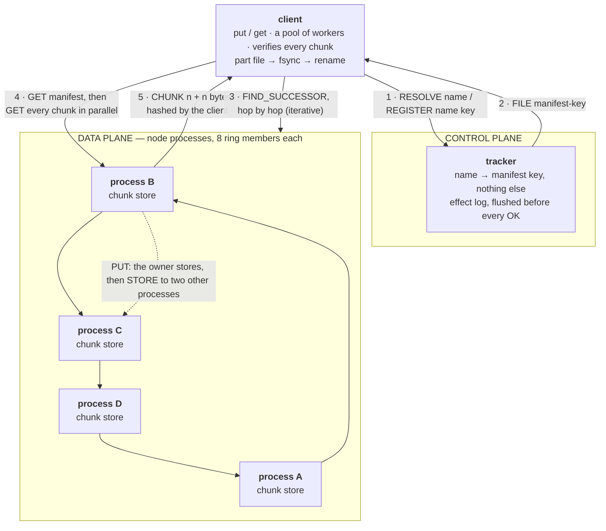
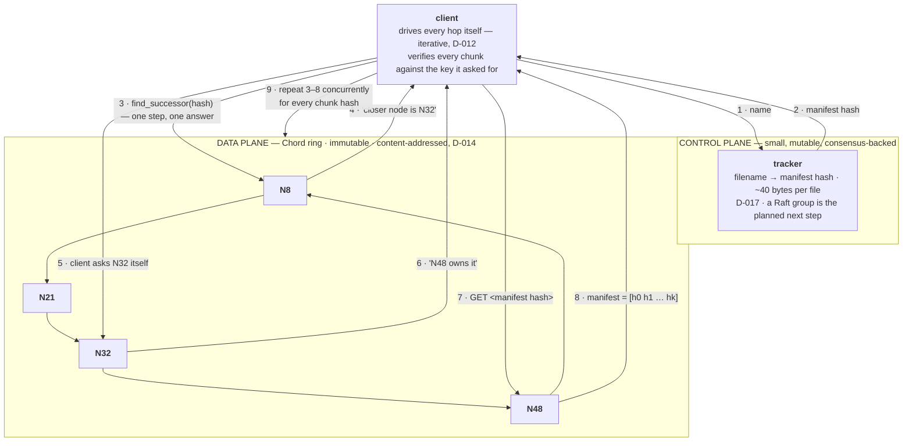

# chord-dht-filesystem | C++17

> Fault-tolerant distributed file storage — content-addressed chunks placed on a Chord ring and
> replicated three ways, under a small tracker that holds only file names.

> [!NOTE]
> **Files now move through the ring end to end:** a file is cut into chunks, stored three times on a
> Chord ring, named in the tracker, and fetched back in parallel with every chunk verified. This
> repository began as an operating-systems course assignment — a BitTorrent-style file sharer — and
> was rebuilt into distributed storage one recorded decision at a time; the coursework code is in the
> history. Every row in the table below was verified by a script at the commit it names — nothing is
> claimed to work that has not been run.
>
> An earlier version of this file claimed multi-tracker synchronisation. That feature was never
> implemented — `connect_to_peer()` was defined and never called. It was removed rather than
> left to be discovered.

---

## Status

Verified by running the scripts in the Evidence column on the machine described in
[`BENCHMARKS.md`](BENCHMARKS.md): the routing suites at `29a829c` (13 Sep 2026), the lookup and churn
suites on 7 Oct 2026, the chunk-plane suites on 8 Oct 2026, and the file-transfer suites on 8 Oct 2026.

| Component | State | Evidence |
|---|---|---|
| Build | **Works.** `tracker`, `node`, `client`, `chunk` and `lookup` build clean, zero warnings | `make clean && make` |
| Files through the ring | **Works**, 378 MB/s for 100 MB at 8 workers ([`BENCHMARKS.md`](BENCHMARKS.md) §5). Upload cuts a file into 512 KiB chunks, stores each through its owner with `W` confirmed copies, stores the manifest (a tree of manifests above 4 GiB), then registers the name. Download fetches and checks the manifest, fetches every chunk in parallel with replica fall-through, writes a part file, flushes it and renames it into place | `make check` — `test-transfer`, 87 checks · `scripts/e2e-transfer.sh` — 8 processes: a node killed mid-download, a corrupt copy, a chunk lost everywhere, the client killed mid-download, two identical uploads at once · `scripts/e2e-edge.sh` — 0 bytes to 3 MB across the chunk boundary, 7/7 |
| Tracker — the namespace | **Works.** Name → manifest key, written once; an effect log flushed before every `OK`, self-checking records, torn records detected and cut off at start-up | `make check` — `test-names`, 39 checks · `scripts/e2e-persistence.sh` · `scripts/e2e-framing.sh` · `scripts/e2e-hangup.sh` |
| A slow or silent peer | **Handled.** A node or the tracker gives every request line and every body a deadline, enforced against the time remaining, so a peer trickling bytes cannot hold a memory slot or a thread | `make check` — `test-net`, 37 checks · `scripts/e2e-deadline.sh` |
| One-command local cluster | **Works** | `scripts/cluster.sh up`, driven by `scripts/e2e-smoke.sh` |
| Container image and compose file | **Written, not yet run** — the development machine has no Docker | `Dockerfile`, `compose.yaml` |
| Continuous integration | **Written, not yet run** — runs once the repository is pushed | `.github/workflows/ci.yml` |
| Chord identifier arithmetic, finger tables, closest-preceding-finger routing | **Works** on a fixed ring. Every lookup reaches the correct owner, and every hop count matches an independent model of the finger rule | `make check` — 127 + 15 unit checks · `scripts/e2e-node.sh` — real 8-node ring, 1808 lookups |
| Chord lookup originator (`lookup`) | **Works** on a fixed ring. Follows `NEXT` to `OWNER`, checks every reply for progress, and reports a refused, timed-out or garbled node by name | `make check` — 70 lookup checks against correct, lying and broken rings · `scripts/e2e-chord.sh` — real 16-node ring, 4000 lookups, one node killed, one frozen |
| Chord joins, stabilisation, failure handling | **Works.** Nodes join through any member, a background thread runs stabilise, notify and finger repair, a refused node is evicted at once and a silent one after two strikes, and a node that loses everyone it knew stops routing and rejoins | `make check` — 97 in-process checks: every round order of two joins between the same pair, kills, freezes, a fast restart, collisions, 200 random churn histories · `scripts/e2e-churn.sh` — 22 checks on real processes, also run under ThreadSanitizer · repair time measured in [`BENCHMARKS.md`](BENCHMARKS.md) §4 |
| Chunk storage, replication, virtual nodes, repair | **Works.** Chunks are files written atomically and flushed; a write is coordinated by the owner and acknowledged after `W` copies on distinct processes; reads check the hash and fall through to the next replica; a process is 8 ring members by default; a dead process's chunks are re-replicated by their new owners, and a scrub replaces copies that rot on disk | `make check` — 105 chunk-plane checks · `scripts/e2e-chunk.sh` — 6 processes × 4 members: corruption, two of three replicas killed, hostile requests, repair · also under ThreadSanitizer · [`BENCHMARKS.md`](BENCHMARKS.md) §6 |
| Coursework tracker, users, groups, peer-to-peer piece transfer | **Retired in Phase 5.** In the history; its transfer baseline is reproducible at `e381179` | [`BENCHMARKS.md`](BENCHMARKS.md) §1 |

Known open defects are listed under [Limitations](#limitations-and-future-work); full
reproduction steps for every one are in [`docs/failures.md`](docs/failures.md).

---

## Overview

**Distributed file storage.** A file is split into 512 KB chunks. Each chunk is named by the
SHA-1 hash of its own contents, and stored on the Chord node that owns that hash and on the next
two nodes around the ring. A small tracker maps each human-readable file name to the hash of the
file's manifest — the list of its chunk hashes — and knows nothing about where chunks live,
because their location is computed rather than stored. A client that wants a file asks the
tracker for one hash, routes to the chunks itself in O(log N) hops, fetches them in parallel from
their replicas, and verifies every chunk against the name it asked for.

**Where it came from.** This began as a BitTorrent-style file sharer, where each participant
served pieces it had downloaded and a tracker listed who held what. An audit of that system
found twenty defects and two structural weaknesses — a tracker that was a central index of every
holder, and files that vanished when their seeders left — and fixing those one decision at a time
turned it into storage. The trade is stated rather than hidden: a swarm gains serving capacity as
a file gets popular, and this system does not. A file has three copies however many people want
it, and in exchange it survives every one of its uploaders going offline.

- **What it does:** distributes file chunks across a ring of nodes, routes lookups in O(log N)
  hops, replicates each chunk on the first three distinct processes after its owner, repairs routing state after failures, and
  transfers chunks in parallel with per-chunk integrity verification.
- **What makes it non-trivial:** the routing state has to stay correct while nodes join and die
  underneath it. Chord's guarantee is that lookups remain *correct* as long as successor
  pointers are correct, even when every finger table is stale — separating correctness from
  performance is the whole design.
- **What it deliberately does not do:** no storage engine (chunks are files on disk), no NAT
  traversal, no wire encryption or authentication, no incentive mechanism. Reasoning for each:
  [`ARCHITECTURE.md`](ARCHITECTURE.md) § Scope boundary.

---

## Results

### Files move through the ring 5.4× faster than the system it replaced — 3.7× from parallelism alone


Measured 8 Oct 2026 at commit `2e7c445`: every repetition a fresh tracker and ring of 16 `node` processes × 8 virtual
nodes, a file uploaded and downloaded with the real client, and compared by SHA-1 — all 116 transfers came back
identical. Medians of 5:

| 512 KiB chunks | 1 MB | 10 MB | 100 MB |
|---|---:|---:|---:|
| The coursework single-seeder system, **re-run the same day** at its own commit | 17.9 MB/s | 54.7 | 70.1 |
| The ring, 1 worker | 73.3 | 123.9 | 103.2 |
| **The ring, 8 workers** | **101.8** | **313.2** | **378.2** |

- **Two comparisons, because they say different things.** Against the old system the ring is 5.4× faster at 100 MB —
  but the ring, three replicas, per-chunk hashing and parallelism all changed at once. Holding everything else fixed,
  **parallelism alone is 3.7×** (1 worker against 8 on the same ring).
- **Timed the way the old system was:** to every chunk verified and written. The new client then flushes and
  renames the file (67 ms at 100 MB); with that and process start-up, 293 MB/s.
- **Eight workers was chosen by a rule fixed before measuring** — the smallest power of two within 10 % of the best —
  and it is the core count: past it, workers queue for CPU and each chunk's latency more than doubles. Per chunk at
  8 workers: **p50 9.4 ms, p99 31 ms**.
- **Uploads: 77 MB/s** at 100 MB, every chunk on two flushed copies before it counts (W = 2).


- **Chunk size matters on loopback, against the prediction.** From 64 KiB to 8 MiB throughput rises from 100 to
  536 MB/s: each chunk pays a lookup and fresh connections whatever its size. 512 KiB stays the default — it is what the
  comparison is pinned to, and larger chunks cost memory, recovery granularity and deduplication that loopback cannot
  show.
- **Deduplication, measured where it fails:** an identical file shares everything, a 1 KiB edit shares 199 of 201
  chunks — and twenty real commits of this repository, as tar files, share **1 chunk of 97**, because fixed-size chunks
  never realign after an insertion.
- **The tracker is O(files):** 77 bytes of log per name, ~200 registrations a second (one flush each).

Method, every table and the limits: [`BENCHMARKS.md`](BENCHMARKS.md) §5.

### Lookup hop count tracks ½ log₂ N, from 2 nodes to a million


Measured 7 Oct 2026 at commit `e042857`. 380,928 lookups over 93 rings, every owner checked
against an independent oracle:

| Ring size | How it ran | Mean hops | ½ log₂ N | 99th percentile |
|---:|---|---:|---:|---:|
| 2048 | real `node` processes, lookups over TCP | **5.38** | 5.5 | 9 |
| 1,048,576 | in process, the same routing code | **9.87** | 10.0 | 15 |

- **A hop is a finger followed**, which is the Chord paper's path length and one less than the
  number of requests the client sends.
- **Real processes stop at 2048**, a ceiling derived from measured per-node memory (about
  0.95 MiB proportional set size per node), not chosen.
- **Beyond that, `sim-hops` replays the same code in one process**: the same membership parser,
  finger builder, routing step and lookup loop, with a function call where the socket was. On every
  real ring it reproduced all 135,168 lookups exactly, owner and path.
- **The mean sits 0.10–0.19 hops below ½ log₂ N at every size from 32 nodes up.** That offset is
  measured and not yet explained.

Method, ring-to-ring spread and memory figures: [`BENCHMARKS.md`](BENCHMARKS.md) §2.

### A killed node is repaired out of the ring in well under a second


Measured 7 Oct 2026 at commit `b171554`: 130 runs, each a fresh ring of real `node` processes. After every
kill a test harness — never the nodes — computes what each survivor should hold from the surviving addresses
alone, and polls until reality matches:

| One node killed, 64 nodes, 1 s stabilisation period | Median | Fastest – slowest |
|---|---:|---:|
| **ring correct** — every successor and predecessor right | **0.63 s** | 0.17 – 1.03 s (10 runs) |
| successor lists correct | 3.48 s | |
| every finger table correct | 5.32 s | |

- **The period was chosen by a rule fixed before measuring**: the longest period at which at least 9 of 10 runs
  repair the ring within 1 s. That is 1000 ms, at 0.44 % of a core per idle node.
- **Repair time does not grow with the ring**: 0.42–0.56 s from 16 to 128 nodes. With k nodes killed at random, the
  ring waits for the slowest of k predecessors' next rounds, close to the predicted T · 0.5^(1/k).
- **Losing a node's whole successor list now costs no more than one death**: 8 adjacent deaths went from 1.49 s
  (worst 4.1 s) to 0.36 s, and 9 from 2.99 s (worst 7.6 s) to 0.67 s, after stabilisation was changed to run to
  its fixed point within a round instead of one step per period.
- **Under lookup load, finger repair speeds up from 4 s to 0.3 s**, because a client that reaches a dead node
  reports it to the node that named it. Of 28,790 lookups issued during and after kills, none failed, and the only
  wrong answers named the dead node in the fraction of a second before its predecessor noticed.
- **Stated limit:** at 256 nodes, 3 of 55 runs wrongly evicted live nodes. Re-run with logs kept, each was a
  5–9 s machine-wide stall in the kernel during which no process on the host could answer — the detector evicting
  peers silent for seconds, as designed, on a host running 256 processes on eight cores (`BENCHMARKS.md` §4a).

Method, every table, the calibration behind the deadline, and the two earlier versions of the selection rules
that failed: [`BENCHMARKS.md`](BENCHMARKS.md) §4.

### Chunks are stored three times on three processes, evenly, and come back in about two seconds


Measured 8 Oct 2026 at commit `7d99fc0`, rings of real `node` processes each with its own on-disk chunk store,
every placement checked by an oracle in the test harness:

| | Result |
|---|---|
| **Load balance** — busiest of 64 processes against the mean | **1.52×** with 8 virtual nodes per process, against 2.80× with one (median of 20 address sets) |
| **Simulation against reality** — 2,000 chunks on 16 real processes | every store held **exactly** the number of chunks the simulation predicted, with 1 and with 8 virtual nodes |
| **Re-replication** — one of 16 processes killed, 300 chunks of 512 KiB | every chunk it held back on three correct live processes in a median of **2.2 s** (1.8–2.9 s, 5 runs) |
| **W with one replica dead** | W = 2 acknowledged **300/300** writes; W = 3 **244/300** until the ring evicted it |
| **W = 1's price** | answers in 14 ms against 31 ms for W = 2, but each acknowledged chunk sits on one disk for about 18 ms; killing the coordinator at the acknowledgement left no other copy in 20 of 20 trials |

- **The number of virtual nodes was chosen by a rule fixed before measuring**: the smallest power of two for which
  copies stored per process vary by at most 0.25 of the mean, at 16 and 64 processes. That is 8, now the default. Each
  virtual node costs about half a percent of a core in background maintenance.
- **W = 2 and W = 3 cost the same while every replica is healthy** (31 vs 32 ms per flushed 512 KiB write) — on
  loopback both replicas are equally fast. W only shows its price when a replica is slow or dead.
- **Stated limit:** one host. Spreading repair over more processes did not make it faster here, because every process
  shares the same cores and disk; the claim is the time, not a speed-up.


Method, every table, the coordinator-crash test and the limits: [`BENCHMARKS.md`](BENCHMARKS.md) §6.

### Single-peer transfer baseline — the "before"

Measured 9 Sep 2026 at commit `e381179` (re-run on 8 Oct at the same commit: 17.9 / 54.7 / 70.1 MB/s), 512 KB pieces, one
seeder, all processes on one host. Median of three runs, each with fresh processes:

| Transfer | Median | Throughput |
|---|---|---|
| 1 MB | 0.048 s | 20.9 MB/s |
| 10 MB | 0.216 s | 46.2 MB/s |
| 100 MB | 1.404 s | **71.2 MB/s** |

Throughput more than triples from 1 MB to 100 MB because the per-transfer fixed cost — a tracker
round trip, a connection to the seeder, a manifest parse — is amortised over more bytes, not
because the transfer speeds up. With one seeder the worker pool runs a single thread, so this is
a **sequential** baseline; it is the "before" for the parallel chunked transfer above, and it was
re-run from its own commit for that comparison, since the code it measured has since been retired.

Method, the wide run-to-run spread, and the reasons this number flatters the system (loopback,
warm page cache, shared cores) are in [`BENCHMARKS.md`](BENCHMARKS.md) §1 — including the first
version of the harness, which reported 165 MB/s because it timed `ftruncate` rather than the
transfer.

Planned curves, and the design question each settles, are listed in
[`BENCHMARKS.md`](BENCHMARKS.md) § Curves worth having. Method, commit fingerprints and the
measurement environment — including a frank list of the distortions that come from running every
peer on one laptop — are recorded there **before** any number is taken.

---

## Architecture — as it exists today



**Upload:** the client cuts the file into 512 KiB chunks and stores each through its owner, which keeps a
flushed copy and forwards two more to the next two distinct processes, answering once `W` copies exist.
Then the manifest is stored the same way, and only then is the name registered — a name never points at a
file that is not all there. **Download:** ① ② the name becomes a manifest key; ③ ④ ⑤ the client routes to the
manifest and then to every chunk concurrently, hashing each; a chunk whose copy is corrupt or whose holder is
dead is read from the next replica. Chunks are written into a part file that is flushed and renamed into
place only when complete.

Diagram-as-text on purpose: it renders on the repository host, it diffs in review, and it cannot
silently drift out of date the way an exported image does.

---


## Target architecture — the system the design decisions describe

Drawn **after** the design decisions were made: a diagram drawn earlier would have decided them
by implication. Kept as diagram-as-text so it diffs in review and cannot drift from the design.



The arrows inside the ring are **successor pointers**. They are the only routing state that has
to be correct; everything else is an accelerator.

**Reading the path.** Steps 1–2 are the only time the tracker is involved, and it returns 40
bytes. Steps 3–6 are the iterative lookup: each node answers *one* question and returns
immediately, and the **client** opens the next connection — which is what makes hop count a
number the client observes rather than one the ring reports. Steps 7–8 fetch the manifest, which
is itself just a chunk. Step 9 repeats the whole lookup-and-fetch for every chunk hash, issued
**concurrently**, because content addressing means consecutive chunks of one file live on
unrelated nodes and there is no locality to walk.

**What each node holds**, in strict order of how much it matters:

| Structure | Carries | If stale or wrong |
|---|---|---|
| **successor pointer** | correctness | wrong answers, returned confidently, undetectable |
| **successor list** (`r ≈ log₂N`) | survival of failure — **and it is the replica set** | node orphaned only if *all* `r` die within one period |
| **finger table** (`m` rows, ~`log₂N` distinct) | speed only | more hops, never a wrong answer |
| **predecessor** | knowing its own arc; joins | joins stall until repaired |
| **chunk store** | the data, keyed by `SHA-1` of its own contents | a failed hash check at the reader; try the next replica |

**What runs in the background on every node**, forever: `stabilize` every `T` seconds (asks the
successor for its predecessor, tightens the pointer, `notify`s), `fix_fingers` (refreshes one
finger per round), and `check_predecessor`. Failure detection rides on these plus **any** failed
call to the successor from any code path (D-013). Nothing is event-driven; everything is
re-derived, so the ring converges from any state.

**What this diagram deliberately does not show**, because they do not exist yet: the Raft group
behind the tracker (planned, not built). Each node in the drawing is a process with several
ring members (virtual nodes), and a chunk's three copies are on three different processes.

## Key Design Rationales

The section that turns a repository into an argument. Written from the decision log in
[`ARCHITECTURE.md`](ARCHITECTURE.md).

### Chunks are content-addressed, which deletes the conflict problem

A chunk's key in the ring is `SHA-1` of its own contents. Two replicas therefore cannot disagree:
the value at a key is by definition the bytes that hash to it. There is no newer version, so the
data plane carries **no versioning, no vector clocks and no conflict resolution** — not because
they were solved, but because the key was chosen so they cannot arise. Reads are self-verifying,
since the client hashes what arrived and compares it to the key it requested, and identical
chunks across different files deduplicate for free.

This is why the quorum rule `W + R > RF` does not appear in this system. That rule guarantees a
read set overlaps a write set *so a read sees the latest version*; with immutable values there is
no latest version, so `W` and `R` decouple — `W` buys durability, `R` buys availability, and they
are set independently.

**Rejected:** keying chunks by `(file_id, chunk_index)`, which is closer to the original
protocol. It makes the value at a key mutable, which brings back conflicting replicas,
versioning, clock skew and read repair — choosing to have a consistency problem.

**Cost:** no in-place update (a changed file produces new keys, and the superseded chunks are
garbage; there is no collector, which is a stated scope boundary), and no influence over
placement at all.

The consistency/availability discussion is not lost — it **moves to the metadata**, which is
genuinely mutable and is the plane replicated by consensus. The system sits in two places on
purpose: available and conflict-free on the data path, consistent on the control path.

### The tracker is a mutable namespace over an immutable store

A chunk's location is computable — it lives at `successor(SHA-1(chunk))` — so the tracker holds
no placement information at all. What the ring cannot tell you is which chunks make up a file and
in what order, so the tracker holds exactly that, in its smallest possible form:
`filename → manifest hash`, about 40 bytes per file. **The manifest itself is a content-addressed
object in the ring**, fetched by an ordinary lookup, which means it inherits replication,
availability and the hash check for free.

This is Git's data model: content-addressed immutable objects with a small mutable namespace on
top. Only the namespace needs consensus — human names change, content does not.

**Rejected:** the tracker holding placement. It creates two systems that can disagree about where
a chunk lives, where one of them is right by construction and the other is a cache that goes stale
on every join and failure — and it re-centralises the thing the ring exists to decentralise.
**Rejected:** the tracker holding full manifests. Its state, and therefore the consensus log,
would grow with total chunk count rather than file count.

**Cost:** one extra round trip, and the tracker becomes required for discovery, since a manifest
hash means nothing to a human. That centralisation is accepted deliberately — it is the one
component made highly available with consensus rather than wished away.

### Lookups are iterative, and that is a measurement decision

A lookup is driven by the originator: each node answers "I am the owner" or "here is someone
closer" and returns immediately, and the client opens the next connection itself. The Chord
paper's pseudocode is recursive — a node forwards on your behalf and the answer returns down the
chain.

The reason is that the routing layer's headline number is **hop count against ring size**. Under
iterative routing the client counts its own loop iterations, so the instrument sits outside the
system being measured. Under recursive routing the ring reports its own hop count and the plot
shows what the system says about itself. The same property gives exact failure attribution — a
node times out and the client knows which one — which is what the failure-recovery phase is
built on.

**Rejected:** recursive. Lower latency and NAT-friendly, but it costs nested timeouts across the
path, removes failure attribution, makes hop counts self-reported, and — in a thread-per-
connection TCP codebase — holds a blocked thread on every node in the path for the duration of
every lookup.

**Cost:** two network traversals per hop instead of one, so roughly double the lookup latency.
Nearly free on loopback, which is where these benchmarks run and which is declared as a
distortion at the top of [`BENCHMARKS.md`](BENCHMARKS.md). The fix for a real deployment is a
short-TTL lookup cache at the originator, not a different routing model: a stale hint costs one
wasted hop and self-corrects, because a routing hint is validated before use and can only ever
cost hops, never correctness.

### `W = 2` — an acknowledged write is a true statement

Every chunk exists on three nodes: its owner and the owner's first two successors, which the
successor list already names. A write is acknowledged once the owner **and at least one
successor** hold it; the third copy propagates in the background. Reads consult one replica and
fall through to the next on a failed hash check.

The owner writes locally and sends to both successors in parallel, so `W = 2` waits for the
*faster* of the two while `W = 3` waits for both — one slow peer would otherwise set the latency
of every write.

**Rejected:** `W = 1` with background propagation. Faster and always available, but an
acknowledged write can be lost if the owner dies before propagating — a system that lies about
durability. **Rejected:** `W = 3`. It buys protection against a second simultaneous failure by
making writes fail during every first one.

**`W` is a runtime parameter, not a constant.** Sweeping it from 1 to 3 produces write latency
and write-success-under-kill as a measured curve, which is what turns "where does this sit on the
consistency/availability trade-off, and how would you flip it?" from an opinion into a plot.

**Cost:** between acknowledgement and background propagation the advertised replication factor of
three is briefly untrue, so that window is measured rather than assumed. If both successors are
unreachable the write fails loudly, which is the correct behaviour given the alternative.

### A refused connection is proof; a timeout is only a suspicion

Failure detection reuses traffic the system already sends. Stabilisation's periodic call to the
successor is the floor, and on top of it **every** other code path that talks to the successor —
lookups, `notify`, chunk transfers — reports its failures to the same detector instead of
discarding them. Detection time is therefore `min(next stabilise, next natural traffic)`:
near-instant on a busy ring, degrading to plain stabilisation on an idle one, where nobody is
affected by the delay.

The two failure signals are not merged. `ECONNREFUSED` means the far kernel sent a reset and
nothing is listening — proof, so the node is evicted at once. A **timeout** is ambiguous between
dead, slow, and packet loss, so it marks the successor suspect and needs a second failure or
confirmation from the next stabilisation round.

**Rejected:** active heartbeats. They buy a bounded detection time, and charge permanent
background traffic, two more tuning constants, and designed-in false positives — a slow node
evicted while still serving. They would also have misfired *here specifically*: every peer in a
test ring shares the same 8 cores, so aggressive heartbeats would manufacture node deaths that
are an artefact of the test rig rather than a property of the system.

**Also rejected:** a phi-accrual detector (Cassandra's adaptive suspicion level). It is the better
answer on a real network and the wrong one on loopback, which has no jitter for it to adapt to.

**Cost:** detection time is a distribution rather than a constant, so reconvergence is published
as two numbers — under load and idle — instead of one.

### 512 KB chunks — pinned for the comparison, swept for the justification

The build uses 512 KB chunks because the Phase 0 baseline was measured at 512 KB, and the
headline transfer claim is parallel transfer *against that baseline*. Changing chunk size at the
same time as adding parallelism would move two variables and make the improvement
unattributable. Chunk size is therefore held constant for the before/after and swept separately,
with parallelism fixed, across `{64 KB, 256 KB, 512 KB, 2 MB, 8 MB}` — five points rather than
three, because three cannot distinguish a curve with a knee from a straight line.

**Rejected:** 64 KB. Chunk count here is a *routing* cost, not only an I/O cost — lookups are
iterative, so each costs two traversals per hop, and a 100 MB file at 64 KB is 1,600 chunks and
roughly 14,400 round trips of pure lookup before any payload moves. **Rejected:** 4 MB. It would
make the deduplication claim theoretical, since a 4 MB span rarely repeats across files.

**Stated in advance:** on loopback this curve may come out nearly flat, because there is no
network latency for larger chunks to amortise. If it is flat, that is the published result.

**Measured, and the prediction failed:** the curve is not flat. On a 16-process ring at 8 workers, 100 MB moves at
100 MB/s in 64 KiB chunks and 536 MB/s in 8 MiB chunks, because every chunk pays a multi-hop lookup over fresh
connections whatever its size. 512 KiB stays: it is what the before/after is pinned to, and what larger chunks cost —
memory per in-flight chunk, the size of a re-fetch, deduplication granularity, one slow holder stalling more of a file —
is what loopback cannot show (`BENCHMARKS.md` §5).

### The ring is 64 bits wide; keys stay 160 bits wide

A chunk's **identity** is the full 160-bit `SHA-1` of its contents — that is what a reader
re-hashes to verify what came back, and what a node stores it under. A chunk's **placement** is a
separate question, and the ring uses only the top 64 bits of that digest to answer it. Truncation
is applied to the address, never to the key, so verification is untouched. Two chunks sharing a
ring point simply route to the same node, which already holds many keys that share nothing but an
arc.

The deciding argument is what a bug would do rather than how much code it is. Unsigned overflow in
C++ is *defined* to wrap modulo 2ⁿ, so at 64 bits the ring is the machine word and `n + (1ULL << i)`
is ring arithmetic with the carry discarded by the hardware. At 160 bits the same finger offset is
a hand-written carry loop — and because the finger table is **self-validating**, a carry bug there
produces wrong fingers, correct answers, no crash, and a **silently inflated hop count**. Hop count
is the entire output of the routing phase, so hand-written arithmetic underneath it was refused.

Two nodes sharing an identifier is the collision that matters, because the interval test evaluates
the arc `(n, n]` as the whole ring — so a node whose successor shares its id concludes it owns
every key. The system therefore answers *"am I alone?"* by comparing **addresses, not
identifiers**; the operating system guarantees `ip:port` uniqueness far more strongly than a hash
does.

**Rejected:** the full 160 bits, as the Chord paper specifies — on the silent failure mode above.
**Rejected:** `unsigned __int128` — a compiler extension with no stream operator, buying headroom
that is already unreachable. **Rejected on a number:** 32 bits, where Phase 4's virtual nodes give
~100,000 identities and a **69%** chance of a node collision — it would have worked until virtual
nodes landed and then broken subtly.

**Checked rather than assumed:** ~100,000 identities in 2⁶⁴ collide with probability ≈ 3 × 10⁻¹⁰.
Cassandra's default partitioner ships 64-bit tokens in production clusters of thousands of nodes.

### Deleting a file is two problems, and the obvious version destroys other people's files

Removing a file's **name** is what a user means by delete. Freeing its **chunks** is what stops
storage growing forever. The obvious implementation — delete every chunk in the file's manifest —
is wrong, because identical content is stored once. Two people who upload the same movie share
every chunk, so one person's delete would destroy the other's file. And with no access control, a
plain delete command would let anyone remove anyone's file.

**The design, scheduled after the MVP rather than built for it:** at upload the tracker returns a
random **owner token**, which delete requires. Chunks are reclaimed by **mark and sweep**, as
`git gc` does: everything reachable from a live name's manifest is kept, and anything else older
than a **grace period** is deleted. The grace period protects an upload whose chunks are stored
but whose name is not yet registered. A node that misses a sweep keeps its garbage until the
next one — a leak, never data loss.

**Rejected:** per-chunk reference counts. They put mutable, three-times-replicated state back into
a data plane designed to be immutable, and a badly timed crash can delete a chunk still in use.

### Distributed storage, not a file-sharing swarm

Placement is decided by a chunk's hash, every chunk has exactly three copies, nothing records who
holds what, and clients do not serve. Together those make this **storage** — closest to Dynamo for
placement and Git for the data model — rather than BitTorrent.

Is it peer-to-peer? In Chord's sense, yes: nodes are symmetric and there is no central index of
data. In BitTorrent's sense, no.

**The cost:** capacity no longer grows with popularity. **The gain:** a file outlives its
uploaders, reads verify themselves, and identical content is stored once.

**Rejected:** making downloaders serve the chunks they fetch, which would need an index of extra
holders — the thing the tracker was designed not to be. **Rejected in hindsight:** trackerless
BitTorrent, which puts peer lists rather than data into a DHT, so availability still depends on
seeders staying online. That alternative was not weighed when the design was made, and the
reasoning is recorded as after-the-fact rather than presented as deliberation.

### The ring is wired from a membership file that no node keeps

On the fixed ring used for the routing benchmark, each node starts with a file listing every
member, computes its successor, predecessor and 64 finger entries from it — and the list is a
**local variable inside the bootstrap function**, destroyed by scope when that function returns.
It never becomes node state. At the moment any lookup is served, the process does not hold the
membership, which is what makes the hop count a measurement of routing rather than of a lookup
table.

This is a deliberate split of two experiments: routing is measured against a **correct** table
here, and whether stabilisation *converges* to a correct table is measured separately once joins
exist — one controlled variable each, with this figure as the baseline the churn numbers degrade
from.

It is also a memory argument, and memory bounds the ring size the curve can reach. At 8192 nodes
the finger tables routing reads cost ~21 MB; retained membership lists would cost ~2.7 GB.

**Rejected:** building the tables by real lookups at startup — it entangles bootstrap failure with
routing failure in the phase whose only output is hop count, and degenerates to O(N) successor
walks before any finger exists. **Rejected:** having the harness compute every node's table, which
creates two implementations of the finger rule that can silently disagree.

**Kept deliberately outside the node:** the "did I reach the true owner?" oracle lives in the test
harness, which has the membership list and computes the answer independently. The checker must not
be the thing being checked.

### Only the successor pointer decides ownership

A node answers a lookup from one test: is the identifier in `(me, successor]`? If so, its successor
owns it; otherwise it names a closer node. It deliberately does **not** also claim keys in
`(predecessor, me]`. That shortcut fires only when a client's first contact happens to be the owner,
about one lookup in N. It would also make the predecessor correctness-critical, so a stale
predecessor could claim keys it does not own. Keeping ownership on the successor alone preserves
the property that every other piece of routing state can be stale at the cost of hops, never of
correctness.

Lookups carry the 64-bit **routing identifier**, not the 160-bit key. Routing only ever asks which
node, and the finger-repair lookups of later phases target ring positions that no key maps to.

### The lookup loop never touches a socket directly

The originator's loop — ask a node, follow `NEXT`, stop at `OWNER` — lives in its own module, and
the one operation "send this line to this peer and return the reply" is passed in. Real sockets
supply it in the `lookup` tool and, later, in `client`; tests supply a ring built in process. The
cases that most need testing — a reply that points backwards, a node that names itself, a garbled
reply — cannot be produced by a correct ring of real processes, but are a few lines of constructed
data this way.

**Rejected:** writing the loop directly into a binary, which could only be tested through real
sockets and would be copied into `client` later.

Each hop currently opens a **fresh connection**. Hop count is what this phase measures, and
connection handling cannot change it; a fresh connect also gives one unambiguous failure signal per
node, because a refused connection is proof nothing is listening. **Rejected:** a connection cache,
where a dead node surfaces as a reset or end-of-stream on a previously good socket and must be
re-probed to be told apart from a stale one. **Cost:** a handshake per hop, and `TIME_WAIT` sockets
that can exhaust ephemeral ports under sustained load on a real network. Reuse will be added with a
measured before and after, if latency needs it.

**Every reply must make progress.** A `NEXT` has to name a node strictly between the one asked and
the key, and an `OWNER` has to be a node the key falls before. Correct routing passes this even with
stale tables, so a violation names a faulty node, and because the distance strictly shrinks, a
lookup cannot cycle. A cap of 65 requests backs it up. It is derived, not chosen: with correct
fingers each jump covers more than half the remaining distance in a 2⁶⁴ space. **Rejected:** an
arbitrary hop cap, or a visited set, neither of which says which node misbehaved.

Every originator socket has a **5 s receive and send timeout**, reported separately from a refused
connection, because a refusal is proof nothing is listening and a timeout is only suspicion. It is
a hang guard, not a failure detector.

### The timeouts are set before the handshake

On Linux a blocking `connect` honours the send timeout, so setting both timeouts **before**
connecting means a host that never answers costs 5 s rather than the kernel's default of about two
minutes of SYN retries. Checked on this machine: a non-answering address gave up after 2.01 s with a
2 s timeout set first, and was still blocked at 8 s without it. The expiry surfaces as
`EINPROGRESS`, which is reported as a timeout, never as a refusal.

**Rejected:** setting them after `connect`, which keeps the two-minute hang for nothing; and a
non-blocking `connect` with a `poll` deadline, which is portable to other kernels but behaves
identically here for about 45 minutes more code. **Cost:** the behaviour is Linux-specific, and one
deadline covers connect, send and receive.

### A hop is a finger followed

The loop records **every node it queried**. The hop count reported in results is the number of
`NEXT` replies followed, which is **requests − 1**; both counts are kept in the raw data. That is
the Chord paper's path length: its explanation of the ½ log₂ N mean counts fingers followed from a
query's starting node, and in this design the originator's first request only reaches that starting
node. Counting requests instead would put every point about one above the paper's curve, a gap
produced by definitions rather than by routing.

**Rejected:** plotting requests. They are what a client pays in round trips, so they are reported
alongside, not discarded.

### The hop-count curve goes past what fits in memory, and shows where

Hop count is a deterministic function of the membership, the start node and the key, so the curve
has two series. Real `node` processes, queried over TCP, run up to a ring size derived from measured
per-node memory. Past that, `sim-hops` runs the **same** code in one process: `parse_members`,
`build_fingers`, `route_step` and the `lookup()` loop, with a function call where the socket was. It
goes to 2²⁰ nodes. Every real ring is also replayed through `sim-hops`, and every lookup must come
back with the same owner by the same path, node for node.

**Rejected:** real processes only, where the curve stops at this laptop's memory; simulation only,
which never touches the running system; and a faster purpose-built simulator, which would be a
second implementation of the finger rule that could disagree silently. **Cost:** the simulated
series measures routing, not the network, and is labelled as in-process.

### An identifier collision stops a node from joining

A joining node looks up its own identifier. A node with the same identifier would be that
identifier's owner, so if the owner returned has the same identifier at a different address, the
new node refuses to start and names both addresses. Separately, no node ever adopts a peer that
carries its own identifier at another address, because the interval test reads `(n, n]` as the
whole ring and the node would conclude it owns every key.

**Rejected:** re-hashing with a salt, which makes the identifier no longer a function of the
address, so every test oracle would need each node's salt from the node itself; and ignoring
collisions, which fail silently. **Cost:** an operator restarts the node, at a probability of
about 3 × 10⁻¹⁰ for 100,000 identities; and two colliding nodes joining at the same moment are
contained by the adoption rule, not repaired.

### A node joins through any node it knows, and listens only afterwards

`node <ip> <port> --join <known-ip:port>` looks up the new node's own identifier through the known
node, using the same lookup loop as the client, and the owner becomes its successor. The background
thread does the rest: stabilisation tightens the predecessor's pointer onto it, `NOTIFY` makes the
successor accept it, and finger repair fills its table. `--create` starts a ring of one.

The joining node **starts listening only once it has a successor**. A node restarted at its old
address before the ring has noticed its death is still named by its predecessor; if it answered
while it still believed it was alone, it would claim every key. Not listening means its old entry is
refused, which is proof of death, so the ring evicts it and the join is retried.

The Phase 2 fixed ring (`node <ip> <port> <membership-file>`) is kept unchanged, because the
hop-count result is defined on it. A fourth mode, `--wired <file>`, starts from that correct state
and then maintains it: the reconvergence benchmark starts there, so it measures recovery from a
kill rather than recovery from a mass join as well. **Rejected:** building every ring by joins,
which would make the benchmark's starting state itself a convergence experiment. **Cost:** four
start modes to test.

### One lock per node, never held across a network call

A node's predecessor, successor list and fingers sit behind one mutex. Request handlers hold it for
microseconds — to run the routing decision or copy an address — and the background thread holds it
only to copy state before a call and to apply the result after. **No thread holds it while talking
to another node**, so a frozen peer can delay one maintenance round but never a lookup. The price
is the check-then-act gap: state can change while a call is in flight, so every result is applied
only if the state it was based on is still current, and is otherwise asked for again next round.

**Rejected:** a reader-writer lock, which buys concurrency for readers that barely hold the lock;
and copy-on-write snapshots, which copy the whole state on every update and in C++17 sit on a
hidden lock pool anyway. Checked with a ThreadSanitizer build of the node driven through the churn
suite.

### Four new messages, and a client cannot evict anyone

Stabilisation adds `NEIGHBOURS` (the successor's predecessor and successor list in one reply, from
one consistent snapshot, so one round trip per period instead of the paper's two) and `NOTIFY`
("I believe I am your predecessor"). Originators add `SUSPECT <ip> <port>`, a report that a node
could not be reached. It is a hint: the receiver probes the named node itself and evicts it only if
its own connection is refused, so a client can cause a ping but never an eviction. `FINGERS` is
read-only and exists so the test harness, not the node, decides whether a finger table is correct.

**Rejected:** separate predecessor and successor-list queries, which cost two connections per round
and two snapshots that can disagree. **Cost:** a line is capped at 1024 bytes, which caps the
successor list at 16 entries.

### Eight successors, because the list length is an exponent

Each node keeps its next eight successors, learned every round by shifting its successor's list one
place. When the successor dies, the node moves to the next live entry in the same round; it is
orphaned only if all eight die within one period. With independent failures that is pʳ — if half
the ring fails at once, (½)⁸ = 1/256. Eight is log₂ of the largest ring benchmarked, following the
Chord paper's r = O(log N), and the first entries are Phase 4's replica set.

**Rejected:** three, the replication minimum, which leaves a node one failure from orphaned after two
adjacent deaths; and a length estimated at run time, which is noisy. **Cost:** a list takes about
eight periods to be clean everywhere after a death, and correlated failures defeat the exponent.

### Leaving is crashing

A node leaves by stopping. Its listening socket closes, the next connection is refused, a refusal
is proof of death, and the neighbours repair the ring the way they repair any crash. There is one
recovery path, and it runs every time anything stops, so it stays correct — the crash-only argument.
**Rejected:** departure messages, which save at most one period, need signal handling, and fall back
to the crash path when they are lost. Leaving with a data hand-off is the version worth building,
and it belongs with replication. **Cost:** a planned departure leaves the ring briefly wrong, exactly
as a crash does.

### Finger repair: one lookup per round, filling every finger it covers

Each round a node looks up the start of its next unrefreshed finger with the client's own lookup
loop, and the owner it gets fills that finger **and every later finger whose start it also covers**.
Of 64 fingers only about log₂ N have distinct owners, so a whole table is refreshed in about log₂ N
rounds instead of the paper's 64, for the same one lookup per round. It is exact: if `o` is the
first node after start `i`, no node lies between any later start below `o` and `o` itself.
**Rejected:** one finger per round, which spends most rounds re-confirming that low fingers equal the
successor; and every finger every round, 64 lookups per node per period forever. **Cost:** a dead
finger survives about log₂ N periods unless a lookup or a client's hint finds it first.

### A refusal evicts at once; a timeout needs a second strike; nothing is adopted unverified

Every call a node makes to another node goes through one function that reports its outcome to the
failure detector. A refused connection evicts the peer immediately, because nothing is listening.
A timeout, a dropped connection or a garbled reply is a strike, and two consecutive strikes evict.
Eviction removes the node from the successor list, the predecessor and the fingers, and if the
successor was evicted, stabilisation moves to the next list entry in the same round.

Two additions to the paper close windows it leaves open. A candidate successor is **pinged before it
is adopted**, because a neighbour's stale predecessor pointer would otherwise re-introduce a node
that was just evicted. And a `NOTIFY` from an unexpected node triggers a ping of the current
predecessor, so a dead predecessor is replaced when the evidence arrives. A node whose whole list has
died falls back to the nearest node it still knows, never to itself, since `(n, n]` would make it
claim every key. **Rejected:** evicting on one timeout, which on eight shared cores would evict live
nodes during scheduling stalls. **Cost:** a frozen node takes two periods and two deadlines to leave.

Strikes count against **every** peer a node holds, fingers included, and finger repair skips a finger
whose lookup fails rather than retrying it every round. Both were learned the hard way: on a real
ring, a frozen node stayed in another node's finger table indefinitely, because the lookup that
should have repaired that finger was itself routed through the frozen node and timed out, and the
repair cycle retried that one finger for ever.

### A client that reaches a dead node reports it, and the report is only a hint

Iterative routing has a consequence for failure detection: lookup traffic never flows between nodes,
so a node never sees a client's failed connection, and client load alone would not speed up
detection at all. So when a lookup fails at a node that an earlier node had named, the client sends
`SUSPECT` to the node that named it and retries from the start. The receiver pings the suspect
itself and evicts only on a refusal, so detection becomes faster under load while no client can
evict anyone. The plain loop is unchanged; recovery is a wrapper, and the `lookup` tool enables it
with `--retries`.

**Rejected:** failing the lookup, which keeps failing until maintenance reaches the dead node;
retrying silently, which follows the same stale pointer; and resuming with an exclusion list, which
changes the request format and the routing decision to save a few round trips. **Cost:** a retry
repeats its earlier hops, and a dead *owner* is never contacted during routing, so its keys resolve
to it until its predecessor stabilises.

### The 65-request cap stays during churn

The cap was derived for correct fingers. With stale fingers a lookup still terminates — every reply
must move strictly closer to the key — but may need up to N requests. The cap stays: a lookup that
needs more than 65 requests during churn is evidence of a badly stale ring, failing it with the
reason named beats waiting through a walk of the ring, and the cap is also what stops a node that
keeps inventing new nodes to forward to. The churn benchmark counts how often it trips.
**Rejected:** a larger cap with no derivation, or none at all. **Cost:** a ring built by many
simultaneous joins can trip it until finger repair has run, so joins are retried.

### "Reconverged" is decided by the test harness, not by the nodes

After a kill, the harness computes what every surviving node *should* hold, from the surviving
addresses alone, and polls every node until reality matches. It records three times, because they
repair at different speeds and mean different things: **ring correct** (every successor and
predecessor right — Chord's correctness condition, and the headline), **successor lists correct**,
and **fingers correct**. A milestone counts only once it stays true. Pointers are read through the
production paths where possible — the successor by asking the node to route its own identifier + 1 —
and the node reports only what it holds; it never judges whether that is right. **Rejected:**
successor pointers alone, which hide the slower repairs; a lookup sweep alone, which cannot say which
node is wrong; and nodes reporting convergence, which no single node can know. **Cost:** polling is
load, and timing resolution is one poll, reported with every number.

### The stabilisation period and the call deadline come off measured curves

Reconvergence grows linearly with the stabilisation period while background cost falls as one over
it, so neither curve has a knee to pick. The selection rules were therefore written down before
measuring. The period is the **longest** swept value (the cheapest) whose median time to a correct
ring after one kill is at most 1 s, with no live node ever wrongly evicted. The node-to-node call
deadline is the smallest round value at least ten times the slowest exchange observed under the
heaviest benchmarked load. Rounds run a fixed delay apart, and each node starts at a random offset so
nodes do not stabilise in step. **Rejected:** values by precedent, and a deadline tied to the period.
**Cost:** the values hold for this machine; the method is what transfers.

### A node that loses everyone it knew stops routing, rather than claiming the ring

If eviction leaves a node knowing no other node, it could conclude it is alone — and then `(n, n]`
makes it the owner of every key. Worse, the in-process churn tests showed a later joiner routed
through such a node forming a **second, separate ring** with it, which stabilisation can never merge
back. So the node becomes an *orphan*: it answers `ERR` to everything the ring routes or checks
liveness with, including `PING`, and each round it re-runs the join procedure through one of up to
32 addresses it remembers (its join contact, successors, predecessors and finger owners). A newcomer
also copies its successor's list at join, so it never depends on one node during its first period.

A node cannot tell "everyone else died" from "I am cut off", so this picks consistency over
availability. **Rejected:** falling back to itself, which splits the ring silently; and orphans
electing one of themselves to restart the ring, which is an agreement problem and would split the
ring under a partition. **Cost:** an orphan whose every remembered address has died stays out — 9
of 200 deliberately harsh churn histories in the tests — and the last survivors of a total collapse
refuse service until an operator restarts one with `--create`.

### When the deadline rule failed, its scope was narrowed and the failure kept

The rule for the call deadline named a load — 256 nodes stabilising every 50 ms — that turned out to
saturate this machine (load average 66 on eight cores). The slowest exchange there was 345 ms, and the rule
had no solution among its candidates. Rather than quietly pick a value, the rule is now applied to the
configurations the benchmark actually runs, the overload measurement is published as the machine's limit,
and the change is recorded as a change. **Rejected:** the largest candidate, which shrinks the stated margin
without a reason; and larger candidates, which would slow eviction of frozen nodes to guard against a load
nobody runs.

### The period and deadline rules were restated when a repeat run disagreed

The benchmark was run twice on identical code, and the rules picked different periods (1000 ms, then
2000 ms) and saw a twelvefold different "slowest exchange". The causes were statistical: a dead node's
predecessor notices at its next round, which lands anywhere in the period, so the median repair time is a
fixed fraction of the period and the 1 s target sat exactly on one period's median; and the maximum of tens
of thousands of samples is set by the rarest pause, including the measuring process's own. The rules now ask
for **at least 9 of 10 runs** to meet the 1 s target — a 99 % upper confidence bound on the median — and set
the deadline from **ten times the 99.9th percentile, and above the slowest exchange seen**. Both runs and
every rule version are kept; the final run used rules fixed before it started.

### Stabilisation runs to its fixed point in one round

The Chord paper's stabilise takes one inward step per round: ask the successor for its predecessor, and
adopt it if it is closer. That is enough after one death, but a node that has lost its whole successor list
falls back to a node far round the ring and then walks back one node per period. The benchmark showed it: a
256-node ring whose nodes started at slightly different times sometimes needed minutes, and nine adjacent
deaths took up to 7.6 s. Now, after adopting a closer successor, a node asks the new one in the same round,
and keeps going until nothing closer is named — every step still verified with a ping, at most 64 per
round. In process, six adjacent deaths with a list of four went from 5 rounds to 1. **Rejected:** rejoining
through the join path, whose lookup for a node's own identifier comes back to the node itself while the ring
still lists it. **Cost:** up to 64 extra round trips in a round that needs them, none in a round that does
not.

### A chunk travels as a header line, then exactly the bytes it names

Control messages are one line each. A chunk is binary and may contain any byte, newlines included, so it
cannot be a line. A message carrying a chunk puts the body's length as the last word of its header —
`PUT <key> <w> <length>`, `STORE <key> <length>`, `CHUNK <length>` — and then sends exactly that many raw
bytes. The length is compared against the 512 KiB maximum **before** a byte is allocated, so a peer cannot
choose how much memory a node allocates; the body is read in a loop until every byte has arrived, so a
short read is not a short chunk; and the header reader never reads past its own newline, so the body's
first byte is still in the socket when the header has been parsed. **Rejected:** encoding the chunk inside
the line, which doubles every transfer and removes the line-length limit; and a second data connection,
which doubles the failures to match up. **Cost:** two framing schemes on one socket, chosen by the verb.

### A chunk is a file, written under a temporary name, flushed, then renamed

Each chunk is one file named by its 40-character key, under a two-character directory. A write goes to a
temporary file, is flushed with `fsync`, renamed over the final name, and the directory is flushed — only
then is it counted as stored. The rename is the commit point: a node killed mid-write leaves a temporary
file, never a final-named file with half a chunk in it, and start-up deletes the leftovers. The key is
checked to be exactly 40 lowercase hexadecimal characters before any path is built, so a request for
`../../etc/passwd` never reaches the filesystem. **Rejected:** an append-only log (a storage engine, out of
scope), memory only (a restart loses everything, and three replicas would not fit), and skipping `fsync`
(roughly five to eight times faster per write here, but "stored" would then mean "in a page cache that a
power cut erases"). **Cost:** two flushes per chunk.

### The owner coordinates each write, and W travels with the request

A client sends `PUT <key> <w> <length>` and the chunk to the key's owner. The owner checks that the bytes hash
to the key, stores its own copy, sends the chunk to the other two replicas **in parallel**, and answers as
soon as `w` copies — its own included — are confirmed; the remaining copy finishes in the background, and the
owner logs how long that took, which is the window in which fewer than three copies exist. With `w = 2` the
answer waits for the faster of the two replicas, not the slower. `w` is in each request rather than on the
node's command line, so one ring under one failure can be measured at `w` = 1, 2 and 3 side by side.
**Rejected:** the client writing every replica (three uploads from the client, and the replica set to learn
first), chain replication (latency becomes the sum of the hops, and immutable chunks have no order for a chain
to protect), and a per-node `W` (a fresh ring per setting). **Cost:** the owner uploads each chunk twice.

### Virtual nodes: several ring members per process, and every request names its member

With one identifier per process the arcs between neighbours are uneven, and the busiest process owns several
times its share. A process started with `--vnodes V` is `V` ring members — `SHA-1("ip:port")` and
`SHA-1("ip:port#i")` — each with its own successor list, fingers and maintenance round, sharing one listening
socket. Every request is prefixed `TO <identifier>` so the process knows which member it is for; the transport
adds it, so the routing code is unchanged. The address identifies the process, which is what replica placement
needs. A refused connection is proof that nothing is listening at that address, so it evicts every member of
the process at once; a timeout is about one member and strikes only that member. **Rejected:** one port per
member (no message changes, but nothing would say which members share a process), one routing table per
process (fewer hops, but it changes the routing rule underneath the hop-count results), and full membership as
in Dynamo (the O(N) per-node state this design avoids). **Cost:** `V` times the maintenance traffic per process.

### Replicas go on three different processes, not three different identifiers

With virtual nodes, a member's successor often belongs to the same process. The Chord paper replicates on
the next members of the ring, which would then put two of a chunk's three copies in one process, and a single
crash would destroy both. The replica set here is built by walking clockwise from the key's owner and taking
each member whose **process** is not already in the set, until there are three. Processes are compared by
address, which is what makes the rule transfer to a real deployment, where it would count machines.
**Rejected:** the next two members regardless of process (correct without virtual nodes, silently wrong with
them), and filtering the successor list itself (the list must name the actual next members for routing and
repair). **Cost:** a ring of fewer than three processes cannot hold three copies, and says so.

### A read checks one replica's bytes itself, and falls through on anything wrong

`R = 1`: the client asks one replica, hashes what comes back and compares it with the key. With content
addressing a wrong, truncated or corrupt chunk cannot hash to its key, so one replica checked locally is as
strong as several compared. If the owner fails, answers `MISSING`, or sends bytes that do not hash to the key,
the client asks the member that answered its lookup — the owner's predecessor, which has just proved it is alive
— for its successor list, and tries the next distinct processes in turn. That keeps reads working during the
window after an owner dies and before the ring has evicted it. **Rejected:** reading two replicas and comparing
(detects nothing hashing does not, at twice the traffic), asking every replica at once (three times the traffic
of every read to speed up the rare failed one), and having the owner name its replicas (useless when the owner
is the one that died). **Cost:** a read whose owner just died pays one failed connection and two extra requests.

### Repair is the owner's job, triggered by a change to its arc, with a slower full scan underneath

After a process dies, every chunk it held is one copy short. Each process runs a repair thread: every period, for
each of its members it compares the arc it owns and the processes that should hold that arc's replicas with what
it last checked, and if either changed it asks the replicas which chunks they lack (`HAVE`, twenty keys at a
time) and sends them. When an owner dies, the next replica becomes the owner of those keys — it already holds
them — sees the change, and copies them to the new third process. A full scan every minute also re-hashes every
local chunk (replacing any that rotted on disk with a copy read through the ring and checked against its key) and
hands chunks the process no longer owns to their owner, as a write the owner replicates. **Rejected:** full scans only (repair waits a whole scan), every replica checking
every chunk (three times the traffic forever), and hash-tree comparison as in Dynamo (the right answer at scale,
more than a laptop's chunk counts need). **Cost:** a full scan re-hashes everything the process holds.

### Virtual nodes per process: chosen from a curve, by a rule written down first

One member per process leaves the busiest process with several times its share of the chunks. Each extra member
evens the load and adds its own stabilisation traffic. The rule, fixed before measuring: the smallest power of two
for which the coefficient of variation (standard deviation over mean) of chunk copies per process is at most 0.25,
in the median of 20 address sets, at 16 and at 64 processes. Placement is a pure function of addresses and keys,
so the curve is computed in process from the node's own hashing and placement code, then checked against a real
ring, where every process's store must hold exactly the number of chunks predicted. **Rejected:** one member per
process (unbalanced), a large fixed number such as Cassandra's 256 (every member here runs its own stabilisation,
so 256 per process is 256 times the traffic), and members in proportion to capacity (no need with identical
processes). **Cost:** the threshold is a target, not a derivation; the curve is published so another one can be read.

### A chunk in flight is held once, shared by its parallel sends, and capped

A node holds a chunk's body in memory while it checks the hash — at most 512 KiB — and a coordinator forwards that
one buffer to both replicas through a shared read-only pointer, so a write costs one chunk of memory, not three. At
most 32 bodies are in memory per process at once, counted by one atomic counter; a request beyond that is refused
with `ERR busy`, its body read in small pieces and discarded rather than buffered. **Rejected:** streaming each body to disk while hashing (the coordinator
would have to read it back to forward it), no cap (a burst or a hostile client could make a node allocate without
limit), and a waiting queue (a slow failure instead of a fast one). **Cost:** 32 is sized to this machine, not
derived; a larger burst gets `busy` and must retry.

### W is compared on one ring under one failure; durability is tested by killing the coordinator

The `W` sweep interleaves writes at `W` = 1, 2 and 3 from the same clients on the same ring through the same
failure — healthy, one replica frozen, one killed — so the settings are compared under identical conditions rather
than on separate rings. Durability is measured directly: the coordinating process is killed the instant it
acknowledges a write, and the harness then asks every live process whether any copy survived. Re-replication time
is judged from outside, like reconvergence: the harness computes every chunk's three correct processes from the live
addresses and asks each one. **Rejected:** a fresh ring per `W` (differences between rings would be mixed into
differences between settings), and inferring durability from the copy count at acknowledgement (true by
construction, and silent about what a crash does next).

### A manifest is a chunk; a large file gets a tree of them

A file's manifest is a text chunk listing its chunk keys and byte counts, stored in the ring like any chunk and named
by the tracker. One manifest holds 8,192 entries — 4 GiB of file at 512 KiB chunks — so a larger file gets an
**index** manifest listing manifests, like a Git tree: the root's key commits to every byte below it, and a reader
pays one round trip per level, not per manifest. The manifest carries no file name, so identical files share one
manifest. The reader checks every count, sum and level before it creates the output file. **Rejected:** a binary
format (more entries per chunk, unreadable by eye — and capacity stops mattering once there is a tree), a flat
manifest with a 4 GiB limit, and a chain of manifests (a 40 GiB file would wait for ten sequential fetches before its
download could go parallel). **Cost:** a fetch per level, and about 100 bytes of client memory per chunk.

### A failed download leaves nothing that looks like the file

A download first fetches and checks the whole manifest, then writes verified chunks into a part file in the
destination's directory, flushes it, and renames it over the destination — one atomic step, so an existing file is
replaced whole or not at all. On any failure the part file is deleted and the destination is untouched; `SIGINT` and
`SIGTERM` delete it too, from a signal handler, since `unlink` is async-signal-safe. Only `SIGKILL` or a crash can
leave a partial file, and its name ends in `.part-`. The inherited client preallocated the destination at full size
before fetching a byte, so a failed transfer left a full-size file of zeros. **Rejected:** writing to the destination
and deleting on failure (a crash leaves a full-size partial file under the real name), buffering in memory, and a
fixed part-file name for resuming (needs a record of finished chunks; not built). **Cost:** a whole-file `fsync` per
download, measured separately.

### A transfer is a fixed pool of workers, and its size comes off a curve

A transfer runs `--workers N` threads that take chunk numbers from one atomic counter; each does its own chunk end to
end — lookup, transfer, verification, write — so memory is one chunk per worker and no two workers share a chunk.
Because content addressing gives every chunk an unrelated owner, there is no locality to exploit and no reason to
order the work. A chunk is retried twice, roughly half and one stabilisation period apart, so a freshly dead node can
be evicted in between; a chunk that still fails stops every worker and fails the whole transfer. The default `N` is
chosen from the measured throughput curve by a rule fixed before measuring. **Rejected:** a thread per chunk
(thousands of threads, and every node's body cap hit at once), an `epoll` event loop (the scalable design, and a
rewrite of every tested exchange), and batching by owner (one slow node stalls a whole batch). **Cost:** a small file
cannot use more workers than it has chunks.

### A client is told where the ring is

The client takes a comma-separated list of ring addresses and starts every lookup at the first one that answers,
moving down the list if a start node stops answering. Routing finds everything else. **Rejected:** having the tracker
hand out node addresses — it would have to track which nodes are alive, putting liveness state back on the control
plane, and a client could not read a file with the tracker down even when it already held the manifest key; a seed
file (the same list, one more file); and learning the membership from the first contact to spread the first hop
(worth it only if the entry node's load is measured to matter). **Cost:** every lookup's first request lands on the
same node.

### The tracker holds names and nothing else

Four messages: register a name for a manifest key, resolve a name, list names a page at a time, and ping. Users,
groups, logins and seeder lists are gone — nobody serves data but the ring, so there is nothing to announce — and the
tracker never sees a chunk or a node address. Each new name is appended to a log as a self-checking record (a short
SHA-1 of the line) and flushed before the tracker answers `OK`, so an acknowledged name survives a crash, and a record
torn by one is detected and skipped rather than replayed as a different key. Recovery replays records through the
same function the live path uses. The log is a list of effects — exactly what a consensus-replicated tracker would
replicate. **Rejected:** keeping the legacy commands alongside (soft state and authorisation rules for a path that no
longer exists), a second tracker program, and records without a checksum. **Cost:** one flush per registration under
one lock, so registrations are serialised at the disk's flush rate; the log only grows.

### A name is written once

Registering a name that is free records it. Registering a taken name with the same manifest key succeeds and changes
nothing — so a client that lost its `OK` and retries succeeds — and with a different key is refused, naming the key
already there. With no access control, a replaceable name is one anyone can replace, and the replaced manifest would
be garbage nothing collects. **Rejected:** last writer wins, keeping versions, and an explicit overwrite flag — all
three let any client replace any file until names have owners. **Cost:** a mistaken upload holds its name until
deletion with ownership exists; to change a file, upload it under a new name.

### One framing layer for every program, and the legacy path retired

The client and the tracker are rebuilt on the same framing code as the node, so the one-reply-one-line rule, the body
framing and the connect deadline each exist once instead of three times. Their logic — chunking, manifests, the worker
pool, the namespace — sits in socket-free modules tested in process, like the node's. The BitTorrent-style peer server,
piece protocol, heartbeat, users and groups are removed; they remain in the history, and the transfer baseline is
reproducible at its own commit. The five suites written against the old programs keep their names and purpose — a
hashed round trip, the chunk-boundary sweep, persistence across a restart, framing under malformed input, and surviving
an abrupt disconnect — and now run against the new ones. The plan to length-prefix tracker replies is withdrawn: no
tracker reply carries a payload any more. **Rejected:** adding the ring path to the old client (two designs and three
framing copies in one program), and keeping the old pair alive just to re-run the baseline (it is re-run from its own
commit). **Cost:** the baseline cannot be re-run from the current tree.

### A peer gets a fixed time to send what it announced

On every connection a node or the tracker accepts, a request line must arrive in full within a deadline (10 s by
default), and so must a body once its header has been read. Before every `recv` the server waits with `poll` for the
time *remaining*, so a peer trickling a byte at a time cannot stretch it; a peer that misses it is disconnected, freeing
its memory slot and thread. **Rejected:** `SO_RCVTIMEO` alone (a per-call timeout, which one byte every few seconds
defeats indefinitely), an event loop with timers (the scalable design, and a rewrite), and no deadline (any client
could hold a node's body slots for as long as it keeps sockets open). **Cost:** it bounds how long each connection holds
a slot, not how many connections an attacker opens.

### Deduplication is measured at the stores, including where it fails

D-014 makes deduplication free: identical chunks have identical keys. How free is measured by counting chunk files in
every store before and after an upload, on edits stated before measuring — the same file under a second name, 1 KiB
changed in place, one byte inserted near the start, 10 MB appended — and on a real history: twenty consecutive commits
of this repository as tar files. Fixed-size chunking predicts that an insertion shifts every later chunk and shares
almost nothing; that case is measured, not avoided. **Rejected:** having the client report what was already stored (a
protocol change, and the component measuring itself), a real corpus alone (one number that explains nothing), and
content-defined chunking to fix insertions (it changes what a chunk is, and the chunk-size comparison with it).
**Cost:** four of the five cases are arithmetic the measurement confirms.

### The chunk-size sweep runs on a build with one constant changed

The comparison with the old system is pinned at 512 KiB; the sweep across 64 KiB to 8 MiB needs chunks larger than the
framing accepts. The limit is one compile-time constant, so the sweep builds a second copy of the tree with it raised to
8 MiB and runs all five sizes on that build; the 512 KiB point is run on both builds to show the raised limit alone
changes nothing. **Rejected:** a run-time limit on every program (one value threaded everywhere, and two programs could
disagree on what a valid message is), stopping the sweep at 512 KiB (no large-chunk side), and raising the default (the
per-process memory cap was sized for 512 KiB). **Cost:** two builds to keep straight; both fingerprints are recorded.

### One command starts a local cluster; the container files are not yet run

`scripts/cluster.sh up` starts a tracker and a ring of nodes on one machine, each with its own store, and `down` stops
exactly the processes it started; the smoke suite drives it, so it is tested on every run. A `Dockerfile` and
`compose.yaml` (a tracker and five nodes on a fixed-address network, because a node's address is its ring identity) are
written but **have not been run** — the development machine has no Docker. **Rejected:** shipping only container files
(nothing verifiable), waiting for Docker (the local launcher is useful and testable now), and installing Docker as a
side effect of this work. **Cost:** the container files stay unverified until they are run.

### Continuous integration runs everything that is fast and deterministic

On every push, on x86-64 and arm64 runners: the build (which must stay warning-free), the unit tests, and every
end-to-end suite that runs in seconds without depending on timing under load. The churn suite and the ThreadSanitizer
runs, which kill and freeze processes on timers, run on demand. The workflow **has not run yet** — it runs once the
repository is pushed — and no badge is shown until it has passed. **Rejected:** unit tests only (they cannot catch a
program that skips the tested code), every suite on every push (a check that fails for timing reasons gets ignored),
and no CI. **Cost:** the timing-sensitive suites run only when asked.

### The transfer is measured against the old system re-run the same day, and against itself at one worker

The old single-seeder baseline is re-run at its own commit on the same day as the new measurement, so a change in the
machine is not mistaken for a change in the system. The new path is timed the way the old one was — from the command to
every chunk verified and written — with the flush and the process start reported separately. And because the new path
changes the ring, replication, verification and parallelism all at once, a second comparison changes only one: the same
ring and files at one worker against the default. Curves against workers, ring size and chunk size, per-chunk p50/p99
latency, deduplication and the tracker's footprint per name complete it. **Rejected:** comparing against the September
number alone (the machine has changed since), and reporting only the old-against-new figure (several variables move at
once). **Cost:** a fresh ring per repetition makes the benchmark slow to run.

### A member that says it is orphaned is evicted at once, even by its own siblings

Found by the transfer benchmark: in a ring started all at once, one process ran its first maintenance round before
the others were listening, evicted them all, and left one of its members knowing nobody — an orphan, which refuses to
route until it rejoins. Its sibling had fallen back onto it as successor and, since a process never evicts its own
members, kept it for ever; every rejoin lookup ended at that sibling, which named the orphan itself, so the orphan
waited for good. Now a reply of `ERR orphaned` evicts the member that sent it, from any node, siblings included: it is
the member's own word that it is out of the ring, as strong as a refused connection. Siblings still never act on
timeouts or refusals about their own process. **Rejected:** rejoining in place by copying an unverified list, waiting
at start-up until every peer listens (removes this cause, not the trap), and falling back to a sibling (two orphaned
siblings would claim the whole ring). **Cost:** one forged `ERR orphaned` reply evicts a member from one node's tables
until its next stabilise puts it back.

### A ring member is its own process; the client stays outside the ring

A peer that stores chunks runs the `node` daemon. `client` is the user-facing program and is the
*originator* of every lookup — it drives the hops itself and is never a ring member. The routing
primitives live in their own translation unit as **free functions taking explicit arguments**,
not as a `ChordNode` type: virtual nodes in Phase 4 mean one process hosting many ring
identities, and any type asserting "a node has one identifier and one finger table" is a promise
that phase would break.

The deciding reason is measurable rather than aesthetic. The largest ring that fits on one
machine is bounded by free memory, and that bound is the x-axis of the hop-count plot — so
per-node resident set size determines how far the log₂N curve can be shown rather than inferred.
A node needs none of the client's download worker pool, stdin loop or tracker session.

**Rejected:** growing the client's existing peer-server thread into the ring node. One process per
participant and no duplicated configuration, but a heavier process per ring member and therefore a
shorter plot, a harness that must drive N stdin loops and N tracker logins per data point, and
routing work landing inside a thousand-line file that the working transfer path depends on.

**Cost:** a participant runs two processes, and the client's peer server will overlap with the
node's chunk store in Phase 5. That duplication is scheduled, not overlooked — and the resolution
is already open, since `client` can link the routing object file if a participant should turn out
to be one process after all.

### Two framing schemes, not one

Requests and replies are newline-delimited lines; a chunk travels as a header line whose last word
is its length, followed by exactly that many bytes. TCP is a byte stream and gives no message
boundaries, so framing is the application's job — but a delimiter is impossible for file data, which
contains the delimiter byte by chance. Both schemes live in one file, `net.cpp`, used by every
program.

**Rejected:** a single scheme for both. Newline-delimiting everything corrupts binary payloads;
length-prefixing everything makes the human-readable control protocol harder to debug by hand,
which matters a lot while the system is being built.

### One conversation per thread, and every request is read to completion

The client used to send `update_seeder` and never read the reply. The tracker answered anyway,
that reply stayed in the socket buffer, and **every later response was one behind — for the
life of the connection.** It surfaced as downloads that sized the destination from one file and
verified the bytes against a different file's hashes.

The rule now has no exceptions: every request is followed by exactly one response, read before
the next request is sent. Where a background thread needs to talk to the tracker, it opens
**its own connection** rather than sharing the main loop's.

That second half is the part worth arguing about. The obvious fix is a mutex on the socket —
and it does not work, because **a mutex protects state and this is a rule about sequence.** Two
threads cannot share one request/response conversation no matter how it is locked, since one
can consume the other's reply. The fix is to remove the sharing, not to guard it.

Cost: one extra connection per client, and one round trip per completed download — per file,
not per piece.

### One command, one reply, one line — enforced by the framing layer

The control protocol is newline-delimited, so a reply that contains a newline of its own is
delivered as two replies and every later reply on that connection is one behind. Five reply
strings did exactly that. The rule is now owned by `send_all`, the single function that frames a
reply: it strips interior delimiters, logs when it has to, and appends exactly one terminator.

**Rejected:** fixing the five strings and moving on. It removes today's instances and adds no
rule, so the next such string reintroduces the defect — and the failure is silent, on a
connection that stays open and keeps answering wrongly. **Also rejected:** length-prefixed
replies, which make the delimiter irrelevant rather than forbidden. They were planned for when the
transfer layer was rewritten, and withdrawn then: no tracker reply carries a payload any more, and
length prefixes are used where payloads are, for chunks.

Regression test: `scripts/e2e-framing.sh`, which drives a raw socket rather than the client —
the client reads one line per reply and would hide which side emitted the extra one.

### The tracker never sees file bytes

It holds names only. This keeps its state small enough to replicate cheaply, and keeps it off
the data path entirely: bytes move between clients and ring nodes, never through the tracker.

**Rejected:** a tracker that also caches popular chunks. It would improve cold-start latency and
would reintroduce the central bandwidth bottleneck that a decentralised data plane exists to
remove.

### The original git history is preserved, not squashed

Ten commits predate the current rebuild; `pre-resurrection` tags the last state of the original
assignment.
The diff between what this was and what it becomes is the evidence that it was built over
months.

**Rejected:** a clean repository. Tidier, and it would have discarded the only record of how the
system actually developed — including a commit that regressed three handlers, which is a lesson
worth keeping visible.

*Each rationale names the alternative it rejected — an entry without one is not finished.*

---

## Project structure

```
chord-dht-filesystem/
├── src/                    # Everything that runs. Logic modules never open a socket (the network is passed in),
│   │                       #   so tests/ drives them in process
│   ├── chord.{h,cpp}       # Routing primitives as pure functions: identifiers, arcs, fingers, route_step
│   ├── net.{h,cpp}         # The one framing layer: lines, length-prefixed bodies, connect and read deadlines
│   ├── lookup.{h,cpp}      # The originator's loop: follows NEXT to OWNER, checks every reply for progress
│   ├── stabilize.{h,cpp}   # A ring member's routing state: joins, stabilise, notify, finger repair, failure handling
│   ├── store.{h,cpp}       # The chunk store: one file per chunk, written to a temporary name, flushed, renamed
│   ├── chunk.{h,cpp}       # PUT/STORE/GET/HAVE, the write coordinator, replica sets on distinct processes,
│   │                       #   verified reads that fall through to the next replica
│   ├── repair.{h,cpp}      # Re-replication: owner-driven arc checks, the scrub, the hand-off
│   ├── transfer.{h,cpp}    # Whole files: chunking, manifests and their tree, the worker pool, the part file
│   ├── names.{h,cpp}       # The namespace: name -> manifest key, written once, with a self-checking log
│   ├── sha1.h              # Header-only wrapper over OpenSSL SHA1(), hex-encoded
│   ├── node.cpp            # `node`: a ring process -- members (virtual nodes), a chunk store, maintenance and repair
│   ├── tracker.cpp         # `tracker`: the namespace on a socket
│   ├── client.cpp          # `client`: put, get, ls, info, resolve -- files through the ring, names through the tracker
│   ├── chunk_main.cpp      # `chunk`: put and get single chunks through a ring
│   ├── lookup_main.cpp     # `lookup`: one lookup per identifier on stdin; prints owner, hops and path
│   ├── sim_hops.cpp        # `sim-hops`: the same routing code and loop with the whole ring in one process
│   └── sim_balance.cpp     # `sim-balance`: chunk placement with the node's own code, for load-balance curves
├── tests/                  # Seven unit-test programs (`make check`): hand-built rings, constructed hostile input,
│                           #   independent oracles
├── scripts/                # End-to-end suites (e2e-*.sh) on real processes, the local cluster launcher
│                           #   (cluster.sh), benchmark harnesses (bench-*.py), plotters (plot-*.py) and oracles
├── docs/                   # The failure log; figures/ holds the benchmark plots and their summary data
├── Makefile                # Hand-written. Objects go to build/, programs to the repository root
├── Dockerfile, compose.yaml # A tracker and five nodes in containers -- written, not yet run
├── .github/workflows/ci.yml # Build, unit tests and the fast end-to-end suites on x86-64 and arm64 -- not yet run
├── ARCHITECTURE.md         # Current design and the full decision log (D-001 ... D-068)
├── BENCHMARKS.md           # Every number, its method and its commit
└── SCALE_NOTES.md          # Where the design breaks at 10x, recorded while building
```

---

## Quick start

```bash
make clean && make          # tracker, node, client, chunk and lookup; no warnings
make check                  # seven unit-test binaries

# A tracker and five nodes on this machine, then a file through them:
scripts/cluster.sh up 5                                   # prints the client command line to use
./client --tracker 127.0.0.1:7000 --ring 127.0.0.1:7001,127.0.0.1:7002 put somefile.iso movie
./client --tracker 127.0.0.1:7000 --ring 127.0.0.1:7001,127.0.0.1:7002 get movie copy.iso
./client --tracker 127.0.0.1:7000 ls
scripts/cluster.sh down                                   # or `wipe` to delete the stores too
```

`put` prints the manifest key, chunk count and timings; `get` verifies every chunk against its key and writes
`copy.iso` only once it is complete. `--workers` sets how many chunks move at once and `--w` how many copies
must exist before a chunk counts as stored.

**Containers:** `docker compose up -d --build` should bring up the same tracker and five nodes, with
`docker compose run --rm client ...` as the client — **these files have not been run yet**; the development
machine has no Docker. `scripts/cluster.sh` is the tested way.

The end-to-end suites start their own processes on their own ports and reap only those, so they can run
side by side:

```bash
./scripts/e2e-transfer.sh   # files through 8 processes x 4 members: kills, corruption, lost chunks, signals
./scripts/e2e-edge.sh       # every size across the chunk boundary, zero bytes included
./scripts/e2e-deadline.sh   # slow and silent peers are cut off
./scripts/e2e-smoke.sh      # the cluster script, and one file round-tripped
./scripts/e2e-persistence.sh ./scripts/e2e-framing.sh ./scripts/e2e-hangup.sh   # the tracker
./scripts/e2e-node.sh ./scripts/e2e-chord.sh ./scripts/e2e-churn.sh ./scripts/e2e-chunk.sh   # the ring

make tsan                   # the node and the client built with ThreadSanitizer:
NODE_CMD="setarch $(uname -m) -R ./node-tsan" CLIENT_CMD="setarch $(uname -m) -R ./client-tsan" ./scripts/e2e-transfer.sh
```

Each suite reaps only its own processes, matched by port. That was not true until 9 Sep: the reaper matched the
binary path alone and two suites run together killed each other's processes, producing a failure that looked
exactly like a product regression.

**Requirements:** g++ with C++17, OpenSSL development headers (`libssl-dev`), POSIX threads, Python 3 for the
suites. Developed on Ubuntu 24.04 / aarch64 under WSL2 with g++ 13.3.

---

## Testing

Seven unit-test binaries (`make check`) and eleven end-to-end suites on real processes. A continuous
integration workflow is written (`.github/workflows/ci.yml`) but has not run yet: it runs once the repository
is pushed.

Routing is tested in two layers because each catches bugs the other cannot. The unit tests build
rings by hand, so they can construct cases a live ring never produces, such as a stale finger
table. The end-to-end suite runs real processes, so it catches the node not using the tested
logic at all. Both check **hop counts** against an independent model, not only which node was
reached: a wrong finger still reaches the right owner, just in more hops, and a suite that checked
owners alone would pass it.

The lookup loop is tested the same way. `test-lookup` hands it rings that a correct deployment can
never produce: replies that point backwards, name the asking node, overshoot the key, are garbled,
or come from a ring that lies forever, plus a ring built so a correct lookup needs exactly the
65-request cap. `e2e-chord.sh` runs the real tool against real processes, kills one node and
freezes another, and checks that each failure is reported as the right kind and names the right
node. Every test was checked by mutation: a line was broken on purpose, and a suite had to fail.

The ring's maintenance is tested the same two ways. `test-stabilize` runs a whole ring in one
process, on one thread, so it can order every node's rounds by hand: two nodes joining between the
same pair in all 24 round orders, a node dying between its notify and its predecessor's stabilise, a
frozen node, a node restarted at its old address before the ring has noticed, an identifier
collision, and 200 random histories of joins, deaths and freezes. Running on one thread also means
a lock held across a call to another node would deadlock the test rather than pass it. Correctness
is judged against an oracle computed from the live addresses alone. `e2e-churn.sh` does the same
with real processes, and is also run against a ThreadSanitizer build of the node. That build was
checked by removing one lock on purpose, and it reported the race.

The chunk plane is tested the same two ways. `test-chunk` runs several processes' stores and ring
members in one process: path-traversal keys (including a 40-character one, so the length check alone
cannot pass it), zero bytes, exactly 512 KiB and one byte more, a body arriving in uneven pieces and a
peer hanging up mid-body over a real socket, replica sets compared with a brute-force oracle on 30 random
rings, `W` against dead and slow replicas, reads past a corrupt owner copy, and repair after a process
dies. `e2e-chunk.sh` repeats the important cases on real processes and checks placement on disk against an
oracle in Python. Twenty deliberate bugs were planted; eighteen were caught. The two that survive are
recorded with the reason: one is covered twice over (the receiver re-checks the hash anyway), and one is a
race on an atomic counter that neither a stress test nor ThreadSanitizer can see — it is correct by
construction (one indivisible `fetch_add`), not by test.

The file path is tested the same two ways. `test-transfer` runs whole uploads and downloads against a ring
that is a map in memory, so a test can lose a chunk everywhere, make one fail twice and then answer, or store a
manifest that lies — 26 malformed manifests are refused one rule at a time, and the largest possible manifest is
checked to fit in a chunk. `test-names` drives the namespace with request lines and a real log file: torn and
altered records, a disk that refuses writes (`/dev/full`), eight threads racing for one name. `e2e-transfer.sh`
runs the real client against eight processes: a node killed as a download starts, a corrupt copy on disk, a
chunk deleted from every replica, the client killed with `SIGKILL` and stopped with `SIGTERM` mid-download, two
identical uploads at once, the tracker down. `e2e-edge.sh` sweeps sizes across the chunk boundary; it was
committed failing on purpose in September, pinning the zero-byte defect, and now passes all seven cases.
Twenty-two deliberate bugs were planted in this code; twenty are caught. The two that survive remove the flush
before acknowledging a download or a registration — a test on a running machine cannot cut the power, so those
are correct by construction, not by test. One more finding from the same exercise: the suite that once proved
the tracker survives `SIGPIPE` no longer can, because the rewritten tracker stops at the first failed send and
Linux only raises the signal on the second; it still proves the tracker survives and keeps serving.

---

## Limitations and future work

Stated limits read as engineering judgement. Unstated ones read as things that were missed.

- **The tracker is a single point of failure.** Replicating it with Raft is the planned next step;
  it is not built.
- **Files cannot be deleted, and storage only grows** (D-023). Removing a file's name needs proof of
  ownership, because there is no access control. Freeing its chunks needs a collector, because
  deduplication means another file may share them. Both are designed and scheduled after the MVP;
  neither is built.
- **No wire encryption or peer authentication.** Any peer can join and any peer can be
  impersonated. Lifting this needs node identities bound to keys, not just addresses.
- **One thread per connection, bounded in time but not in number.** A node or the tracker cuts off a
  peer that sends too slowly, which frees its memory slot, but a client that keeps opening connections
  still gets a thread for each; there are no per-source limits. An event loop is the fix.
- **Names are written once, and anyone can register one.** There are no users, so a replaceable name
  would be one anyone could replace; a mistaken upload holds its name until deletion with an owner token
  exists. The same file uploaded with a different chunk size or manifest fan-out is a different
  manifest.
- **Fixed-size chunks deduplicate poorly after an insertion.** One byte inserted near the start of a
  file shifts every later chunk; content-defined chunking is the known fix, not built. Measured in
  [`BENCHMARKS.md`](BENCHMARKS.md).
- **Registrations are serialised at the disk's flush rate.** Each new name is flushed before it is
  acknowledged, under one lock; group commit would lift it.
- **The container files have not been run, and continuous integration has not run** — the development
  machine has no Docker, and the workflow runs once the repository is pushed.
- **No clean shutdown.** Every connection handler is a detached thread that nothing joins, so
  processes are killed rather than stopped — possibly mid-write.
- **A node that loses every node it knew stays out until one of its remembered contacts is alive.** It refuses
  to route rather than claim the whole ring, and rejoins when it can; with no live contact, an operator restarts
  it. There is no configured seed list yet.
- **At 256 nodes on one machine, live nodes were wrongly evicted in 3 of 55 runs.** Each time the whole host
  stalled in the kernel for 5–9 s, and peers silent that long were evicted, as the detector specifies; they
  re-inserted themselves. A fixed deadline cannot tell a long stall from a freeze; an adaptive (phi-accrual)
  detector is the known improvement on a real network.
- **All benchmarking is single-host.** Loopback has no propagation delay and all peers share one
  page cache and eight cores, so throughput numbers are optimistic and round-trip-sensitive
  numbers are very optimistic. Quantified in [`BENCHMARKS.md`](BENCHMARKS.md).

---

*This repository began as an operating-systems course assignment (Sep–Nov 2025) and was rebuilt as a
distributed systems project; the original history is deliberately intact.*
