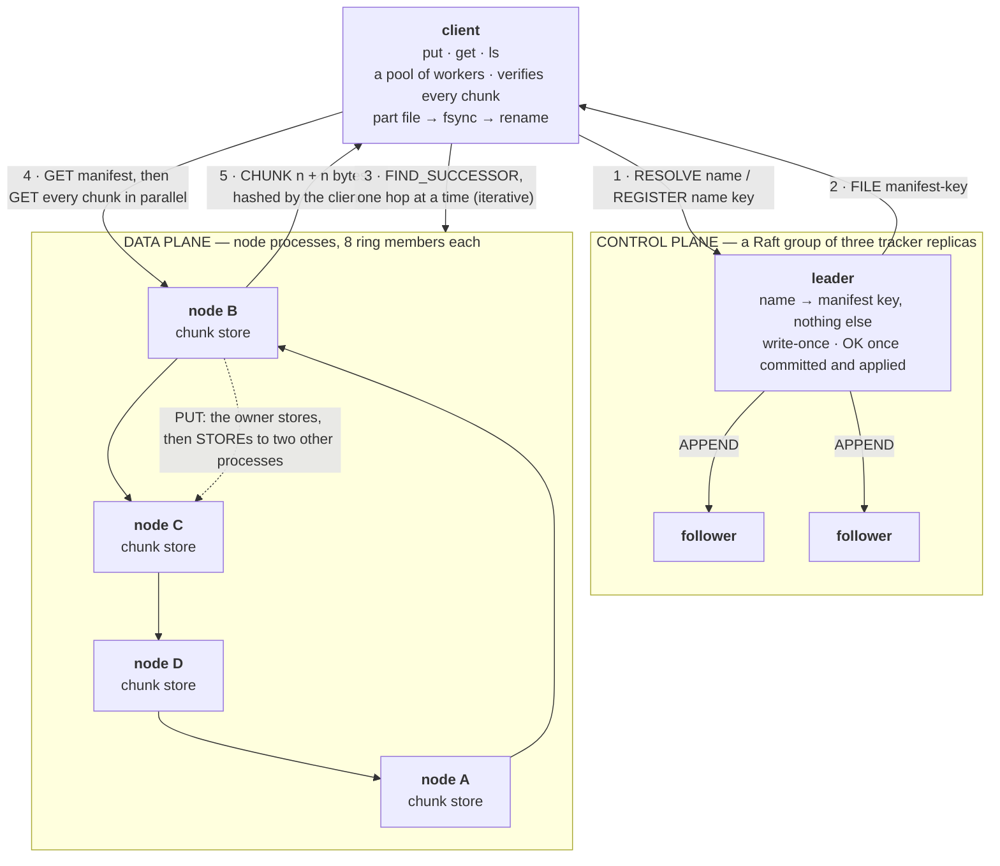

# chord-dht-filesystem

[](https://github.com/ChaitanyaShah21/chord-dht-filesystem/actions/workflows/ci.yml)
[](LICENSE)

Fault-tolerant distributed file storage in C++17. A file is cut into **content-addressed chunks**,
each named by the SHA-1 of its own bytes and stored on **three different processes** of a
**Chord ring**; a small **tracker** maps each file name to the hash of the file's manifest and holds
nothing else. A client resolves a name, routes to every chunk itself in O(log N) hops, fetches the
chunks in parallel, verifies each against its name, and writes the file only once it is complete.
The tracker is itself a **Raft group** of three replicas, hand-written, so it survives the loss of any one.
Nodes join, fail and are repaired out of the ring while it keeps serving; a dead node's chunks are
copied back to three live processes within seconds. POSIX sockets and threads, OpenSSL for SHA-1,
a hand-written `Makefile` — no other libraries.

Every number below was measured by a committed harness at a recorded commit, and every design
decision is in a log with the alternatives it rejected ([`ARCHITECTURE.md`](ARCHITECTURE.md)).
The repository began as a BitTorrent-style file sharer written for an operating-systems course; how
it became this is in [`docs/postmortem-resurrection.md`](docs/postmortem-resurrection.md), and the
coursework is in the history, unsquashed.

## Architecture



**Upload:** the client cuts the file into 512 KiB chunks and sends each to its owner, which flushes a
copy, forwards two more to the next two *distinct processes* clockwise, and answers once `W` copies
(default 2) exist. The manifest — the list of chunk keys, itself a chunk — is stored the same way,
and only then is the name registered, so a name never points at a file that is not all there.
**Download:** the name becomes a manifest key (1–2); the client fetches and checks the manifest, then
looks up and fetches every chunk concurrently (3–5). A chunk whose copy is corrupt, or whose holder is
dead, is read from the next replica. In the background every node stabilises its successor pointers,
repairs its fingers, evicts dead peers and re-replicates chunks that lost a copy.

Diagram-as-text, so it renders on GitHub and diffs in review. Wire format:
[`docs/protocol.md`](docs/protocol.md).

## Results

> **Measurement environment.** One machine — 8 cores, aarch64, Ubuntu 24.04 under WSL2 — with every
> node, tracker and client a process on loopback. There is no network latency, every replica is
> equally fast and all of them share one page cache and eight cores, so throughput is optimistic and
> anything sensitive to round trips more so. Distortions are listed in
> [`BENCHMARKS.md`](BENCHMARKS.md#known-distortions); every result there gives its method and commit.

### Files move through the ring 5.4× faster than the system it replaced — 3.7× from parallelism alone


| 100 MB download, 512 KiB chunks | Throughput |
|---|---:|
| the coursework single-seeder system, re-run the same day at its own commit (`e381179`) | 70.1 MB/s |
| the ring, 16 processes × 8 virtual nodes, 1 worker | 103.2 MB/s |
| **the ring, 8 workers** | **378.2 MB/s** |

Medians of 5 at commit `2e7c445`; all 116 transfers compared by SHA-1. Per chunk at 8 workers: p50
9.4 ms, p99 31.4 ms. With the final flush and rename, 293 MB/s. Uploads: 77 MB/s with every chunk on
two flushed copies. Eight workers was chosen by a rule fixed before measuring; past the core count,
workers queue for CPU. [`BENCHMARKS.md`](BENCHMARKS.md) §5.


**Chunk size matters on loopback, against the prediction**: 100 MB/s at 64 KiB to 536 MB/s at 8 MiB,
because every chunk pays a multi-hop lookup over fresh connections. 512 KiB stays the default — the
comparison is pinned to it, and what larger chunks cost is what loopback cannot show. **Deduplication,
measured where it fails:** a 1 KiB edit shares 199 of 201 chunks, but twenty real commits of this
repository as tar files share 1 of 97 — fixed-size chunks never realign after an insertion. §5.

### Lookups take ½ log₂ N hops, from 2 nodes to a million


**5.38 hops** on 2,048 real node processes (½ log₂ N = 5.5) and **9.87** at 2²⁰ nodes replayed in one
process by the same routing code, which reproduced all 135,168 real lookups exactly. 380,928 lookups,
every owner checked against an independent oracle. Commit `e042857`. [`BENCHMARKS.md`](BENCHMARKS.md) §2.

### A killed node is repaired out of the ring in 0.63 s


Median time until every successor and predecessor is right again after one of 64 nodes is killed
(9 of 10 runs under 1 s), judged by an oracle in the harness, never by the nodes. It does not grow
with ring size (0.42–0.56 s from 16 to 128 nodes); losing a node's whole successor list went from
1.49 s to 0.36 s after stabilisation was changed to reach its fixed point within a round. Under
lookup load, of 28,790 lookups during and after kills, none failed. Commit `b171554`.
[`BENCHMARKS.md`](BENCHMARKS.md) §4.

### Three copies on three processes, evenly, restored in 2.2 s


With 8 virtual nodes per process the busiest of 64 processes stores **1.52×** the mean, against 2.80×
with one. After a process dies, every chunk it held is back on three correct live processes in a
median **2.2 s**. With one replica dead, `W = 2` acknowledged 300 of 300 writes and `W = 3` 244 of 300;
`W = 1` answers in 14 ms against 31 ms, but at the acknowledgement no other copy existed in 20 of 20
coordinator crashes. Commit `7d99fc0`. [`BENCHMARKS.md`](BENCHMARKS.md) §6.


### The tracker survives its leader: a new one in 219 ms, writes again in 231 ms


The tracker is a hand-written **Raft** group of three replicas. Killing its leader: a new leader in a median
**219 ms** (164–407 ms over 20 kills) and the client's next acknowledged write **231 ms** after the kill, at an election
timeout of 150 ms — chosen by a rule fixed before measuring: the smallest value with no election in 90 s of saturating
writes. Election time runs at 1.3–1.45× the timeout, close to what the mechanism predicts. A write now waits for two flushes in
series instead of one: **131 registrations a second** at one client against
269 for the single tracker it replaced, and 264
against 276 under 16 clients, where the leader's flush is the ceiling for
both. Correctness is checked in a seeded simulation — loss, duplication, reordering, partitions and crashes, with
Raft's four safety properties checked after every step and every client answer checked for linearizability — and on
real processes with `SIGKILL` and `SIGSTOP`. Commits `0d5c1c9` (failover) and `e3d6c65` (writes). [`BENCHMARKS.md`](BENCHMARKS.md) §7,
[`docs/consensus.md`](docs/consensus.md).


### Deleting a file frees exactly what no other file uses


Twenty files in pairs sharing half their chunks; one of each pair deleted with its owner's token; one `gc` run:
**62,928,030 bytes freed on disk** — exactly three copies of what the deleted files used alone, plus their manifests —
in each of 3 runs, matching the collector's own report, with every remaining file downloading whole. A sweep drops
**5,634 copies a second** (48,009 in 8.5 s), 22× faster than when every drop flushed its directory. An upload that has
stored its chunks but not yet named them survives a collection, and so does one reusing old orphans of a deleted
file: each node drops only what nothing has written for the grace period. Commit `478cee0`.
[`BENCHMARKS.md`](BENCHMARKS.md) §9, [`docs/deletion.md`](docs/deletion.md).

### Checking three copies costs one message per arc, and the third copy lands within milliseconds

Copies named by their own hash cannot disagree, so anti-entropy only has to find *missing* ones. Repair's periodic scan
of a healthy ring holding 12,288 copies on 8 nodes now exchanges one digest per arc — **258 messages, 29,928 bytes** —
instead of a listing per twenty chunks: 932 messages, 813,636 bytes (27×). An acknowledged write has its third copy
within 5–7 ms at p99. Commit `bc1e6c7`. [`BENCHMARKS.md`](BENCHMARKS.md) §10, [`docs/storage.md`](docs/storage.md).

### Killed, frozen and starved of packets, it loses nothing it acknowledged


Two uploaders and two downloaders ran for 180 s while every 8–15 s a seeded fault struck: a node killed and restarted,
a node frozen, the tracker leader killed, a follower frozen, or 5 % packet loss for 10 s (netem, in a private network
namespace). **Across 9 runs and 114 faults no acknowledged name or byte was lost**, no download returned wrong bytes,
and every chunk was back on three correct processes within 5 s of the last fault; 3 of 11,224 uploads failed and were
never acknowledged. The cost is stalls: up to 25 s per run in which nothing completed. Loss exposed a design limit: the
200 ms node deadline and 150 ms Raft timer, chosen on loopback, sit below TCP's retransmission timeouts — 492 strikes
and 247 elections in a run, against 14 and 6 with a real-network profile at 1.2 s (D-095). Commits `2cdd569`,
`c6242fe`. [`BENCHMARKS.md`](BENCHMARKS.md) §11, [`docs/faults.md`](docs/faults.md).

### It runs as containers, and a dead container is not a dead process

`compose.yaml` — three tracker replicas, five nodes, Prometheus and Grafana — passes the same kind of suite as the plain
processes, in CI on x86-64 and arm64: the ring correct by the oracle, every dashboard query answering, the leader and a
node killed with every file still whole and every chunk back on three live processes, then a full restart on the
volumes. A 100 MiB file goes up at 43.6 MB/s and comes back at 161 MB/s (medians of 5). Running it found what loopback
cannot show: **a container's address dies with it, so nothing refuses the connection** — the kernel gives up after
3.08 s instead of answering in 4 ms. Every death becomes a timeout, evicted by two strikes like a freeze, and while the
first tracker a client tries is down, every command takes **3.08 s to resolve a name instead of 9 ms** (D-096). Commit
`5b9d686`. [`BENCHMARKS.md`](BENCHMARKS.md) §12.

### Every process is observable, at no measurable cost


The dashboard in `deploy/`, rendered by Grafana 13.2.3 from Prometheus 3.15.0 scraping every process every 2 s, over a
240 s fault-injection run (18 faults: nodes killed and frozen, three leader kills, followers frozen — the red marks in
the process timeline; 1,545 of 1,545 uploads and 4,526 of 4,526 downloads succeeded). Every node, tracker replica and client serves Prometheus metrics, and every request line carries a request id that
`scripts/trace.py` follows through every process's log. A 100 MB download runs at 375 MB/s against 384 before
(medians of 10 alternating runs; 10 MB: 287 against 284 over 20); a scrape is 0.33 ms at the median and 2.3 ms at p99
during transfers. Commit `dcf18f8`. [`BENCHMARKS.md`](BENCHMARKS.md) §8, [`docs/observability.md`](docs/observability.md).

## Key design rationales

Each row is a decision in [`ARCHITECTURE.md`](ARCHITECTURE.md); [`docs/design.md`](docs/design.md)
has every alternative considered and what it would have cost.

| Decision | Why | Rejected alternative |
|---|---|---|
| **Chunks are content-addressed** (D-014) | replicas cannot disagree, so there are no versions, no vector clocks and no conflict resolution; reads verify themselves; identical chunks are stored once | key = (file, chunk index): mutable values, and with them the whole consistency problem |
| **Iterative lookups** (D-012) | the client counts its own hops and knows exactly which node failed; no node holds a thread for someone else's lookup | recursive (the paper's): self-reported hop counts, nested timeouts, blocked threads on every node in the path |
| **A 64-bit ring under 160-bit keys** (D-019) | ring arithmetic is the machine word's own wrap-around — no hand-written carries under the hop-count measurement | the full 160 bits, where a carry bug would silently inflate hop counts; 32 bits, a 69 % collision chance at 100,000 virtual nodes |
| **3 copies, `W = 2`, `R = 1`, per-request `W`** (D-015, D-046) | an acknowledged write is on two disks; a read checks one replica's hash and falls through; `W` is a measured trade-off curve | `W = 1` (acknowledged writes lost on a crash — measured); `W = 3` (writes fail during every single failure) |
| **Replicas on distinct processes** (D-048) | with virtual nodes, "the next two ring members" often share a process, so one crash would take two copies | the Chord paper's successor-list replication |
| **A refusal is proof, a timeout is suspicion** (D-013, D-035) | a refused connection evicts at once; a timeout needs a second strike; nothing is adopted until it answers a ping | heartbeats, which on eight shared cores manufacture false deaths |
| **An isolated node stops routing** (D-040, D-067) | a node that lost everyone cannot tell "they died" from "I am cut off"; claiming the ring could split it in two | falling back to itself — the tests showed it forming a second ring that never merges |
| **The tracker holds names, written once** (D-017, D-058, D-059) | a chunk's location is computed, so the tracker is O(files); an effect log flushed before `OK` survives a crash | the tracker holding placement — two systems that can disagree about where a chunk lives |
| **Part file, `fsync`, rename** (D-055) | a failed or interrupted download leaves nothing that looks like the file | preallocating the destination, which left full-size files of zeros (defect R2b) |
| **A fixed pool of workers** (D-056) | bounded memory, and its size is a measured curve | a thread per chunk; an `epoll` rewrite of every tested exchange |
| **A deadline per request line and body** (D-061) | a peer trickling bytes cannot hold a thread or a memory slot | `SO_RCVTIMEO`, which one byte every few seconds defeats |
| **Logic never opens a socket** (D-018, D-024, D-060) | every module takes the network as a parameter, so tests build hostile rings in process | logic written into the programs, testable only through real sockets |
| **Distributed storage, not a swarm** (D-022) | a file outlives every uploader | making downloaders serve chunks, which needs an index of holders |
| **Sources in `src/`, programs at the root** (D-068) | a readable tree; every script and document keeps its paths | binaries in `bin/` — thirty command lines changed for nothing |

**The replicated tracker** — depth and alternatives in [`docs/consensus.md`](docs/consensus.md):

| Decision | Why | Rejected alternative |
|---|---|---|
| **Three tracker replicas** (D-069) | the smallest group that survives a failure, like the chunk plane's three copies | two (a majority of two is two: it survives nothing); five by default (measured, not chosen) |
| **Raft as a socket-free core** (D-070) | time, storage and messages are passed in, so tests replay lost, reordered and duplicated messages and crashes from a seed | Raft written among the server's threads and sockets |
| **A fresh connection per Raft call** (D-071) | a lost connection is a lost message; every reply is the reply to the request just sent | persistent connections, whose replies can belong to an earlier, timed-out call |
| **One lock, held across the flush, never across a call** (D-072) | no reply can carry state that is not yet on disk | releasing the lock during the flush |
| **Timers from one base, chosen by a rule** (D-073) | E is the smallest value with no spurious election under load; failover is measured at every candidate | the paper's 150–300 ms by precedent |
| **One file of self-checking records per replica** (D-074) | one flush per step; a crash's torn tail is cut, older damage refuses to start | skipping damaged records, which leaves a hole in the log |
| **`OK` after the entry is applied; no client sessions** (D-075) | a write-once registration is idempotent, so a retry after a leader change is safe | sessions to deduplicate what already deduplicates itself |
| **ReadIndex reads** (D-076) | linearizable with no clock assumption; a round trip, no flush | leases, which a paused leader can outlive |
| **Check-quorum** (D-077) | a leader cut off from the majority steps down instead of stalling its clients | pre-vote (deferred; costs one election per healed partition) |
| **No snapshots** (D-078) | names were written once, so a snapshot would have been as large as the log (deletion, D-089, changes that; still not built) | `InstallSnapshot`, a second replication path that saves almost nothing |
| **Fixed membership with a fingerprint** (D-079) | a replica started with a different member list is refused, not counted | joint consensus (deferred) |
| **A one-replica group is the single tracker** (D-080) | one code path, so every existing suite tests the replicated code | keeping the old tracker as a mode |
| **Every replica's address, then redirects** (D-081) | as the client already finds the ring | followers forwarding requests to the leader |
| **Measure before batching flushes** (D-082) | the flush's share is measured on disk against `tmpfs` | building group commit before knowing what it saves |

**Observability** — metrics, logs and the dashboard; depth in [`docs/observability.md`](docs/observability.md):

| Decision | Why | Rejected alternative |
|---|---|---|
| **Metrics over HTTP on a separate port** (D-083) | Prometheus scrapes every process directly; one hardened thread — a 4 KiB, 2 s request cap, one response, close | a `METRICS` line plus an exporter per process; pushing, where a dead process looks like a quiet one |
| **Histograms, and labels only from fixed sets** (D-084) | a p99 can be computed across every node after adding their buckets; no label can grow without bound | summaries, whose quantiles cannot be combined; averages, which hide the tail |
| **Throughput measured at the nodes** (D-085) | a client lives for one transfer, often less than a scrape interval; the nodes live as long as the ring | a Pushgateway, which keeps a dead client's numbers |
| **A hand-written `key=value` logger** (D-086) | one event is one line, written with one system call, so threads never interleave and every line parses | `spdlog` (an external library); free text |
| **A request id on every request line** (D-087) | one upload can be followed through the client, the tracker and every node it touched | a trailing field, which would break the body-length rule |
| **Prometheus and Grafana from configuration in `deploy/`** (D-088) | the dashboard is a screenshot of a running cluster, not a description of one | configuration that has never run a query |

**Deletion** — unnaming and collecting; depth in [`docs/deletion.md`](docs/deletion.md):

| Decision | Why | Rejected alternative |
|---|---|---|
| **The uploader's secret deletes a name** (D-089) | only whoever uploaded can delete; the tracker and its log hold only the secret's hash; a retried registration stays safe | a token the tracker returns, which a retry would hand to anyone; anyone may delete |
| **A separate mark-and-sweep collector** (D-090) | marks every chunk reachable from a live name through verified reads; deletes nothing if any tree cannot be read | nodes deleting whatever is not in a set they are sent, which a forged set empties |
| **A grace period on each node's monotonic clock, renewed by every write** (D-091) | an upload that has stored chunks but not yet registered — or reused an old orphan — cannot lose them; no acknowledged upload is ever collected | upload leases through Raft, which need the same timeout for crashed clients |
| **A shared key on `DROP`** (D-092) | the data plane's first destructive request is not open to anyone who can reach a node | no check |

**Anti-entropy** — what is left of it when copies cannot disagree; depth in [`docs/storage.md`](docs/storage.md):

| Decision | Why | Rejected alternative |
|---|---|---|
| **A digest per arc before any listing** (D-093) | a healthy replica set is checked in one exchange per arc, not one per twenty chunks; read repair has nothing to fix when copies cannot differ | Merkle trees on every node; read repair of missing copies by the reader |

**Fault injection** — depth in [`docs/faults.md`](docs/faults.md):

| Decision | Why | Rejected alternative |
|---|---|---|
| **Faults as signals and netem, judged by invariants** (D-094) | real processes killed, frozen and restarted under a live workload, and packets lost and delayed without root, from a seed; four invariants decide, not the absence of errors | a proxy between every pair, which would change every address and so the ring |
| **A silent dead host is suspicion, not proof** (D-096) | a container's or a host's address refuses nothing once it dies; an unreachable host is also what a brief network loss looks like, so eviction stays two strikes; the client's 3 s per command while one tracker host is down is recorded, its fix named | treating `EHOSTUNREACH` as proof; a client deadline below a lost SYN's 1 s retransmission |
| **Loopback defaults, and a measured real-network profile** (D-095) | the 200 ms node deadline and Raft's 150 ms base sit below TCP's retransmission timeouts; a profile at 1,200 ms is measured under packet loss, and every earlier number stays tied to its own settings | new defaults, which would detach every measured number from the configuration it describes |

## Project structure

```
chord-dht-filesystem/
├── src/                    # Everything that runs. Logic modules never open a socket (the network is passed in),
│   │                       #   so tests/ drives them in process
│   ├── chord.{h,cpp}       # Routing primitives as pure functions: identifiers, arcs, fingers, route_step
│   ├── net.{h,cpp}         # The one framing layer: lines, length-prefixed bodies, connect and read deadlines
│   ├── lookup.{h,cpp}      # The originator's loop: follows NEXT to OWNER, checks every reply for progress
│   ├── stabilize.{h,cpp}   # A ring member's routing state: joins, stabilise, notify, finger repair, failure handling
│   ├── store.{h,cpp}       # The chunk store: one file per chunk, written to a temporary name, flushed, renamed
│   ├── chunk.{h,cpp}       # PUT/STORE/GET/HAVE, the write coordinator, replica sets on distinct processes,
│   │                       #   verified reads that fall through to the next replica
│   ├── repair.{h,cpp}      # Re-replication: owner-driven arc checks, the scrub, the hand-off
│   ├── transfer.{h,cpp}    # Whole files: chunking, manifests and their tree, the worker pool, the part file
│   ├── names.{h,cpp}       # The namespace: name -> manifest key, written once -- the state machine Raft replicates
│   ├── raft.{h,cpp}        # Raft as a deterministic core: elections, replication, the commit rule, ReadIndex
│   ├── raft_log.{h,cpp}    # A replica's term, vote and log as one file of self-checking records
│   ├── raft_wire.{h,cpp}   # VOTE and APPEND on the line framing, with strict parsers
│   ├── replica.{h,cpp}     # One replica: a lock around the core, a ticker, a sender per peer, waiting clients
│   ├── group.{h,cpp}       # The client's side of the group: the address list, redirects and retries
│   ├── metrics.{h,cpp}     # Counters, histograms and gauges, rendered in the Prometheus text format
│   ├── http.{h,cpp}        # The metrics port: just enough HTTP/1.0, one hardened thread
│   ├── log.{h,cpp}         # One key=value line per event, written with one system call; request ids
│   ├── collect.{h,cpp}     # The collector: mark every live tree, walk the ring, sweep each node
│   ├── sha1.h              # Header-only wrapper over OpenSSL SHA1(), hex-encoded
│   ├── node.cpp            # `node`: a ring process -- members (virtual nodes), a chunk store, maintenance and repair
│   ├── tracker.cpp         # `tracker`: one replica of the namespace's Raft group (alone: the single tracker)
│   ├── client.cpp          # `client`: put, get, ls, info, resolve, delete -- files through the ring, names through the tracker
│   ├── gc_main.cpp         # `gc`: one collection of the chunks no name uses any more
│   ├── chunk_main.cpp      # `chunk`: put and get single chunks through a ring
│   ├── lookup_main.cpp     # `lookup`: one lookup per identifier on stdin; prints owner, hops and path
│   ├── sim_hops.cpp        # `sim-hops`: the same routing code and loop with the whole ring in one process
│   └── sim_balance.cpp     # `sim-balance`: chunk placement with the node's own code, for load-balance curves
├── tests/                  # Eleven unit-test programs (`make check`): hand-built rings, constructed hostile input,
│                           #   a seeded simulation of the Raft group with its safety properties checked every step
├── scripts/                # End-to-end suites (e2e-*.sh), the local cluster launcher (cluster.sh), Prometheus and
│                           #   Grafana against it (observe.sh), one request across every log (trace.py),
│                           #   benchmark harnesses (bench-*.py), plotters (plot-*.py), test oracles
├── deploy/                 # Prometheus's configuration, Grafana's provisioning and the dashboard, as text
├── docs/                   # A guide per subsystem, the design document, the failure log, the postmortem;
│                           #   figures/ holds the plots and the summary data each is drawn from
├── Makefile                # Hand-written. Objects go to build/, programs to the repository root
├── Dockerfile, compose.yaml # Three tracker replicas, five nodes, Prometheus and Grafana in containers (e2e-compose.sh)
├── .github/workflows/ci.yml # Build, unit tests, the fast end-to-end suites and the containers, on x86-64 and arm64
├── ARCHITECTURE.md         # Current design and the full decision log (D-001 ... D-096)
├── BENCHMARKS.md           # Every number, its method and its commit
└── SCALE_NOTES.md          # Where the design breaks at 10x, recorded while building
```

| Guide | Covers |
|---|---|
| [`docs/routing.md`](docs/routing.md) | identifiers, ownership, fingers, the iterative lookup, hop counts |
| [`docs/membership.md`](docs/membership.md) | joins, stabilisation, failure detection, orphans, virtual nodes, reconvergence |
| [`docs/storage.md`](docs/storage.md) | the chunk store, replica sets, `W`, verified reads, repair |
| [`docs/transfer.md`](docs/transfer.md) | manifests, the worker pool, the part file, the tracker's namespace |
| [`docs/protocol.md`](docs/protocol.md) | every message, its replies and errors, framing, deadlines |
| [`docs/consensus.md`](docs/consensus.md) | the replicated tracker: Raft, each decision with its alternatives |
| [`docs/observability.md`](docs/observability.md) | metrics and why each one, the log format, the request id, the dashboard |
| [`docs/deletion.md`](docs/deletion.md) | deleting a name with its owner's secret, the mark-and-sweep collector, the race with uploads |
| [`docs/faults.md`](docs/faults.md) | the fault-injection harness, its invariants, the recovery plots and what the runs found |
| [`docs/testing.md`](docs/testing.md) | the test layers, oracles, mutation testing, ThreadSanitizer |
| [`docs/design.md`](docs/design.md) | each major decision with the alternatives considered |
| [`docs/failures.md`](docs/failures.md) | every defect reproduced: how it was found, the root cause, why the fix works |
| [`docs/postmortem-resurrection.md`](docs/postmortem-resurrection.md) | from a broken course assignment to this system |

## Quick start

**Requirements:** Linux, g++ with C++17, `make`, OpenSSL development headers (`libssl-dev`),
Python 3 for the test suites. Developed on Ubuntu 24.04 (aarch64) with g++ 13.3.

```bash
make                         # tracker, node, client, chunk, lookup, sim-hops, sim-balance; zero warnings
scripts/make-testdata.sh     # deterministic test files in testdata/ (gitignored)

scripts/cluster.sh up 5      # three tracker replicas on :7000-7002, five nodes on :7010-7014, 8 ring members each

T=127.0.0.1:7000,127.0.0.1:7001,127.0.0.1:7002
./client --tracker $T --ring 127.0.0.1:7010,127.0.0.1:7011 put testdata/large.dat movie
./client --tracker $T --ring 127.0.0.1:7010,127.0.0.1:7011 get movie /tmp/movie
cmp testdata/large.dat /tmp/movie && echo identical
./client --tracker $T ls
scripts/trace.py <request-id> cluster/logs     # one request through every process's log (ids are in --log output)

scripts/observe.sh up        # Prometheus :9090 and Grafana :3000/d/chordfs, from release archives in ~/.local/opt
scripts/observe.sh down
scripts/cluster.sh down      # stops exactly the processes `up` started; `wipe` also deletes the stores
```

`put` prints the manifest key, chunk count, timings and the **token** that owns the name — `./client --tracker $T
delete movie <token>` unnames it, and `./gc --tracker $T --ring … --gc-key <file>` later frees chunks no file uses
(nodes started with `NODE_ARGS="--gc-key <file>"`); `get` verifies every chunk against its key
and creates `/tmp/movie` only once it is complete. `--workers` sets how many chunks move at once,
`--w` how many copies must exist before a chunk counts as stored; `get-key <key> <file>` reads a file
by manifest key with no tracker at all. Run `./client`, `./node` or `./tracker` with no arguments for
every option.

**Containers** — the same system from `compose.yaml`: three tracker replicas, five nodes, Prometheus and Grafana,
each container at a fixed address on one bridge network. Tested end to end by `scripts/e2e-compose.sh`, locally and
in CI.

```bash
docker compose up -d --build
docker compose run --rm client put /work/testdata/large.dat movie     # /work is this directory
docker compose run --rm client get movie /work/testdata/copy.dat
cmp testdata/large.dat testdata/copy.dat && echo identical
docker compose run --rm client ls
                                                                      # the dashboard: http://localhost:3000/d/chordfs
docker compose kill tracker1 node3                                    # it keeps serving
docker compose down -v                                                # -v also deletes the stores and logs
```

## Testing

```bash
make check                              # eleven unit-test programs, 956 checks
for s in scripts/e2e-*.sh; do "$s" || break; done   # fifteen suites on real processes, about seven minutes
```

Two layers, because each catches what the other cannot. **In process**, every module takes the network
as a parameter, so tests build rings by hand — stale tables, replies that point backwards, nodes that
lie, manifests that lie, a disk that refuses writes — and order every node's rounds by hand; the tracker's Raft
core runs in a **seeded simulation** that loses, duplicates and reorders messages, partitions and crashes replicas,
and checks Raft's safety properties after every step and every client answer for linearizability. **On real
processes**, the suites kill, freeze and restart nodes mid-operation, corrupt chunks on disk, kill the
client mid-download, and trickle bytes at servers. Correctness is always judged by an **oracle in the
harness**, computed from the live addresses alone — never by asking the system under test.

The tests were themselves tested by **mutation**: 132 bugs planted in the ring, chunk, transfer, consensus,
observability, deletion and anti-entropy code, each in a fresh build; 120 were caught by the functional tests and three
more only by ThreadSanitizer. Every survivor is explained: redundant defences (two independent fixes for one
failure; a hash checked twice), a race on an atomic counter that no test can see, the flushes
before an acknowledgement, which only a power cut would show, a reset that Linux loopback never makes visible, and a
race on a file between a drop and a write, which no sanitizer sees and 2,000 racing rounds never hit. Among the consensus bugs — committing an
earlier term's entry by counting, forgetting a vote, voting for a stale log, applying before commit —
three first survived, and each became a new test. The node, the client and the tracker also run under
ThreadSanitizer with no report. Details: [`docs/testing.md`](docs/testing.md).

**Continuous integration** (`.github/workflows/ci.yml`) runs on every push, on x86-64 and arm64: the warning-free
build, the unit tests, the ten end-to-end suites that do not depend on timing under load, and `e2e-compose.sh` on the
container deployment. The churn, consensus, observability and deletion suites and the ThreadSanitizer runs kill and
freeze processes on timers, so they run on demand, where a shared runner's scheduling cannot make them flaky.

## Limitations

- **All measurements are on one host.** Loopback has no propagation delay, and every process shares
  one page cache and eight cores; nothing has been measured across machines. The default timers (a 200 ms node deadline,
  Raft's 150 ms base) are for this host: under packet loss they mistake lost packets for dead processes. A real-network
  profile (1.2 s each) is measured under emulated loss only (D-095), and every exchange is a fresh TCP connection, so a
  lost SYN still costs a second.
- **The tracker group's membership is fixed.** A replica whose disk is lost cannot be replaced while the
  group runs — membership change is not built — and losing a majority stops registration and resolution
  (downloads by manifest key still work). Pre-vote is not built, so a replica returning from a partition
  forces one election.
- **Deleting is two steps, and garbage lives at least two hours.** A name is deleted at once by its uploader's token;
  its chunks are freed only by a `gc` run, only once no remaining file uses them and nothing has written them for the
  grace period. A lost token means the name can never be deleted, and a name pointing at a manifest that does not
  exist stops every collection until its owner deletes it. The collection key travels in cleartext.
- **No authentication or encryption.** Any process that can reach a node can join the ring, register a
  name, or send `ERR orphaned` on a member's behalf. A name is written once per owner: a mistaken upload
  holds its name until its token deletes it.
- **One thread per connection**, bounded in time by the read deadline but not in number; there are no
  per-source limits. An event loop is the known fix.
- **At 256 nodes on one 8-core machine, live nodes were wrongly evicted in 3 of 55 runs**, each during a
  5–9 s stall of the whole host. A fixed deadline cannot tell a stall that long from a freeze.
- **Fixed-size chunks deduplicate poorly after an insertion**; content-defined chunking is not built.
- **A registration waits for two flushes in series** (the leader's, then a follower's), and under load the leader
  flushes one proposal at a time: about 131 a second at one client and
  264 at 16 on this disk. Group commit and a parallel leader flush are the known fixes;
  neither is built.
- **No resumable downloads**, and a `SIGKILL`ed client leaves a `.part-` file behind.
- **A client starts at the first tracker address it is given.** While that replica's host or container is down, every
  command waits out one 3 s deadline before reaching a live replica (D-096); asking every replica at once is the known
  fix, not built.

## Licence

[MIT](LICENSE).
