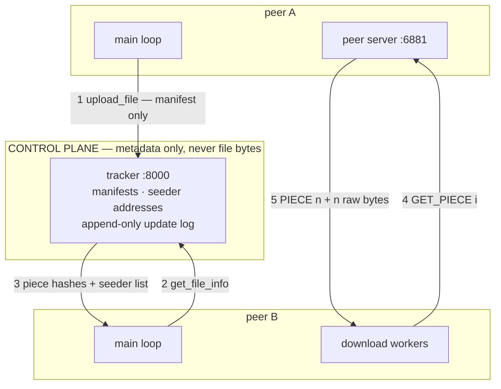
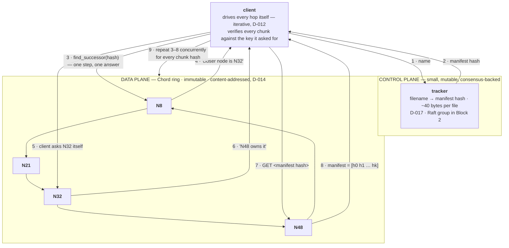

# chord-dht-filesystem | C++17

> Fault-tolerant distributed file storage — content-addressed chunks placed on a Chord ring and
> replicated three ways, under a small tracker that holds only file names.

> [!NOTE]
> **Under active reconstruction: the legacy BitTorrent-style layer works; the Chord ring routes
> lookups but does not store data yet.** This repository began as an operating-systems course
> assignment — a BitTorrent-style file sharer — and is being rebuilt into distributed storage. Every row in the table below was verified by a script
> at the commit it names — nothing is claimed to work that has not been run.
>
> An earlier version of this file claimed multi-tracker synchronisation. That feature was never
> implemented — `connect_to_peer()` was defined and never called. It was removed rather than
> left to be discovered.

---

## Status

Verified by running the scripts in the Evidence column on the machine described in
[`BENCHMARKS.md`](BENCHMARKS.md): the legacy suites at `a9c69cc` (9 Sep 2026), the routing suites
at `29a829c` (13 Sep 2026), the lookup suites on 7 Oct 2026.

| Component | State | Evidence |
|---|---|---|
| Build | **Works.** `tracker`, `client` and `node` build clean, zero warnings | `make clean && make` |
| Tracker — users, groups, metadata | **Works** in memory | `scripts/e2e-smoke.sh` |
| Tracker — persistence across restart | **Works.** Replay applies effects directly rather than re-running commands, so recovery cannot be refused by an authorisation guard it never reaches | `scripts/e2e-persistence.sh` — 4/4 |
| Tracker — multi-tracker sync | **Never existed.** Dead code; superseded by the planned Raft group | — |
| Legacy BitTorrent-style transfer | **Works**, verified by SHA-1 end to end across a piece-boundary sweep | `scripts/e2e-smoke.sh` PASS · `scripts/e2e-edge.sh` 6/7 |
| Chunking + SHA-1 manifests | **Works**, including the short final piece | `scripts/e2e-edge.sh` — the `minus1`, `exact_1piece` and `plus1` cases |
| Zero-byte file | **Broken.** An empty file produces an empty manifest, the tracker rejects the upload, and the client reports success anyway | `scripts/e2e-edge.sh` — case `empty`, a deliberately failing test |
| Tracker — survives an abrupt client disconnect | **Works.** `SIGPIPE` is ignored, so a peer that vanishes mid-reply is an error value rather than a fatal signal | `scripts/e2e-hangup.sh` |
| Chord identifier arithmetic, finger tables, closest-preceding-finger routing | **Works** on a fixed ring. Every lookup reaches the correct owner, and every hop count matches an independent model of the finger rule | `make check` — 127 + 15 unit checks · `scripts/e2e-node.sh` — real 8-node ring, 1808 lookups |
| Chord lookup originator (`lookup`) | **Works** on a fixed ring. Follows `NEXT` to `OWNER`, checks every reply for progress, and reports a refused, timed-out or garbled node by name | `make check` — 70 lookup checks against correct, lying and broken rings · `scripts/e2e-chord.sh` — real 16-node ring, 4000 lookups, one node killed, one frozen |
| Chord joins, stabilisation, replication, chunk storage | **Not built yet** | — |

Known open defects are listed under [Limitations](#limitations-and-future-work); full
reproduction steps for every one are in [`docs/failures.md`](docs/failures.md).

---

## Overview

**Distributed file storage.** A file is split into 512 KB chunks. Each chunk is named by the
SHA-1 hash of its own contents, and stored on the Chord node that owns that hash and on the next
two nodes around the ring. A small tracker maps each human-readable file name to the hash of the
file's manifest — the list of its chunk hashes — and knows nothing about where chunks live,
because their location is computed rather than stored. A client that wants a file asks the
tracker for one hash, routes to the chunks itself in O(log N) hops, fetches them in parallel from
their replicas, and verifies every chunk against the name it asked for.

**Where it came from.** This began as a BitTorrent-style file sharer, where each participant
served pieces it had downloaded and a tracker listed who held what. An audit of that system
found twenty defects and two structural weaknesses — a tracker that was a central index of every
holder, and files that vanished when their seeders left — and fixing those one decision at a time
turned it into storage. The trade is stated rather than hidden: a swarm gains serving capacity as
a file gets popular, and this system does not. A file has three copies however many people want
it, and in exchange it survives every one of its uploaders going offline.

- **What it does:** distributes file chunks across a ring of nodes, routes lookups in O(log N)
  hops, replicates each chunk to three successors, repairs routing state after failures, and
  transfers chunks in parallel with per-chunk integrity verification.
- **What makes it non-trivial:** the routing state has to stay correct while nodes join and die
  underneath it. Chord's guarantee is that lookups remain *correct* as long as successor
  pointers are correct, even when every finger table is stale — separating correctness from
  performance is the whole design.
- **What it deliberately does not do:** no storage engine (chunks are files on disk), no NAT
  traversal, no wire encryption or authentication, no incentive mechanism. Reasoning for each:
  [`ARCHITECTURE.md`](ARCHITECTURE.md) § Scope boundary.

---

## Results

### Lookup hop count tracks ½ log₂ N, from 2 nodes to a million


Measured 7 Oct 2026 at commit `e042857`. 380,928 lookups over 93 rings, every owner checked
against an independent oracle:

| Ring size | How it ran | Mean hops | ½ log₂ N | 99th percentile |
|---:|---|---:|---:|---:|
| 2048 | real `node` processes, lookups over TCP | **5.38** | 5.5 | 9 |
| 1,048,576 | in process, the same routing code | **9.87** | 10.0 | 15 |

- **A hop is a finger followed**, which is the Chord paper's path length and one less than the
  number of requests the client sends.
- **Real processes stop at 2048**, a ceiling derived from measured per-node memory (about
  0.95 MiB proportional set size per node), not chosen.
- **Beyond that, `sim-hops` replays the same code in one process**: the same membership parser,
  finger builder, routing step and lookup loop, with a function call where the socket was. On every
  real ring it reproduced all 135,168 lookups exactly, owner and path.
- **The mean sits 0.10–0.19 hops below ½ log₂ N at every size from 32 nodes up.** That offset is
  measured and not yet explained.

Method, ring-to-ring spread and memory figures: [`BENCHMARKS.md`](BENCHMARKS.md) §2.

### Single-peer transfer baseline

Measured 9 Sep 2026 at commit `e381179`, 512 KB pieces, one
seeder, all processes on one host. Median of three runs, each with fresh processes:

| Transfer | Median | Throughput |
|---|---|---|
| 1 MB | 0.048 s | 20.9 MB/s |
| 10 MB | 0.216 s | 46.2 MB/s |
| 100 MB | 1.404 s | **71.2 MB/s** |

Throughput more than triples from 1 MB to 100 MB because the per-transfer fixed cost — a tracker
round trip, a connection to the seeder, a manifest parse — is amortised over more bytes, not
because the transfer speeds up. With one seeder the worker pool runs a single thread, so this is
a **sequential** baseline; it exists to be the "before" for the parallel chunked transfer in
Phase 5, and it cannot be recovered once that code lands.

Method, the wide run-to-run spread, and the reasons this number flatters the system (loopback,
warm page cache, shared cores) are in [`BENCHMARKS.md`](BENCHMARKS.md) §1 — including the first
version of the harness, which reported 165 MB/s because it timed `ftruncate` rather than the
transfer.

Planned curves, and the design question each settles, are listed in
[`BENCHMARKS.md`](BENCHMARKS.md) § Curves worth having. Method, commit fingerprints and the
measurement environment — including a frank list of the distortions that come from running every
peer on one laptop — are recorded there **before** any number is taken.

---

## Architecture — as it exists today



**Request path:** ① the uploading peer hashes its file in 512 KB pieces and sends the manifest —
never the bytes — to the tracker. ② the downloading peer asks for that manifest and ③ receives
the piece hashes plus a list of seeders as `ip:port`. ④ its workers connect **directly** to those
peers and request pieces by index. ⑤ each reply is a length-prefixed header then raw bytes; the
SHA-1 is verified before the piece is written at its offset, and a mismatch re-requests from a
different seeder.

The target Chord architecture is drawn once its open design questions are resolved — see
[`ARCHITECTURE.md`](ARCHITECTURE.md) § Open forks. Drawing it earlier would decide those
questions by implication.

Diagram-as-text on purpose: it renders on the repository host, it diffs in review, and it cannot
silently drift out of date the way an exported image does.

---


## Target architecture — the system the design decisions describe

Drawn **after** the design decisions were made: a diagram drawn earlier would have decided them
by implication. Kept as diagram-as-text so it diffs in review and cannot drift from the design.



The arrows inside the ring are **successor pointers**. They are the only routing state that has
to be correct; everything else is an accelerator.

**Reading the path.** Steps 1–2 are the only time the tracker is involved, and it returns 40
bytes. Steps 3–6 are the iterative lookup: each node answers *one* question and returns
immediately, and the **client** opens the next connection — which is what makes hop count a
number the client observes rather than one the ring reports. Steps 7–8 fetch the manifest, which
is itself just a chunk. Step 9 repeats the whole lookup-and-fetch for every chunk hash, issued
**concurrently**, because content addressing means consecutive chunks of one file live on
unrelated nodes and there is no locality to walk.

**What each node holds**, in strict order of how much it matters:

| Structure | Carries | If stale or wrong |
|---|---|---|
| **successor pointer** | correctness | wrong answers, returned confidently, undetectable |
| **successor list** (`r ≈ log₂N`) | survival of failure — **and it is the replica set** | node orphaned only if *all* `r` die within one period |
| **finger table** (`m` rows, ~`log₂N` distinct) | speed only | more hops, never a wrong answer |
| **predecessor** | knowing its own arc; joins | joins stall until repaired |
| **chunk store** | the data, keyed by `SHA-1` of its own contents | a failed hash check at the reader; try the next replica |

**What runs in the background on every node**, forever: `stabilize` every `T` seconds (asks the
successor for its predecessor, tightens the pointer, `notify`s), `fix_fingers` (refreshes one
finger per round), and `check_predecessor`. Failure detection rides on these plus **any** failed
call to the successor from any code path (D-013). Nothing is event-driven; everything is
re-derived, so the ring converges from any state.

**What this diagram deliberately does not show**, because they do not exist yet: the Raft group
behind the tracker (Block 2, subject to the 1 Nov trip-wire) and virtual nodes (Phase 4).

## Key Design Rationales

The section that turns a repository into an argument. Written from the decision log in
[`ARCHITECTURE.md`](ARCHITECTURE.md).

### Chunks are content-addressed, which deletes the conflict problem

A chunk's key in the ring is `SHA-1` of its own contents. Two replicas therefore cannot disagree:
the value at a key is by definition the bytes that hash to it. There is no newer version, so the
data plane carries **no versioning, no vector clocks and no conflict resolution** — not because
they were solved, but because the key was chosen so they cannot arise. Reads are self-verifying,
since the client hashes what arrived and compares it to the key it requested, and identical
chunks across different files deduplicate for free.

This is why the quorum rule `W + R > RF` does not appear in this system. That rule guarantees a
read set overlaps a write set *so a read sees the latest version*; with immutable values there is
no latest version, so `W` and `R` decouple — `W` buys durability, `R` buys availability, and they
are set independently.

**Rejected:** keying chunks by `(file_id, chunk_index)`, which is closer to the original
protocol. It makes the value at a key mutable, which brings back conflicting replicas,
versioning, clock skew and read repair — choosing to have a consistency problem.

**Cost:** no in-place update (a changed file produces new keys, and the superseded chunks are
garbage; there is no collector, which is a stated scope boundary), and no influence over
placement at all.

The consistency/availability discussion is not lost — it **moves to the metadata**, which is
genuinely mutable and is the plane replicated by consensus. The system sits in two places on
purpose: available and conflict-free on the data path, consistent on the control path.

### The tracker is a mutable namespace over an immutable store

A chunk's location is computable — it lives at `successor(SHA-1(chunk))` — so the tracker holds
no placement information at all. What the ring cannot tell you is which chunks make up a file and
in what order, so the tracker holds exactly that, in its smallest possible form:
`filename → manifest hash`, about 40 bytes per file. **The manifest itself is a content-addressed
object in the ring**, fetched by an ordinary lookup, which means it inherits replication,
availability and the hash check for free.

This is Git's data model: content-addressed immutable objects with a small mutable namespace on
top. Only the namespace needs consensus — human names change, content does not.

**Rejected:** the tracker holding placement. It creates two systems that can disagree about where
a chunk lives, where one of them is right by construction and the other is a cache that goes stale
on every join and failure — and it re-centralises the thing the ring exists to decentralise.
**Rejected:** the tracker holding full manifests. Its state, and therefore the consensus log,
would grow with total chunk count rather than file count.

**Cost:** one extra round trip, and the tracker becomes required for discovery, since a manifest
hash means nothing to a human. That centralisation is accepted deliberately — it is the one
component made highly available with consensus rather than wished away.

### Lookups are iterative, and that is a measurement decision

A lookup is driven by the originator: each node answers "I am the owner" or "here is someone
closer" and returns immediately, and the client opens the next connection itself. The Chord
paper's pseudocode is recursive — a node forwards on your behalf and the answer returns down the
chain.

The reason is that the routing layer's headline number is **hop count against ring size**. Under
iterative routing the client counts its own loop iterations, so the instrument sits outside the
system being measured. Under recursive routing the ring reports its own hop count and the plot
shows what the system says about itself. The same property gives exact failure attribution — a
node times out and the client knows which one — which is what the failure-recovery phase is
built on.

**Rejected:** recursive. Lower latency and NAT-friendly, but it costs nested timeouts across the
path, removes failure attribution, makes hop counts self-reported, and — in a thread-per-
connection TCP codebase — holds a blocked thread on every node in the path for the duration of
every lookup.

**Cost:** two network traversals per hop instead of one, so roughly double the lookup latency.
Nearly free on loopback, which is where these benchmarks run and which is declared as a
distortion at the top of [`BENCHMARKS.md`](BENCHMARKS.md). The fix for a real deployment is a
short-TTL lookup cache at the originator, not a different routing model: a stale hint costs one
wasted hop and self-corrects, because a routing hint is validated before use and can only ever
cost hops, never correctness.

### `W = 2` — an acknowledged write is a true statement

Every chunk exists on three nodes: its owner and the owner's first two successors, which the
successor list already names. A write is acknowledged once the owner **and at least one
successor** hold it; the third copy propagates in the background. Reads consult one replica and
fall through to the next on a failed hash check.

The owner writes locally and sends to both successors in parallel, so `W = 2` waits for the
*faster* of the two while `W = 3` waits for both — one slow peer would otherwise set the latency
of every write.

**Rejected:** `W = 1` with background propagation. Faster and always available, but an
acknowledged write can be lost if the owner dies before propagating — a system that lies about
durability. **Rejected:** `W = 3`. It buys protection against a second simultaneous failure by
making writes fail during every first one.

**`W` is a runtime parameter, not a constant.** Sweeping it from 1 to 3 produces write latency
and write-success-under-kill as a measured curve, which is what turns "where does this sit on the
consistency/availability trade-off, and how would you flip it?" from an opinion into a plot.

**Cost:** between acknowledgement and background propagation the advertised replication factor of
three is briefly untrue, so that window is measured rather than assumed. If both successors are
unreachable the write fails loudly, which is the correct behaviour given the alternative.

### A refused connection is proof; a timeout is only a suspicion

Failure detection reuses traffic the system already sends. Stabilisation's periodic call to the
successor is the floor, and on top of it **every** other code path that talks to the successor —
lookups, `notify`, chunk transfers — reports its failures to the same detector instead of
discarding them. Detection time is therefore `min(next stabilise, next natural traffic)`:
near-instant on a busy ring, degrading to plain stabilisation on an idle one, where nobody is
affected by the delay.

The two failure signals are not merged. `ECONNREFUSED` means the far kernel sent a reset and
nothing is listening — proof, so the node is evicted at once. A **timeout** is ambiguous between
dead, slow, and packet loss, so it marks the successor suspect and needs a second failure or
confirmation from the next stabilisation round.

**Rejected:** active heartbeats. They buy a bounded detection time, and charge permanent
background traffic, two more tuning constants, and designed-in false positives — a slow node
evicted while still serving. They would also have misfired *here specifically*: every peer in a
test ring shares the same 8 cores, so aggressive heartbeats would manufacture node deaths that
are an artefact of the test rig rather than a property of the system.

**Also rejected:** a phi-accrual detector (Cassandra's adaptive suspicion level). It is the better
answer on a real network and the wrong one on loopback, which has no jitter for it to adapt to.

**Cost:** detection time is a distribution rather than a constant, so reconvergence is published
as two numbers — under load and idle — instead of one.

### 512 KB chunks — pinned for the comparison, swept for the justification

The build uses 512 KB chunks because the Phase 0 baseline was measured at 512 KB, and the
headline transfer claim is parallel transfer *against that baseline*. Changing chunk size at the
same time as adding parallelism would move two variables and make the improvement
unattributable. Chunk size is therefore held constant for the before/after and swept separately,
with parallelism fixed, across `{64 KB, 256 KB, 512 KB, 2 MB, 8 MB}` — five points rather than
three, because three cannot distinguish a curve with a knee from a straight line.

**Rejected:** 64 KB. Chunk count here is a *routing* cost, not only an I/O cost — lookups are
iterative, so each costs two traversals per hop, and a 100 MB file at 64 KB is 1,600 chunks and
roughly 14,400 round trips of pure lookup before any payload moves. **Rejected:** 4 MB. It would
make the deduplication claim theoretical, since a 4 MB span rarely repeats across files.

**Stated in advance:** on loopback this curve may come out nearly flat, because there is no
network latency for larger chunks to amortise. If it is flat, that is the published result.

### The ring is 64 bits wide; keys stay 160 bits wide

A chunk's **identity** is the full 160-bit `SHA-1` of its contents — that is what a reader
re-hashes to verify what came back, and what a node stores it under. A chunk's **placement** is a
separate question, and the ring uses only the top 64 bits of that digest to answer it. Truncation
is applied to the address, never to the key, so verification is untouched. Two chunks sharing a
ring point simply route to the same node, which already holds many keys that share nothing but an
arc.

The deciding argument is what a bug would do rather than how much code it is. Unsigned overflow in
C++ is *defined* to wrap modulo 2ⁿ, so at 64 bits the ring is the machine word and `n + (1ULL << i)`
is ring arithmetic with the carry discarded by the hardware. At 160 bits the same finger offset is
a hand-written carry loop — and because the finger table is **self-validating**, a carry bug there
produces wrong fingers, correct answers, no crash, and a **silently inflated hop count**. Hop count
is the entire output of the routing phase, so hand-written arithmetic underneath it was refused.

Two nodes sharing an identifier is the collision that matters, because the interval test evaluates
the arc `(n, n]` as the whole ring — so a node whose successor shares its id concludes it owns
every key. The system therefore answers *"am I alone?"* by comparing **addresses, not
identifiers**; the operating system guarantees `ip:port` uniqueness far more strongly than a hash
does.

**Rejected:** the full 160 bits, as the Chord paper specifies — on the silent failure mode above.
**Rejected:** `unsigned __int128` — a compiler extension with no stream operator, buying headroom
that is already unreachable. **Rejected on a number:** 32 bits, where Phase 4's virtual nodes give
~100,000 identities and a **69%** chance of a node collision — it would have worked until virtual
nodes landed and then broken subtly.

**Checked rather than assumed:** ~100,000 identities in 2⁶⁴ collide with probability ≈ 3 × 10⁻¹⁰.
Cassandra's default partitioner ships 64-bit tokens in production clusters of thousands of nodes.

### Deleting a file is two problems, and the obvious version destroys other people's files

Removing a file's **name** is what a user means by delete. Freeing its **chunks** is what stops
storage growing forever. The obvious implementation — delete every chunk in the file's manifest —
is wrong, because identical content is stored once. Two people who upload the same movie share
every chunk, so one person's delete would destroy the other's file. And with no access control, a
plain delete command would let anyone remove anyone's file.

**The design, scheduled after the MVP rather than built for it:** at upload the tracker returns a
random **owner token**, which delete requires. Chunks are reclaimed by **mark and sweep**, as
`git gc` does: everything reachable from a live name's manifest is kept, and anything else older
than a **grace period** is deleted. The grace period protects an upload whose chunks are stored
but whose name is not yet registered. A node that misses a sweep keeps its garbage until the
next one — a leak, never data loss.

**Rejected:** per-chunk reference counts. They put mutable, three-times-replicated state back into
a data plane designed to be immutable, and a badly timed crash can delete a chunk still in use.

### Distributed storage, not a file-sharing swarm

Placement is decided by a chunk's hash, every chunk has exactly three copies, nothing records who
holds what, and clients do not serve. Together those make this **storage** — closest to Dynamo for
placement and Git for the data model — rather than BitTorrent.

Is it peer-to-peer? In Chord's sense, yes: nodes are symmetric and there is no central index of
data. In BitTorrent's sense, no.

**The cost:** capacity no longer grows with popularity. **The gain:** a file outlives its
uploaders, reads verify themselves, and identical content is stored once.

**Rejected:** making downloaders serve the chunks they fetch, which would need an index of extra
holders — the thing the tracker was designed not to be. **Rejected in hindsight:** trackerless
BitTorrent, which puts peer lists rather than data into a DHT, so availability still depends on
seeders staying online. That alternative was not weighed when the design was made, and the
reasoning is recorded as after-the-fact rather than presented as deliberation.

### The ring is wired from a membership file that no node keeps

On the fixed ring used for the routing benchmark, each node starts with a file listing every
member, computes its successor, predecessor and 64 finger entries from it — and the list is a
**local variable inside the bootstrap function**, destroyed by scope when that function returns.
It never becomes node state. At the moment any lookup is served, the process does not hold the
membership, which is what makes the hop count a measurement of routing rather than of a lookup
table.

This is a deliberate split of two experiments: routing is measured against a **correct** table
here, and whether stabilisation *converges* to a correct table is measured separately once joins
exist — one controlled variable each, with this figure as the baseline the churn numbers degrade
from.

It is also a memory argument, and memory bounds the ring size the curve can reach. At 8192 nodes
the finger tables routing reads cost ~21 MB; retained membership lists would cost ~2.7 GB.

**Rejected:** building the tables by real lookups at startup — it entangles bootstrap failure with
routing failure in the phase whose only output is hop count, and degenerates to O(N) successor
walks before any finger exists. **Rejected:** having the harness compute every node's table, which
creates two implementations of the finger rule that can silently disagree.

**Kept deliberately outside the node:** the "did I reach the true owner?" oracle lives in the test
harness, which has the membership list and computes the answer independently. The checker must not
be the thing being checked.

### Only the successor pointer decides ownership

A node answers a lookup from one test: is the identifier in `(me, successor]`? If so, its successor
owns it; otherwise it names a closer node. It deliberately does **not** also claim keys in
`(predecessor, me]`. That shortcut fires only when a client's first contact happens to be the owner,
about one lookup in N. It would also make the predecessor correctness-critical, so a stale
predecessor could claim keys it does not own. Keeping ownership on the successor alone preserves
the property that every other piece of routing state can be stale at the cost of hops, never of
correctness.

Lookups carry the 64-bit **routing identifier**, not the 160-bit key. Routing only ever asks which
node, and the finger-repair lookups of later phases target ring positions that no key maps to.

### The lookup loop never touches a socket directly

The originator's loop — ask a node, follow `NEXT`, stop at `OWNER` — lives in its own module, and
the one operation "send this line to this peer and return the reply" is passed in. Real sockets
supply it in the `lookup` tool and, later, in `client`; tests supply a ring built in process. The
cases that most need testing — a reply that points backwards, a node that names itself, a garbled
reply — cannot be produced by a correct ring of real processes, but are a few lines of constructed
data this way.

**Rejected:** writing the loop directly into a binary, which could only be tested through real
sockets and would be copied into `client` later.

Each hop currently opens a **fresh connection**. Hop count is what this phase measures, and
connection handling cannot change it; a fresh connect also gives one unambiguous failure signal per
node, because a refused connection is proof nothing is listening. **Rejected:** a connection cache,
where a dead node surfaces as a reset or end-of-stream on a previously good socket and must be
re-probed to be told apart from a stale one. **Cost:** a handshake per hop, and `TIME_WAIT` sockets
that can exhaust ephemeral ports under sustained load on a real network. Reuse will be added with a
measured before and after, if latency needs it.

**Every reply must make progress.** A `NEXT` has to name a node strictly between the one asked and
the key, and an `OWNER` has to be a node the key falls before. Correct routing passes this even with
stale tables, so a violation names a faulty node, and because the distance strictly shrinks, a
lookup cannot cycle. A cap of 65 requests backs it up. It is derived, not chosen: with correct
fingers each jump covers more than half the remaining distance in a 2⁶⁴ space. **Rejected:** an
arbitrary hop cap, or a visited set, neither of which says which node misbehaved.

Every originator socket has a **5 s receive and send timeout**, reported separately from a refused
connection, because a refusal is proof nothing is listening and a timeout is only suspicion. It is
a hang guard, not a failure detector.

### The timeouts are set before the handshake

On Linux a blocking `connect` honours the send timeout, so setting both timeouts **before**
connecting means a host that never answers costs 5 s rather than the kernel's default of about two
minutes of SYN retries. Checked on this machine: a non-answering address gave up after 2.01 s with a
2 s timeout set first, and was still blocked at 8 s without it. The expiry surfaces as
`EINPROGRESS`, which is reported as a timeout, never as a refusal.

**Rejected:** setting them after `connect`, which keeps the two-minute hang for nothing; and a
non-blocking `connect` with a `poll` deadline, which is portable to other kernels but behaves
identically here for about 45 minutes more code. **Cost:** the behaviour is Linux-specific, and one
deadline covers connect, send and receive.

### A hop is a finger followed

The loop records **every node it queried**. The hop count reported in results is the number of
`NEXT` replies followed, which is **requests − 1**; both counts are kept in the raw data. That is
the Chord paper's path length: its explanation of the ½ log₂ N mean counts fingers followed from a
query's starting node, and in this design the originator's first request only reaches that starting
node. Counting requests instead would put every point about one above the paper's curve, a gap
produced by definitions rather than by routing.

**Rejected:** plotting requests. They are what a client pays in round trips, so they are reported
alongside, not discarded.

### The hop-count curve goes past what fits in memory, and shows where

Hop count is a deterministic function of the membership, the start node and the key, so the curve
has two series. Real `node` processes, queried over TCP, run up to a ring size derived from measured
per-node memory. Past that, `sim-hops` runs the **same** code in one process: `parse_members`,
`build_fingers`, `route_step` and the `lookup()` loop, with a function call where the socket was. It
goes to 2²⁰ nodes. Every real ring is also replayed through `sim-hops`, and every lookup must come
back with the same owner by the same path, node for node.

**Rejected:** real processes only, where the curve stops at this laptop's memory; simulation only,
which never touches the running system; and a faster purpose-built simulator, which would be a
second implementation of the finger rule that could disagree silently. **Cost:** the simulated
series measures routing, not the network, and is labelled as in-process.

### An identifier collision stops a node from joining

A joining node looks up its own identifier. A node with the same identifier would be that
identifier's owner, so if the owner returned has the same identifier at a different address, the
new node refuses to start and names both addresses. Separately, no node ever adopts a peer that
carries its own identifier at another address, because the interval test reads `(n, n]` as the
whole ring and the node would conclude it owns every key.

**Rejected:** re-hashing with a salt, which makes the identifier no longer a function of the
address, so every test oracle would need each node's salt from the node itself; and ignoring
collisions, which fail silently. **Cost:** an operator restarts the node, at a probability of
about 3 × 10⁻¹⁰ for 100,000 identities; and two colliding nodes joining at the same moment are
contained by the adoption rule, not repaired.

### A node joins through any node it knows, and listens only afterwards

`node <ip> <port> --join <known-ip:port>` looks up the new node's own identifier through the known
node, using the same lookup loop as the client, and the owner becomes its successor. The background
thread does the rest: stabilisation tightens the predecessor's pointer onto it, `NOTIFY` makes the
successor accept it, and finger repair fills its table. `--create` starts a ring of one.

The joining node **starts listening only once it has a successor**. A node restarted at its old
address before the ring has noticed its death is still named by its predecessor; if it answered
while it still believed it was alone, it would claim every key. Not listening means its old entry is
refused, which is proof of death, so the ring evicts it and the join is retried.

The Phase 2 fixed ring (`node <ip> <port> <membership-file>`) is kept unchanged, because the
hop-count result is defined on it. A fourth mode, `--wired <file>`, starts from that correct state
and then maintains it: the reconvergence benchmark starts there, so it measures recovery from a
kill rather than recovery from a mass join as well. **Rejected:** building every ring by joins,
which would make the benchmark's starting state itself a convergence experiment. **Cost:** four
start modes to test.

### One lock per node, never held across a network call

A node's predecessor, successor list and fingers sit behind one mutex. Request handlers hold it for
microseconds — to run the routing decision or copy an address — and the background thread holds it
only to copy state before a call and to apply the result after. **No thread holds it while talking
to another node**, so a frozen peer can delay one maintenance round but never a lookup. The price
is the check-then-act gap: state can change while a call is in flight, so every result is applied
only if the state it was based on is still current, and is otherwise asked for again next round.

**Rejected:** a reader-writer lock, which buys concurrency for readers that barely hold the lock;
and copy-on-write snapshots, which copy the whole state on every update and in C++17 sit on a
hidden lock pool anyway. Checked with a ThreadSanitizer build of the node driven through the churn
suite.

### Four new messages, and a client cannot evict anyone

Stabilisation adds `NEIGHBOURS` (the successor's predecessor and successor list in one reply, from
one consistent snapshot, so one round trip per period instead of the paper's two) and `NOTIFY`
("I believe I am your predecessor"). Originators add `SUSPECT <ip> <port>`, a report that a node
could not be reached. It is a hint: the receiver probes the named node itself and evicts it only if
its own connection is refused, so a client can cause a ping but never an eviction. `FINGERS` is
read-only and exists so the test harness, not the node, decides whether a finger table is correct.

**Rejected:** separate predecessor and successor-list queries, which cost two connections per round
and two snapshots that can disagree. **Cost:** a line is capped at 1024 bytes, which caps the
successor list at 16 entries.

### A ring member is its own process; the client stays outside the ring

A peer that stores chunks runs the `node` daemon. `client` is the user-facing program and is the
*originator* of every lookup — it drives the hops itself and is never a ring member. The routing
primitives live in their own translation unit as **free functions taking explicit arguments**,
not as a `ChordNode` type: virtual nodes in Phase 4 mean one process hosting many ring
identities, and any type asserting "a node has one identifier and one finger table" is a promise
that phase would break.

The deciding reason is measurable rather than aesthetic. The largest ring that fits on one
machine is bounded by free memory, and that bound is the x-axis of the hop-count plot — so
per-node resident set size determines how far the log₂N curve can be shown rather than inferred.
A node needs none of the client's download worker pool, stdin loop or tracker session.

**Rejected:** growing the client's existing peer-server thread into the ring node. One process per
participant and no duplicated configuration, but a heavier process per ring member and therefore a
shorter plot, a harness that must drive N stdin loops and N tracker logins per data point, and
routing work landing inside a thousand-line file that the working transfer path depends on.

**Cost:** a participant runs two processes, and the client's peer server will overlap with the
node's chunk store in Phase 5. That duplication is scheduled, not overlooked — and the resolution
is already open, since `client` can link the routing object file if a participant should turn out
to be one process after all.

### Two framing schemes, not one

Client↔tracker messages are newline-delimited; client↔client piece transfers are
length-prefixed. TCP is a byte stream and gives no message boundaries, so framing is the
application's job — but a delimiter is impossible for file data, which contains the delimiter
byte by chance.

**Rejected:** a single scheme for both. Newline-delimiting everything corrupts binary payloads;
length-prefixing everything makes the human-readable control protocol harder to debug by hand,
which matters a lot while the system is being built.

### One conversation per thread, and every request is read to completion

The client used to send `update_seeder` and never read the reply. The tracker answered anyway,
that reply stayed in the socket buffer, and **every later response was one behind — for the
life of the connection.** It surfaced as downloads that sized the destination from one file and
verified the bytes against a different file's hashes.

The rule now has no exceptions: every request is followed by exactly one response, read before
the next request is sent. Where a background thread needs to talk to the tracker, it opens
**its own connection** rather than sharing the main loop's.

That second half is the part worth arguing about. The obvious fix is a mutex on the socket —
and it does not work, because **a mutex protects state and this is a rule about sequence.** Two
threads cannot share one request/response conversation no matter how it is locked, since one
can consume the other's reply. The fix is to remove the sharing, not to guard it.

Cost: one extra connection per client, and one round trip per completed download — per file,
not per piece.

### One command, one reply, one line — enforced by the framing layer

The control protocol is newline-delimited, so a reply that contains a newline of its own is
delivered as two replies and every later reply on that connection is one behind. Five reply
strings did exactly that. The rule is now owned by `send_all`, the single function that frames a
reply: it strips interior delimiters, logs when it has to, and appends exactly one terminator.

**Rejected:** fixing the five strings and moving on. It removes today's instances and adds no
rule, so the next such string reintroduces the defect — and the failure is silent, on a
connection that stays open and keeps answering wrongly. **Also rejected, for now:**
length-prefixed replies, which make the delimiter irrelevant rather than forbidden. That is the
better protocol, it is what the piece transfer already uses, and it is scheduled for Phase 5
when the transfer layer is rewritten; it buys nothing until a reply needs structured output.

Regression test: `scripts/e2e-framing.sh`, which drives a raw socket rather than the client —
the client reads one line per reply and would hide which side emitted the extra one.

### The tracker never sees file bytes

It holds names only. This keeps its state small enough to replicate cheaply, and keeps it off
the data path entirely: bytes move between clients and ring nodes, never through the tracker.

**Rejected:** a tracker that also caches popular chunks. It would improve cold-start latency and
would reintroduce the central bandwidth bottleneck that a decentralised data plane exists to
remove.

### The original git history is preserved, not squashed

Ten commits predate the current rebuild; `pre-resurrection` tags the last state of the original
assignment.
The diff between what this was and what it becomes is the evidence that it was built over
months.

**Rejected:** a clean repository. Tidier, and it would have discarded the only record of how the
system actually developed — including a commit that regressed three handlers, which is a lesson
worth keeping visible.

*More rationales are added as the open forks resolve. Each names the alternative it rejected —
an entry without one is not finished.*

---

## Project structure

```
chord-dht-filesystem/
├── chord.h, chord.cpp     # Routing primitives as pure functions: identifiers, arcs, fingers, route_step
├── net.h, net.cpp         # Line framing, and one request/reply exchange that tells refused from timed out
├── node.cpp               # Chord ring member: bootstraps from a membership file, answers FIND_SUCCESSOR
├── lookup.h, lookup.cpp   # The originator's loop: follows NEXT to OWNER, checks every reply for progress
├── lookup_main.cpp        # `lookup`: runs one lookup per identifier on stdin, prints owner, hops and path
├── sim_hops.cpp           # `sim-hops`: the same routing code and loop with the ring in one process
├── tracker.cpp            # Legacy metadata index and peer discovery; thread per client
├── client.cpp             # Legacy peer: main loop, peer server, download workers, heartbeat
├── sha1.h                 # Header-only wrapper over OpenSSL SHA1(), hex-encoded
├── test_chord.cpp         # Unit tests: hand-built rings, independent oracles, routing simulation
├── test_net.cpp           # Unit tests: framing edge cases, and refused/timeout/closed over real sockets
├── test_lookup.cpp        # Unit tests: the lookup loop against correct, lying and broken rings
├── Makefile               # Hand-written; `make` builds the binaries, `make check` runs the unit tests
├── scripts/
│   ├── e2e-node.sh        # A real ring: owners and hop counts checked against independent models
│   ├── e2e-chord.sh       # The C++ originator on a real ring: paths vs a model, killed and frozen nodes
│   ├── bench-hops.py      # Hop count vs ring size: real processes and in-process replay, with oracles
│   ├── plot-hops.py       # Draws docs/figures/hops-vs-n.png from the benchmark summary
│   ├── e2e-smoke.sh       # Happy path: one file transferred, SHA-1 compared end to end
│   ├── e2e-edge.sh        # Piece-boundary sweep: 0, 1, n-1, n, n+1, 2n, multi-piece
│   ├── e2e-persistence.sh # Builds state, restarts the tracker, asks for the same facts back
│   ├── e2e-framing.sh     # One command, one reply, one line -- on a raw socket
│   ├── e2e-hangup.sh      # A client that vanishes must not take the tracker with it
│   ├── bench-baseline.sh  # The single-peer transfer baseline recorded in BENCHMARKS.md
│   └── make-testdata.sh   # Deterministic test corpus; regenerates testdata/ in <1 s
├── docs/
│   ├── failures.md        # Every defect: how it was found, root cause, why the fix works
│   └── figures/           # Benchmark plots and the summary data each is drawn from
├── ARCHITECTURE.md        # Design and decision log: every decision, every rejected alternative
├── BENCHMARKS.md          # Every number, its method, its commit fingerprint
├── SCALE_NOTES.md         # Where the design breaks at 10x, captured while building
└── testdata/              # Gitignored; regenerate with scripts/make-testdata.sh
```

---

## Quick start

> This section becomes a single `docker compose up` bringing up a five-peer ring and the
> tracker once the deployment kit lands in Phase 5. Until then, the build and the end-to-end
> suites run directly:

```bash
make clean && make          # tracker, client, node and lookup, no warnings
make check                  # unit tests: identifier arithmetic, routing, framing, the lookup loop

./scripts/e2e-node.sh       # a real 8-node Chord ring: owners and hop counts vs independent models
./scripts/e2e-chord.sh      # the C++ lookup tool on a 16-node ring, including a killed and a frozen node
./scripts/e2e-smoke.sh      # transfers a 300 KB file, compares SHA-1 end to end
./scripts/e2e-persistence.sh # restarts the tracker, checks the state came back
./scripts/e2e-framing.sh    # framing: malformed input must not desync the connection
./scripts/e2e-hangup.sh     # liveness: an abrupt client disconnect must not kill the tracker
./scripts/e2e-edge.sh       # piece-boundary sweep; 6/7 by design while R4 is open
```

Each suite reaps only its own processes, matched by port, so they can be run concurrently.
That was not true until 9 Sep: the reaper matched the binary path alone and two suites run
together killed each other's tracker, producing a failure that looked exactly like a product
regression.

**Requirements:** g++ with C++17, OpenSSL development headers (`libssl-dev`), POSIX threads.
Developed on Ubuntu 24.04 / aarch64 under WSL2 with g++ 13.3.

---

## Testing

Three unit-test binaries (`make check`) and seven end-to-end suites. No continuous integration yet —
CI lands in Phase 5.

Routing is tested in two layers because each catches bugs the other cannot. The unit tests build
rings by hand, so they can construct cases a live ring never produces, such as a stale finger
table. The end-to-end suite runs real processes, so it catches the node not using the tested
logic at all. Both check **hop counts** against an independent model, not only which node was
reached: a wrong finger still reaches the right owner, just in more hops, and a suite that checked
owners alone would pass it.

The lookup loop is tested the same way. `test-lookup` hands it rings that a correct deployment can
never produce: replies that point backwards, name the asking node, overshoot the key, are garbled,
or come from a ring that lies forever, plus a ring built so a correct lookup needs exactly the
65-request cap. `e2e-chord.sh` runs the real tool against real processes, kills one node and
freezes another, and checks that each failure is reported as the right kind and names the right
node. Every test was checked by mutation: a line was broken on purpose, and a suite had to fail.

`e2e-edge.sh` **fails on purpose**: its `empty` case is defect R4, still open. A failing test
that pins a known defect is more useful than a passing test that avoids it, and it turns a
remembered bug into a regression check. Deleting the case would raise the pass rate and lower
the information.

---

## Limitations and future work

Stated limits read as engineering judgement. Unstated ones read as things that were missed.

- **The tracker is a single point of failure.** Replicating it with Raft is planned for Block 2
  (Oct–Nov); it is second in the cut order, after deletion, if the schedule slips.
- **Files cannot be deleted, and storage only grows** (D-023). Removing a file's name needs proof of
  ownership, because there is no access control. Freeing its chunks needs a collector, because
  deduplication means another file may share them. Both are designed and scheduled after the MVP;
  neither is built.
- **No wire encryption or peer authentication.** Any peer can join and any peer can be
  impersonated. Lifting this needs node identities bound to keys, not just addresses.
- **`GET_PIECE` serves any path a requester asks for** — a directory-traversal hole. Fixed when
  the transfer layer is rewritten; recorded rather than quietly patched, because it is a good
  example of trusting input from a peer you did not choose.
- **No timeouts on the peer path** (defect R8). Connection failures are handled; a peer that is
  alive but stalled is not, and will hang a download worker indefinitely. Four such peers hang
  a download permanently, silently, at zero progress.
- **A peer chooses how much memory this client allocates** (defect R7). The `PIECE <n>` header
  is used as an allocation size without being checked against the length the manifest implies.
- **Five tracker replies contain an embedded newline** (defect R6), so one command produces two
  lines and every later reply on that connection is one behind. The framing contract is not
  enforced anywhere; it is assumed by every caller.
- **No clean shutdown.** Every connection handler is a detached thread that nothing joins, so
  processes are killed rather than stopped — possibly mid-write.
- **All benchmarking is single-host.** Loopback has no propagation delay and all peers share one
  page cache and eight cores, so throughput numbers are optimistic and round-trip-sensitive
  numbers are very optimistic. Quantified in [`BENCHMARKS.md`](BENCHMARKS.md).

---

*This repository began as an operating-systems course assignment (Sep–Nov 2025). It is being
rebuilt as a distributed systems project; the original history is deliberately intact.*
