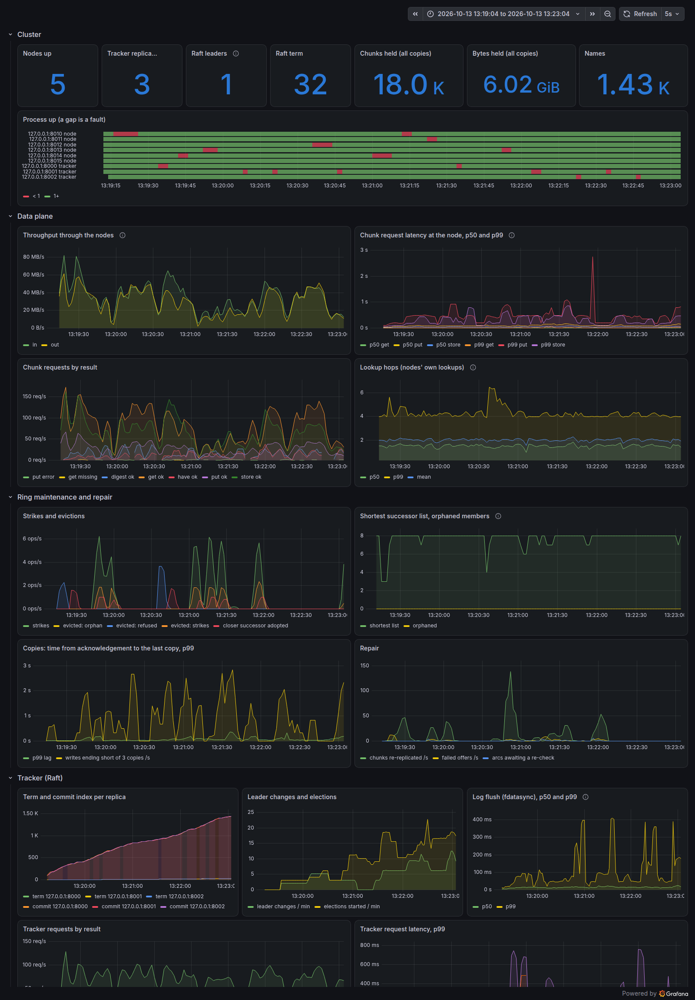

# Observability: metrics, logs and the dashboard

What a running cluster can be asked about itself, and how one transfer is followed through every process it
touched. This guide covers the decisions and the alternatives considered for each, the metrics and why each one is
there, the log format, the request id, and the dashboard. Every decision links to its full entry in
[`ARCHITECTURE.md`](../ARCHITECTURE.md).

> **Status:** built, tested and measured ([`BENCHMARKS.md`](../BENCHMARKS.md) §8); the dashboard has run against the
> cluster — every one of its 36 queries returned data — and is shown below over a fault-injection run.

## The decisions

### Metrics over HTTP on their own port — [D-083](../ARCHITECTURE.md#d-083--every-process-serves-its-metrics-over-a-minimal-hand-written-http10-responder-on-a-separate-port)

Every process takes `--metrics <port>` and answers `GET /metrics` there in the Prometheus text format. One thread
serves one connection at a time: the request head must be at most 4 KiB and arrive within 2 s, the answer is one
response with a `Content-Length`, and the connection is closed. Nothing else is spoken on that port.

| Alternative | Why not |
|---|---|
| **A `METRICS` line on the protocol port, and an exporter** | a second process per process, and a scrape shares the data path's threads |
| **HTTP on the protocol port** | `GET <key>` is already a chunk request there |
| **Pushing (StatsD, a Pushgateway)** | a dead process stops pushing and looks quiet; a failed scrape is itself the signal |
| **prometheus-cpp** | an external library |

### Instruments and labels — [D-084](../ARCHITECTURE.md#d-084--histograms-with-fixed-buckets-for-latencies-and-hops-counters-and-gauges-for-the-rest-labels-only-from-fixed-sets)

Latencies and hop counts are histograms — a counter per bucket, a sum and a count — so percentiles are computed after
adding many processes' buckets together. Counters only go up; gauges are read at scrape time. A label takes values
only from a small fixed set: never a key, a name, a request id or an address.

| Alternative | Why not |
|---|---|
| **Summaries** | quantiles computed in each process cannot be combined: a p99 of p99s means nothing |
| **Averages** | hide the tail a user waits on |
| **Metrics counted from the logs** | they would depend on the wording of every log line |

### Where transfer numbers come from — [D-085](../ARCHITECTURE.md#d-085--the-client-serves-metrics-while-it-runs-the-dashboards-throughput-and-latency-are-measured-at-the-nodes)

A client process lives for one transfer, often shorter than a scrape interval. It still serves metrics while it runs
(`--metrics`), but the dashboard's throughput and latency are measured at the nodes, which live as long as the ring:
bytes in and out, and the time each chunk request takes to serve.

| Alternative | Why not |
|---|---|
| **A Pushgateway** | another daemon, and a dead client's last numbers stay up |
| **A metrics file at exit** | a collector to read it, and nothing during a long transfer |
| **A long-running client** | not the program users run |

### One `key=value` line per event — [D-086](../ARCHITECTURE.md#d-086--a-hand-written-logger-one-keyvalue-line-per-event-written-with-one-system-call)

```
ts=2026-10-09T13:14:16.123Z level=info proc=node:7010 req=6f1c2a9e0b3d4c5a event=chunk.put key=ab12... copies=3 ms=1.9
```

`src/log.cpp` formats each event as one line and writes it with one system call, so lines from different threads
never interleave. A value with a space, `=`, a quote or a control character is quoted and escaped, so an event can
never become two lines. `--log-level` sets the threshold (default `info`).

| Alternative | Why not |
|---|---|
| **`spdlog`** | an external library |
| **JSON lines** | heavier escaping, harder to read and grep |
| **Free text** | no level, no request id, no fields a tool can find |

### The request id — [D-087](../ARCHITECTURE.md#d-087--a-request-id-travels-as-a-rid-id-prefix-on-every-request-line-and-a-server-carries-it-into-its-own-calls)

```
RID 6f1c2a9e0b3d4c5a PUT ab12... 2 524288
```

A client makes one id per command (or takes `--request-id`) and prefixes every request line with it. A server takes
the prefix off first, keeps the id in a thread-local variable while it handles the request, logs it on every line,
and passes it on in every call it makes for that request — a coordinator's copies to the other replicas included.

| Alternative | Why not |
|---|---|
| **A trailing field** | a body-carrying line's last word is its length (D-044) |
| **A separate header line** | a second line per request, and the desyncs that brings |
| **The chunk key as the id** | names a chunk, not a transfer |

### Prometheus and Grafana — [D-088](../ARCHITECTURE.md#d-088--prometheus-and-grafana-run-from-configuration-in-the-repository-against-the-local-cluster-with-release-binaries-kept-outside-it)

`deploy/` holds the Prometheus configuration, Grafana's provisioning and the dashboard as JSON.
`scripts/observe.sh up` runs both against the cluster from `scripts/cluster.sh`, using the official release
binaries unpacked outside the repository; `compose.yaml` has the same services for Docker (not yet run).

| Alternative | Why not |
|---|---|
| **Configuration only** | queries that have never run are guesses |
| **Waiting for Docker** | not installed, and not needed for this |

## The metrics, and why each one is there

Every process serves `/metrics` on `--metrics <port>`; `scripts/cluster.sh` gives each one its protocol port + 1000.
Each metric answers a question one of the system's own claims raises. Labels come only from the fixed sets shown.

**Every node** (`src/node.cpp`, `register_metrics`):

| Metric | Type | Why it is there |
|---|---|---|
| `chordfs_lookup_hops` | histogram | lookups stay O(log N): about ½ log₂ N fingers. A stale-finger regression moves it right (D-026) |
| `chordfs_lookup_seconds`, `chordfs_lookup_failures_total{error}` | histogram, counter | a lookup's cost, and why the failed ones failed — refused, timeout, no-progress, … (D-024) |
| `chordfs_ring_rounds_total` | counter | maintenance is running: about members ÷ period per second. A dip is the process not being scheduled — the stalls behind the 256-node false evictions |
| `chordfs_ring_strikes_total` | counter | suspicion (D-035). Strikes without evictions mean slow peers, not dead ones |
| `chordfs_ring_evictions_total{evidence}` | counter | how members leave: `refused` (proof), `strikes` (suspicion twice), `orphan` (its own word, D-067) |
| `chordfs_ring_successor_changes_total`, `chordfs_ring_rejoins_total` | counter | joins, and orphans finding their way back (D-040) |
| `chordfs_ring_successor_list_min` | gauge | the margin before a member is cut off: 8 when healthy; a member orphans only if every entry dies |
| `chordfs_ring_orphaned_members` | gauge | members refusing to route (D-040): should be 0 |
| `chordfs_chunk_requests_total{verb,result}` | counter | load and outcome per verb: `put`, `store`, `get`, `have` × `ok`, `missing`, `busy`, `error` |
| `chordfs_chunk_request_seconds{verb}` | histogram | where a chunk's time goes at the node; a `PUT` is answered once W copies exist (D-046) |
| `chordfs_chunk_bytes_total{direction}` | counter | throughput, summed over nodes: the dashboard's transfer rate whatever the clients' lifetimes (D-085) |
| `chordfs_put_replication_lag_seconds` | histogram | from a write's acknowledgement to its last copy: the window with fewer than three copies |
| `chordfs_put_copies_short_total` | counter | coordinated writes whose copies ended below three: repair has work |
| `chordfs_store_chunks`, `chordfs_store_bytes` | gauge | what each process holds — storage only grows until deletion |
| `chordfs_repair_*_total`, `chordfs_repair_pending_arcs` | counter, gauge | re-replication at work (D-050): rounds, full scans, chunks sent, failed offers, hand-offs, scrubbed files, and arcs to check again |
| `chordfs_body_slots_in_use` | gauge | bodies held in memory, of 32 (D-052): at 32 the node answers `ERR busy` |
| `chordfs_connections_open`, `chordfs_connections_total` | gauge, counter | one thread per connection is a known limit (D-061): this is how close it is |
| `chordfs_request_errors_total{type}` | counter | requests dropped before an answer: `deadline`, `line_too_long`, `malformed`, `too_large`, `busy`, `closed_mid_body` |

**Every tracker replica** (`src/tracker.cpp`):

| Metric | Type | Why it is there |
|---|---|---|
| `chordfs_raft_role{role}` | gauge | 1 for the role held: `sum(role="leader")` is the number of leaders — 1, or 0 during an election |
| `chordfs_raft_term`, `chordfs_raft_leader` | gauge | a term that keeps rising is elections that keep failing |
| `chordfs_raft_commit_index`, `chordfs_raft_applied_index`, `chordfs_raft_last_index` | gauge | replicas that agree have one commit index; a lagging follower shows here |
| `chordfs_raft_elections_total`, `chordfs_raft_leader_changes_total` | counter | failover, counted where it happens; with no failures both stay flat (D-073's rule) |
| `chordfs_raft_flush_seconds` | histogram | each step's `fdatasync`: the write path's main cost (D-082) |
| `chordfs_tracker_requests_total{verb,result}` | counter | registrations, resolves and lists by outcome, `redirect` and `unavailable` included |
| `chordfs_tracker_request_seconds{verb}` | histogram | a registration waits for two flushes in series (§7) |
| `chordfs_names` | gauge | the namespace's size, as applied on this replica |

**A client**, while it runs (`--metrics`): `chordfs_client_chunks_total{op,result}`, `chordfs_client_bytes_total{op}`,
`chordfs_client_chunk_seconds{op}`, and its own lookups' `chordfs_lookup_hops`. Every process also has
`process_start_time_seconds`: a restart shows as a new value.

## Logs

One line per event, `key=value`, written by `src/log.cpp` with one system call:

```
ts=2026-10-09T13:56:49.711Z level=info proc=node:7312 req=0123456789abcdee event=chunk.put key=714b1c28... result=ok reply="OK 2" bytes=300000 ms=2.166
```

| Event | Level | Written by |
|---|---|---|
| `chunk.put`, `chunk.store`, `chunk.get` | info | a node, for every chunk request it answers |
| `chunk.have`, `ring.request` | debug | a node: repair's bookkeeping, and every routing hop of every lookup |
| `ring`, `storage` | info | a node's maintenance and repair events, their texts kept word for word in `msg` |
| `tracker.register`, `tracker.resolve` | info | a replica, for every registration and resolve it answers (a follower's `REDIRECT` included) |
| `raft.role` | info | a replica, at every change of role or term |
| `client.start`, `client.put`, `client.get`, `client.note` | info, warn | a client with `--log <file>` |

## Following one request

```
RID 0123456789abcdee TO 3fa4c1d2e5b6a798 FIND_SUCCESSOR 9c2e...      a lookup hop
RID 0123456789abcdee PUT 714b1c28... 2 300000                        the chunk, to its owner
RID 0123456789abcdee STORE 714b1c28... 300000                        the owner's copies, sent on its behalf
RID 0123456789abcdee REGISTER f1 e8c77918...                         the name, last
```

`scripts/trace.py <id> <log directories>` collects every line carrying an id from every process's log and prints them
in time order, with a summary of what each process did:

```
request 0123456789abcdee: 9 events in 5 processes
  node:7310      chunk.store x2
  node:7312      chunk.put x1, storage x1
  node:7313      chunk.store x1, chunk.put x1, storage x1
  node:7311      chunk.store x1
  tracker:7300   tracker.register x1
```

A client's id is made per command, or chosen with `--request-id`. A server keeps the id of the request it is
handling in a thread-local variable; a thread started inside that request starts without it, so the coordinator hands
the id to each copy's thread explicitly. Each repair round makes its own id.

## The dashboard

`deploy/grafana/dashboards/chordfs.json` is generated by `deploy/grafana/make-dashboard.py`, one line of PromQL per
panel: the cluster at a glance (processes up, leaders, term, chunks, bytes, names; a timeline of every process's
`up`, where a gap is a fault), the data plane (throughput, chunk latency p50/p99 per verb, results, hop counts), ring
maintenance and repair (strikes and evictions, the shortest successor list, the replication window, repair), the
tracker (term and commit index per replica, elections and leader changes, flush and request latency), and errors.

```bash
scripts/cluster.sh up 5          # metrics on every port + 1000, listed in cluster/targets.json
scripts/observe.sh up            # Prometheus on :9090, Grafana on :3000/d/chordfs
scripts/observe.sh down
```



**Run and checked** on 13 Oct 2026 with the official release archives of Prometheus 3.15.0
(`prometheus-3.15.0.linux-arm64.tar.gz`, from github.com/prometheus/prometheus/releases, checked against its
`sha256sums.txt`) and Grafana OSS 13.2.3 (`grafana-13.2.3.linux-arm64.tar.gz`, from dl.grafana.com, checked against its
`.sha256`), unpacked in `~/.local/opt/`. Every target answered (`up` = 1 for all seven to nine processes), and every one
of the dashboard's 36 queries returned data against a live cluster. The screenshot is of `scripts/faults.py` (seed 2,
240 s), rendered by headless Chromium after the run, of exactly its time range, so that the browser took no CPU from the
run it shows.

One thing running it found: the target lists first labelled processes `role="node"` and `role="tracker"`. A tracker's
`chordfs_raft_role` metric has a label of the same name, and Prometheus renames a scraped label that collides with a
target label (to `exported_role`) — so `sum(chordfs_raft_role{role="leader"})` returned nothing. The target label is now
`component`.
